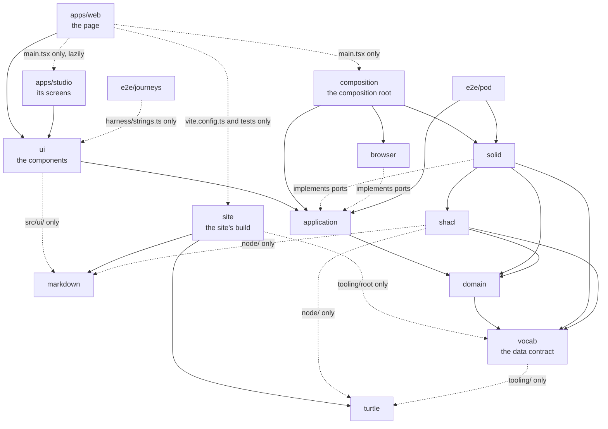

# Architecture

Solid Memo is structured as hexagonal (ports & adapters) layers, and each
layer is its own npm workspace package in a [Turborepo](https://turborepo.com)
monorepo. A package's `package.json` names what it may import, and
`npm run check:boundaries` holds every import to that
([boundaries.md](boundaries.md)). The composition root is the one place
where the layers meet.

## Packages

| Package | Folder | Responsibility |
|---|---|---|
| `@solid-memo/web` | `apps/web/` | The site's one page: its entry point (`src/main.tsx`), which renders the app over the use cases `composition` wires, the page (`src/App.tsx`) that shows Solid Memo, or the Studio at its routes, loaded lazily, and the Vite build that also publishes `ns/` (the vocabulary and shapes), `decks/` (the [deck library](deck-library.md)) and these docs, rendered by `site`, with the app ([deployment.md](deployment.md)). |
| `@solid-memo/studio` | `apps/studio/` | Solid Memo Studio ([studio.md](studio.md)): its screens and router (`src/ui/`), and its entry point, `StudioWorkspace`, which the site's page loads as a chunk of its own at the hashes under `#/studio`. |
| `@solid-memo/composition` | `packages/composition/` | The composition root (`createAppUseCases` in `src/appUseCases.ts`): every adapter behind its port, the guest's pod, the pod fence and the write fence ([boundaries.md](boundaries.md#the-pod-fence)), the site's documents read from where it is served, and the use cases over them, a Studio trial's sandbox among them (`createTrialUseCases` in `src/trialUseCases.ts`, [studio.md](studio.md#the-trial)). An app passes what is its own: its name, where it is served, the build's values. |
| `@solid-memo/ui` | `packages/ui/` | The Preact UI: the components and the router (`src/ui/`), the messages in each language (`src/i18n/`), the theme and the styles (`src/style.css`). It receives `UseCases` and knows no adapter. |
| `@solid-memo/application` | `packages/application/` | Use cases (what the app does) and ports (what the app needs). |
| `@solid-memo/domain` | `packages/domain/` | Pure types and pure functions: the app's vocabulary, SRS, migrations. |
| `@solid-memo/vocab` | `packages/vocab/` | The data contract: the TypeScript generated (`src/*.generated.ts`) from the RDF vocabulary and SHACL shapes in the repository's `ns/` ([vocab.md](vocab.md), [shapes.md](shapes.md)), with the generator (`tooling/`); vendored profiles (`vendor/`) and fixtures. |
| `@solid-memo/solid` | `packages/solid/` | Adapters for Solid pods (Inrupt): repositories, the type index, the instance copier, the pod fence, the write fence, the pod-reading shape validator, the deck archive (decks as Turtle or JSON-LD files, [data-model.md](data-model.md#decks-as-files)), the drafts of releases and the Turtle a release is written in ([data-model.md](data-model.md#drafts-and-releases)), and the guest's pod kept in the browser ([guest-mode.md](guest-mode.md)). |
| `@solid-memo/shacl` | `packages/shacl/` | The SHACL engine (rdf-validate-shacl, loaded lazily), profiles and shape loading (`src/`); node-side validation of Turtle files and the deck library's index and checks, its Markdown rules among them (`node/`, `npm run library`). |
| `@solid-memo/browser` | `packages/browser/` | Adapters for the browser: the update journal, the language, the guest's pod's store (IndexedDB), and files saved as downloads and opened from the user's disk (`FileExchange`). |
| `@solid-memo/site` | `packages/site/` | Node-only: the site's build, which only `apps/web`'s `vite.config.ts` and tests, and the root scripts that archive and check the docs, use. The values the site is built with (`siteBuild`), its `robots.txt` and sitemap (`siteMap`), and the Vite plugin that publishes `ns/` and `decks/` with it (`publishTurtle`) ([deployment.md](deployment.md)); and the repository's own docs, read with `markdown`'s parser and rendered to static pages, their links checked and their Mermaid diagrams drawn to SVG in Chromium, with the Vite plugin that publishes them ([markdown.md](markdown.md#the-docs-as-a-site)), their pages listed from their index, `docs/docs.ttl`, which it reads with `turtle`. Imports nothing of `vocab` but `tooling/root`, where the repository's folders are. |
| `@solid-memo/turtle` | `packages/turtle/` | Node-only Turtle tooling (n3): parsing and the house-style formatter. |
| `@solid-memo/markdown` | `packages/markdown/` | Markdown in data, read into a tree of its own, folded to what the app shows and bounded at every entry point, derived as plain text, and checked by the rules for a release; and the repository's own docs, read in the same dialect with their headings kept, which `site` renders. Imports nothing of the app's. |
| `@solid-memo/e2e-pod` | `e2e/pod/` | End-to-end tests of the app's use cases and Solid adapters against real Solid servers, started in Docker ([testing.md](testing.md)). |
| `@solid-memo/e2e-journeys` | `e2e/journeys/` | The user journeys: whole flows a user takes through the built app, driven in Chromium, Firefox and WebKit with Playwright against a Community Solid Server in Docker ([testing.md](testing.md#user-journeys)). It imports nothing of the app's but its messages, to find text on screen by. |

Each package's folder has a `README.md`: what the package is, what it
exports, what it may import and who may import it, and how to test it.
Its `package.json` has a one-line `description`.

## Dependency rule

A package may depend only on packages below it in this graph. Adapters
implement application ports (dependency inversion): the application
owns the interfaces, adapters conform to them.



Packages are consumed as TypeScript source (`exports` maps
`@solid-memo/<package>/<module>` to `src/<module>.ts`): there is no
build step between packages, and Vite bundles the app from source.
`ui` maps `@solid-memo/ui/<module>` to `src/ui/<module>.tsx`, lists its
few `.ts` modules one by one, and exports `style.css` and the message
files (`i18n/<locale>.json`).

## Tasks

`turbo.json` runs each package's `typecheck`, `test`, `test:roundtrip`
(`solid`'s, every library release through a draft, [testing.md](testing.md)),
`generate:check`, `format:turtle:check`, `library:check` and `build` in dependency order,
cached by input. A task's inputs are its package's files and those of the
packages it depends on; the few that also read `ns/` or `decks/` add them
in their package's own `turbo.json` (`vocab`, `site`, `shacl`, `solid`,
`composition`, `apps/web` and `apps/studio`), so a deck edit reruns only the tasks that
read the library. A test that reads any other file outside its package
adds it the same way (`e2e/pod`'s the workflows, `site`'s the root's
`package.json` and `CNAME`, `apps/web`'s the `LICENSE` its About page links to): a
file Turbo does not know of changes no input, so CI, which starts from
`main`'s cache, would reuse `main`'s result and never run the test on
the change it checks. The one exception is a test that checks only that
a file the docs link to is there (`site`'s and `apps/web`'s), as
that could be any file: lychee checks the same links in CI's `docs`
job, on every run ([testing.md](testing.md#documentation)). The Studio has no build of its own: Solid Memo's
bundles it ([studio.md](studio.md)).

```sh
npm run check     # Biome's lint, markdownlint, cspell; then every package: typecheck, tests (100% coverage), the round trip, drift, Turtle formatting, the deck library; then boundaries
npm run build     # the site, the Studio and the docs included, into apps/web/dist/
npm run browsers  # once: Chromium, which npm run check and npm run build draw the docs' diagrams in (markdown.md)
npm run dev       # the site, from source; the Studio at #/studio
npm start         # the site as deployed: built, then served at http://localhost:4173
npm run test:unit # every package's tests in one run, without coverage (a file or two: `-- <path>`)
npm run test:watch # the same, in watch mode
npm run test:pod  # e2e/pod against the Solid servers it starts in Docker (testing.md)
npm run pod       # a Community Solid Server at http://127.0.0.1:3999/, to poke at by hand
npm run pod:clean # take down the servers an interrupted run left
npm run generate  # the vocab package's generated TypeScript, from ns/
npm run format:turtle  # every Turtle file in the house style
npm run library   # the deck library's index, decks/index.ttl
npm run crosscheck # the pySHACL cross-check CI runs (Python, scripts/requirements-ci.txt)
```

## Key objects

- `UseCases` ([useCases.ts](../packages/application/src/useCases.ts)) —
  the UI's only entry point. Created once by the composition root,
  `createAppUseCases` ([appUseCases.ts](../packages/composition/src/appUseCases.ts)),
  which the site's `apps/web/src/main.tsx` calls, and passed to its top
  component (`App`) as a prop, and from there to Solid Memo's screens
  and the Studio's alike.
- Slices — `UseCases` is the intersection of one interface per feature:
  the session and the guest (`session`), the instances, the
  preferences, the decks, the cards, the deck library, where a mistake
  is reported (`mistakeReports`), the courses, study, the statistics,
  the instance checks (`instanceChecks`), and the Studio's drafts,
  publishing, instance graph and trial. Each is made in
  `packages/application/src/<feature>.ts` by `create<Feature>UseCases`,
  from only the ports it uses, each required; what several share is a
  store of its own, made once: the preferences
  ([preferenceStore.ts](../packages/application/src/preferenceStore.ts)),
  the answers on their way to the log and read from it
  ([answerStore.ts](../packages/application/src/answerStore.ts)) and the
  digest ([digestStore.ts](../packages/application/src/digestStore.ts)).
  `createUseCases` makes the stores and composes every slice; its
  `Dependencies` has no port that falls back to doing nothing, so a
  port the composition root forgets is a type error. A Studio trial
  composes only the slices it plays (`createTrialUseCases`,
  `TrialUseCases`), and the screens it is played in take only those.
- Ports ([ports.ts](../packages/application/src/ports.ts)) — narrow
  interfaces (one per external capability) implemented by factories in
  `packages/solid/src/` and `packages/browser/src/`.
- Domain types ([packages/domain/src/](../packages/domain/src/)) — free
  of any library type, so every layer above can be tested without
  adapters. The record types they map to are generated in the vocab
  package from the SHACL [shapes](shapes.md); the migration chain in
  `packages/domain/src/shapes/migrations/` is hand-written.

## Query keys

The screens cache what they read from a pod with TanStack Query, each
read under a query key, and a write refreshes what it changed by those
keys. Every key is made by a function of one module:
[packages/ui/src/ui/queryKeys.ts](../packages/ui/src/ui/queryKeys.ts)
for those Solid Memo's screens use, the Studio's too, and
[apps/studio/src/ui/queryKeys.ts](../apps/studio/src/ui/queryKeys.ts)
for those only the Studio reads, built on the first. A new key goes
there, never into a screen as an array written out, which
`npm run check:keys` refuses ([testing.md](testing.md#the-repositorys-own-checks)).

A key whose first items are another's sits under it: refreshing or
dropping the shorter key reaches it too. The decks' arrangement
(`queryKeys.deckTree`) sits under the instance's decks, so whatever
refreshes the decks refreshes it, and a deck's study counts
(`queryKeys.studyCounts`) under its study queue, so whatever drops the
queue drops them. Each function's comment says which key it sits
under, and the modules' tests check that it does.

## Why

- Vendor code stays swappable and upgradeable in isolation (see
  [vendor-code.md](vendor-code.md)): each vendor library is a dependency
  of as few packages as can use it, most of them only one.
- A boundary is a package's `package.json`, not a convention, and a
  script checks it.
- Every seam is injectable, which is what makes 100% unit coverage per
  package practical (see [testing.md](testing.md)).
