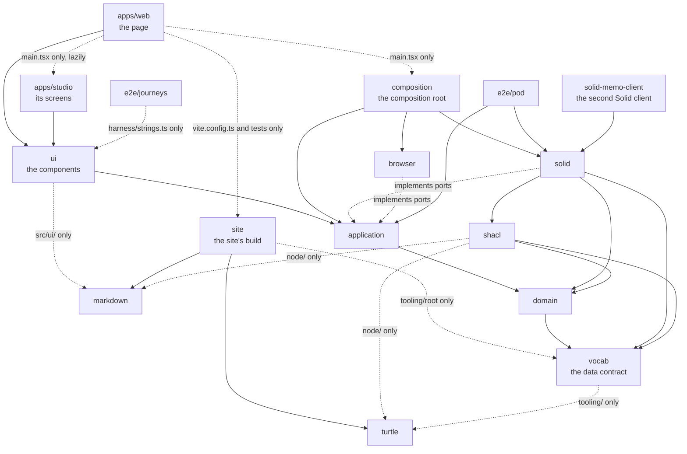

# Architecture

Solid Memo is built in hexagonal (ports & adapters) layers, each an
npm workspace package in a [Turborepo](https://turborepo.com)
monorepo. A package's `package.json` names what it may import, which
`npm run check:boundaries` enforces ([boundaries.md](boundaries.md)).
The layers meet only in the composition root.

## Packages

| Package | Folder | Responsibility |
|---|---|---|
| `@solid-memo/web` | `apps/web/` | The site's one page: the entry point (`src/main.tsx`); the page (`src/App.tsx`), showing Solid Memo or, at its routes, the Studio; and the Vite build, publishing the app with `ns/` (the vocabulary and shapes), `decks/` (the [deck library](deck-library.md)) and these docs ([deployment.md](deployment.md)). |
| `@solid-memo/studio` | `apps/studio/` | Solid Memo Studio ([studio.md](studio.md)): screens and router (`src/ui/`) and its entry point, `StudioWorkspace`, its own chunk, loaded at the hashes under `#/studio`. |
| `@solid-memo/composition` | `packages/composition/` | The composition root (`createAppUseCases`): every adapter behind its port, the guest's pod, the pod and write fences ([boundaries.md](boundaries.md#the-pod-fence)) and the credential gate, the site's documents read from where it's served, and the use cases over them, a Studio trial's sandbox too (`createTrialUseCases` in `src/trialUseCases.ts`, [studio.md](studio.md#the-trial)). An app passes its name, where it's served and the build's values. |
| `@solid-memo/ui` | `packages/ui/` | The Preact UI: components and router (`src/ui/`), messages in each language (`src/i18n/`), the theme and styles (`src/style.css`). It gets `UseCases` and knows no adapter. |
| `@solid-memo/application` | `packages/application/` | Use cases (what the app does) and ports (what it needs). |
| `@solid-memo/domain` | `packages/domain/` | Pure types and pure functions: the app's vocabulary, SRS, migrations. |
| `@solid-memo/vocab` | `packages/vocab/` | The data contract: TypeScript generated (`src/*.generated.ts`) from the RDF vocabulary and SHACL shapes in `ns/` ([vocab.md](vocab.md), [shapes.md](shapes.md)), its generator (`tooling/`), vendored profiles (`vendor/`) and fixtures. |
| `@solid-memo/solid` | `packages/solid/` | Adapters for Solid pods, over the Solid client modules in `src/client/` ([vendor-code.md](vendor-code.md)): repositories, type index, instance copier, pod and write fences, the pod-reading shape validator, the deck archive (decks as Turtle or JSON-LD files, [data-model.md](data-model.md#decks-as-files)), release drafts and a release's Turtle ([data-model.md](data-model.md#drafts-and-releases)), and the guest's pod kept in the browser ([guest-mode.md](guest-mode.md)). |
| `@solid-memo/solid-memo-client` | `packages/solid-memo-client/` | A second implementation of `solid`'s client modules and `shacl`'s Turtle reader, with no Inrupt library, which the build puts in their place with `SOLID_CLIENT=solid-memo-client` ([solid-memo-client.md](solid-memo-client.md)). Inrupt's stays the default. |
| `@solid-memo/shacl` | `packages/shacl/` | The SHACL engine (rdf-validate-shacl, loaded lazily), profiles and shape loading (`src/`); in `node/`, validation of Turtle files and the deck library's index and checks, Markdown rules included (`npm run library`). |
| `@solid-memo/browser` | `packages/browser/` | Browser adapters: the update journal, the language, the guest's pod's store (IndexedDB), and files saved as downloads or opened from disk (`FileExchange`). |
| `@solid-memo/site` | `packages/site/` | Node-only build of the site, used only by `apps/web`'s `vite.config.ts` and tests and by the root scripts that archive and check the docs: the build values (`siteBuild`), `robots.txt` and sitemap (`siteMap`), the Vite plugin publishing `ns/` and `decks/` (`publishTurtle`; see `deployment.md`), and the docs' build: the pages `docs/docs.ttl` lists, read with `turtle` and `markdown` and rendered to static pages, Mermaid drawn in Chromium ([markdown.md](markdown.md#the-docs-as-a-site)). Of `vocab` it imports only `tooling/root`, where the repository's folders are. |
| `@solid-memo/turtle` | `packages/turtle/` | Node-only Turtle tooling (n3): parsing and the house-style formatter. |
| `@solid-memo/markdown` | `packages/markdown/` | Markdown in data, read into its own tree: folded to what the app shows, bounded at every entry point, made plain text, checked by a release's rules. It reads the docs in the same dialect, headings kept, for `site`, and imports nothing of the app's. |
| `@solid-memo/e2e-pod` | `e2e/pod/` | End-to-end tests of the use cases and Solid adapters against real Solid servers in Docker ([testing.md](testing.md)). |
| `@solid-memo/e2e-journeys` | `e2e/journeys/` | The user journeys: whole flows through the built app, driven with Playwright in Chromium, Firefox and WebKit against a Community Solid Server in Docker ([testing.md](testing.md#user-journeys)). Of the app it imports only the messages, to find text on screen. |

Each package's `README.md` says what it is and exports, what it may
import, who may import it, and how to test it; its `package.json` has
a one-line `description`.

## Dependency rule

A package may depend only on packages below it in this graph. Adapters
implement the application's ports (dependency inversion): the
application owns the interfaces.



Packages are consumed as TypeScript source, with no build step
between them: `exports` maps `@solid-memo/<package>/<module>` to
`src/<module>.ts`, and Vite bundles the app from source. `ui` maps
`@solid-memo/ui/<module>` to `src/ui/<module>.tsx`, lists its few
`.ts` modules one by one, and exports `style.css` and the message
files (`i18n/<locale>.json`).

## Tasks

`turbo.json` runs each package's `typecheck`, `test`, `test:roundtrip`
(`solid`'s, [testing.md](testing.md)), `generate:check`,
`format:turtle:check`, `library:check` and `build` in dependency
order, cached by input: the files of the task's package and its
dependencies. The few that read `ns/` or `decks/` add them
in their package's `turbo.json` (`vocab`, `site`, `shacl`, `solid`,
`composition`, `apps/web` and `apps/studio`), so a deck edit reruns
only the tasks that read the library. Every task's hash holds
`SOLID_CLIENT` and `scripts/solidClient.ts`, the switch between the
Solid clients, and the tasks the switch reaches hold
`packages/solid-memo-client/src/` among their inputs
([solid-memo-client.md](solid-memo-client.md#switching-clients)).

A test that reads a file outside its package adds it the same way
(`e2e/pod`'s the workflows, `site`'s the root's `package.json` and
`CNAME`, `apps/web`'s the `LICENSE` its About page links to).
A file Turbo doesn't know of changes no input, so CI, starting from
`main`'s cache, would reuse `main`'s result and never run the test on
the change. Exempt is a test that only checks that a docs link's
target exists (`site`'s and `apps/web`'s), as that could be any file;
lychee checks those links in CI's `docs` job on every run
([testing.md](testing.md#documentation)).
The Studio has no build of its own; Solid Memo's bundles it
([studio.md](studio.md)).

```sh
npm run check     # Biome's lint, markdownlint, cspell; then every package: typecheck, tests (100% coverage), the round trip, drift, Turtle formatting, the deck library; then boundaries
npm run build     # the site, the Studio and the docs included, into apps/web/dist/
npm run browsers  # once: Chromium, which npm run check and npm run build draw the docs' diagrams in (markdown.md)
npm run dev       # the site, from source; the Studio at #/studio
npm start         # the site as deployed: built, then served at http://localhost:4173
npm run test:unit # every package's tests in one run, without coverage (a file or two: `-- <path>`)
npm run test:watch # the same, in watch mode
npm run test:pod  # e2e/pod against the Solid servers it starts in Docker (testing.md)
npm run pod       # a Community Solid Server at http://127.0.0.1:3999/, to poke at by hand
npm run pod:clean # take down the servers an interrupted run left
npm run generate  # the vocab package's generated TypeScript, from ns/
npm run format:turtle  # every Turtle file in the house style
npm run library   # the deck library's index, decks/index.ttl
npm run crosscheck # the pySHACL cross-check CI runs (Python, scripts/requirements-ci.txt)
```

## Key objects

- `UseCases` ([useCases.ts](../packages/application/src/useCases.ts)) —
  the UI's only entry point, made once by the composition root's
  `createAppUseCases`
  ([appUseCases.ts](../packages/composition/src/appUseCases.ts)), called
  from `apps/web/src/main.tsx`. `App` gets it as a prop and hands it to
  both apps' screens.
- Slices — `UseCases` is the intersection of one interface per
  feature:
  - the session and the guest (`session`), the instances, the
    preferences, the decks, the cards and the deck library;
  - where a mistake is reported (`mistakeReports`) and what's new in a
    version (`whatsNew`);
  - the courses, study, the statistics and the instance checks
    (`instanceChecks`);
  - the Studio's drafts, publishing, instance graph and trial.

  `create<Feature>UseCases` in `packages/application/src/<feature>.ts`
  makes each slice from only the ports it uses, each required. Slices
  share stores made once: the preferences
  ([preferenceStore.ts](../packages/application/src/preferenceStore.ts)),
  the answers written to and read from the log
  ([answerStore.ts](../packages/application/src/answerStore.ts)), and
  the digest ([digestStore.ts](../packages/application/src/digestStore.ts)).
  `createUseCases` makes the stores and composes every slice. No port
  in its `Dependencies` falls back to doing nothing, so a port the
  composition root forgets is a type error. A Studio trial composes
  only the slices it plays (`createTrialUseCases`, `TrialUseCases`),
  and its screens take only those.
- Ports ([ports.ts](../packages/application/src/ports.ts)) — narrow
  interfaces, one per external capability, implemented by factories in
  `packages/solid/src/` and `packages/browser/src/`.
- Domain types ([packages/domain/src/](../packages/domain/src/)) — free
  of library types, so every layer above is testable without
  adapters. They map to the record types `vocab` generates from the
  SHACL [shapes](shapes.md); the migration chain in
  `packages/domain/src/shapes/migrations/` is hand-written.

## Query keys

The screens cache each pod read under a query key with TanStack
Query, and a write refreshes what it changed by key. A function in one
of two modules makes every key:

- [packages/ui/src/ui/queryKeys.ts](../packages/ui/src/ui/queryKeys.ts):
  the keys Solid Memo's screens use, the Studio's too;
- [apps/studio/src/ui/queryKeys.ts](../apps/studio/src/ui/queryKeys.ts):
  the keys only the Studio reads, built on the first.

A new key goes in one of these modules, never into a screen as an
array written out, which `npm run check:keys` refuses
([testing.md](testing.md#the-repositorys-own-checks)).

A key whose first items are another's sits under it, so refreshing or
dropping the shorter key reaches it too: the decks' arrangement
(`queryKeys.deckTree`) sits under the instance's decks, and a deck's
study counts (`queryKeys.studyCounts`) under its study queue. Each
function's comment names the key it sits under, which the modules'
tests check.

## Why

- Vendor code stays swappable and upgradeable in isolation
  ([vendor-code.md](vendor-code.md)): each vendor library is a
  dependency of as few packages as can use it, most often one.
- A boundary is a package's `package.json`, not a convention, and a
  script checks it.
- Every seam is injectable, making 100% unit coverage per package
  practical ([testing.md](testing.md)).
