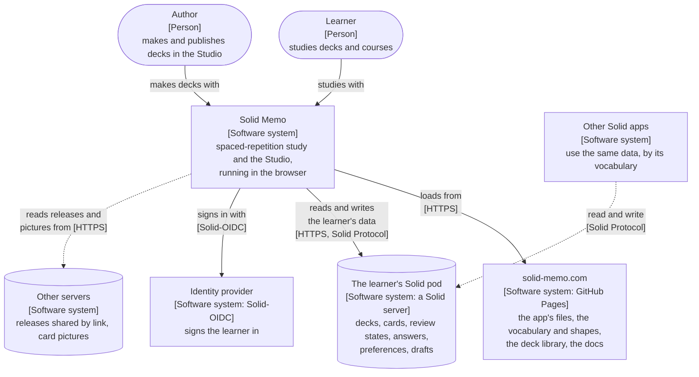
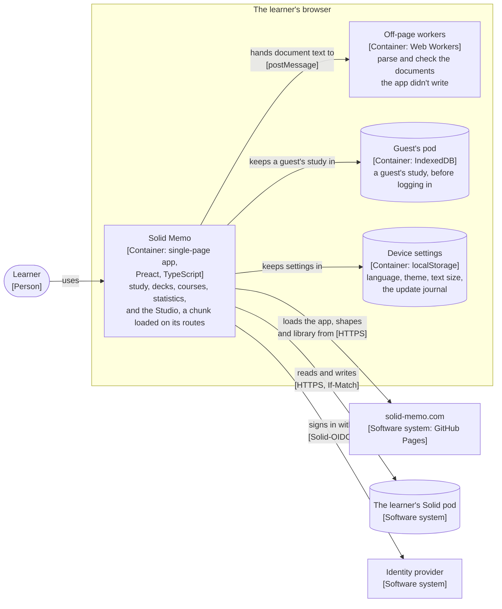
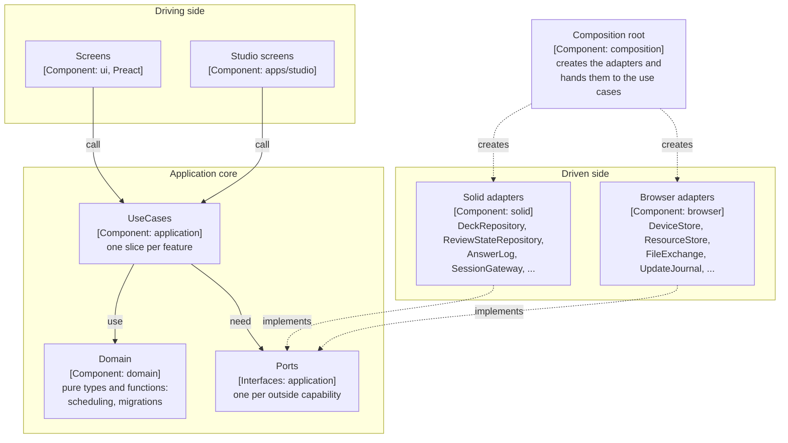
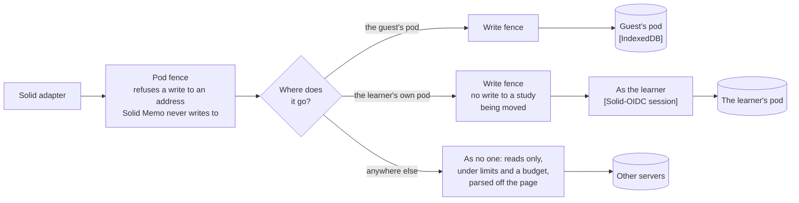
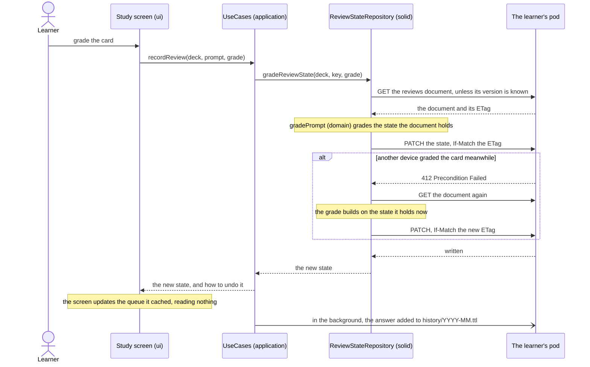
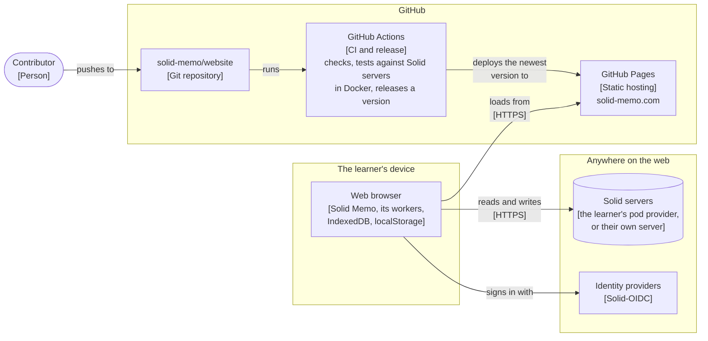
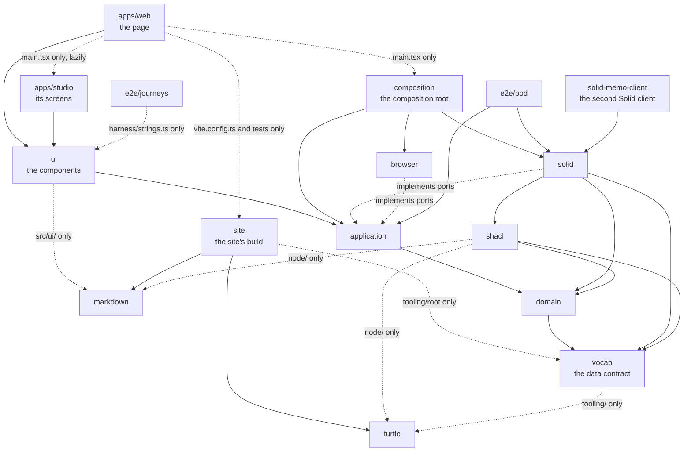

# Architecture

Solid Memo is built in hexagonal (ports & adapters) layers, each an
npm workspace package in a [Turborepo](https://turborepo.com)
monorepo. A package's `package.json` names what it may import, which
`npm run check:boundaries` enforces ([boundaries.md](boundaries.md)).
The layers meet only in the composition root.

The diagrams below show Solid Memo at the levels of the
[C4 model](https://c4model.com): the system in its context, the
containers it runs as, and the components inside them. The packages
and their imports are the level below, the code. Two views of
[arc42](https://arc42.org) follow the same way: a runtime view of a
grade on its way to a pod, and a deployment view of where everything
runs.

## Reading the diagrams

- A stadium is a person, a box a software system, a container or a
  component, and a cylinder a store of data.
- Each box names its kind in brackets, and its technology where it
  has one, as C4 does: `[Container: Web Workers]`.
- A frame is a boundary: what's inside runs in it, or belongs to it.
- An arrow points from the one that acts. Its label says what it does,
  and how in brackets.
- A dotted arrow is a dependency only some cases or files have.

## The system in its context



Solid Memo has no server of its own ([privacy.md](privacy.md)). The
site serves files and nothing else, and the browser talks straight to
the pod's server. So a learner's study stays where they put it, any
Solid app that knows the [vocabulary](vocab.md) can use it, and the
project runs nothing that holds anyone's data. A guest's study, before
logging in, is in the browser instead ([guest-mode.md](guest-mode.md)).

## Containers

What runs where: the page and its workers in the learner's browser,
each store the browser keeps, and the systems the page talks to.



The page makes every request itself, and a worker gets only a
document's text. So a worker never holds the learner's login, and a
document too large or too strange to read holds up a worker, not the
page ([validation.md](validation.md#off-the-page)). A write is sent
`If-Match` the version it was made from, so a change made elsewhere is
never written over ([data-model.md](data-model.md#write-discipline)).

## Components

Inside the page, Solid Memo is built in ports and adapters. The use
cases hold what the app does. They reach the outside only through
ports, interfaces the application owns, which the adapters implement.



The arrows between the core and the adapters point inward: an adapter
depends on the application, never the other way round. So the use
cases and the domain run in tests with no pod and no browser, and a
library behind an adapter can be replaced there alone
([vendor-code.md](vendor-code.md)). [Key objects](#key-objects) names
the interfaces, and [boundaries.md](boundaries.md) the imports each
package may make.

## A request on its way to a pod

Every request of an adapter that reads or writes an instance's data
passes the same steps, made in the composition root
([appUseCases.ts](../packages/composition/src/appUseCases.ts)). Each
step guards one thing, so no adapter has to.



The credential gate sends the learner's login only into their own pod,
so a catalog that names a document on another server can't make the
app write there or show it the learner's login
([boundaries.md](boundaries.md#the-pod-fence)). An instance the learner
registered on another server is read as them, under the same limits.

## Runtime: a grade

A grade shows the layers at work. The screen calls a use case, the use
case applies the domain's scheduling through a port, and the adapter
writes one document of the pod, conditionally
([srs.md](srs.md#what-a-grade-costs)).



The answer is added with an insert-only `PATCH` that reads nothing
first, so the log grows without the learner waiting for it
([data-model.md](data-model.md#the-answer-log)).

## Deployment



A version reaches the site only once it's released, from its release
commit ([deployment.md](deployment.md), [releasing.md](releasing.md)).
The learner's pod and identity provider can be anyone's: the app
follows the Solid Protocol, tested against several servers
([testing.md](testing.md)).

## Packages

The folders of `packages/` say each package's role. A role with
several packages has a folder of its own; a role with one is at the top,
under the package's name:

```text
packages/
  core/          domain, application: the rules, and the use cases with the ports they drive
  adapters/      browser, inrupt-client, shacl, solid, solid-client, solid-memo-client
  lib/           markdown, turtle, vocab: libraries the rest builds on
  composition/   wires the ports to the adapters
  ui/            the screens both apps share
  build-tools/   node only: builds the site and its docs, draws and checks them
apps/            web, studio
e2e/             journeys, pod
```

A package in `core/` imports only `core/` and `lib/`, one in `lib/`
only `lib/`, and only the adapters, the composition root and the
end-to-end tests import an adapter, as `npm run check:boundaries` checks
([boundaries.md](boundaries.md#layers)). A package keeps its name
wherever its folder is (`@solid-memo/domain` is `packages/core/domain/`).

| Package | Folder | Responsibility |
|---|---|---|
| `@solid-memo/web` | `apps/web/` | The site's one page: the entry point (`src/main.tsx`); the page (`src/App.tsx`), showing Solid Memo or, at its routes, the Studio; and the Vite build, publishing the app with `ns/` (the vocabulary and shapes), `decks/` (the [deck library](deck-library.md)) and these docs ([deployment.md](deployment.md)). |
| `@solid-memo/studio` | `apps/studio/` | Solid Memo Studio ([studio.md](studio.md)): screens and router (`src/ui/`) and its entry point, `StudioWorkspace`, its own chunk, loaded at the hashes under `#/studio`. |
| `@solid-memo/composition` | `packages/composition/` | The composition root (`createAppUseCases`): every adapter behind its port, the guest's pod, the pod and write fences ([boundaries.md](boundaries.md#the-pod-fence)) and the credential gate, the site's documents read from where it's served, the workers that read the documents the app didn't write (`src/offPageWorker.ts`), and the use cases over them, a Studio trial's sandbox too (`createTrialUseCases` in `src/trialUseCases.ts`, [studio.md](studio.md#the-trial)). An app passes its name, where it's served and the build's values. |
| `@solid-memo/ui` | `packages/ui/` | The Preact UI: components and router (`src/ui/`), messages in each language (`src/i18n/`), the theme and styles (`src/style.css`). It gets `UseCases` and knows no adapter. |
| `@solid-memo/application` | `packages/core/application/` | Use cases (what the app does) and ports (what it needs). |
| `@solid-memo/domain` | `packages/core/domain/` | Pure types and pure functions: the app's vocabulary, SRS, migrations. |
| `@solid-memo/vocab` | `packages/lib/vocab/` | The data contract: TypeScript generated (`src/*.generated.ts`) from the RDF vocabulary and SHACL shapes in `ns/` ([vocab.md](vocab.md), [shapes.md](shapes.md)), its generator (`tooling/`), vendored profiles (`vendor/`) and fixtures. |
| `@solid-memo/solid-client` | `packages/adapters/solid-client/` | The seam between the Solid adapters and a Solid client: the types and limits a client works to, the Turtle a write sends, and the modules a client gives, declared with no body, which the build resolves to the client `SOLID_CLIENT` names ([boundaries.md](boundaries.md#the-solid-client-libraries)). |
| `@solid-memo/solid` | `packages/adapters/solid/` | Adapters for Solid pods, through a Solid client's modules (`solid-client`, [vendor-code.md](vendor-code.md)): repositories, type index, instance copier, pod and write fences, the pod-reading shape validator, the deck archive (decks as Turtle or JSON-LD files, [data-model.md](data-model.md#decks-as-files)), release drafts and a release's Turtle ([data-model.md](data-model.md#drafts-and-releases)), the guest's pod kept in the browser ([guest-mode.md](guest-mode.md)), and the worker that reads, parses and checks the documents the app didn't write, off the page ([validation.md](validation.md#off-the-page)). |
| `@solid-memo/inrupt-client` | `packages/adapters/inrupt-client/` | The default Solid client: the modules `solid-client` declares, on Inrupt's libraries. |
| `@solid-memo/solid-memo-client` | `packages/adapters/solid-memo-client/` | The Solid client with no Inrupt library: the modules `solid-client` declares, and `shacl`'s Turtle reader, which the build puts in place with `SOLID_CLIENT=solid-memo-client` ([solid-memo-client.md](solid-memo-client.md)). Inrupt's stays the default. |
| `@solid-memo/shacl` | `packages/adapters/shacl/` | The SHACL engine (rdf-validate-shacl, loaded lazily), profiles and shape loading (`src/`); in `node/`, validation of Turtle files and the deck library's index and checks, Markdown rules included (`npm run library`). |
| `@solid-memo/browser` | `packages/adapters/browser/` | Browser adapters: the update journal, the language, the guest's pod's store (IndexedDB), and files saved as downloads or opened from disk (`FileExchange`). |
| `@solid-memo/build-tools` | `packages/build-tools/` | Node-only build of the site, used only by `apps/web`'s `vite.config.ts` and tests and by the root scripts that archive and check the docs: the build values (`siteBuild`), `robots.txt` and sitemap (`siteMap`), the Vite plugin publishing `ns/` and `decks/` (`publishTurtle`; see `deployment.md`), and the docs' build: the pages `docs/docs.ttl` lists, read with `turtle` and `markdown` and rendered to static pages, Mermaid drawn in Chromium ([markdown.md](markdown.md#the-docs-as-a-site)). Of `vocab` it imports only `tooling/root`, where the repository's folders are. |
| `@solid-memo/turtle` | `packages/lib/turtle/` | Node-only Turtle tooling (n3): parsing and the house-style formatter. |
| `@solid-memo/markdown` | `packages/lib/markdown/` | Markdown in data, read into its own tree: folded to what the app shows, bounded at every entry point, made plain text, checked by a release's rules. It reads the docs in the same dialect, headings kept, for `build-tools`, and imports nothing of the app's. |
| `@solid-memo/e2e-pod` | `e2e/pod/` | End-to-end tests of the use cases and Solid adapters against real Solid servers in Docker ([testing.md](testing.md)). |
| `@solid-memo/e2e-journeys` | `e2e/journeys/` | The user journeys: whole flows through the built app, driven with Playwright in Chromium, Firefox and WebKit against a Community Solid Server in Docker ([testing.md](testing.md#user-journeys)). Of the app it imports only the messages, to find text on screen. |

Each package's `README.md` says what it is and exports, what it may
import, who may import it, and how to test it; its `package.json` has
a one-line `description`.

## Dependency rule

A package may depend only on packages below it in this graph. Adapters
implement the application's ports (dependency inversion): the
application owns the interfaces.



Packages are consumed as TypeScript source, with no build step
between them: `exports` maps `@solid-memo/<package>/<module>` to
`src/<module>.ts`, and Vite bundles the app from source. `ui` maps
`@solid-memo/ui/<module>` to `src/ui/<module>.tsx`, lists its few
`.ts` modules one by one, and exports `style.css` and the message
files (`i18n/<locale>.json`).

## Tasks

`turbo.json` runs each package's `typecheck`, `test`, `test:roundtrip`
(`solid`'s, [testing.md](testing.md)), `test:growth` (`solid`'s and
`application`'s growth tests), `generate:check`,
`format:turtle:check`, `library:check` and `build` in dependency
order, cached by input: the files of the task's package and its
dependencies. The few that read `ns/` or `decks/` add them
in their package's `turbo.json` (`vocab`, `build-tools`, `shacl`, `solid`,
`composition`, `apps/web` and `apps/studio`), so a deck edit reruns
only the tasks that read the library. Every task's hash holds
`SOLID_CLIENT` and `scripts/solidClient.ts`, the switch between the
Solid clients, and the tasks the switch reaches hold
`packages/adapters/solid-memo-client/src/` among their inputs
([solid-memo-client.md](solid-memo-client.md#switching-clients)).

A test that reads a file outside its package adds it the same way
(`e2e/pod`'s the workflows, `build-tools`' the root's `package.json` and
`CNAME`, `apps/web`'s the `LICENSE` its About page links to).
A file Turbo doesn't know of changes no input, so CI, starting from
`main`'s cache, would reuse `main`'s result and never run the test on
the change. Exempt is a test that only checks that a docs link's
target exists (`build-tools`' and `apps/web`'s), as that could be any file;
lychee checks those links in CI's `docs` job on every run
([testing.md](testing.md#documentation)).
The Studio has no build of its own; Solid Memo's bundles it
([studio.md](studio.md)).

```sh
npm run check     # Biome's lint, markdownlint, cspell; then every package: typecheck, tests (100% coverage), the round trip, drift, Turtle formatting, the deck library; then boundaries
npm run build     # the site, the Studio and the docs included, into apps/web/dist/
npm run browsers  # once: Chromium, which npm run check and npm run build draw the docs' diagrams in (markdown.md)
npm run dev       # the site, from source; the Studio at #/studio
npm start         # the site as deployed: built, then served at http://localhost:4173
npm run test:unit # every package's tests in one run, without coverage (a file or two: `-- <path>`)
npm run test:watch # the same, in watch mode
npm run test:pod  # e2e/pod against the Solid servers it starts in Docker (testing.md)
npm run pod       # a Community Solid Server at http://127.0.0.1:3999/, to poke at by hand
npm run pod:clean # take down the servers an interrupted run left
npm run generate  # the vocab package's generated TypeScript, from ns/
npm run format:turtle  # every Turtle file in the house style
npm run library   # check the deck library, and write its index, decks/index.ttl, which git ignores
npm run library:index   # only write the index, as the site's build does first
npm run crosscheck # the pySHACL cross-check CI runs (Python, scripts/requirements-ci.txt)
```

## Key objects

- `UseCases` ([useCases.ts](../packages/core/application/src/useCases.ts)) —
  the UI's only entry point, made once by the composition root's
  `createAppUseCases`
  ([appUseCases.ts](../packages/composition/src/appUseCases.ts)), called
  from `apps/web/src/main.tsx`. `App` gets it as a prop and hands it to
  both apps' screens.
- Slices — `UseCases` is the intersection of one interface per
  feature:
  - the session and the guest (`session`), the instances, the
    preferences, the decks, the cards and the deck library;
  - where a mistake is reported (`mistakeReports`) and what's new in a
    version (`whatsNew`);
  - the courses, study, the statistics and the instance checks
    (`instanceChecks`);
  - the Studio's drafts, publishing, instance graph and trial.

  `create<Feature>UseCases` in `packages/core/application/src/<feature>.ts`
  makes each slice from only the ports it uses, each required. Slices
  share stores made once: the preferences
  ([preferenceStore.ts](../packages/core/application/src/preferenceStore.ts)),
  the answers written to and read from the log
  ([answerStore.ts](../packages/core/application/src/answerStore.ts)), and
  the digest ([digestStore.ts](../packages/core/application/src/digestStore.ts)).
  They share whose a document is too
  ([readScope.ts](../packages/core/application/src/readScope.ts)). A
  document read for an instance is read as the signed-in user only when
  it's the instance's, so no slice takes a WebID from a screen.
  `createUseCases` makes the stores and composes every slice. No port
  in its `Dependencies` falls back to doing nothing, so a port the
  composition root forgets is a type error. A Studio trial composes
  only the slices it plays (`createTrialUseCases`, `TrialUseCases`),
  and its screens take only those.
- Ports ([ports/](../packages/core/application/src/ports/)) — narrow
  interfaces, one per external capability, in one module per kind of
  thing behind them: `session.ts`, `pod.ts` and `library.ts`, which the
  factories in `packages/adapters/solid/src/` implement; `checks.ts`, which
  `shacl` implements through `solid`; and `device.ts`, which
  `packages/adapters/browser/src/` implements. A type two of them need is in
  `shared.ts`. An import names the module, so an adapter's imports
  show which ports it implements, and a slice's which ports it drives.
- Domain types ([packages/core/domain/src/](../packages/core/domain/src/)) — free
  of library types, so every layer above is testable without
  adapters. They map to the record types `vocab` generates from the
  SHACL [shapes](shapes.md); the migration chain in
  `packages/core/domain/src/shapes/migrations/` is hand-written.

## Query keys

The screens cache each pod read under a query key with TanStack
Query, and a write refreshes what it changed by key. A function in one
of two modules makes every key:

- [packages/ui/src/ui/queryKeys.ts](../packages/ui/src/ui/queryKeys.ts):
  the keys Solid Memo's screens use, the Studio's too;
- [apps/studio/src/ui/queryKeys.ts](../apps/studio/src/ui/queryKeys.ts):
  the keys only the Studio reads, built on the first.

Each cached read is defined once, beside its key, in one of two
`queries` modules:

- [packages/ui/src/ui/queries.ts](../packages/ui/src/ui/queries.ts):
  the reads Solid Memo's screens make, the Studio's too;
- [apps/studio/src/ui/queries.ts](../apps/studio/src/ui/queries.ts):
  the reads only the Studio makes, built on the first.

A definition is TanStack Query's `queryOptions`: the key, the use case
that fills it, and how long what it read stays fresh (`staleTime`,
`refetchOnWindowFocus` and the like), with the reason in its comment.
A screen spreads a definition into `useQuery`, `useQueries` or a
prefetch. It adds only what is its own: when it reads (`enabled`), and
what it makes of the data (`select`). A definition given no argument
to read with, such as no instance open, reads nothing (`skipToken`).
So every screen that reads a key reads it the same way. Two reads that
fill one key differently would show each other's data, so each gets a
key of its own, as the check made when an instance opens and the
developer report's full check do
([validation.md](validation.md)).

When a read that's already cached fails as it's made again, the
workspace keeps showing what it read before. An access token may
expire while the app is in the background, and the next read may well
work. The workspace shows a read's error only when nothing of it is
cached: the instances, and the decks, cards, course or library deck
the route needs (`lookupWaiting` in
[packages/ui/src/ui/Workspace.tsx](../packages/ui/src/ui/Workspace.tsx)).

A new key goes in a keys module, and a new read in a `queries`
module. `npm run check:keys` refuses a key written out as an array in
a screen, and a `queryKey` property outside the `queries` modules
([testing.md](testing.md#the-repositorys-own-checks)). A write's
refresh, a removal, and a QueryClient's read or write of one query
name the key by its function in a keys module, and only such a filter
of queries gives a `queryKey` elsewhere.

A key whose first items are another's sits under it, so refreshing or
dropping the shorter key reaches it too: the decks' arrangement
(`queryKeys.deckTree`) sits under the instance's decks, and a deck's
study counts (`queryKeys.studyCounts`) under its study queue. Each
function's comment names the key it sits under, which the modules'
tests check.

### What a write refreshes

Which cached reads a write makes stale is set once, in
[packages/ui/src/ui/writeEffects.ts](../packages/ui/src/ui/writeEffects.ts),
by the kind of write: `changes.cards(deck)` for a write of a deck's
cards document, `changes.deckSchedule(deck)` for its pace or
direction, and so on. A screen writes with `useWrite`, a mutation that
names its writes (`changes`) and refreshes what they make stale as it
ends, whether it succeeded or failed. A write of several documents
may stop part-way, after it changed some, so a failed write is
followed by a refresh too. What a write makes stale may depend on how
it ended: an upgrade of a deck that failed before it wrote anything
leaves the deck's documents as they were (`upgradeChanges` in
[packages/ui/src/ui/LibraryUpgradeContainer.tsx](../packages/ui/src/ui/LibraryUpgradeContainer.tsx)).
The refresh is over before the mutation's own `onSuccess` or
`onError` runs, so a screen that opens another after a write opens it
on what was written. A write the screen answers at once, such as an
answer to a course's question, refreshes in the `background` instead.

A write that patches the cache itself rather than reading it again
keeps its own `onSuccess`: an answer in a study session, and the
decks' arrangement, whose writes wait in turn for one another
(`useDeckTreeEditor` in
[packages/ui/src/ui/deckTreeEditor.ts](../packages/ui/src/ui/deckTreeEditor.ts)).

A refresh drops some queries, such as a deck's study queue, so that a
screen opened later doesn't start on what the write changed. A
dropped query that a screen shows is read again instead. The
statistics, the cards' progress and their answers are read again after
every mutation (`keepStudyFiguresFresh` in
[packages/ui/src/ui/studyFigures.ts](../packages/ui/src/ui/studyFigures.ts)),
so no write names them.

Every `QueryClient` the apps make hashes its keys with
`boundedQueryKeyHash` from the first module. TanStack Query keys its
cache by a hash of each key, by default the key's JSON. A key holds
IRIs read from a pod, and some hold several, so that JSON could pass
16,383 characters. V8 hashes a longer string by its length alone, and
the cache's lookups would slow with the square of the number of such
keys. A key whose JSON is longer gets a short id
instead, the same for every key of the same JSON and different from
every other key's (`PathMap` in
[packages/core/domain/src/pathKeys.ts](../packages/core/domain/src/pathKeys.ts)).
Refreshing or dropping a shorter key matches the keys themselves, not
their hashes, so it reaches a key with a long id too. Code that tells
one query's key from another's uses `matchQuery`, which hashes with
the query's own function, never `hashKey`.

## Why

- Vendor code stays swappable and upgradeable in isolation
  ([vendor-code.md](vendor-code.md)): each vendor library is a
  dependency of as few packages as can use it, most often one.
- A boundary is a package's `package.json`, not a convention, and a
  script checks it.
- Every seam is injectable, making 100% unit coverage per package
  practical ([testing.md](testing.md)).
