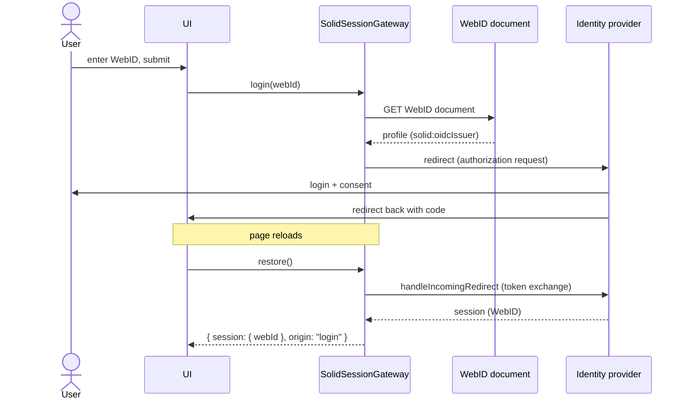

# Authentication

Login, session restore, and logout against a Solid identity provider using
[Solid-OIDC](https://solidproject.org/TR/oidc), which builds on
[OpenID Connect](https://openid.net/specs/openid-connect-core-1_0.html)
and [DPoP](https://www.rfc-editor.org/rfc/rfc9449) (the specifications
and their status are in [standards.md](standards.md)). All authentication code lives in
[packages/solid/src/solidSessionGateway.ts](../packages/solid/src/solidSessionGateway.ts),
behind the `SessionGateway` port.

## Login flow

The user enters only their [WebID](https://www.w3.org/2005/Incubator/webid/spec/identity/)
([its profile in Solid](https://solid.github.io/webid-profile/); collected by the
[onboarding flow](onboarding.md), validated as an `https:` URL). The app
dereferences it (unauthenticated) and reads the `solid:oidcIssuer` triple to
find their identity provider, then starts the OIDC redirect flow. The issuer
is never inferred from the WebID's origin — the two often differ (a WebID on
`alice.datapod.igrant.io` is served by the issuer `datapod.igrant.io`) — and
must itself be an `https:` URL.

Alternatively the user picks a suggested provider ([onboarding](onboarding.md));
`loginWithIssuer` then skips the profile lookup and starts the same flow at
that issuer.

The app never handles credentials: no password field, no client secret, no
hand-rolled OIDC. On its own domain, the app names itself by its
[Client ID Document](#the-client-id-document); anywhere else, or with a
provider that does not list `webid` in its `scopes_supported`, the authn
library registers the client dynamically, under the site's name (`VITE_APP_NAME`,
[configuration.md](configuration.md)). Either way, the library runs the
authorization-code + PKCE flow, and the provider sends the user back to
the folder the site is served from, the page's address without
`index.html` or a hash.

## The Client ID Document

Solid-OIDC lets an app name itself by the address of a JSON-LD
document that says who it is and where a provider may send the user
back ([Solid-OIDC, section 5](https://solidproject.org/TR/oidc#clientids)).
Solid Memo's is at <https://solid-memo.com/clientid.jsonld>. The build
writes it on the domain in [CNAME](../CNAME), as it writes the sitemap
([deployment.md](deployment.md#what-the-artifact-contains)), by
[clientId.ts](../packages/site/src/clientId.ts):

| Field | Value |
|---|---|
| `client_id` | The document's own address, `https://<domain>/clientid.jsonld`. |
| `client_name` | The site's name (`VITE_APP_NAME`), the same name it registers under elsewhere. |
| `redirect_uris` | The site's root, `https://<domain>/`, alone: the app is one page. |
| `client_uri`, `logo_uri` | The site's root, and its picture, `solid-memo-avatar.png`. |
| `scope`, `grant_types`, `response_types` | What the library asks for: `openid offline_access webid`, the authorization code and refresh grants, `code`. |
| `token_endpoint_auth_method` | `none`: the app has no secret. |

It has no `tos_uri`, as there are no terms of service, and no `post_logout_redirect_uris`, which
Solid-OIDC's context does not define and logout, which ends the session
in this browser alone, does not use. Without a `CNAME` the build writes
none; a copy of it in `apps/web/public/` fails the build.

The build gives the page the document's address too (`__CLIENT_ID__`,
[configuration.md](configuration.md#what-a-build-computes)), and the
gateway passes it to the authn library as `clientId` only when the
page is served from the folder the document is in. Elsewhere, on
`npm run dev` and `npm start`, in the user journeys, on a fork's address
or in a subfolder, the provider would refuse the login, since the
document lists no redirect URL there, so the app registers dynamically,
as it did before it had one.

The library, in turn, uses the document only with a provider whose
`/.well-known/openid-configuration` lists `webid` in `scopes_supported`,
and registers dynamically with any other. Of the suggested providers
([onboarding.md](onboarding.md)), solidcommunity.net and solidweb.me
(Community Solid Server) and Inrupt PodSpaces (`login.inrupt.com`) list
it; iGrant.io's Data Pod (Node Solid Server) does not, so nothing
changed there. `login.inrupt.com` does not list `none` among its
`token_endpoint_auth_methods_supported`, though Inrupt's own guide
describes Client ID Documents for apps with no secret; a login there
with the document is yet to be tried on the deployed site. A session from before the document restores with the
client it was registered as, and the user's next login moves it to the
document.

What follows from it:

- **The address is part of the public API**
  ([api/self-hosting.txt](../api/self-hosting.txt)). A provider records a
  user's consent per client ID, so a new address would ask every user to
  consent again.
- **The provider reads it, not the app.** A provider that lists `webid`
  but cannot fetch the document refuses the login on its own page, which
  does not send the user back, so the app cannot say why; the
  [interop report](../.github/ISSUE_TEMPLATE/interop.yml) is the place
  for such a provider. Community Solid Server fetches the document at
  each login, and Inrupt's caches it for a time it does not state, so a
  new redirect URL goes into the document a release before the app uses
  it.
- **The tests check it, but no journey logs in with it**: the journeys
  serve the site at `http://127.0.0.1:4173`, so they register
  dynamically. [clientId.test.ts](../packages/site/src/clientId.test.ts)
  checks the document,
  [solidSessionGateway.test.ts](../packages/solid/src/solidSessionGateway.test.ts)
  when the gateway names it, and the build test that the site's build
  writes it with the address its page logs in with.

## Session restore

`restore()` runs on every page load (App's boot effect), through the
`restoreSession` use case, which falls back to a guest's session when a
guest studied in this browser ([guest-mode.md](guest-mode.md)). It completes a
pending OIDC redirect if one is in flight, otherwise silently restores a
previous session (`restorePreviousSession: true`). It returns a domain
`EstablishedSession` (`{ session, origin }`) or `null`. `origin` is
`"login"` when the library emitted its `LOGIN` event (a login redirect just
completed) and `"restored"` otherwise; the UI shows the "Pod connected"
onboarding step only for the former, unless every instance's preferences
say to skip it ([onboarding.md](onboarding.md#skipping-the-connected-screen)).

Solid Memo and the Studio are one page, so they share this one session
([studio.md](studio.md)): a login in either is a login in both. A
redirect URL may carry no hash, so the identity provider sends the user
back to the site's root, without the route they left from. The gateway
puts that route back before `restore()` returns. On a login, `startLogin`
keeps the hash in `sessionStorage` (`solid-memo:login-hash`) and
`restore()` takes it from there. On a silent restore, the library
reports the page it left (its `SESSION_RESTORED` event) and `restore()`
takes the hash from that. Either way it replaces the page's hash and
fires `hashchange`, so the routers follow, as after a link. So a reload
comes back to the screen it left, and a login set off at the Studio's
landing page (`#/studio`) comes back to the Studio, not to Solid Memo's
decks.

## Authenticated requests

Repositories receive `fetch` by injection. The composition root injects
[authFetch](../packages/solid/src/authFetch.ts), a lazy wrapper that
delegates to the current default session's fetch at call time — never a
reference captured before login — behind a router that sends the
guest's URLs to the pod kept in the browser instead
([guest-mode.md](guest-mode.md)). Every pod read goes through it, the
WebID document's too: the storage gateway hands @inrupt/solid-client the
profile it read, since left to itself the library reads it with the
browser's own fetch.

## Logout

`logout()` clears the session via the authn library; the UI additionally
clears the react-query cache so no pod data outlives the session that
fetched it.
