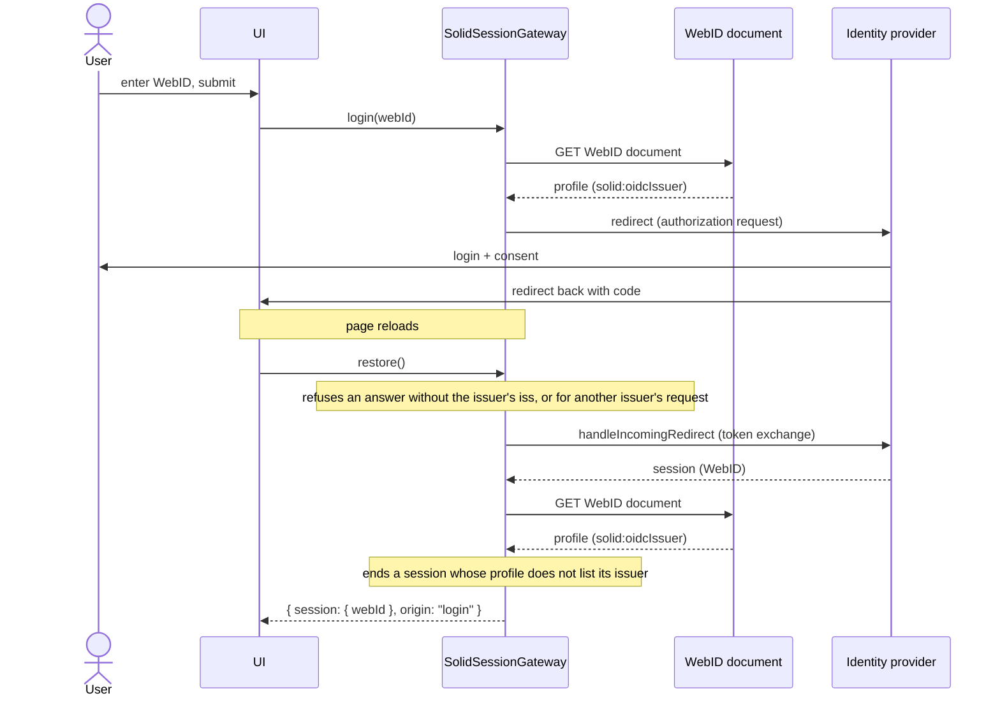

# Authentication

Login, session restore and logout against a Solid identity provider use
[Solid-OIDC](https://solidproject.org/TR/oidc), which builds on
[OpenID Connect](https://openid.net/specs/openid-connect-core-1_0.html)
and [DPoP](https://www.rfc-editor.org/rfc/rfc9449);
[standards.md](standards.md) lists their status. The authentication
code is in
[packages/solid/src/solidSessionGateway.ts](../packages/solid/src/solidSessionGateway.ts),
behind the `SessionGateway` port. It signs in through the sign-in client
the composition root passes it, the one in
[client/session.ts](../packages/solid/src/client/session.ts), the only
file that calls the authentication library. A build with
`SOLID_CLIENT=solid-memo-client` passes another sign-in client in its
place, on `oauth4webapi` and no Inrupt library
([solid-memo-client.md](solid-memo-client.md#sign-in)); this page
describes the default, Inrupt's, and says where the other differs.

## Login flow

The learner enters only a [WebID](https://www.w3.org/2005/Incubator/webid/spec/identity/)
([its profile in Solid](https://solid.github.io/webid-profile/)); the
[onboarding flow](onboarding.md) validates it as an `https:` URL. The
app reads the WebID document unauthenticated, under `PROFILE_LIMITS`
([the credential gate](boundaries.md#the-credential-gate)), takes the
issuer (`https:` too) from its `solid:oidcIssuer` triple, and starts
the OIDC redirect flow. The issuer is never inferred from the WebID's
origin: a WebID on `alice.datapod.igrant.io` has the issuer
`datapod.igrant.io`.

For a suggested provider, `loginWithIssuer` skips the profile lookup
and starts at that issuer.

The app never handles credentials: no password field, no client secret,
no hand-rolled OIDC. The authn library runs the authorization-code +
PKCE flow. On its own domain the app names itself by its
[Client ID Document](#the-client-id-document); elsewhere, or with a
provider whose `scopes_supported` lacks `webid`, the library registers
dynamically under the site's name (`VITE_APP_NAME`,
[configuration.md](configuration.md)). `solid-memo-client`'s sign-in
client leaves the protocol to a library too, `oauth4webapi`, and
chooses the client the same way. The provider returns the learner to
the page's address without `index.html` or a hash.

### One session per login

The library keeps a session in `localStorage` under its ID, and its
provider with it. A tab holds its refresh token in memory, and at each
refresh reads the provider to send it to from `localStorage`, by the ID
alone. Every tab that restores a session shares that session's ID, and
a logout leaves the ID on the page. So
[client/session.ts](../packages/solid/src/client/session.ts) passes a
new ID to every login the user starts. The library clears what it kept
of earlier sessions on that login, so another tab still under the old
ID has no provider to refresh at, and sends nothing. That tab's session
ends at its next refused read after the access token expires
([An expired session](#an-expired-session)). A silent restore keeps its
session's ID, since it goes to that session's provider.

The same file refuses a provider's metadata when an endpoint's parsed
path starts with `//`, because the library would sign the DPoP proof
for a request to it as a proof for another host. A login at such a
provider fails before the browser leaves (`loginProviderRefused`), and
a refresh there fails without a request to the token endpoint. A
refresh reads the metadata anew and calls the global `fetch` itself,
with no option to replace it, so the sign-in client wraps the global
`fetch`. Every request of the page passes through that wrapper, and it
reads only an answer from an address ending in the metadata's path,
under the limits of a profile
([client/readLimits.ts](../packages/solid/src/client/readLimits.ts)).
Past them, the read fails as too large and the request is canceled.

`solid-memo-client` needs neither: it refreshes only a stored session
from the tab's own provider, and its library builds a proof's address
from the request's own origin and path
([solid-memo-client.md](solid-memo-client.md#sign-in)).

### The issuer on the provider's answer

Every provider gets the same redirect URL and, on the site's domain,
the same client ID. So the `iss` parameter
([RFC 9207](https://www.rfc-editor.org/rfc/rfc9207)) is what ties the
provider's answer to the issuer it came from, and only the tab that
sent the browser to a provider knows that issuer. A code is redeemed
where the request it answers went, which the sign-in client looks up
by the answer's `state`. The gateway checks both before a sign-in
client redeems any code:

- Before the browser leaves for a provider, the gateway keeps that
  provider's issuer in `sessionStorage` (`solid-memo:login-issuer`),
  which belongs to this tab, until the next page load. A login keeps
  the issuer it goes to. A silent restore keeps the issuer of the
  session it restores, which the sign-in client names
  (`sessionIssuer()`), and forgets it if the page doesn't leave. It
  does the same before it passes an answer to the client, which could
  still leave.
- `restore()` drops an answer, a code or an error, when this tab sent
  the browser to no provider: it removes the answer from the address
  and restores the previous session as on any load. Such an answer
  comes from a link with a provider's parameters, say, and refusing it
  would stop the session for that load.
- It refuses an answer without `iss` (`loginIssuerMissing`), and one
  whose `iss` is another issuer than the one kept, a trailing slash
  aside (`loginIssuerMismatch`).
- It refuses an answer, a code or an error, whose `state` names no
  request the sign-in client holds (`loginNotStarted`), and one whose
  request went to another issuer than the one kept
  (`loginIssuerMismatch`). The client would drop an answer it doesn't
  hold and restore silently, leaving for the provider again. The client
  names that issuer (`requestIssuer(state)`). Inrupt's library keeps its
  requests in `localStorage`, which every tab shares, and keeps one
  that was never answered. It fetches the provider's metadata again
  from the request's issuer when the answer comes, and checks `iss`
  only against that metadata. So a provider could otherwise pass on
  the state of a request left for another provider, and that
  provider's metadata could name the honest one and its own token
  endpoint.
- It removes a refused answer from the address before it shows the
  error, so a reload doesn't try it again.
- `solid-memo-client` requires `iss` itself too, whatever the
  provider's metadata says, and checks it against the issuer of the
  login it keeps in this tab. `oauth4webapi` checks that issuer
  against the metadata it fetches.

An answer comes through only from the provider this tab sent the
browser to, and only for a request that went to that provider. A
provider's error without `iss` is refused too: the learner sees the
safety error, not the provider's. If that error answers a silent
restore, the stored session stays, as a refused answer proves nothing
of the provider, so each reload shows the error again until the
learner logs in.

A provider that doesn't send `iss` can't be used to log in.

The fix that brought in these three errors has a
[security advisory](https://github.com/solid-memo/website/security/advisories/GHSA-vrcx-39mp-3746),
and each error names it as its `advisory`
([appError.ts](../packages/domain/src/appError.ts)).
The app links to the advisory after the error's text, in the
learner's language, and the error's `message` ends with its address.
That address is upstream's repository, never `VITE_REPO_URL`
([configuration.md](configuration.md#vite_repo_url)): the advisory
belongs to Solid Memo, and a fork's repository doesn't have it.

## The Client ID Document

Solid-OIDC lets an app name itself by the address of a JSON-LD
document describing it and its redirect URLs
([Solid-OIDC, section 5](https://solidproject.org/TR/oidc#clientids)).
Solid Memo's is at <https://solid-memo.com/clientid.jsonld>.
[clientId.ts](../packages/site/src/clientId.ts) writes it at build time
for the domain in [CNAME](../CNAME), like the sitemap
([deployment.md](deployment.md#what-the-artifact-contains)):

| Field | Value |
|---|---|
| `client_id` | Its own address, `https://<domain>/clientid.jsonld`. |
| `client_name` | The site's name (`VITE_APP_NAME`). |
| `redirect_uris` | The site's root, `https://<domain>/`, alone: the app is one page. |
| `client_uri`, `logo_uri` | The site's root, and its picture, `solid-memo-avatar.png`. |
| `scope`, `grant_types`, `response_types` | What the library asks for: `openid offline_access webid`, the authorization code and refresh grants, `code`. |
| `token_endpoint_auth_method` | `none`: the app has no secret. |

It has no `tos_uri` (no terms of service) and no
`post_logout_redirect_uris` (Solid-OIDC's context doesn't define it,
and logout, local to this browser, doesn't use it). Without a `CNAME`
the build writes no document; a copy in `apps/web/public/` fails the
build.

The build gives the page the document's address (`__CLIENT_ID__`,
[configuration.md](configuration.md#what-a-build-computes)). The gateway
passes it to the library as `clientId` only when the page is served
from the document's folder. Elsewhere the document lists no redirect
URL, the provider would refuse the login, and the app registers
dynamically: on `npm run dev` and `npm start`, in the user journeys,
on a fork's address or in a subfolder.

Of the suggested providers ([onboarding.md](onboarding.md)),
solidcommunity.net and solidweb.me (Community Solid Server) and Inrupt
PodSpaces (`login.inrupt.com`) list `webid` in their
`/.well-known/openid-configuration`. `login.inrupt.com` lacks `none` in its
`token_endpoint_auth_methods_supported`, though Inrupt's guide
describes Client ID Documents for apps with no secret; a login there
with the document on the deployed site is untried. A session from
before the document restores with the client it was registered as. The
next login moves it to the document.

- **The address is part of the public API**
  ([api/self-hosting.txt](../api/self-hosting.txt)): providers record
  consent per client ID, so a new address asks every learner again.
- **The provider reads it, not the app.** A provider that lists `webid`
  but can't fetch the document refuses the login on its own page and
  doesn't send the learner back, so the app can't say why; such a
  provider goes in an [interop report](../.github/ISSUE_TEMPLATE/interop.yml). Community
  Solid Server fetches the document at each login; Inrupt's caches it
  for an unstated time, so a new redirect URL goes into the document a
  release before the app uses it.
- **The tests check it, but no journey logs in with it.** Journeys
  serve the site at `http://127.0.0.1:4173` and register dynamically.
  [clientId.test.ts](../packages/site/src/clientId.test.ts) checks the
  document,
  [solidSessionGateway.test.ts](../packages/solid/src/solidSessionGateway.test.ts)
  when the gateway names it, and the build test that the build writes
  it with the address its page logs in with.

## Session restore

`restore()` runs on every page load (App's boot effect) through the
`restoreSession` use case, which falls back to a guest's session if a
guest studied in this browser ([guest-mode.md](guest-mode.md)).
It completes a pending OIDC redirect, or else silently restores a
previous session (`restorePreviousSession: true`), and returns a domain
`EstablishedSession` (`{ session, origin }`) or `null`. `origin` is
`"login"` when the library's `LOGIN` event fired (a login redirect
completed on this load), and `"restored"` otherwise. The UI shows the
"Pod connected" onboarding step only for `"login"`, unless every instance's preferences say to skip it
([onboarding.md](onboarding.md#skipping-the-connected-screen)).

The library tells a login from a silent restore only by the page it
keeps in `localStorage` (`solidClientAuthn:currentUrl`) on leaving for
a restore, and it keeps a session for later reloads only after a
login. Only a completed redirect takes that page off, so the sign-in
client also does when the provider's answer to this tab is an error,
and before every login. A login after a failed restore is then a login
like any other.

`restore()` completes only a redirect this tab set off. Before a
login, and before a restore that may leave for the provider, the
sign-in client marks the tab in `sessionStorage`
(`solid-memo:provider-redirect`). The library would take any `code`,
`state` or `error` on the page's address for a redirect to complete,
and end the stored session when that failed. So unless the tab has the
mark and the address carries a `state` the library sent, the client
takes `code`, `state`, `iss`, `error`, `error_description` and
`session_state` off the address before the library sees them. The
gateway has dropped such an answer already when this tab sent the
browser to no provider, and refused it when the tab awaits another
answer
([The issuer on the provider's answer](#the-issuer-on-the-providers-answer)).
The client's check holds for a sign-in client on its own. A provider's
answer has to come back to the tab that left for it, since
`sessionStorage` is kept per tab; `solid-memo-client` needs the same.

Solid Memo and the Studio are one page ([studio.md](studio.md)): a
login in either is a login in both. A redirect URL can't carry a hash,
so the provider returns the learner to the site's root; the gateway
restores the route before `restore()` returns:

- On a login, `startLogin` keeps the hash in `sessionStorage`
  (`solid-memo:login-hash`) and `restore()` reads it back.
- On a silent restore, the hash comes from the page the library's
  `SESSION_RESTORED` event reports.

`restore()` then sets the page's hash and fires `hashchange` for the
routers. A reload returns to the screen it left, and a login started
at the Studio's landing page (`#/studio`) to the Studio, not to Solid
Memo's decks.

`solid-memo-client`'s sign-in client restores a session from a
refresh token it keeps in IndexedDB, with the DPoP key pair, and
leaves the page only when it has none, or the provider refuses it. Its
access tokens stay in memory
([solid-memo-client.md](solid-memo-client.md#what-a-session-keeps)).

### When the provider doesn't answer

The app shows only its loading screen until `restore()` settles, and
the Inrupt library's restore may never settle: the fix has a
[security advisory](https://github.com/solid-memo/website/security/advisories/GHSA-m5g9-pcp3-w6w8).
So the gateway bounds what stays on the page and notes what leaves it:

- **The deadline**: `RESTORE_DEADLINE_MS`, 60 seconds, covers all of
  `restore()` on the page, a login's answer included. Past it, `restore()`
  rejects with `restoreTimedOut`, and the landing page shows the error
  and the login. It's a whole restore's allowance, not a request's: a
  restore can make a few requests, a slow but working provider should
  still restore, and `solid-memo-client` alone gives each request 30
  seconds. The deadline keeps the stored session: another page can
  keep the tab from leaving for the provider, so running out of time
  doesn't show that the provider failed.
- **After the deadline**: what the sign-in client is still doing can't
  be called off. With the Inrupt library, metadata that arrives late
  can still send the page to the provider, and the provider chooses
  when. The answer it then sends is refused or dropped.
  `solid-memo-client` doesn't store a session it completes after the
  learner forgot it.
- **The attempt**: before a silent restore, the gateway keeps the
  provider and the time in `sessionStorage`
  (`solid-memo:restore-attempt`) until the next load. A load that finds
  it, with no answer on the address, doesn't restore silently: the
  provider hasn't sent the browser back. `restore()` rejects with
  `restoreNotReturned`, and the landing page adds a link to the provider
  beside the login. A load the learner started with Reload doesn't
  count, since the page hadn't left. A silent restore that runs out of
  time keeps the attempt too, so the next load doesn't wait on the
  provider again, and the load after that tries again. A login's
  answer that runs out of time keeps none.
- **The stored session**: only the provider's own refusal of this tab's
  request, an answer whose `state` matches it, ends the stored session,
  in the sign-in client. Neither an attempt's age nor the deadline
  does, since another page can control both: it can navigate the tab,
  keep it from leaving, and choose when it brings it back. A restore
  that fails, an attempt that found no answer, and a refused answer
  keep the session too, and the next load tries again. A login's own
  answer leaves the stored session alone.
- **Forget this session**: the landing page that shows
  `restoreTimedOut` or `restoreNotReturned` offers "Forget this
  session" while a session is stored. It ends the stored session in
  the sign-in client (`forgetSession()`), without asking the provider,
  and the restore attempt, and announces a logout to the other tabs.
  The landing page then shows no error. It takes the learner's click on
  the app's own page. That's the cost of the deadline keeping the
  session: with a provider that never answers, each fresh load waits up
  to the deadline, or shows that the provider didn't answer, until the
  learner logs in again or forgets the session.
- **A page brought back**: the browser can bring a page that left for
  the provider back from its back/forward cache, its restore still
  pending and its deadline running again. Another page can bring it
  back too, so its deadline keeps the session, as any deadline does. A
  later load in the tab may have restored the session and taken the
  attempt by then. Such a page reloads, and if its deadline still runs
  out, it leaves what that load kept alone.

### The issuer in the WebID's profile

A provider says which WebID a session belongs to, in its ID token, and
the sign-in clients take its word. So a session is checked against the
WebID's profile too, before `restore()` returns it: on a login and on
every restore, with either sign-in client, in one place in the gateway.

- A WebID longer than `MAX_BASE_CHARACTERS` (512 characters) ends the
  session before anything is read, and shows `webIdTooLong`. A WebID
  that long is far beyond any real one, and beyond the longest address
  Solid Memo accepts as a document's base; the storage lookup derives
  addresses from its path.
- The gateway reads the WebID document as no one, under
  `PROFILE_LIMITS`, asking the pod rather than the browser's cache.
- It looks for the session's issuer among the `solid:oidcIssuer`
  values, a trailing slash aside. The sign-in client names that issuer
  (`sessionIssuer()`), of the session it's logged in with.
- A profile that can be read and doesn't list the issuer ends the
  session, which then shows `webIdIssuerNotListed`. The learner can
  add the provider to their profile, or log in at one it lists.
- A session stays if the profile can't be read, in a few seconds at
  most. A slow, absent or private pod locks no one out, so the check
  says only what a profile that answers says. The check comes once the
  sign-in client has restored, so `RESTORE_DEADLINE_MS` doesn't cover
  it: its own few seconds add to the loading screen.
- A session also stays if the client can't name its issuer, which
  takes the client's own record of the session being gone. That session
  hasn't passed the check: it was never made.
- A guest logs in nowhere, so a guest's session isn't checked.

The check adds one read of the profile to a load. After a login, the
account's issuer lookup uses that read rather than making its own, so
a login reads the document no more often than before.

The check doesn't vouch for a provider: a session under a WebID whose
profile lists that provider passes it.

## Authenticated requests

The composition root injects repositories' `fetch`:
[authFetch](../packages/solid/src/authFetch.ts), a wrapper around the
sign-in client's fetch, which calls the current session's, never one
captured before login.
[solidSession.ts](../packages/solid/src/solidSession.ts) makes it and
the session gateway on one client. A router in front sends the guest's URLs to the browser's pod
([guest-mode.md](guest-mode.md)). Every pod read goes through
authFetch, the WebID document's too. An instance's data is sent with it
only into the user's own pod, their storages and the instances they
registered. A deck's document elsewhere is read without it and never
written ([the credential gate](boundaries.md#the-credential-gate)). A
release outside the user's own pod is read without it
([studio.md](studio.md#drafts)). The storage
gateway hands the profile lookup (`getProfileStorages`, in
`client/resources.ts`) the profile it read, so the lookup doesn't fetch
it with the browser's fetch.

authFetch follows no redirect: it sends every request with
`redirect: "error"`, whatever the caller asked. The
[pod fence](boundaries.md#the-pod-fence) checks the address asked for,
and Inrupt's sign-in client sends a redirected request that ends 401
or 403 again to the new address, with fresh credentials. Both sign-in
clients send the request with the redirect mode authFetch gives it
([solid-memo-client.md](solid-memo-client.md#restore-refresh-and-logout)).
So no request carries the user's credentials to an address the fences
never saw.

authFetch also refuses (`credentialsRefused`), before anything is sent
and whatever the method, an address whose path would lead to another
server if read as an address of its own, or to no address at all.
Inrupt's sign-in client builds a DPoP proof's `htu` that way, so a proof
sent to such an address would name another server. The test is on the
parsed address, so every spelling of a `//` at the start of the path is
caught, and a path with one further along (`/a//b`) isn't refused here.

On `solid-memo-client`, a storage that speaks Linked Web Storage gets a
Bearer token the client exchanges the ID token for, sent within that
storage only. The client answers its challenge, and sends the request
again, before authFetch sees the response
([solid-memo-client.md](solid-memo-client.md#linked-web-storage)).
Inrupt's sign-in client gives the app no ID token short of ending the session, so it can't.

When a request fails and wasn't aborted, authFetch asks the same
address with a HEAD as no one, the redirect not followed:

- **No redirect:** the failure is passed on as it came.
- **A read** (GET, HEAD, OPTIONS) that redirects is sent again as no
  one (`anonymousFetch`), the redirect followed. A WebID whose public
  profile is behind a redirect still reads. If that read follows no
  redirect, the first failure is passed on instead.
- **A write** that redirects is refused (`redirectRefused`), and the
  app shows why. A write to the profile of such a WebID, a type index
  link say, fails the same way.

The HEAD asks as no one, so it can't tell a redirect the user would
get from one only visitors with no login get. On a server that sends
those to a login page, a write that failed for another reason, such
as a dropped connection, shows as `redirectRefused`. Nothing is sent
to the login page.

### An expired session

The app drops the session and shows the login again only when the
session is gone. authFetch announces it
(`solid-memo:session-expired`) on a 401 in two cases:

- **The sign-in client no longer has the user.** The access token
  expired with no refresh token to renew it, or the provider refused
  the refresh token, and the client ended the session.
- **The user's own storage or identity provider refuses the token.**
  The 401 names the token invalid (`invalid_token` in
  `WWW-Authenticate`). The own storages are those the user's profile
  names, read as no one, and those entered on this page.

On `solid-memo-client`, a 401 from a Linked Web Storage storage reaches
authFetch only after the client tried to answer its challenge: a token
exchange, and the request sent again. A storage's token the storage
refuses is exchanged anew once first, so an expired one ends no
session.

A 401 from any other server, such as an instance the user registered
in someone else's pod, says nothing of the session. The caller reads
it as refused access, and the user stays logged in. A logout isn't an
expired session either.

## Logout

`logout()` clears the session through the authn library, and the UI
clears the react-query cache: no pod data outlives its session. On
`solid-memo-client`, `logout()` deletes the stored session from
IndexedDB, and keeps the provider's registration of the app. Neither
client ends the session at the provider.

Each tab holds its token in its own memory, so a logout is announced to
this browser's other tabs
([`logoutChannel.ts`](../packages/browser/src/logoutChannel.ts)): on a
`BroadcastChannel`, or through a `localStorage` key where the browser
has none or refuses one. Each tab with a user then runs the same local
`logout()`, which discards its token and deletes the session data from
storage. With the authn library, its refresh timer isn't canceled: its
next refresh fails for want of that data, and no further one is set, in
a tab with a login of its own too. That holds for as long as the data
stays deleted. A later login can store it again under the same ID, and
the old timer's refresh then succeeds, though the tab's requests no
longer use the token it gets. The tab shows the landing and clears its
react-query cache. It announces nothing itself, and doesn't contact the
provider. A session a tab is restoring when it hears the announcement
is logged out of as well once it arrives. A guest's tab keeps its
study, which belongs to no login.

A page held in the browser's back/forward cache hears nothing while it
is there. When it comes back, it asks whether a session is still stored,
and with none it runs the same local logout.

The announcement is best effort, and has these limits:

- Where a browser allows neither way, the other tabs keep their current
  token until it expires.
- A page back from the cache finds a session stored if someone logged in
  while it was away. It then keeps its screen, and its token until that
  expires.
- A tab the browser froze hears the announcement when it resumes. If
  someone has logged in again by then, that tab's local logout can remove
  the session stored for the new login. This fails closed: the tabs
  holding the new login's token keep working, and the next reload shows
  the landing.
- Other devices aren't told.
