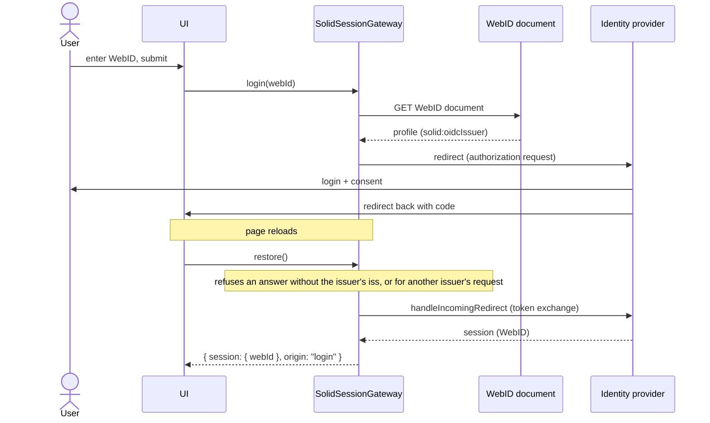

# Authentication

Login, session restore and logout against a Solid identity provider use
[Solid-OIDC](https://solidproject.org/TR/oidc), which builds on
[OpenID Connect](https://openid.net/specs/openid-connect-core-1_0.html)
and [DPoP](https://www.rfc-editor.org/rfc/rfc9449);
[standards.md](standards.md) lists their status. The authentication
code is in
[packages/solid/src/solidSessionGateway.ts](../packages/solid/src/solidSessionGateway.ts),
behind the `SessionGateway` port. It signs in through the sign-in client
the composition root passes it, the one in
[client/session.ts](../packages/solid/src/client/session.ts), the only
file that calls the authentication library. A build with
`SOLID_CLIENT=solid-memo-client` passes another sign-in client in its
place, on `oauth4webapi` and no Inrupt library
([solid-memo-client.md](solid-memo-client.md#sign-in)); this page
describes the default, Inrupt's, and says where the other differs.

## Login flow

The learner enters only a [WebID](https://www.w3.org/2005/Incubator/webid/spec/identity/)
([its profile in Solid](https://solid.github.io/webid-profile/)); the
[onboarding flow](onboarding.md) validates it as an `https:` URL. The
app reads the WebID document unauthenticated, takes the issuer
(`https:` too) from its `solid:oidcIssuer` triple, and starts the OIDC
redirect flow. The issuer is never inferred from the WebID's
origin: a WebID on `alice.datapod.igrant.io` has the issuer
`datapod.igrant.io`.

For a suggested provider, `loginWithIssuer` skips the profile lookup
and starts at that issuer.

The app never handles credentials: no password field, no client secret,
no hand-rolled OIDC. The authn library runs the authorization-code +
PKCE flow. On its own domain the app names itself by its
[Client ID Document](#the-client-id-document); elsewhere, or with a
provider whose `scopes_supported` lacks `webid`, the library registers
dynamically under the site's name (`VITE_APP_NAME`,
[configuration.md](configuration.md)). `solid-memo-client`'s sign-in
client leaves the protocol to a library too, `oauth4webapi`, and
chooses the client the same way. The provider returns the learner to
the page's address without `index.html` or a hash.

### The issuer on the provider's answer

Every provider gets the same redirect URL and, on the site's domain,
the same client ID. So the `iss` parameter
([RFC 9207](https://www.rfc-editor.org/rfc/rfc9207)) is what ties the
provider's answer to the issuer it came from, and only the tab that
sent the browser to a provider knows that issuer. A code is redeemed
where the request it answers went, which the sign-in client looks up
by the answer's `state`. The gateway checks both before a sign-in
client redeems any code:

- Before the browser leaves for a provider, the gateway keeps that
  provider's issuer in `sessionStorage` (`solid-memo:login-issuer`),
  which belongs to this tab, until the next page load. A login keeps
  the issuer it goes to. A silent restore keeps the issuer of the
  session it restores, which the sign-in client names
  (`sessionIssuer()`), and forgets it if the page doesn't leave.
- `restore()` drops an answer, a code or an error, when this tab sent
  the browser to no provider: it removes the answer from the address
  and restores the previous session as on any load. Such an answer
  comes from a link with a provider's parameters, say, and refusing it
  would stop the session for that load.
- It refuses an answer without `iss` (`loginIssuerMissing`), and one
  whose `iss` is another issuer than the one kept, a trailing slash
  aside (`loginIssuerMismatch`).
- It refuses a code whose `state` names no request the sign-in client
  holds (`loginNotStarted`), and one whose request went to another
  issuer than the one kept (`loginIssuerMismatch`). The client names
  that issuer (`requestIssuer(state)`). Inrupt's library keeps its
  requests in `localStorage`, which every tab shares, and keeps one
  that was never answered. It fetches the provider's metadata again
  from the request's issuer when the answer comes, and checks `iss`
  only against that metadata. So a provider could otherwise pass on
  the state of a request left for another provider, and that
  provider's metadata could name the honest one and its own token
  endpoint.
- It removes a refused answer from the address before it shows the
  error, so a reload doesn't try it again.
- `solid-memo-client` requires `iss` itself too, whatever the
  provider's metadata says, and checks it against the issuer of the
  login it keeps in this tab. `oauth4webapi` checks that issuer
  against the metadata it fetches.

An answer comes through only from the provider this tab sent the
browser to, and with a code, only for a request that went to that
provider. A provider's error without `iss` is refused too: the learner
sees the safety error, not the provider's. If that error answers a
silent restore, the Inrupt library still holds the session to
restore, so each reload shows the error again until the learner logs
in.

A provider that doesn't send `iss` can't be used to log in.

## The Client ID Document

Solid-OIDC lets an app name itself by the address of a JSON-LD
document describing it and its redirect URLs
([Solid-OIDC, section 5](https://solidproject.org/TR/oidc#clientids)).
Solid Memo's is at <https://solid-memo.com/clientid.jsonld>.
[clientId.ts](../packages/site/src/clientId.ts) writes it at build time
for the domain in [CNAME](../CNAME), like the sitemap
([deployment.md](deployment.md#what-the-artifact-contains)):

| Field | Value |
|---|---|
| `client_id` | Its own address, `https://<domain>/clientid.jsonld`. |
| `client_name` | The site's name (`VITE_APP_NAME`). |
| `redirect_uris` | The site's root, `https://<domain>/`, alone: the app is one page. |
| `client_uri`, `logo_uri` | The site's root, and its picture, `solid-memo-avatar.png`. |
| `scope`, `grant_types`, `response_types` | What the library asks for: `openid offline_access webid`, the authorization code and refresh grants, `code`. |
| `token_endpoint_auth_method` | `none`: the app has no secret. |

It has no `tos_uri` (no terms of service) and no
`post_logout_redirect_uris` (Solid-OIDC's context doesn't define it,
and logout, local to this browser, doesn't use it). Without a `CNAME`
the build writes no document; a copy in `apps/web/public/` fails the
build.

The build gives the page the document's address (`__CLIENT_ID__`,
[configuration.md](configuration.md#what-a-build-computes)). The gateway
passes it to the library as `clientId` only when the page is served
from the document's folder. Elsewhere the document lists no redirect
URL, the provider would refuse the login, and the app registers
dynamically: on `npm run dev` and `npm start`, in the user journeys,
on a fork's address or in a subfolder.

Of the suggested providers ([onboarding.md](onboarding.md)),
solidcommunity.net and solidweb.me (Community Solid Server) and Inrupt
PodSpaces (`login.inrupt.com`) list `webid` in their
`/.well-known/openid-configuration`. `login.inrupt.com` lacks `none` in its
`token_endpoint_auth_methods_supported`, though Inrupt's guide
describes Client ID Documents for apps with no secret; a login there
with the document on the deployed site is untried. A session from
before the document restores with the client it was registered as. The
next login moves it to the document.

- **The address is part of the public API**
  ([api/self-hosting.txt](../api/self-hosting.txt)): providers record
  consent per client ID, so a new address asks every learner again.
- **The provider reads it, not the app.** A provider that lists `webid`
  but can't fetch the document refuses the login on its own page and
  doesn't send the learner back, so the app can't say why; such a
  provider goes in an [interop report](../.github/ISSUE_TEMPLATE/interop.yml). Community
  Solid Server fetches the document at each login; Inrupt's caches it
  for an unstated time, so a new redirect URL goes into the document a
  release before the app uses it.
- **The tests check it, but no journey logs in with it.** Journeys
  serve the site at `http://127.0.0.1:4173` and register dynamically.
  [clientId.test.ts](../packages/site/src/clientId.test.ts) checks the
  document,
  [solidSessionGateway.test.ts](../packages/solid/src/solidSessionGateway.test.ts)
  when the gateway names it, and the build test that the build writes
  it with the address its page logs in with.

## Session restore

`restore()` runs on every page load (App's boot effect) through the
`restoreSession` use case, which falls back to a guest's session if a
guest studied in this browser ([guest-mode.md](guest-mode.md)).
It completes a pending OIDC redirect, or else silently restores a
previous session (`restorePreviousSession: true`), and returns a domain
`EstablishedSession` (`{ session, origin }`) or `null`. `origin` is
`"login"` when the library's `LOGIN` event fired (a login redirect
completed on this load), and `"restored"` otherwise. The UI shows the
"Pod connected" onboarding step only for `"login"`, unless every instance's preferences say to skip it
([onboarding.md](onboarding.md#skipping-the-connected-screen)).

`restore()` completes only a redirect this tab set off. Before a
login, and before a restore that may leave for the provider, the
sign-in client marks the tab in `sessionStorage`
(`solid-memo:provider-redirect`). The library would take any `code`,
`state` or `error` on the page's address for a redirect to complete,
and end the stored session when that failed. So unless the tab has the
mark and the address carries a `state` the library sent, the client
takes `code`, `state`, `iss`, `error`, `error_description` and
`session_state` off the address before the library sees them. The
gateway has dropped such an answer already when this tab sent the
browser to no provider, and refused it when the tab awaits another
answer
([The issuer on the provider's answer](#the-issuer-on-the-providers-answer)).
The client's check holds for a sign-in client on its own. A provider's
answer has to come back to the tab that left for it, since
`sessionStorage` is kept per tab; `solid-memo-client` needs the same.

Solid Memo and the Studio are one page ([studio.md](studio.md)): a
login in either is a login in both. A redirect URL can't carry a hash,
so the provider returns the learner to the site's root; the gateway
restores the route before `restore()` returns:

- On a login, `startLogin` keeps the hash in `sessionStorage`
  (`solid-memo:login-hash`) and `restore()` reads it back.
- On a silent restore, the hash comes from the page the library's
  `SESSION_RESTORED` event reports.

`restore()` then sets the page's hash and fires `hashchange` for the
routers. A reload returns to the screen it left, and a login started
at the Studio's landing page (`#/studio`) to the Studio, not to Solid
Memo's decks.

`solid-memo-client`'s sign-in client restores a session from a
refresh token it keeps in IndexedDB, with the DPoP key pair, and
leaves the page only when it has none, or the provider refuses it. Its
access tokens stay in memory
([solid-memo-client.md](solid-memo-client.md#what-a-session-keeps)).

## Authenticated requests

The composition root injects repositories' `fetch`:
[authFetch](../packages/solid/src/authFetch.ts), a wrapper around the
sign-in client's fetch, which calls the current session's, never one
captured before login.
[solidSession.ts](../packages/solid/src/solidSession.ts) makes it and
the session gateway on one client. A router in front sends the guest's URLs to the browser's pod
([guest-mode.md](guest-mode.md)). Every pod read goes through
authFetch, the WebID document's too. An instance's data is sent with it
only into the user's own pod, their storages and the instances they
registered. A deck's document elsewhere is read without it and never
written ([the credential gate](boundaries.md#the-credential-gate)). A
release outside the user's own pod is read without it
([studio.md](studio.md#drafts)). The storage
gateway hands the profile lookup (`getProfileStorages`, in
`client/resources.ts`) the profile it read, so the lookup doesn't fetch
it with the browser's fetch.

authFetch follows no redirect: it sends every request with
`redirect: "error"`, whatever the caller asked. The
[pod fence](boundaries.md#the-pod-fence) checks the address asked for,
and Inrupt's sign-in client sends a redirected request that ends 401
or 403 again to the new address, with fresh credentials. Both sign-in
clients send the request with the redirect mode authFetch gives it
([solid-memo-client.md](solid-memo-client.md#restore-refresh-and-logout)).
So no request carries the user's credentials to an address the fences
never saw.
When a request fails and wasn't aborted, authFetch asks the same
address with a HEAD as no one, the redirect not followed:

- **No redirect:** the failure is passed on as it came.
- **A read** (GET, HEAD, OPTIONS) that redirects is sent again as no
  one (`anonymousFetch`), the redirect followed. A WebID whose public
  profile is behind a redirect still reads. If that read follows no
  redirect, the first failure is passed on instead.
- **A write** that redirects is refused (`redirectRefused`), and the
  app shows why. A write to the profile of such a WebID, a type index
  link say, fails the same way.

The HEAD asks as no one, so it can't tell a redirect the user would
get from one only visitors with no login get. On a server that sends
those to a login page, a write that failed for another reason, such
as a dropped connection, shows as `redirectRefused`. Nothing is sent
to the login page.

## Logout

`logout()` clears the session through the authn library, and the UI
clears the react-query cache: no pod data outlives its session. On
`solid-memo-client`, `logout()` deletes the stored session from
IndexedDB, and keeps the provider's registration of the app. Neither
client ends the session at the provider.
