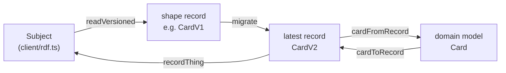
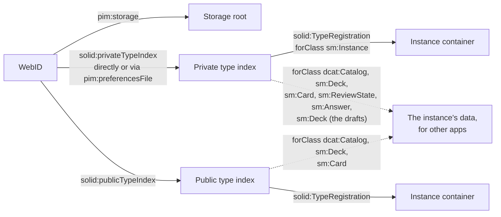
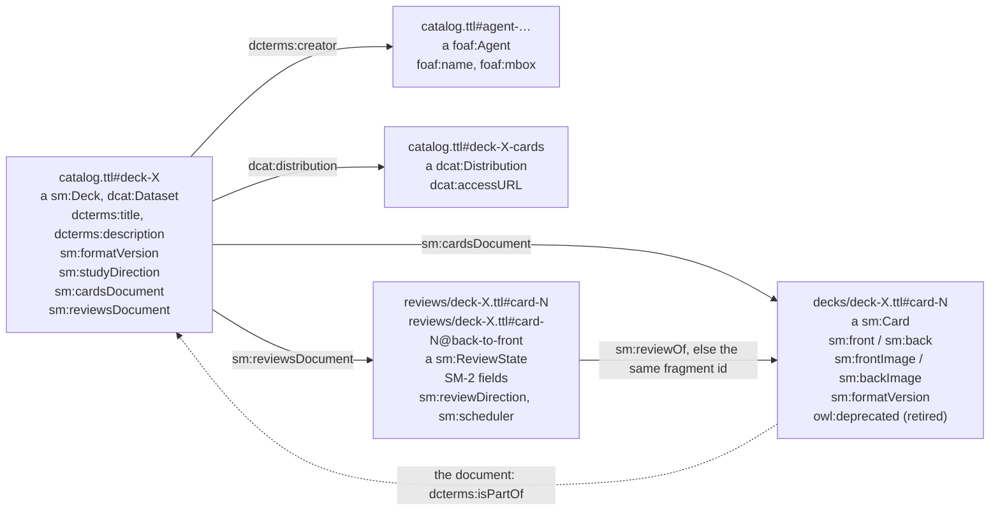
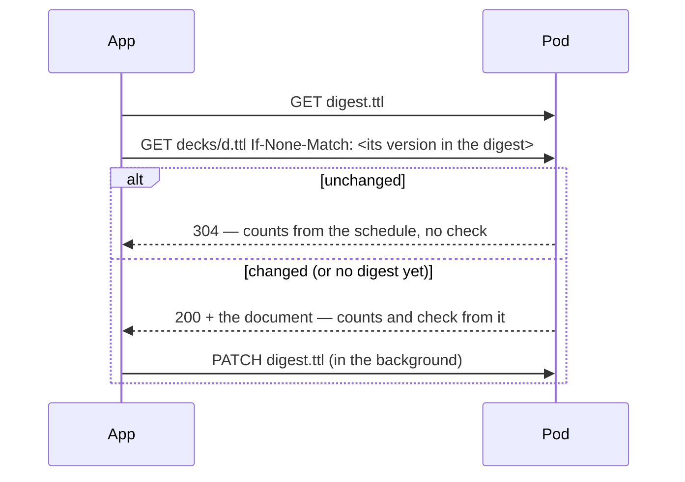

# Data model in the pod

Solid Memo keeps everything a learner makes and studies in their own
Solid Pod, as linked data files in one folder, the instance. This page
says which file holds what, how the app finds the files after a login,
and how it writes them without losing a change made on another device.

The code is in `packages/solid/src/`: the vocabulary in
[vocab.ts](../packages/solid/src/vocab.ts), discovery in
[typeIndex.ts](../packages/solid/src/typeIndex.ts). The app reads and
writes the pod by the [Solid
Protocol](https://solidproject.org/TR/protocol), and finds Solid Memo's
data through the [type indexes](https://solid.github.io/type-indexes/),
an editor's draft
([standards.md](standards.md#drafts-and-de-facto-specifications)).

## Vocabulary and shapes

Solid Memo mints its own terms under
`https://solid-memo.com/ns/vocab/v1.ttl#` (prefix `sm:` below); no
existing RDF vocabulary covers spaced repetition.
[`ns/vocab/v1.ttl`](../ns/vocab/v1.ttl) defines them
([vocab.md](vocab.md)), and a SHACL shape under
[`ns/shapes/`](../ns/shapes/) says what a valid subject of each class
looks like, version by version ([shapes.md](shapes.md)). The site
publishes both, and the app's constants, record types and descriptors
are generated from them. Readers ignore unknown triples, and writers
never delete triples they don't understand.

Every subject Solid Memo writes carries `sm:formatVersion`. A subject
with neither that stamp nor a Solid Memo class is another app's, unless
it's the catalog or a subject of Solid Memo's names it as its creator,
publisher or distribution. Another scheduler's review state is another
app's too. The data check only warns about them
([validation.md](validation.md#data-another-app-wrote)).



## Discovery chain



- **Storage**: `pim:storage` triples in the (extended) profile, via
  `getPodUrlAll`; else the Solid Protocol's Link-header walk-up from the
  WebID URL (`rel="type"` targeting `pim:Storage`, capital S); else a
  URL typed by hand. 0, 1 or N storages are handled.
- **Instances**: one `solid:TypeRegistration` per instance,
  `solid:forClass sm:Instance`, in the private type index by default,
  its `dcterms:title` naming the instance (harmless extra triples): the
  only registration Solid
  Memo reads to find its instances. Reading accepts
  `solid:instanceContainer` or `solid:instance` naming an http(s)
  address with no query, fragment or dot segment (`..`, `%2e%2e` in any
  case; `isInstanceAddress` in
  [instanceLayout.ts](../packages/domain/src/instanceLayout.ts)). The
  address is taken as written: another spelling of a folder (its host's
  case, a name outside ASCII) is that folder
  ([below](#where-an-instances-documents-are)). An instance created,
  attached by URL or moved to from a guest's pod is registered at its
  address as a request sends it (`instanceAddressOf`):
  `HTTPS://Pod.example:443/kortlekar-å` is
  `https://pod.example/kortlekar-%C3%A5/`. Text that's no http(s)
  address isn't an instance to attach (`notAnInstanceNoMeta`).
- **Each class of an instance's data** has a registration of its own,
  titled with the instance's name, for other apps ([examples
  below](#registrations)):
  - the catalog: `dcat:Catalog`, `solid:instance` its subject
    `catalog.ttl#catalog`;
  - the decks: `sm:Deck`, `solid:instance` `catalog.ttl`;
  - the cards: `sm:Card`, `solid:instanceContainer` `decks/`;
  - the review states: `sm:ReviewState`, `reviews/`;
  - the answers: `sm:Answer`, `history/`;
  - the drafts of releases: `sm:Deck` again, `solid:instanceContainer`
    `drafts/` (a draft's release document is a deck too, told from the
    instance's decks by where it is).

  Per the Type Indexes spec, `solid:instance` names the one resource
  holding the class's subjects, and `solid:instanceContainer` a
  container whose documents hold them. The catalog's, decks' and cards'
  registrations go in each index that registers the instance. The
  review states', answers' and drafts' go in the private index only,
  even for an instance registered publicly, and without one nowhere.
  They're written:
  - when an instance is created;
  - by a [format update](migrations.md#the-pod-migration) once it
    updated every document (a failure there leaves the update done);
  - when a guest's study moves into the pod as a new instance
    ([guest-mode.md](guest-mode.md#as-a-new-instance));
  - by **Register what is missing** under **Findable by other apps** in
    Preferences (not offered to a guest), which lists each registration
    that belongs in an index and whether it's there. A linked index that
    can't be read is left out of the list and said to be unreadable, and
    nothing is added to it.

  They're never written on opening an instance, which would fight other
  editors of the index and add back what the user removed. Attaching an
  instance by URL writes only its `sm:Instance` registration; adding a
  guest's study to an instance writes none.
- **Writing a type index** saves it with `If-Match` the version read; on
  a 412 it tries again, three attempts in all (`changeIndex` in
  [typeIndex.ts](../packages/solid/src/typeIndex.ts)). A registration is
  added only when no equal one is there: the same class, naming the same
  resource under either predicate, the container with or without its
  trailing slash.
  [typeIndex.integration.test.ts](../e2e/pod/src/typeIndex.integration.test.ts)
  reads every registration back from real servers.
- **Type index links** are read from the WebID subject in the WebID
  document and in its extended profile documents (`rdfs:seeAlso` /
  `foaf:isPrimaryTopicOf`), plus `pim:preferencesFile` for the private
  one. Only the documents on the WebID's origin, on its document's
  origin or in a storage the WebID document names are read; a link to
  one anywhere else is left alone
  ([boundaries.md](boundaries.md#the-credential-gate)).
- **Missing indexes** are normal on Community Solid Server pods. The app
  warns the user, who chooses to create the private index (a document
  under `<storage>settings/` plus a profile link) or to register
  publicly. The index goes in a storage the WebID leads to (never one
  typed by hand): the instance's, else the first, never the server of an
  instance elsewhere (attached by URL, or in a storage typed by hand).
  Without such a storage the index isn't created (`typeIndexNoStorage`,
  `ownStorageFor` in `typeIndex.ts`).
  The link goes in the WebID document when it's writable, else in the
  first extended profile that accepts it (on Inrupt PodSpaces the WebID
  document on `id.inrupt.com` is read-only, and `<storage>profile` is
  writable). An index document already at the target URL is adopted,
  not overwritten. If registration fails, instance creation fails
  loudly, with no local fallback, and the new container is cleaned up.
  For an instance registered publicly, the review states' and answers'
  registrations go to the private index afterward; a refusal there
  doesn't fail the creation, and leaves them for **Register what is
  missing**.
- **Deleting an instance** deletes what Solid Memo wrote in its
  container and nothing else (`deleteInstanceData` in
  [instanceData.ts](../packages/solid/src/instanceData.ts)), then
  removes its registrations of every class from both type indexes
  (below). In order:
  1. each deck's cards and reviews documents as the catalog names them,
     if they're the deck's: they say so, or they're in the instance's
     own folder (below);
  2. the answer log's months (`history/<YYYY-MM>.ttl`);
  3. the drafts the catalog links that are in the instance's `drafts/`
     ([Drafts and releases](#drafts-and-releases));
  4. `preferences.ttl`, `palettes.ttl`, `digest.ttl` and
     `catalog.ttl`, in that order, so a failed delete can be retried
     and find the decks and drafts again. A catalog the pod serves but
     that can't be read is kept, with the decks' documents and the
     drafts; the rest goes;
  5. `decks/`, `reviews/`, `history/` and `drafts/`, each only if then
     empty;
  6. `meta.ttl`, last of the documents, so a half-deleted instance still
     attaches by URL;
  7. the container, only if then empty.

  From each document only what's Solid Memo's of its kind is removed
  ([Write discipline](#write-discipline), `removeOwned`):
  - a deck's cards, their distractors, its review states and the
    document's saying it's the deck's;
  - a month's answers (`sm:Answer`);
  - the preferences (`sm:Preferences`);
  - the palettes (`sm:Palette`, `sm:ColorSet`);
  - the digest's receipts, schedules and month summaries;
  - the catalog's subjects (the catalog, its decks, groups, agents and
    distributions);
  - the instance's `#it`;
  - a draft's subjects and what they lead to.

  A document holding another app's subjects too is kept with those
  alone, and the result names it (`keptDocuments`), for an instance
  registered at the pod's root too. A document's ACL goes with it (the
  Solid Protocol has the server delete it). A document that's missing,
  or goes before the delete, counts as deleted.

  Anything else in the folder is another app's, and kept, as are the
  releases published from the instance (`releases/`), which others may
  have added by their address, and every container on the folder's path.
  A notice (`KeptFolderNotice`) links the kept folder, says why it was
  kept (another app's files, or the releases, `keptReleases`) and how
  many documents were kept for another app's data. The delete's
  confirmation says both are kept. Data goes before registration, so a
  failure leaves the instance listed and the delete retryable.

  Every blocking server the end-to-end tests start
  ([testing.md](testing.md#commands)), and Pivot and Community Solid
  Server 8, keep another app's file and its folder, and delete a folder
  holding only Solid Memo's documents with its access rules
  ([foreignData.integration.test.ts](../e2e/pod/src/foreignData.integration.test.ts)).
  Solid-Nextcloud lists a folder's ACL among its contents, so there such
  a folder is kept, its access rules in it. The advisory servers'
  `expected-failures.json` says what they fail, and why.

### Registrations

In the type index, the instance's own registration, by which Solid Memo
finds it:

```turtle
<#sm-inst-9f3c1a> a solid:TypeRegistration ;
    solid:forClass sm:Instance ;
    solid:instanceContainer <https://pod.example/solid-memo/main/> ;
    dcterms:title "Japanese study" .
```

Beside it, one registration for each class of its data: its catalog as a
DCAT catalog, its decks, and the containers of its cards, review states
and answers.

```turtle
<#sm-cat-4b7d2e> a solid:TypeRegistration ;
    solid:forClass dcat:Catalog ;
    solid:instance <https://pod.example/solid-memo/main/catalog.ttl#catalog> ;
    dcterms:title "Japanese study" .

<#sm-deck-1c8e40> a solid:TypeRegistration ;
    solid:forClass sm:Deck ;
    solid:instance <https://pod.example/solid-memo/main/catalog.ttl> ;
    dcterms:title "Japanese study" .

<#sm-card-7a21d9> a solid:TypeRegistration ;
    solid:forClass sm:Card ;
    solid:instanceContainer <https://pod.example/solid-memo/main/decks/> ;
    dcterms:title "Japanese study" .
```

and, in the private type index only:

```turtle
<#sm-review-52f0b3> a solid:TypeRegistration ;
    solid:forClass sm:ReviewState ;
    solid:instanceContainer <https://pod.example/solid-memo/main/reviews/> ;
    dcterms:title "Japanese study" .

<#sm-answer-e9d417> a solid:TypeRegistration ;
    solid:forClass sm:Answer ;
    solid:instanceContainer <https://pod.example/solid-memo/main/history/> ;
    dcterms:title "Japanese study" .

<#sm-draft-3d90c6> a solid:TypeRegistration ;
    solid:forClass sm:Deck ;
    solid:instanceContainer <https://pod.example/solid-memo/main/drafts/> ;
    dcterms:title "Japanese study" .
```

`meta.ttl` makes a container self-describing: attach-by-URL reads it to
recover an instance that lost its registration. Deleting an instance
removes the `sm:Instance` registration by its container, and each other
by the exact IRI it names (`<container>catalog.ttl#catalog`,
`<container>catalog.ttl`, `<container>decks/`, `<container>reviews/`,
`<container>history/`, `<container>drafts/`). None is removed by what
lies under the container, where another app may have registered its own
data. A registration that registers something else too keeps it, and
loses only the link to the instance's data.

## Instance layout

```text
<storage>solid-memo/<name>/          (default path; user-editable)
├── meta.ttl        #it: a sm:Instance; dcterms:title; dcterms:created;
│                        on an instance an earlier version's format
│                        update made, dcterms:replaces and
│                        dcterms:modified, ignored and kept;
│                        sm:formatVersion 2
├── preferences.ttl #it: a sm:Preferences (created with the instance,
│                        FSRS-6 its scheduler; an instance made before
│                        has none until its first save, and reads as
│                        SM-2): study caps, sm:answerScale,
│                        sm:developerMode, sm:invalidDataPolicy, sm:theme,
│                        sm:studyScheduler (sm:sm2 or sm:fsrs6),
│                        sm:desiredRetention,
│                        sm:schedulerInvitationDismissed, sm:palette
│                        (a concept of sm:Palettes, or another IRI,
│                        kept), sm:textSize, sm:formatVersion 6;
│                        whether logging in skips the Connected
│                        screen (sm:connectedScreenSkipped true,
│                        outside the shape)
├── palettes.ttl    the palettes the user designed, if any: one
│                        sm:Palette per palette (#palette-<id>),
│                        dcterms:title, sm:basedOn, sm:lightColors and
│                        sm:darkColors, its sm:ColorSet subjects beside
│                        it (#palette-<id>-light, #palette-<id>-dark),
│                        a #rrggbb color for each role it sets;
│                        sm:formatVersion 1 (docs/theme.md)
├── catalog.ttl     one subject per deck (titles live ONLY here), a
│                        sm:Deck and dcat:Dataset: sm:formatVersion 6,
│                        dcterms:description, sm:studyDirection, optional
│                        dcterms:creator/license, dcat:theme,
│                        dcat:keyword (language-tagged),
│                        prov:wasDerivedFrom, the deck's own study caps
│                        (sm:deckNewCardsPerDay/MaxReviewsPerDay), and
│                        for a course the chapters completed
│                        (sm:completedChapter); the language its
│                        card text (and a course's text) is shown
│                        in first (sm:deckCardLanguage, outside the
│                        shape);
│                        beside each deck its
│                        dcat:Distribution (#deck-X-cards) and the
│                        foaf:Agent nodes of its creators (#agent-…);
│                        and the deck groups (#group-…), a sm:DeckGroup
│                        and dcat:Catalog each: sm:formatVersion 1;
│                        on the catalog, its drafts (sm:releaseDraft)
├── decks/<deckId>.ttl    card corpus: one sm:Card per fragment (slow churn),
│                        sm:front/back text and/or sm:frontImage/backImage
│                        IRIs, optional sm:frontImageDescription/
│                        backImageDescription (a picture's alt text),
│                        sm:frontNote/backNote under each
│                        side and sm:frontLabel/backLabel above it,
│                        dcterms:subject (what it is about), each
│                        with sm:formatVersion; a retired card
│                        (owl:deprecated true) is kept but not studied;
│                        a card names its wrong options
│                        (sm:distractor, and schema:suggestedAnswer),
│                        sm:Distractor subjects beside it; a retired
│                        one (owl:deprecated true) is kept but never
│                        offered; the document itself (<>)
│                        dcterms:isPartOf the deck's entry
├── reviews/<deckId>.ttl  SM-2 state: one sm:ReviewState per card and
│                        direction (fast churn) — #<cardId> front→back,
│                        #<cardId>@back-to-front the other way — naming
│                        its card (sm:reviewOf), its direction
│                        (sm:reviewDirection) and sm:scheduler sm:sm2;
│                        optional sm:previous* snapshot = state before
│                        the day's first review (restored by "reset the
│                        day"); sm:formatVersion 2. Beside it, once FSRS-6
│                        has scheduled the prompt, its FSRS-6 state:
│                        sm:scheduler sm:fsrs6, #<cardId>@fsrs6 or
│                        #<cardId>@back-to-front@fsrs6, stability,
│                        difficulty, due day, its own snapshot;
│                        sm:formatVersion 1; the document itself (<>)
│                        dcterms:isPartOf the deck's entry
├── history/<YYYY-MM>.ttl  the answer log (below): one sm:Answer per grade
│                        given in study or a course that month,
│                        appended, never edited; sm:formatVersion 1
├── drafts/<name>/v<N>/   a draft of a release, linked from the catalog
│                        (sm:releaseDraft): release.ttl, its root (the
│                        draft deck, sm:formatVersion 1), agents, sources
│                        and how it was made; chapter-<id>.ttl per
│                        chapter; cards.ttl, the cards no chapter asks
│                        ([below](#drafts-and-releases))
├── releases/<name>/v<N>.ttl  a release published from a draft, linked
│                        from the catalog (sm:publishedRelease): one
│                        document, readable by everyone, never written
│                        again (the user may publish elsewhere instead)
└── digest.ttl      derived data (below): a sm:DocumentReceipt per document
                         (#receipt-<path>), a sm:DeckSchedule per deck
                         (#schedule-<path>) and a sm:MonthSummary per past
                         month of the answer log (#month-<path>), each
                         stamped with the versions it was learned from;
                         sm:formatVersion 1 (a receipt or a month
                         summary), 2 (a schedule)
```

A deck's documents are found through its catalog entry
(`sm:cardsDocument`, `sm:reviewsDocument`), never by name: an earlier
version's library upgrade moved them to `decks/<deckId>-<uuid>.ttl` and
`reviews/<deckId>-<uuid>.ttl`. Today's upgrade writes them where they
are ([migrations](migrations.md#how-an-upgrade-is-applied)).

### Where an instance's documents are

A catalog, a type index and every link in them are untrusted data
([markdown.md](markdown.md#safety)). An address they name is used only
where Solid Memo keeps such documents, or, for a deck's documents, only
as they allow (below). The address and the folder are first taken as a
request sends them (`new URL(…).href`, `canonicalUrlOf`), which resolves
a dot segment (`..`, `%2e%2e` in any case) and spells the host and any
character outside ASCII one way. Then the address is checked to be in
the folder (`isDocumentIn` in
[instanceLayout.ts](../packages/domain/src/instanceLayout.ts); the
[graph](studio.md#graph) does the same). An instance written otherwise,
`https://Pod.example/kortlekar-å/`, keeps its decks, and a link that
climbs out of it doesn't lead there.

After the folder, an address may hold nothing a server might read as a
step out of it, though a request leaves it as it is:

- a query or a fragment;
- a `;`;
- an encoded slash, backslash or percent sign (`%2F`, `%5C`, `%25`);
- a NUL, an overlong UTF-8 byte (`%C0`, `%C1`) or a `%u` escape;
- a segment that begins with a dot, or an empty one (`//`, which a
  client may merge into one slash).

No document Solid Memo names has any.

- **A deck's documents are read wherever its entry names them.** Their
  folders and names are free: a user or a tool may rename `decks/` and
  `reviews/`, move the documents elsewhere in the pod, or lay the pod
  out flat, with the instance at the pod's root. A deck can be used when
  its entry is a subject of the instance's `catalog.ttl` and each
  document is at an address a deck's may be (`isDeckInPlace`,
  `isDeckDocumentAddress`). That's plain http(s), with nothing a server
  might read as a step elsewhere (as above). It isn't a folder, an
  access control or metadata resource (`.acl`, `.acr`, `.meta`), or one
  of the instance's own documents (its meta, preferences, palettes,
  catalog and digest, `history/`, `drafts/`, `releases/`). New decks are
  made in `decks/` and `reviews/`. One outside the user's own pod (their
  storages and the instances they registered) is read as no one, and
  nothing is written to or deleted there, whatever it says
  (`writeOutsidePod`, [boundaries.md](boundaries.md#the-credential-gate)).
  Removing its deck, or deleting its instance, keeps it, and says so.
  In an instance from someone else's pod, only documents in the
  instance's folder are the user's: a deck whose documents lie
  elsewhere in that pod can be read only if they're public, and can't
  be studied.
- **A deck's document is written to, or deleted, only when it says it is
  the deck's**: the document states
  `<> dcterms:isPartOf <catalog.ttl#deck-X>`, naming this deck's entry
  (`ownsDocument`; [below](#decks-and-cards)), which only someone who
  may write the document can state. A draft made from a release holds
  what others wrote, so it never keeps a statement that one of its
  documents is `dcterms:isPartOf` anything (`draftEntries`). A release
  (`<> a sm:Deck`) is never a deck's document, whatever it says, nor is
  a draft's own document in its folder: its release document,
  `cards.ttl` or a chapter's. It's unclaimed, and claiming leaves it as it is
  (`isDeckItself` and `isDraftDocument` in
  [deckPlace.ts](../packages/solid/src/deckPlace.ts)).
- **An older document that doesn't say so** (from an earlier version, a
  repair or a copy) is the deck's in the instance's own folder, unless
  that folder is the root of a pod or a storage (typed `pim:Storage`).
  There the next write states it. One that names any other catalog's
  entry (such as a nested instance's) isn't the deck's: the app never
  adds a second owner on its own, and refuses the write
  (`deckDocumentUnclaimed`). The data check doesn't read a document in
  the instance's own folder to list it as unclaimed. The folder is asked
  once a session; when the pod doesn't answer (an error or a refusal,
  `cannotCheck`), the write fails and can be retried, and the folder is
  asked again; the document isn't taken for unclaimed. A refusal before
  anything is sent, `deckDocumentUnclaimed` among them, leaves a library
  upgrade saying nothing was changed. A document not yet made is made
  only in the instance's folder.

  Anywhere else the app never states it on its own: the document is
  **unclaimed**. The deck is read and
  studied, but each answer, edit or removal that would touch the
  document is refused with `deckDocumentUnclaimed` before anything is
  sent, and removing the deck removes only its entry. The [instance
  check](validation.md#flow) names such a deck with its documents'
  addresses, in the data check and the Studio's
  [Health](studio.md#health) screen, with "These are this deck's
  documents". Once the user confirms, each document is made to say it's
  the deck's: one write made only while it's as read (`If-Match`), or
  only where there's none (`claimDeckDocuments`;
  `createDeckDocumentGuard` in `deckPlace.ts`). Removing a deck, or
  deleting its instance, takes out a document's cards and review states
  only when every deck it names is leaving; otherwise only
  the leaving deck's `dcterms:isPartOf` goes (`deckDocumentSubjects` in
  [ownership.ts](../packages/solid/src/ownership.ts)).
- **Any other deck is left alone.** It isn't listed (`toDecks` in
  [deckMapper.ts](../packages/solid/src/mappers/deckMapper.ts)), so
  nothing reads, writes or deletes through it, whatever the [invalid
  data policy](validation.md#the-invalid-data-policy). The instance
  check reports its entry as not conforming (`DeckPlace`). Removing it
  there, like any problem with no repair, removes the entry from the
  catalog and no document it names. A deck handed to the adapters from
  anywhere else is held to the same rule: a write through it is
  `deckGone`, with nothing written, and removing it
  removes only its entry (`removeDecks` in
  [solidDeckRepository.ts](../packages/solid/src/solidDeckRepository.ts)).
- **A draft** the catalog links (`sm:releaseDraft`) is one only at
  `<instance>drafts/<name>/v<N>/release.ttl`, in the instance's
  `drafts/` as a request sends it, with no dot segment, and with N a
  safe integer, so the address names the same draft again
  (`draftPlaceOf`). A name that's a dot segment is no draft's.
- **A release** the catalog links (`sm:publishedRelease`) is listed only
  at an http(s) address named as a release is, `…/<name>/v<N>.ttl`,
  written as a request sends it, like the folder it's published in
  ([studio.md](studio.md#publishing-a-release)). It's made public again
  only when the catalog lists it, its document is a release, and it's in
  the instance or in a storage of the user's that holds the instance.
  An instance attached from another's pod may list the user's own.

## Decks and cards

Reading a whole deck is one GET (the N+1 problem: Solid servers have
no batch requests or SPARQL), and a study session never rewrites card
content.



- The **catalog** holds one subject per deck with its title and links to
  the two documents, so the deck list renders from one fetch. A deck's
  title and description are language-tagged text, one value per
  language, in any language the user states since deck format 5
  (format 4 required English;
  [i18n.md](i18n.md#text-in-the-users-languages)). Since deck format 3 a
  deck is a DCAT dataset (`dcat:Dataset`, [vocab.md](vocab.md),
  [validation.md](validation.md)):
  - It always has a description (`dcterms:description`): what it covers
    and where its content came from. It's shown on the deck page, its
    URLs as links. A deck without one gets `"Flashcards: <title>."@en`
    and `"Kortlek: <title>."@sv` (app-written text for any title).
  - It may name its authors (`dcterms:creator`), each a `foaf:Agent`
    node `#agent-<slug>` beside the deck, with `foaf:name` and a
    `mailto:` `foaf:mbox`, shown as `Name <email>`. Only a bare
    address counts as the email: one with `,`, `;`, `?`, `#`, `%` or
    `&` in it leaves the whole author a name, shown without a link.
    The slug is the
    author folded to ASCII, `unnamed` when nothing is left of it. An
    author the folding loses letters or digits of, such as 김민수 or "Kim
    민수", or that has none to lose, such as "—", gets six hex digits of a
    hash of the whole author after it (`#agent-unnamed-5a5e6e`,
    `#agent-kim-ad54ba`). Two such authors stay two agents. An agent
    is read by the IRI the deck names (one written under an older rule
    is replaced on the deck's next save).
  - It may name a license (`dcterms:license`, a URL), topics
    (`dcat:theme`, concepts of the [topics](vocab.md#concept-schemes)
    scheme) and keywords (`dcat:keyword`), language-tagged since deck
    format 6, several per language; untagged ones saved before are kept,
    their language unknown.
  - Its cards document is its `dcat:distribution` (`#deck-X-cards`, with
    `dcat:accessURL`).
  - A deck copied from the [deck library](deck-library.md), or from a
    release added [from a link](deck-library.md#from-a-link), names the
    release it came from with `prov:wasDerivedFrom` (`dcterms:source`
    before format 3), wherever that release is; it's read, never
    written.

  Agents no deck names any more go with the deck that named them. The
  Studio edits the authors and the license (`setDeckProvenance`,
  [deckProvenance.ts](../packages/domain/src/deckProvenance.ts)). Two
  authors that would share an agent node are refused, and a license is
  one of `KNOWN_LICENSES`
  ([license.ts](../packages/domain/src/license.ts)) or the one the deck
  has.
- **Card sides**: each side is text (`sm:front` / `sm:back`, a literal),
  a picture (`sm:frontImage` / `sm:backImage`, always an IRI; a string
  there is ignored) or both; a side with neither makes the subject not a
  card. A side's text is language-tagged, one value per language (`zxx`
  for codes, numbers and symbols), or, as saved before card format 5,
  one untagged literal of unknown language, never both; untagged text is
  kept only while untouched. A note under a side (`sm:frontNote` /
  `sm:backNote`) and the label above it (`sm:frontLabel` /
  `sm:backLabel`, the front's since card format 6) are language-tagged
  text in any language.

  Pictures are shown only when their URL is http(s). A picture may have
  a language-tagged description (`sm:frontImageDescription` /
  `sm:backImageDescription`), read to whoever can't see it, in its
  place, while its side is asked, so it never gives the answer away.
  Without one it's named by its side ("Picture on the front of the
  card").

  A card may say how its texts are written, `sm:textFormat`
  (`sm:markdown` or `sm:plainText`, [vocab.md](vocab.md#text-formats)),
  for the sides, the notes, the labels and the card's distractors,
  never the pictures' descriptions; without it the text is plain. A
  card copied from a library release keeps what it's about,
  `dcterms:subject` (card format 7,
  [deck-library.md](deck-library.md#what-a-card-is-about)), which the
  app neither shows nor edits. Every edit and copy keeps both, an
  import or a course question joining the deck included. An edit trims
  plain text; text in any other format loses only the blank lines
  before it and the white space after it, so the spaces that start a
  Markdown code block survive.

  Wherever a side is shown whole (study, a library preview, a card's
  page, a library card), a tap, or Enter or Space on the button over it,
  enlarges its picture to the viewport's width or height, keeping its
  shape. Another tap, Escape, the focus moving on or a scroll puts it
  back ([ZoomableImage](../packages/ui/src/ui/ZoomableImage.tsx)). In
  study, Space on a picture's button doesn't reveal the answer; a
  grade's key still answers.
- **Direction**: a deck's `sm:studyDirection` is a concept of
  `sm:StudyDirections`: `sm:frontToBack`, `sm:backToFront` or
  `sm:bidirectional` (every card asked both ways). Formats 1 and 2 used
  the string `sm:direction`, absent meaning front→back. It's changed in
  the Browser; a library deck brings its own.
- **Study pace**: a deck may set its own daily limits,
  `sm:deckNewCardsPerDay` and `sm:deckMaxReviewsPerDay`, in place of the
  instance's `sm:newCardsPerDay` and `sm:maxReviewsPerDay`; a limit it
  doesn't set follows the preferences.
- **Card language**: a deck may name the language its card text is shown
  in first, `sm:deckCardLanguage`, one lower-case language tag. Its
  fronts, backs, notes, labels, picture descriptions and wrong options
  then rank that language ahead of the app's; a card without text in it
  shows as usual ([i18n.md](i18n.md#which-language)). On a course's
  deck it ranks the course's text too, on the course's own screens: the
  course's title and description, its chapters' titles and descriptions
  and its steps' theory. The keywords, and a plain deck's title and
  description, don't follow it.

  Like `sm:position` and `sm:completedChapter` it belongs to no shape
  (`DeckV6` is unchanged). Every other write of the deck keeps it as the
  entry has it (`withDeck`), so a deck read before it changed can't
  undo it. Only `setCardLanguage` sets or removes it, on the entry as it
  is then (If-Match), as `completeChapter` adds a chapter. A new entry
  (an import, a guest's deck moved) is written with the deck's, and a
  reader drops a value that names no language. It's chosen from the
  languages its cards state, and a release drafted from the deck leaves
  it behind.

  The study pace and the card language are set on the deck's own
  Preferences page (`#/deck-preferences`, from the deck's page). A
  library release never sets them, and a library upgrade keeps the
  copy's.
- **Format versions**: every subject the app writes carries
  `sm:formatVersion`, the version of its class's [shape](shapes.md) it
  conforms to. The instance is at 1, decks at 3 (DCAT), cards at 2
  (pictures), review states at 2, preferences at 6 (the palette and the
  text size) and deck schedules at 2 (the scheduler). The catalog, agent
  and distribution nodes, and a palette of the user's own and its color
  sets, are at 1. Readers treat a missing version as 1, read older
  versions as they are, and pass a newer one through unchanged.
  Bringing a pod up to date is the user's call
  ([migrations.md](migrations.md)). A developer can check an instance
  against the shapes in the browser.
- **Cards** are hash-fragment subjects (`#card-<uuid>`, or the library's
  own ids such as `#sweden` for imported decks) inside one document per
  deck. Fragment ids are generated once at creation and never
  re-derived.
- **Review state** lives in a separate document per deck, one subject
  per card *and direction*: `#<cardId>` for front→back (as was every
  state written before directions existed), and
  `#<cardId>@back-to-front` for the other way. Since vocabulary 1.16
  every state the app writes says what it's of: `sm:reviewOf` names the
  card (`<cards document>#<cardId>`), `sm:reviewDirection` the
  direction (`sm:frontToBack` or `sm:backToFront`) and
  `sm:scheduler sm:sm2` the algorithm of its fields. A reader joins a
  state to its card in
  [reviewStateMapper.ts](../packages/solid/src/mappers/reviewStateMapper.ts)
  and [reviewRecord.ts](../packages/domain/src/reviewRecord.ts):
  - **What the state says wins.** The card is the one `sm:reviewOf`
    names and the direction the one `sm:reviewDirection` names; what the
    state leaves out comes from the
    fragment rule above (no `@back-to-front` suffix: front→back). A
    state another app named `#state-7f3a` is read when it names its
    card, and `#card-1` naming card 2 is a state of card 2.
  - **A link into a cards document the deck had** names its card too
    (an earlier [library
    upgrade](migrations.md#how-an-upgrade-is-applied) moved the cards).
    `sm:reviewOf` into any document beside the cards named
    `<deckId>.ttl` or `<deckId>-<…>.ttl` is read by its fragment. The
    state's next write names the current cards document.
  - **What isn't read**: a state whose `sm:reviewOf` names a subject
    outside the deck's cards documents (another deck's card, or the
    document's own subject). Nor one whose direction is neither way
    (say `sm:bidirectional`), or of another scheduler: any value of
    `sm:scheduler` but the `sm:sm2` and `sm:fsrs6` IRIs, a literal too.
    Absent means SM-2. Another scheduler's state is never read, written
    over or removed, the [check](validation.md#data-another-app-wrote)
    only warns about it, and the app schedules the card beside it.
  - **An FSRS-6 state is the app's own** (vocabulary 1.21): an
    `sm:ReviewState` naming `sm:scheduler sm:fsrs6` and nothing else,
    beside the SM-2 state of the same prompt. The app keeps that one up
    to date on every review, whichever scheduler sets the due days
    ([srs.md](srs.md#fsrs-6)). It's read by its `sm:reviewOf` and
    `sm:reviewDirection` alone, which its shape requires, and written at
    `#<cardId>@fsrs6` (front→back) or `#<cardId>@back-to-front@fsrs6`,
    from which the fragment rule reads no card. One per card and
    direction counts, by SM-2's rule (the one at the subject the app
    names for it first), and only while fresh (the SM-2 state has the
    same `sm:lastReviewedAt`). A stale one (an older app graded SM-2
    alone, the day was reset, the card forgotten) and an orphan (no SM-2
    state beside it) set no due day; the next review under FSRS-6
    replaces it, estimated from the SM-2 state. A change to the SM-2
    state that keeps its last review goes unseen. An older app's Set due
    date in the Studio moves the SM-2 due day alone, and under FSRS-6
    the FSRS-6 due day still counts until the card's next review.
  - **One state per card and direction.** Where several are of the same,
    the one at the subject the fragment rule names counts, else the
    first by subject IRI (code-unit order); the others stay, unread.
  - **Writing** a state goes onto the subject read for it, so a review
    of another app's `#state-7f3a` edits it in place. A state not yet in
    the document goes to the subject the fragment rule names, unless
    that subject is another's (another card's state, another
    scheduler's, any other app's subject); then it goes to a new
    `#review-<uuid>` that names its card. A subject the fragment rule
    names for the same card and direction that can't be read (half a
    snapshot, say) is written over. An FSRS-6 state goes the same way,
    to the subject named for it. A grade under FSRS-6 writes both states
    in the one PATCH it makes under SM-2; under SM-2 the FSRS-6 state is
    left as it is, and goes stale.
    [foreignData.integration.test.ts](../e2e/pod/src/foreignData.integration.test.ts)
    reviews, on real servers, a state another app named its own way,
    beside another scheduler's state.
  - **Resetting the day** removes only the state read for each card and
    direction it undoes; a second state of the same stays, and is read
    from then on. FSRS-6's states of the day go back in the same save:
    restored to their snapshot, or removed when introduced that day or
    without one ([srs.md](srs.md#resetting-the-day)).

  Card edits and review updates never touch each other's documents.
- Cards and reviews documents are created lazily on first write. Deck
  removal deletes both documents and the catalog subject. Card removal
  removes every `sm:ReviewState` of the card, both ways and read or not
  (SM-2's by `sm:reviewOf` or the fragment rule, FSRS-6's by their
  links), and no other subject (another scheduler's state stays). The
  Studio's edits do the same ([studio.md](studio.md#review-state)), as
  does a card moved away or forgotten (`applyReviewChanges` with
  `every`).
- **The cards and reviews documents say whose they are.** Every write of
  a deck's cards or reviews document by the deck's own operations adds
  `<> dcterms:isPartOf <catalog.ttl#deck-X>` once, on the document's own
  subject, never on a card or a review state. Those operations are:
  - import;
  - adding, editing or removing a card, and stating its languages;
  - an answer, and a day reset;
  - a course's question joining the deck;
  - the format update's rewrite of outdated cards and states;
  - a library upgrade's write of the cards and states;
  - a guest's deck added to an instance.

  It tells Solid Memo it may change the document
  ([above](#where-an-instances-documents-are)). An import or a library
  upgrade reads and writes the cards and states as without it, and a
  release is never written. A [repair](validation.md#repair) from the
  data check and a copy of the instance (a guest's study moved into a
  new instance) leave the document as it was. One untouched since
  vocabulary 1.16 (a reviews document, since this version) doesn't say
  it yet. Another `dcterms:isPartOf` there stays (another app may point
  two decks at one document). One naming another deck's entry is added
  to only when the user claims the document for this deck too. The
  subject has no class, so no shape checks it. When it says no more than
  that, it's Solid Memo's (`isDeckBackLink` in
  [ownership.ts](../packages/solid/src/ownership.ts)), and the [data
  check](validation.md#flow) doesn't list it as a stray.

An instance's URL is permanent, and so is every document's and subject's
in it: the [format update](migrations.md#the-pod-migration) and the
library upgrade write the documents where they are, and change no
registration (the format update only adds those missing). Another app
may keep a link to the instance, a deck, a card or a review state.

## The catalog

`catalog.ttl#catalog` is a `dcat:Catalog` (shape `CatalogV1`) of the
instance's decks. It has a `dcterms:title` (the instance's name), a
`dcterms:description` and a `dcterms:publisher`: the pod owner's WebID,
described in the same document as a `foaf:Agent` with their profile's
`foaf:name`. Its `dcat:themeTaxonomy` names the topics scheme and the EU
data themes, and its `dcat:dataset` each deck. It may state a license
(`dcterms:license`), which the document then types a
`dcterms:LicenseDocument`, as DCAT-AP asks; a license it no longer
states loses that type.

Saving a deck adds only that deck's link, and removing a deck removes
only its own. A dataset another app listed in the catalog stays listed
through every deck save and every write of the whole catalog. The one
link a whole write drops is one to a subject of the catalog's own
document that's no `dcat:Dataset`, left by a deck removed some other
way (it would fail DCAT-AP's class check). A member another app
described in the document keeps its link whatever its class; the check
only warns about it
([validation.md](validation.md#data-another-app-wrote)). A dataset in
another document isn't held to its class
([validation.md](validation.md#profiles-dcat-ap-and-skos)), and an
instance listing one stays valid on real servers
([foreignData.integration.test.ts](../e2e/pod/src/foreignData.integration.test.ts)).

The catalog is written when an instance is created, and by the [format
update](migrations.md) for an instance made before there were catalogs;
its registration as the [Discovery chain](#discovery-chain) says. The
whole document conforms to DCAT-AP, a course's deck typed
`schema:Course` too ([Courses](#courses)), and a test holds what the app
writes to it.

The instance's name is in the meta document's `dcterms:title`, the
catalog's `dcterms:title`, and the `dcterms:title` of every registration
of the instance's data in each type index (its `sm:Instance` one names
it in the instance list). Renaming it in the Studio (`renameInstance`,
[studio.md](studio.md#the-instance)) writes them all, each document
read and written again on a 412. A catalog description the old name
gave (`defaultCatalogDescription`) follows the new name; one the user
wrote stays.

A deck's description, topics and keywords are edited in its Browser
("Describe deck") and on its about screen in the Studio, the keywords as
one comma-separated list per language the user states. The description
is required, as DCAT-AP asks. Only the keyword languages the user states
in an edit are checked and stored in their canonical form ("iw" →
"he"). A tag the deck already has is kept as stored, even one another
app wrote that the app wouldn't accept from the user.

## Deck groups

The user arranges the deck list into named groups that can nest. A group
is a subject of `catalog.ttl` beside the decks, a `sm:DeckGroup` and a
`dcat:Catalog` (shape `DeckGroupV1`), never a `dcat:Dataset`, listing
sub-catalogs with `dcat:catalog` and datasets with `dcat:dataset`, as
DCAT-AP allows. The order is Solid Memo's own `sm:position` (DCAT's
`dcat:prev`/`next` are series versions, and the library uses them as
such).

```turtle
<#catalog> a dcat:Catalog ; …
    dcat:dataset <#deck-a>, <#deck-b>, <#deck-c> ;   # still every deck
    dcat:catalog <#group-x1> .                       # the top-level groups
<#group-x1> a sm:DeckGroup, dcat:Catalog ;
    sm:formatVersion 1 ;
    dcterms:title "Languages"@en ;                   # one name, in the UI's language
    dcterms:description "Deck group: Languages."@en, "Kortleksgrupp: Languages."@sv ;   # generated
    dcterms:publisher <https://alice.example/profile/card#me> ;   # the catalog's
    dcat:dataset <#deck-a>, <#deck-b> ;
    dcat:catalog <#group-y2> ;
    sm:position 0 .
<#deck-a> sm:position 0 .
```

- **The catalog still lists every deck** with `dcat:dataset`; a group
  lists only its own members, and the catalog's `dcat:catalog` the
  top-level groups. An edit writes only the links to the decks and
  groups the arrangement places; a member link to a dataset or catalog
  in another document, or to one the app can't read, stays.
- **A deck or group is in one parent**: the catalog (top level) or one
  group; a deck no group lists is at the top level.
- **Positions count within one parent**, decks and groups in one
  sequence, 0 first. Members sort by position, those without one last,
  in document order. The first arrangement of a level
  writes positions 0…n−1 for every member at that level; new and
  imported decks get none.
- **An empty group stays** until the user removes it; removing a group
  moves its members, in order, into its place in its parent.
- `sm:position` on a deck and the catalog's `dcat:catalog` belong to no
  shape (`DeckV6` and `CatalogV1` are unchanged), so writing a deck or
  the catalog keeps them.

What isn't one valid tree is read as one, not refused. A link to
nothing, from a group to itself, or of the wrong kind (a `dcat:dataset`
link to a group, a `dcat:catalog` link to a deck) is ignored. A node
several parents list goes to the group with the lowest URL, except a
group the catalog's `dcat:catalog` lists, which stays at the top level.
A cycle is broken by moving its lowest-URL group to the top level. A
group nested deeper than 16 groups (`MAX_GROUP_DEPTH`) is read at the
top level, with the groups it holds counting their depth from there.
The editor doesn't stop a move that nests a group deeper, so the next
read shows that group at the top level. A negative position counts as none; on a tie of positions, decks come
before groups, each kind in document order. A group in a format newer
than the app's makes the arrangement read-only. So does, under the
"Set invalid data aside" policy (`sm:blockSubject`, the default), a
catalog or group that doesn't conform, or that check still running
([validation.md](validation.md#the-invalid-data-policy)). A group the
app can't read is never edited: its members show at the top level, and
the catalog's `dcat:catalog` keeps its link.

**Writing an arrangement.** The screen sends an edit, not a finished
layout (`DeckTreeEdit` in
[deckTree.ts](../packages/domain/src/deckTree.ts)). An edit moves a
node after a sibling, combines two into a new group, renames or removes
a group, or gathers decks at the end of a group (the Studio's bulk
move).
[Keeping a guest's study](guest-mode.md#adding-to-an-instance) grafts
new groups around decks the tree has at the end of the top level, a
no-op once one of its groups is there. The repository
(`editDeckTree` in
[solidDeckRepository.ts](../packages/solid/src/solidDeckRepository.ts))
applies the edit to `catalog.ttl` as the pod holds it then:

- **read, apply, write once**: what changed is written in one PATCH with
  `If-Match` ([write discipline](#write-discipline)); an edit that
  changes nothing sends nothing;
- **on 412 the edit is applied again** to the document as it is now,
  three attempts in all, so another tab's change is kept. A move names
  its neighbor, not an index, and the screen mints a new group's URL
  (`newDeckGroup`), so an edit means the same on the fresh tree, and a
  retried combine is a no-op. An edit that no
  longer fits (its group or node gone) fails with `deckTreeChanged`;
- **a PATCH, never a whole PUT**: where the pod has no strong ETag, a
  PUT would undo what changed since the read;
- **only the groups written and the catalog are checked** before the
  write (`checkWrite`), so a deck set aside beside the one moved doesn't
  stop the move;
- **removing a deck** removes it from every group's `dcat:dataset` too,
  in the same write; its siblings keep their positions, and the next
  arrangement closes the gap.

**Several decks at once.** The Studio changes several decks in one write
of `catalog.ttl` ([studio.md](studio.md)). A move into a group is one
`gather` edit, which leaves a deck already in the group where it is, so
a retry changes nothing. A
pace or a direction is one save of every entry (`saveDecks`). Removing
decks first removes their cards and review states from their documents,
deleting each document that then holds nothing else (one holding
another app's data too is kept, `keptDocuments`), then their entries in
one save (`removeDecks`).

## Wrong options

Any card may have wrong options, shown beside its back in a
multiple-choice question ([courses.md](courses.md)). Each is an
`sm:Distractor` subject of the card's document, typed `schema:Answer`
too, with `sm:formatVersion 1`, its text (`sm:distractorText`) and,
optionally, why it's wrong (`sm:distractorNote`). The card names each
with `sm:distractor` and, since vocabulary 1.16,
`schema:suggestedAnswer` ([below](#courses)), in step through every
write of a card (bulk edits, moves, copies and imports, a course's
question joining the deck included). Solid Memo's card editor and the
Studio's card inspector edit them
([studio.md](studio.md#card-inspector); the domain is
[distractors.ts](../packages/domain/src/distractors.ts)):

- **A new one** is written once it has text, as `#<card>-d<n>`, `n` one
  more than the highest such id the card or the release the deck came
  from has used. An id the release published is never used again (a
  learner's answers may name it, `sm:chosenDistractor`); one deleted
  before it was published may be.
- **Retiring** one writes `owl:deprecated true` on its subject, and
  restoring it removes that. A retired one stays named by the card, is
  read marked retired (`toDistractor`) and kept by every write, and only
  a question's choices leave it out (`choicesOf`).
- **Deleting** one removes its subject and the card's link to it, in the
  one write of the card, and only one the deck's release never
  published; one it did is retired instead.
- Each change is a write of the card (`updateCard`): the card and its
  distractors are written, those it names no more removed unless
  another card names them (`withoutUnnamedDistractors`), and triples
  the app doesn't know kept (`withDistractors`).
- A wrong option not in the back's languages is a warning in a pod's
  deck, never a refusal.
- **A card and a distractor never share an id.** Both are subjects of
  the cards document at their ids. A write of a card onto an
  `sm:Distractor` subject, or of a distractor onto an `sm:Card`
  subject, is refused before anything is sent (`idTakenInDeck`), and
  the deck is left as it was.
- **A distractor belongs to one card.** A write that leaves a
  distractor it writes named (`sm:distractor`) by two cards is refused
  the same way (`assertDistractorsOwnedOnce`), so an upgrade never
  gives a distractor a card keeps to another card. Removing a card, or
  a distractor it no longer names, never removes one another card still
  names.
- **A deck an earlier version left mixed up** may have a subject typed
  both `sm:Card` and `sm:Distractor`, or a distractor two cards name.
  A write of such a card is refused (`idTakenInDeck`) rather than made
  onto the other's subject. While another card names the subject as
  its distractor, removing the card that took it over, by hand or in an
  upgrade, removes only the card statements: the `sm:Card` type and the
  card properties (`withoutCardSubject`). The other card keeps its
  distractor and is editable again.

## Courses

A [course](courses.md) is a library release with an outline of chapters
and steps. Its state uses the documents above and no new type-index
entries:

- **The outline stays in the release.** Chapters and steps are never
  copied: the app reads them from the release the deck's
  `prov:wasDerivedFrom` names.
- **The deck holds only the cards answered.** Starting a course writes
  an empty deck. A question answered for the first time writes its card,
  its `sm:Distractor` subjects and its first review state, under the
  release's fragment ids (`#q-why-solid-1a`, `#q-why-solid-1a-d1`), and
  its `sm:textFormat` when the release states one. The app reads only
  `sm:distractor`; a write of the card adds or removes only the
  `schema:suggestedAnswer`s that are its own distractors, so another
  app's stay. `schema:suggestedAnswer` belongs to no shape, and only the
  copy in the pod states it, never a library release. Removing a card
  removes the distractors it names.
- **The entry says it is a course's deck.** Starting a course types its
  catalog entry `schema:Course` too, beside `sm:Deck` and
  `dcat:Dataset`, as its release is typed (`Deck.course`). The deck
  shape asks only that the entry be a `dcat:Dataset` and isn't closed,
  so the deck format didn't move and every write of the entry keeps the
  type. A deck
  [added from a guest's study](guest-mode.md#adding-to-an-instance) and
  a deck file carry it, a file without the progress too. A copy made
  before the type lacks it; the library's index, or the copy's own
  release, tells it a course.
- **Completed chapters are on the catalog entry**: one
  `sm:completedChapter <release#ch-…>` per chapter whose final review
  was passed, kept by every write of the entry. It's added with an
  If-Match PATCH, three attempts in all, as a [deck
  group](#deck-groups) edit is. A deck
  added from a guest's study (`addDeck`) gets the guest's completed
  chapters with its new entry, and the Studio marks a chapter not done,
  or restarts the course, the same way (`setCompletedChapters`), a write
  that passes the shape check.
- **Answers** go to the [answer log](#the-answer-log), with
  `sm:answerMode`.
- **Everything else is derived**: a step is done when each card it's
  checked by has a review state, and a chapter opens when the one before
  it is completed.

```turtle
# catalog.ttl
<#deck-x> a solid-memo:Deck , dcat:Dataset ; …
    prov:wasDerivedFrom <https://solid-memo.com/decks/solid-fundamentals/v1.ttl> ;
    solid-memo:completedChapter <https://solid-memo.com/decks/solid-fundamentals/v1.ttl#ch-why-solid> .
```

## Drafts and releases

Vocabulary 1.18 and its shapes let a creator write a release in their
own pod, as a draft, before publishing it
([vocab.md](vocab.md#drafts-and-releases),
[studio.md](studio.md#drafts)):

- **A draft is a container** of the instance, `drafts/<name>/v<N>/` (the
  version it drafts), holding
  - `release.ttl`: the release's root, the draft deck, which is the
    document itself (`<>`) as a release is its document. It holds the
    deck's agents, its distribution, its sources, how it was made (its
    `prov:Activity` subjects, license documents) and the series it
    describes;
  - `chapter-<id>.ttl` for each chapter: the chapter, its steps, the
    cards they and the chapter ask, and those cards' distractors;
  - `cards.ttl`: the cards no chapter asks (a plain deck's, or questions
    not yet placed) and their distractors.

  A subject keeps its fragment id in whichever document it's in, and
  moves with its place (a question moved to another chapter goes to that
  chapter's document); what names it names it where it is. A chapter's
  document left with nothing in it is deleted. Anything else in the
  container (`isDraftDocumentName` in
  [draftLayout.ts](../packages/domain/src/release/draftLayout.ts)) is
  another app's, and left alone. Every id of a draft is letters, digits,
  `.`, `_` and `-`, starting with a letter or digit (`DRAFT_ID`), so a
  chapter's document is always in the draft's container. A draft whose
  documents name a subject otherwise is neither opened nor written
  (`draftIdUnsupported`).
- **Links on the catalog.** `sm:releaseDraft` names a draft's release
  document, and `sm:publishedRelease` a release published from the
  instance. Like `sm:newcomerCourse` on the library's catalog, they
  belong to no shape, so `CatalogV1` keeps them through every write.
  Only a link to a draft's place in the same instance is followed. A
  learner's app reads `sm:publishedRelease` in a creator's shared
  catalog to find newer versions of a release it added from a link.
- **A draft is checked as a draft.** Its deck, chapters and steps are
  checked against the draft shapes, which don't yet ask what only a
  published release needs; its cards and distractors as anywhere else
  ([validation.md](validation.md#the-write-check)), on every write and
  in the instance's check. What no shape describes (how the release was
  made, its sources) is written as it is, and kept through every edit;
  the Studio's release screen writes it as the library's releases do
  ([deck-library.md](deck-library.md#provenance),
  [studio.md](studio.md#the-releases-metadata-and-provenance)). A
  draft names the release it was published as with `sm:releasedAs`, and
  is then no longer edited. An `sm:releasedAs` at an address no release
  can have (`isPublishedReleaseUrl`, as for the catalog's releases) is
  read as absent: the Studio neither links it nor asks it whether the
  release is public. Of several, one at a release's address is read.
- **Writes** follow the [write discipline](#write-discipline). Making a
  draft puts each document only where none is (`If-None-Match: *`), the
  release document first, then links it from the catalog (`If-Match`,
  read and made again on a 412). A release document already there means
  the name is taken and nothing's written; the Studio tries the next
  name. Any later failure deletes what was written before the failure
  is shown, so no draft is left unlinked.

  An edit is one write of each document it changes, made only if the
  document is as it was read (`If-Match`; a new chapter's document, only
  where none is). When one changed elsewhere, it's made again on the
  draft as it is then, three times in all. An edit made from a read that
  another edit has overtaken is refused (changedElsewhere). Each
  document an edit changes is one whole PUT, `If-Match`: Community
  Solid Server's in-memory store cuts text short after a PATCH, and
  node-solid-server stores a boolean a PATCH inserts as false. A server
  with no strong ETag gets no `If-Match`, so there an edit made
  elsewhere meanwhile is written over.

  Deleting a draft removes its subjects from its documents, the release
  document last, deleting each document that then holds nothing else;
  subjects nothing of the draft leads to are another app's and kept
  with their document (`keptDocuments`). Then it deletes the draft's
  container and the ones above it (`drafts/<name>/`, `drafts/`) where
  they're then empty, then the link.
- **A release is frozen.** It's written once, at library deck format 6,
  and describes its own series and publisher
  ([deck-library.md](deck-library.md#a-release-outside-the-library)).
  `assemble` makes a draft a release's text, with every subject moved to
  the release's address, `@base` that address, and its release time set.
- **Publishing a release**
  ([solidReleasePublisher.ts](../packages/solid/src/solidReleasePublisher.ts),
  [studio.md](studio.md#publishing-a-release)) puts that text, as it is,
  at `releases/<name>/v<N>.ttl` of the instance, or in another folder
  the user chooses, in one PUT only where nothing is
  (`If-None-Match: *`). A 412 is `releaseTaken`, unless the document
  there states the same statements, its `dcterms:issued` and
  `dcterms:modified` aside, and no other draft of the instance names it:
  then publishing goes on from there. Next, only `<release>.acl` or
  `<release>.acr` ([glossary](glossary.md#solid-and-the-web)), on the
  release's origin, gets public read and nothing else, and no other
  access control changes. Where a server names another one as the
  document's, such as the folder's, that one's left as it is and the
  release stays private. Then the
  catalog links it (`sm:publishedRelease`, If-Match, read and made
  again on a 412), and the draft names it (`sm:releasedAs`), If-Match on
  the version the draft was checked and assembled at
  (`changedElsewhere`). A failure after the PUT is finished by
  publishing again at the same address. The app never writes a release
  again, nor deletes it, and registers it in no type index: the
  catalog's link is how its author's releases are found.

## The answer log

Every grade given in study is kept for the statistics
([statistics.ts](../packages/domain/src/statistics.ts)): activity by
study day, streaks, how well reviews were remembered, in all and month
by month (`monthlyRetention`), and the running total of prompts
introduced (`introducedOverTime`). How many prompts are new, young and
mature, and the reviews due ahead, come from the review states, not the
log ([srs.md](srs.md#where-cards-stand)): a review state says only
where a card stands now, and the log is the history. Once a day has
answers, a strip above the deck list says what the day came to
(`todayOf`, [statistics.md](statistics.md)). The log is source data:
nothing could rebuild it.

- **One document per study month** for the whole instance,
  `history/<YYYY-MM>.ttl` (`historyUrlOf`, by the study day's month, so
  a day is never split). A year of statistics is twelve GETs whatever
  the number of decks; reading it again is a `304` for each month that
  didn't change.
  The today strip keeps a summary of each past month in the
  [digest](#the-digest).
- **One subject per answer**, `#answer-<time>-<random>` (for one added
  from a guest's study, followed by the id of the deck it was added to;
  [answer.ts](../packages/domain/src/answer.ts)). It names:
  - the deck's catalog entry and the card it was given to; either may
    since be removed, and a removed deck's answers stay, as a removed
    deck;
  - the direction, and the SM-2 grade, whichever answer scale gave it;
  - when it was given, and the study day it counts toward, fixed then so
    a later day-boundary change doesn't move it;
  - the prompt's interval before (absent on its first answer, which
    introduced it) and after.

  An answer to a [course](courses.md) question says how it was given
  (`sm:answerMode sm:multipleChoice`) and, when it was wrong, which
  wrong option was chosen (`sm:chosenDistractor`, the distractor in the
  deck's cards document). An answer given in study says neither, which
  means recalled. Since vocabulary 1.19 an answer may say how long it
  took, in milliseconds the app was shown. That's from the prompt to the
  answer revealed, or to the option chosen (`sm:recallMillis`), and
  from there to the grade (`sm:gradeMillis`), each left out above ten
  minutes. It
  may say the day the prompt was due before it (`sm:priorDue`, absent
  on a first answer), and the device's offset from UTC then, in minutes
  east of Greenwich (`sm:utcOffsetMinutes`). Each is optional, and an
  older app ignores them ([migrations.md](migrations.md)).
- **The intervals and due day are those of the scheduler that set
  them.** The grade is always the SM-2 quality, but the interval before
  and after an answer and the day it was due come from what set the
  prompt's due day then (`effectiveStates`). Under FSRS-6 that's its
  fresh FSRS-6 state, else the SM-2 state its first FSRS-6 review is
  estimated from. The log's format doesn't change.
- **Added without reading** (`appendToDocument`): one insert-only PATCH,
  with no precondition, since an answer names a subject no other writer
  does. Every server tested creates the document and its container when
  missing, and keeps every one of several concurrent inserts
  (e2e/pod/src/history.integration.test.ts). A [guest's study added to
  an instance](guest-mode.md#adding-to-an-instance) brings its answers
  the same way: a month's in one PATCH, or several where one would pass
  64 KiB (`appendAll`). Each id is the guest's followed by the new
  deck's, so adding it again to the same deck changes nothing. Adding
  it to another deck (the guest's deck added anew) makes an entry of
  its own, never one naming two decks.
- **After the review, not in its way**: `recordReview` saves the review
  state, then queues the answer, with its response times
  ([statistics.md](statistics.md#response-times)), to be added in the
  background. One that fails waits, with those after
  it, for the next answer, the end of the session or the statistics
  page. An answer still queued when the tab closes is lost; its review
  isn't.
- **Resetting the day removes that deck's answers of the day**
  (`removeDay`: read, remove, save with If-Match, again on 412).
  **Undoing an answer in a session removes that one answer** by its id
  (`removeAnswer`, the same way), or drops it while it still waits to be
  added ([srs.md](srs.md#undoing-the-last-answer)). Nothing else removes
  answers.
- **A card moved to another deck leaves its answers behind.** A
  [Studio](studio.md#moving-and-copying-cards) move never rewrites the
  log: past answers keep naming the source deck and card, and in the
  target the card's history starts again, though its review state may
  come along. A copy's history starts in the target; the original keeps
  its own.
- **Read whole by the Studio** (`loadAnswerLog`): every month, for a
  card's history, its lapses and the deck's leeches
  ([studio.md](studio.md#a-decks-schedule)). The statistics
  (`getStatistics`) read the months of their range. Both go through one
  cache (`readLogMonths`), which keeps each month's answers in the page
  with the version they were read at; a month is read again only once
  it changed (`readMonthSince`, a conditional GET). A read adds to the
  cache and never replaces it; a month the log no longer lists is
  dropped ([statistics.md](statistics.md#loading)). An answer counts
  only in its month's document. One whose study day is more than a day
  outside that month is left out (`isOfStudyMonth`; the day allows for
  the time zone), as is one whose study day isn't a real date. So is
  one outside 0100-01-04 to 9999-12-31, the days `shiftStudyDay` keeps
  in order. The Studio names a deck's past answers by their card's id in
  its current cards document (`deckAnswers`), which a library upgrade
  may have moved.
- Checked in the full check only ([validation.md](validation.md)), since
  the current month changes every session.

## The digest

`digest.ttl` lets a visit skip what hasn't changed. It holds only what
Solid Memo learned of the other documents, each fact stamped with the
version (ETag) of the document it was learned from
([studyDigest.ts](../packages/domain/src/studyDigest.ts)):

- a **receipt** per document: at that version it conformed to the shapes
  (`sm:conformedTo` names the rules, a hash of the shape files the site
  was built with) and/or nothing in it was in an older format
  (`sm:latestFormat`);
- a **schedule** per deck, from given versions of its cards and reviews
  documents: prompts due by study day (`sm:dueOnDay "2026-10-01 12"`),
  prompts never reviewed, and the reviews and introductions of the day
  it was computed on. With today's preferences they give the deck list
  the same counts as `buildStudyQueue`
  ([srs.md](srs.md#study-days-and-the-queue)). It names the direction,
  the day boundary and the scheduler it was computed with
  (`sm:scheduledWith`, the preferences' `sm:studyScheduler`), and holds
  only while all three are the deck's and the preferences' (switching
  scheduler writes no review);
- a **month summary** per past study month of the [answer
  log](#the-answer-log) that the today strip looks back over, from a
  given version of its `history/<YYYY-MM>.ttl` (`sm:summaryOf`,
  `sm:summarizedVersion`). It holds each study day's answers, new
  cards, scored reviews and lapses
  (`sm:studyDayCounts "2026-09-29 12 3 8 1"`). It holds the month's
  reviews of young prompts and how many were remembered
  (`sm:youngReviewCount`, `sm:youngRecalledCount`), and how many
  recalled answers took each whole second
  (`sm:recallSecondsCount "4 7"`, a minute or more counted at 60). The
  strip shows these and estimates the time left today from them
  ([statistics.md](statistics.md#the-today-strip)). A summary needs no
  day boundary, and a month no longer looked back over is dropped.



- **A stale digest is never wrong, only slow.** Every fact is used only
  after the pod says its document is still at the stamped version. A
  document changed elsewhere is read and checked in full, and the digest
  repaired with what that read learned; nothing else keeps it up to
  date.
- **When a study session ends** (End session, leaving the screen, or the
  page being hidden) the deck's schedule and its reviews document's
  receipt are brought up to date.
- **Writes** are edits like any other (If-Match; [write
  check](validation.md#the-write-check)). Changes learned while a write
  is under way go in the next one. On a 412 it's read and changed
  again, six times in all, waiting longer before each (50 ms, then
  100 ms, …), since a page learning a check's documents writes the
  digest several times running. A failed write is dropped: the next
  visit learns it again.
- **Read leniently.** A subject that doesn't fit its shape is left out,
  and relearned. The digest isn't one of the documents an instance is
  [checked](validation.md) by.
- **It is as good as the pod's ETags.** Community Solid Server 6 stamps
  its ETags in whole seconds, so a document changed elsewhere in the
  same second as Solid Memo read it is taken for unchanged until it
  changes again (7 stamps milliseconds). The same holds for `If-Match`
  (below).
- **A pod without ETags gains nothing.** node-solid-server (5.x, 6.0.0)
  gives no ETag on a read, so nothing is kept, and every visit reads
  everything.
- The [format update](migrations.md#the-pod-migration) doesn't write the
  digest; what it says of the documents it writes is relearned on the
  next visit.

## Decks as files

The Studio saves a deck as a file, and makes a deck of a file
([studio.md](studio.md#import-and-export)): Turtle or JSON-LD, one deck
to a file. The domain names its parts
([deckFile.ts](../packages/domain/src/deckFile.ts)), and the
`DeckArchive` port reads and writes it
([solidDeckArchive.ts](../packages/solid/src/solidDeckArchive.ts)).

An export holds triples as the pod has them, at the pod's IRIs:

- the deck's entry in `catalog.ttl`, its distribution and the agents it
  names as its creators, its card language (`sm:deckCardLanguage`) among
  them, but not its `sm:position`, nor its `sm:completedChapter`s
  unless the progress goes too;
- every subject of its cards document: its cards and their wrong
  options, retired ones too, and whatever another app put there;
- with the progress, every subject of its reviews document.

Nothing is rewritten: a deck still at an older format is exported at it.
A JSON-LD file is flattened: every subject is a node of its `@graph`,
and its `@context` is the prefixes the Turtle uses too (`sm`, `dcterms`,
`dcat` and so on), written in full.

An import reads the file as the pod is read, with the same mappers:

- the file must hold one deck (`sm:Deck`) that fits its shape;
- its cards are the cards of its cards document, its review states those
  of its reviews document, of cards it holds;
- an older format is brought up to date as it's read
  ([migrations.md](migrations.md)), and the screen says how many parts
  were. A deck, card or review state in a newer format than the app
  reads is refused (`deckFileTooNew`, not `writtenByNewerApp`, which
  refuses to save over pod data a newer version wrote), and nothing is
  written;
- a subject of these kinds that can't be read is left out, and the
  screen says how many were;
- relative IRIs are resolved against `https://file.solid-memo.invalid/`
  and the file's name (`DECK_FILE_BASE`);
- a JSON-LD context named by its address (or `@import`) is refused, as
  reading it would fetch that address. The parser reads the document as
  the check saw it, so a key named twice is the last one for both, and
  its document loader fetches nothing;
- a JSON-LD context below the top level (in a term's definition, or on
  a node inside the document) is refused, as is a list of more than 8
  contexts (`deckFileUnreadable`). The parser applies a term's context
  again at every use of the term, and builds each context from a copy
  of all the terms before it, so a small file of such contexts holds
  the tab for minutes. A file this app exports states its context once,
  at the top;
- a JSON-LD context that defines a term by more than an IRI (an object,
  such as one with a `@container`) is refused (`deckFileUnreadable`).
  The parser reads the values of some such terms, a `@graph` container,
  in time growing with their square. A context may give only strings,
  for its terms and for keywords such as `@vocab`; a file this app
  exports states prefixes alone;
- the parser reads the document as it streams, each object written
  again with its context first. A parser that held every node to the
  end would match each against every typed one, in time growing with
  the square of the nodes;
- JSON nested deeper than 12 levels is refused (`deckFileUnreadable`),
  before anything else reads it: the JSON-LD parser takes time far
  beyond linear in the depth, and a file this app exports nests 5;
- a file larger than `DECK_FILE_LIMITS` in `solidDeckArchive.ts` is
  refused (`deckFileTooLarge`), and nothing is written. The limits are
  64 MiB of text, a million triples, and 256 Mi characters in the terms
  of those triples, which a prefix or a context can make far longer
  than the text. They leave a wide margin over a deck of tens of
  thousands of cards with progress, which the pod holds with no limit.
  A release file the Studio opens is held to a release's limits
  ([deck-library.md](deck-library.md#from-a-link));
- a triple with a term Turtle can't write as it is is left out (below).

The deck is then written as a new deck of the instance (`importedDeck`).
It keeps the file's deck id, so a deck exported, removed and imported
again comes back at its URLs, and the log's answers name it again. It
takes a fresh id when the instance has a deck by that id or one using a
document of that name, or when the id or its distribution's
(`<id>-cards`) is already a subject of the catalog. So does an id the
app wouldn't give (`deck-…`), so no deck lands on `#catalog`, a group
or an agent. Its
cards keep their ids.

Only what Solid Memo knows of the deck and its cards is written, as any
deck: triples another app put there are in the file, but not imported.
Each card names its wrong options with `sm:distractor` and
`schema:suggestedAnswer`, each typed `sm:Distractor` and
`schema:Answer`. Each review state names its card in the new cards
document (`sm:reviewOf`), its direction and `sm:sm2`. Its FSRS-6 states
come too, as the app's own; a state of another scheduler isn't
imported. The deck needs no type-index registration of its own
([Registrations](#registrations)). The writes follow the [write
discipline](#write-discipline): the cards document is created
(If-None-Match), the reviews document written, and then the deck's entry
added to the catalog, each checked against the shapes.

## UI gaps

What the data model holds that Solid Memo's screens don't edit. Most of
it's shown in Solid Memo; the [Studio](studio.md) closes the gaps one
by one.

- **Edited in the Studio**:
  - a deck's authors and license, and its course progress (a chapter
    marked not done, the course restarted);
  - the instance's name, and the catalog's description and license;
  - a card's wrong options and review state (forgotten, or given a due
    day), and the deck a card is in (moved or copied to another);
  - edits of many cards at once, and several library copies upgraded at
    once;
  - a deck exported to a file or imported from one;
  - a draft of a release: what it says of itself, a course's chapters,
    steps and questions and their order, and its cards' wrong options.
- **Shown only**:
  - the answer log, as statistics, and in the Studio as a card's
    history, the wrong options chosen, lapses and leeches;
  - the schedule in the digest, as counts, and in the Studio as a
    forecast;
  - the check of the shapes, in developer mode, and in the Studio as a
    deck's or the instance's health;
  - a draft's release check, and a preview of its listing in the
    library.
- **Not shown**: a catalog's `dcterms:modified`, which the app keeps but
  never writes; a library copy's release provenance beyond its authors,
  license and sources.

## Write discipline

- **Writes go only where Solid Memo writes.** Every pod write passes the
  pod fence ([boundaries.md](boundaries.md#the-pod-fence)), which
  refuses, before anything is sent, a write to an address that's unsafe
  to write: one a server might read as another, or an access control or
  metadata resource (`.acl`, `.acr`, `.meta`). No access control is
  written but a release's own, by the release publisher (a resource
  without its own ACL inherits its ancestors' access; a malformed one
  replaces that inheritance and can lock the owner out (WAC) or expose
  data). Otherwise access control stays whatever the user's server
  dictates.
- **No write holds a term Turtle can't write as it is.** Such a term is
  an IRI with a control character, a space or one of `` <>"{}|^`\ ``. So
  is a blank node label or a language tag outside Turtle's grammar, a
  language subtag over 8 characters, which the pod's parser refuses, text
  typed `rdf:langString` without a language, a base direction, or a
  quoted triple. JSON-LD can hold such a term, and the writers don't escape it,
  so a `>` would end an IRI and the rest be read as statements no check
  saw. A PATCH, a PUT, an insert-only PATCH, a release's Turtle and an
  export are refused with `unwritableTerm` before anything is sent
  ([writableTerms.ts](../packages/solid/src/writableTerms.ts)). An
  imported deck leaves such triples out; a release read from a file is
  refused, as a draft keeps its triples as they are.
- Mutations always follow read → modify → save
  ([datasets.ts](../packages/solid/src/datasets.ts): `readDataset` or
  `getSolidDatasetOrNull`, then `saveDataset`). The save sends a PATCH
  of the delta, or for a large edit one PUT of the whole document as
  read and edited (below), so unknown triples survive. Only brand-new
  documents are saved from `createSolidDataset()`. The one exception is
  the [answer log](#the-answer-log): answers are added unread, with an
  insert-only PATCH.
- An edit of many subjects is made to the dataset at once: a release's
  cards written, cards removed, and cards, catalog entries and review
  states brought to this app's format (`setThings` and `removeThings` in
  [client/rdf.ts](../packages/solid/src/client/rdf.ts), `editOf` in
  [datasetEdit.ts](../packages/solid/src/datasetEdit.ts)). A subject at
  a time would copy the whole document at each, in time growing with the
  square of its subjects. A list of values of one subject, such as a
  card's distractors or the catalog's links to its decks, is set in one
  call too (`setIriAll` and `setStringAll` of a subject's builder). An
  add at each value would copy the list so far. The edit and its
  save then take time that grows with the document.
- A card moved to another deck in the
  [Studio](studio.md#moving-and-copying-cards) is written afresh in the
  target with only what Solid Memo knows of it. Its subject and its
  wrong options' are removed from the source, triples another app put
  on them included. A copy leaves those triples in the source and
  doesn't carry them over.
- **Every write states what it expects to find**, as an HTTP
  precondition:
  - an edit is sent with
    `If-Match: <the ETag the document was read with>`; if the document
    changed since, the pod answers 412 and nothing is written. An edit
    is a PATCH, or one PUT of the whole document when the PATCH would be
    larger than 64 KiB (a PATCH larger than 100 kB fails on
    node-solid-server, and a format update of a large deck exceeds it).
    Without `If-Match` (no strong ETag, below), such a PUT undoes a
    change made elsewhere since the read. Two edits are always one PUT
    (`saveDataset`'s `whole`): stating the language of a deck's untagged
    card sides (`stateCardLanguages`), and the Studio's bulk edits of
    cards (`editCards`, [studio.md](studio.md#bulk-edits)). Community
    Solid Server's in-memory store cuts a document short after a PATCH
    holding text beyond ASCII. A save of the
    preferences is always one PUT too, since node-solid-server stores a
    boolean a PATCH inserts as false (the preferences hold two, the
    developer settings and "Not now" to switching to FSRS-6);
  - a creation is sent with `If-None-Match: *` (by the Solid client
    library, behind `client/resources.ts`, for datasets and containers,
    by the copier for files); had something appeared there meanwhile, 412;
  - deleting a document read before sends `If-Match` too. Every removal
    of Solid Memo's data from a document (deleting an instance, a deck
    or a draft, or taking back what a failed creation wrote) goes
    through `removeOwned` in `datasets.ts`. It has a rule for what of
    each kind of document is Solid Memo's
    ([ownership.ts](../packages/solid/src/ownership.ts)). It reads the
    document afresh, takes out Solid Memo's subjects of that kind,
    less any a newer version of the app wrote, and the blank nodes only
    they name. It deletes the document only when nothing else is left in
    it; otherwise it writes back what's left: a PATCH of `DELETE DATA`,
    or, where a blank node goes, one PUT of the rest, each `If-Match`
    its read. A document that isn't RDF, or holds nothing of Solid
    Memo's, is kept and nothing is sent. On a 412 it reads and removes
    again, once; a second 412 is `changedElsewhere`. Where the pod gives
    no strong ETag, the delete and the PATCH go without `If-Match`; a
    PUT, or a PATCH too large to send as one, isn't sent, and the
    document is kept as it is. A deck's cards or reviews document is
    removed from only when it's the deck's ([where an instance's
    documents are](#where-an-instances-documents-are)). A deck another
    tab adds meanwhile is missed, and keeps the folder in place.

  An edit or a delete is matched to its read by the document's address
  as a request sends it (`isSameUrl`), so one spelled another way than
  the pod answered with still carries the `If-Match` of that read.

  A 412 surfaces as a `PreconditionFailedError` naming the document
  ("changed elsewhere … Reload and try again"). Nothing retries on its
  own, except the writes that re-apply a change to the document as it is
  then:
  - [the digest](#the-digest);
  - an edit of the [deck groups](#deck-groups), and the Studio's edits
    of metadata (a deck's authors and license, the instance's name, the
    catalog, a course's chapters completed), three times in all;
  - a bulk edit of cards, planned again on the cards as they are, three
    times in all, stopping when that plan isn't the one previewed.

  A grade's edit of the reviews document is made from the document as
  last read or written, at the version that left
  ([srs.md](srs.md#what-a-grade-costs)); on a 412 it's read and graded
  again, once. Weak ETags (`W/"…"`) are never sent in `If-Match`, whose
  comparison is strong; a document the pod gives no ETag is written
  without `If-Match`. When the pod answers a write made on a
  precondition (`If-Match`, or `If-None-Match: *`) with a strong ETag,
  the app keeps the written dataset at that version, as a read keeps
  what it read. The next edit sends `If-Match` with it, and the next
  read `If-None-Match`. Without it (Community Solid Server 7 answers a
  PATCH with none), nothing is kept, and the next read downloads the
  document. Either way the read that edit was made from is out of date.
  A later save from it, of the dataset saved or another edit of the same
  read, is refused with a `PreconditionFailedError` before anything is
  sent, and so is a delete made on it. Sent without `If-Match`, either
  could undo the first save and a change made elsewhere since. A read
  saved to another document isn't out of date where it was read: an
  edit or delete of it there still sends its `If-Match`. A read
  without a strong ETag has no precondition to lose: an edit of it is
  still written again without `If-Match`, and deleted without one.
  node-solid-server gives no ETag on a read and ignores `If-Match`;
  5.7.4 ignores `If-None-Match: *` too, which 5.8.8 and 6.0.0 enforce.
  There no edit is conditional: a PATCH still keeps a change made
  elsewhere, a large edit's PUT doesn't. Community Solid Server 6's
  whole-second ETags miss a change made in the same second as the read
  (as in the digest). The end-to-end tests hold all of this against
  real servers, that one included ([testing.md](testing.md)).
- **An edit's PATCH body is written by Solid Memo** (`patchBody` in
  [client/sparqlUpdate.ts](../packages/solid/src/client/sparqlUpdate.ts),
  sent by `writeDocument` in `client/resources.ts`), not by
  `@inrupt/solid-client`: one triple a line, a
  space before each `.`. node-solid-server's parser fails on a triple
  whose closing `.` touches the term before it (`<#a> <#b> 1.}`), as
  `@inrupt/solid-client` writes them. That server finds a decimal only
  as JavaScript spells its number (`1`, `2.5`), though it serves a
  whole one as `1.0` and another app may have written `2.50`. A PATCH it
  refuses (409) for a deletion spelled as read is sent once more, its
  deleted decimals so spelled. A triple gone is refused the second time
  too; one found then holds the same number.
- **A document is downloaded once while it is unchanged**, though a
  screen asks for it several times (a deck's cards for its study queue,
  the format check and the data check). A read already under way
  is shared, and a document read before is asked for with
  `If-None-Match: <its ETag>`; on 304 the dataset read then is returned
  (datasets are immutable). A write to the document forgets both, unless
  it kept what it wrote at the version the pod answered with (above).
  It's kept in memory for the open page only. Logged in, the browser's
  own cache doesn't do this: without it a login downloaded every deck
  three times. That cache is never asked (`cache: "no-store"`), since it
  may keep a document the pod gives a modification time and no
  `Cache-Control` for days, and answer a plain read with it.
- Reading builds the dataset in one pass
  ([linearDataset.ts](../packages/solid/src/client/linearDataset.ts)):
  `@inrupt/solid-client` copies the whole graph for every quad, which
  took 9 s for a deck of 3,000 cards.
- 404 is a normal state for not-yet-created documents; repositories
  treat it as empty, not as an error.
- **What Solid Memo didn't write, it doesn't delete or unlink.** A write
  touches only the triples it changes, and a delete only resources Solid
  Memo knows it wrote ([deleting an instance](#discovery-chain)). A
  [guest's deck](guest-mode.md#adding-to-an-instance) may be added to a
  newly created instance: when that fails before the deck's entry names
  them, its cards and reviews documents are deleted, each as read, with
  `If-Match`. Only a folder Solid Memo made whole, at a URL it found
  free, and nothing names yet is deleted recursively: the guest's study
  moved into a new instance, when that fails half-way or a closed tab
  leaves it behind.
- **An update writes each document in one edit, held to its read.** The
  format update and the library upgrade write each document where it is,
  in one edit made only if the document is still at the version read
  (`If-Match`). The edit is made from that same read or, for an
  upgrade's cards, from the changes planned on it
  ([migrations.md](migrations.md#the-pod-migration)). A document whose
  write fails is as it was, and nothing is put back. No write puts an
  older format over a subject a newer version of the app wrote
  ([migrations.md](migrations.md#versions)).
