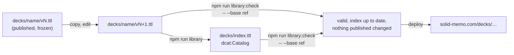
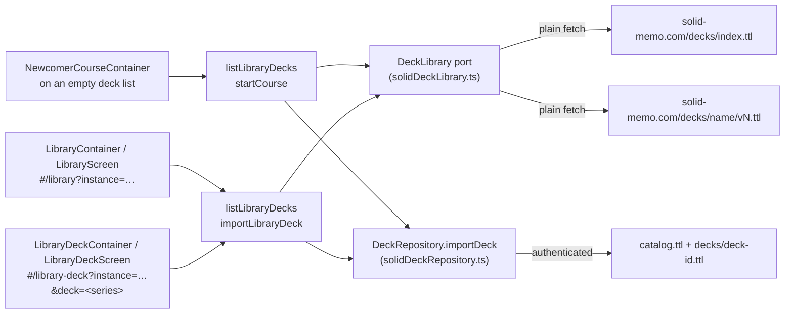
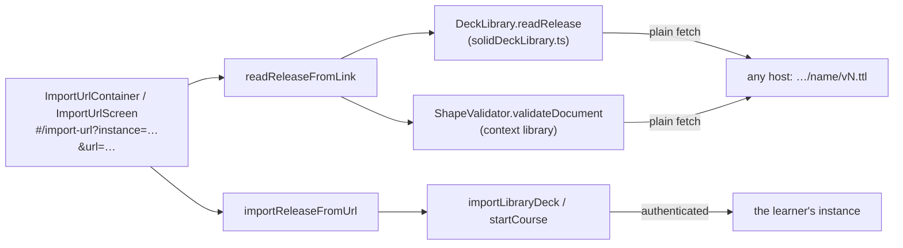

# Deck library

The deck library is the set of ready-made decks and
courses anyone can copy into their own instance. They are files in
this repository's `decks/` folder, published with the site and
described in DCAT, a standard catalog format other tools can read.
This page says how a deck version is written, checked and published,
and how the app lists, imports and adds one from a link.

Ready-made decks that any user can copy into their own instance. The
library lives in this repository's [`decks/`](../decks/) folder and is
published with the site, next to the app
([deployment.md](deployment.md)), at `https://solid-memo.com/decks/`.
It is described with [DCAT](https://www.w3.org/TR/vocab-dcat-3/) and
conforms to [DCAT-AP](validation.md#profiles-dcat-ap-and-skos): the
library is a `dcat:Catalog`, each deck a `dcat:DatasetSeries` of its
versions, each version a `dcat:Dataset` with its cards and a Turtle
`dcat:Distribution`.

| Path under `decks/` | IRI | What |
|---|---|---|
| `index.ttl` | `https://solid-memo.com/decks/index.ttl` | The catalog the app lists, generated from the versions and committed: each deck a series (`index.ttl#<name>`), its current version described in full but for its cards, how it was made and any email, the publisher `index.ttl#solid-memo`, and the [course for newcomers](#courses). |
| `<name>/v<N>.ttl` | `https://solid-memo.com/decks/<name>/v<N>.ttl` | Version `N` of a deck, frozen once published; its cards are fragments of it (`…/v1.ttl#sweden`). |

Nothing else is in `decks/`: no lock file, no sources, no scripts. A
deck's name is lower-case letters, digits and dashes; its versions run
`v1.ttl`, `v2.ttl`, … without gaps. Every IRI ends in `.ttl`, as the
vocabulary's and the shapes' do: GitHub Pages serves a `.ttl` file as
`text/turtle` but negotiates no content, so an address without the
extension would be a 404. Each file states its own address as its
`@base`.



## A version

A version is one `sm:Deck` (also a `dcat:Dataset`), the document
itself (`<>`), in library deck format 5 (`LibraryDeckV5`,
[shapes.md](shapes.md)) or, from vocabulary 1.18, format 6
(`LibraryDeckV6`, the same properties), with its cards as hash-fragment
subjects in card format 4, 5, 6 or 7. A version stays at the format it was
published in; a new one is written at format 6, its series and
publisher still in the index:

- **Title and description** are language-tagged, one per language, one
  of them English (the library's curation policy, so that anyone who
  reads English can read every deck). **Keywords** are tagged too,
  several per language. Title, description and keywords come in every
  language the app speaks (English, Swedish, Korean, German, Spanish and
  French): when the app gains a language, every deck gets a version that
  adds it. `LIBRARY_LANGUAGES` in
  [`curationRules.ts`](../packages/domain/src/release/curationRules.ts)
  takes them from `LOCALES` ([i18n.md](i18n.md)), and
  `npm run library:check` asks them of each deck's newest version
  ([Checks](#checks)). The app shows only the reader's keywords
  ([i18n.md](i18n.md#which-language)). **Topics** are `dcat:theme`s from
  [`ns/vocab/topics.ttl`](../ns/vocab/topics.ttl), next to `EDUC`
  (Education, culture and sport) from the European Union's
  [data theme table](https://op.europa.eu/en/web/eu-vocabularies/concept-scheme/-/resource?uri=http://publications.europa.eu/resource/authority/data-theme),
  its broad subjects for data sets; **languages** are EU
  authority-table IRIs described in
  [`ns/vocab/external.ttl`](../ns/vocab/external.ttl).
- **Creators** are `foaf:Agent` nodes of the document, with a name and
  no email; **licenses**
  are IRIs typed `dcterms:LicenseDocument`, and a version states at
  least one ([Checks](#checks)); the **sources** it was
  compiled from are `prov:wasDerivedFrom` IRIs, each a subject of its
  own with its title, creator and license.
- **The contact** is the project's issue tracker, not a person's email
  ([below](#contact)).
- **The release**: `dcat:version "N"`, `dcterms:issued`, one
  `adms:versionNotes` (a plain string: the shape allows one, untagged),
  `dcat:inSeries` and `dcat:isVersionOf` `<…/decks/index.ttl#<name>>`,
  `dcterms:publisher <…/decks/index.ttl#solid-memo>`, a
  `dcat:distribution <#turtle>` pointing at the file itself, and from
  version 2 `dcat:prev` and `dcat:previousVersion` `<…/<name>/v<N-1>.ttl>`.
- **A picture on a card is described** (`sm:frontImageDescription`,
  `sm:backImageDescription`) in English and in every other language the
  card's text is in, so a screen reader can say what it shows; without
  one it says only that there is a picture, and where the picture is the
  question the card cannot be studied without sight. The description
  says what a sighted learner sees and never gives the answer away: "Three
  vertical stripes, green, white and red", not the country.
  `npm run library:check` asks it of each deck's newest version
  ([Checks](#checks)).
- **A published card is never removed, but retired**: keep it and add
  `owl:deprecated true` (card format 3 and later). Copies of the deck
  keep it and its review history, but no longer study it; a later
  version can bring it back by leaving the flag out. `sm:cardCount` in
  the index counts the cards in use.
- **Text in a language written right to left** is tagged with its
  language like any other (`"كِتَاب"@ar`), with no bidi control
  characters: the app lays it out right to left from its tag
  ([i18n.md](i18n.md#text-in-the-users-languages)). The Arabic decks
  write their Arabic fully voweled and in NFC, which puts a vowel mark
  before a shadda on the same letter, whatever order it was typed in.

[`decks/greek-alphabet/v1.ttl`](../decks/greek-alphabet/v1.ttl) is a
small, complete example.

## Courses

A version may be a [course](courses.md): a deck whose cards are taught
in chapters of steps, each card asked as a multiple-choice question.
Beside what every version has, a course has:

- the extra type `schema:Course` on the release itself, and
  `sm:studyDirection sm:frontToBack`;
- its chapters (`sm:Chapter`, chapter format 1) and steps (`sm:Step`,
  step format 1), subjects of the release beside its cards;
- on each card it asks, `sm:distractor` links to its wrong options,
  `sm:Distractor` subjects (distractor format 1) of the release.

The index leaves the chapters, steps and distractors out, as it leaves
the cards out. It keeps the release's `schema:Course` type, so the app
can tell a course from a deck by the index alone (`LibraryDeck.isCourse`).
The app reads the outline from the release when the learner opens the
course. [`decks/solid-fundamentals/v1.ttl`](../decks/solid-fundamentals/v1.ttl)
is the first course, and the first release written in Markdown.

A course's chapters, steps and distractors are never removed, as its
cards are not: one that should go is retired (`owl:deprecated true`), so
the learners' decks that follow the course keep their place in it.

The index names at most one course for newcomers:
`<> sm:newcomerCourse <#name>` on the catalog, the series of a course
the app offers to someone with no decks yet
([courses.md](courses.md#the-course-for-newcomers)). It is library
configuration, not part of any release: `NEWCOMER_COURSE` in
[deckLibrary.ts](../packages/shacl/node/deckLibrary.ts) names the deck
(`io.newcomerCourse` in `main`, so its tests can name another), and
`undefined` names none (and retires the journey that expects an offer,
[courses.md](courses.md#the-course-for-newcomers)). The term belongs to no shape: `CatalogV1` does
not own it, and DCAT-AP ignores it.

## Contact

A version names the library's contact, the project's issue tracker, as
its `dcat:contactPoint`: a `vcard:Kind` node of the document, as
[DCAT-AP 3.0.1](https://semiceu.github.io/DCAT-AP/releases/3.0.1/)
describes one. It names no one's email: no subject states `foaf:mbox`.

```turtle
@prefix vcard: <http://www.w3.org/2006/vcard/ns#> .

<> dcat:contactPoint <#contact> .

<#contact>
    a vcard:Kind ;
    vcard:hasURL <https://github.com/solid-memo/website/issues> .
```

The versions published before this rule name the maintainer's email
instead (`foaf:mbox` on `<#anton-wiklund>`). They are frozen, so they
keep it; a deck's next version drops it. The index never repeats an
email, whichever version is current: `keptInIndex`
([seriesEntry.ts](../packages/domain/src/release/seriesEntry.ts)) leaves
out every `foaf:mbox`, and keeps the current version's contact. The
command checks the rule on every version new since `--base`
(`contactProblems`, [Checks](#checks)); `LIBRARY_CONTACT` in
[curationRules.ts](../packages/domain/src/release/curationRules.ts)
names the tracker. The Studio's release check for the library asks the
same of a draft (`repoPolicy`, [studio.md](studio.md#the-release-check)),
and its release screen writes the contact. A release in a pod
([studio.md](studio.md)) is the author's own and may name an email. The
app reads the contact's web page to say where a mistake in a release from a link is reported
([Reporting a mistake](#reporting-a-mistake)).

## Provenance

Each authored deck says how it was made, in
[PROV-O](https://www.w3.org/TR/prov-o/), inside its version file:

- The deck is `prov:wasGeneratedBy <#compilation>`, a `prov:Activity`
  with when it ended, the sources it `prov:used` and
  `prov:wasAssociatedWith <#anton-wiklund>`. Its first comments are the
  attribution, "Compiled by Anton Wiklund with the help of AI."@en and
  "Sammanställd av Anton Wiklund med hjälp av AI."@sv; the others say how
  the cards were selected, researched and checked, and on what grounds
  the deck may carry its license.
- The compilation `prov:wasInformedBy` its quality-control rounds,
  `<#review-0>`, `<#review-1>`, …: each a `prov:Activity` whose label
  names what it looked at (sources and licenses, facts, language, …)
  and whose comments give its scope and its outcome. Machine checks (the
  SHACL and DCAT-AP validators, checks against live Wikidata) are named
  as such.
- Each source has an `rdfs:comment` quoting the evidence for its
  license, and says whether the deck took content from it or used it to
  verify facts only.

The record is condensed from the working notes kept while a deck was
compiled; those notes' per-card evidence and queries are not part of
the library. The few decks that were not researched card by card
(generated from one source, such as the Swedish word decks and network
ports, or written directly, such as the capitals) describe their sources
and licenses, some the command that generated them, but have no review
rounds. The index leaves the
record out (every `rdfs:comment`, and the activities but for the
compilation's type, which DCAT-AP asks for); the app shows the deck's
sources and license on its page, and the version file has the rest.

## What a card is about

A card compiled from linked data names the thing it is about, by the
IRI its source gives it, as `dcterms:subject`:

```turtle
<#sweden>
    a solid-memo:Card ;
    dcterms:subject <http://www.wikidata.org/entity/Q34> ;
    …
```

So a later version can be made again from the source and checked
against it card by card, not by labels, which change; new languages can
be taken from the source's own labels; and the same thing can be found
in two decks. A card about several things names each.

- **The term.** `dcterms:subject` has no domain, so it fits a card.
  `schema:about` does not (its domain is a creative work), `owl:sameAs`
  would make the card *be* the thing, and `prov:wasDerivedFrom` already
  names, on a pod's deck, the release it came from.
- **The IRI** is the thing's, not a page about it: Wikidata's concept
  form, `http://www.wikidata.org/entity/Q34`, not
  `https://www.wikidata.org/wiki/Q34`. It is on one of the namespaces
  the library knows, `ABOUT_NAMESPACES` in
  [deckLibrary.ts](../packages/shacl/node/deckLibrary.ts): Wikidata's,
  the [labor market taxonomy's](#the-taxonomy-deck)
  (`http://data.jobtechdev.se/taxonomy/concept/`) and the
  Rijksmuseum collection's (`https://id.rijksmuseum.nl/`). `npm run library:check` names any other
  (`aboutProblems`, [Checks](#checks)); a deck compiled from another
  source adds its namespace there first.
- **What the source says of the thing** may follow the cards, as the
  thing's own statements: the taxonomy deck states, of a replaced
  concept, `dcterms:isReplacedBy` each concept that replaces it. The
  card's text still says it; the IRIs are for the tools.
- **The index leaves it out**, as it leaves the cards out: neither a
  card's `dcterms:subject` nor what the release says of the things the
  cards are about, unless the release names that thing as a source.
- **A learner's copy keeps the subjects** from card format 7 on, which
  names `dcterms:subject`: an import reads it from each card whatever
  format the release states (the taxonomy deck's cards are at format 4),
  and writes it on the copy's card, where every edit keeps it. A newer
  release that changes only subjects is offered to a copy as an upgrade
  of its own, which gives every card the release's subjects, and to a
  copy imported before card format 7, which lost them
  ([migrations.md](migrations.md#catching-up-with-the-library)). What the
  release says of the things themselves is not copied.
- **The app shows none of it yet**, and never fetches from these sources
  while someone studies. A Studio draft keeps it, as it keeps every
  triple of an imported release
  ([testing.md](testing.md#strategy-per-layer), the round trip).
- **A deck compiled from linked data keeps its IDs** from its next
  version on: the taxonomy deck, whose script writes them, and the
  decks compiled from Wikidata, such as `famous-paintings` and
  `capitals-of-the-world`, their QIDs.

## Publishing a new version

A published version is never edited or removed, only followed by the
next. To change a deck `<name>` whose latest version is `N`:

1. Copy `decks/<name>/v<N>.ttl` to `decks/<name>/v<N+1>.ttl` and edit
   the copy: cards (retire, never delete), texts, sources, provenance.
2. In the copy, change its `@base` to its own address
   (`…/<name>/v<N+1>.ttl`) and set
   - `dcat:version "<N+1>"`,
   - `dcat:prev` and `dcat:previousVersion` `<https://solid-memo.com/decks/<name>/v<N>.ttl>`,
   - `dcterms:issued` to the release time, and `dcterms:modified` if the
     deck has it,
   - `adms:versionNotes` to what changed, in one string,
   - the [contact](#contact): `dcat:contactPoint <#contact>` and its
     `vcard:Kind` node, and no `foaf:mbox` (an agent copied from a
     version published before the rule has one: remove it).
3. `npm run format:turtle`, then `npm run library`, which validates the
   library and writes `decks/index.ttl` (the new version becomes the
   series' `dcat:last` and current version). Then
   `npm run library:check -- --base origin/main`, which checks the
   contact of every version new since `origin/main`.
4. Look at it: `npm run dev` serves the working tree's `decks/`, so the
   library screen lists the new version and offers it to copies of the
   old one ([migrations.md](migrations.md#catching-up-with-the-library)).
5. Commit the new version and the index together, as a `feat(decks)`
   commit ([CONTRIBUTING.md](../CONTRIBUTING.md#commit-messages)). The
   release it makes publishes them, once deployed
   ([deployment.md](deployment.md)).

A new deck is the same with `decks/<name>/v1.ttl`, without `dcat:prev`
and `dcat:previousVersion`, its notes "First release.". It is also
listed in [REUSE.toml](../REUSE.toml) under the license its
`dcterms:license` names, as `"decks/<name>/*.ttl"`, and a version that
changes the deck's license moves it there to the license's own
annotation, or names that version alone. `npm run check:reuse` fails
until it agrees ([style.md](style.md#licenses)).

**Text over several lines.** `npm run format:turtle` writes a literal
whose text has a line feed as a long string, `"""…"""` with its language
tag, its lines verbatim and never indented (leading spaces can matter).
A backslash and every control character but a tab or a line feed are
escaped (a carriage return as `\r`), and so is any quote that would end
or run into a delimiter, so the text reads back the same. Every other
literal stays on one line.

## The taxonomy deck

The deck of new and changed Swedish occupation names,
[`swedish-labour-market-taxonomy-occupation-names`](../decks/swedish-labour-market-taxonomy-occupation-names/),
is generated, not written: one version per version of the labor market
taxonomy of Arbetsförmedlingen, the Swedish Public Employment Service,
which its JobTech taxonomy API serves under CC0 1.0, as the deck is.
[scripts/taxonomy_deck.py](../scripts/taxonomy_deck.py) makes it, with
Python's standard library alone. Its docstring says which names become
cards, and why, and how it handles the taxonomy's inconsistencies.

The script reads the deck's newest version, `v<N>.ttl`, and writes
`v<N+1>.ttl` beside it, covering every taxonomy version up to the newest
(or `--to`). From `v<N>.ttl` it carries over, verbatim, what it cannot
make itself: the title, description and keywords in every language of
the app, the creator's name (never an email), and the review rounds
that made those texts, by which the new version's `<#generation>` is
`prov:wasInformedBy`. It keeps every card of `v<N>.ttl`, and retires one
that no rule makes any longer. It writes the rest of what
[a new version](#publishing-a-new-version) needs: `dcat:version`,
`dcat:prev` and `dcat:previousVersion`, `dcterms:issued` (`--issued`,
by default today in UTC), the version notes, the publisher, the series,
the [contact](#contact) and the Turtle distribution.

Each card names the taxonomy concepts it is about, as
`dcterms:subject <http://data.jobtechdev.se/taxonomy/concept/<id>>`
([What a card is about](#what-a-card-is-about)): an outdated name the
concepts that had it, a new name the live concepts that have it. A
replaced concept, after the cards, `dcterms:isReplacedBy` the concepts
its card's back names, which keeps their names. A retired card keeps the
subjects it was published with. A run may cover the same taxonomy
versions as `v<N>.ttl` when the script now writes something else of
them, and refuses when the cards would come out the same.

A version is reproducible. Its [provenance](#provenance) records the
script at the commit it ran from, with its SHA-256 and the Python and
Unicode versions, the command line, and every taxonomy version read,
with the query that fetched it and a checksum of the answer. Running
that command at that commit makes the version again, byte for byte. So
the script refuses to run unless it is committed and unmodified
(`--allow-uncommitted` writes a draft), and stops when a taxonomy
version the deck records no longer matches its checksum.

- `--check` writes nothing, and prints the newest taxonomy version, the
  newest one the deck covers, whether there is a version to add, and
  the deck version that would hold it, as `key=value` lines.
- `--verify` writes nothing, makes the cards of the deck's newest
  version again from the taxonomy versions it records, and fails unless
  they come out byte for byte the same.

To make a version by hand, from the repository root on an up-to-date
`main`:

```sh
python3 scripts/taxonomy_deck.py --verify --cache-dir ~/.cache/taxonomy
python3 scripts/taxonomy_deck.py --cache-dir ~/.cache/taxonomy
npm run format:turtle
npm run library
npm run library:check -- --base origin/main
```

The script prints what it included, left out and adjusted, then the
version notes. Commit the new version with the index as a
`feat(decks)` commit that names its issue
([CONTRIBUTING.md](../CONTRIBUTING.md#commit-messages)), as for
[any new version](#publishing-a-new-version).

The [Taxonomy workflow](../.github/workflows/taxonomy.yml) does this
every Monday, and by hand (Actions › Taxonomy › Run workflow). Its
`check` job runs `--check`. When the taxonomy has a version the deck
lacks, its `update` job runs `--verify`, makes the next version, and
checks it as CI's `library` and `crosscheck` jobs do. Only then does it
open the issue "Taxonomy version N is out" (label `deck`), unless one is
open already, and push a commit to the branch `taxonomy-deck` that
closes it, and the issues of earlier taxonomy versions still open, with
`Closes:` lines. It opens a pull request from that branch, or updates
the one already open. A pull request already open for the newest
taxonomy version is left alone: merge it, or close it to have it made
again. Nothing merges it on its own. Once it is merged through the merge
queue ([testing.md](testing.md#the-merge-queue)), the next release
publishes the version, as it does any other. When a job fails, the
`failed` job opens the issue "The weekly taxonomy deck update failed",
or comments on the one open, with a link to the run.

### The taxonomy app

The `update` job pushes and opens the pull request with the token of a
GitHub App, not the workflow's own. A pull request opened with the
workflow's token starts no workflow, so CI would never run on it,
`ci-ok` would never report, and it could not be merged. The App's token
starts workflows as anyone's does. Only this workflow can use it: the
App's private key is a secret of the `labour-market-deck` environment,
which allows only `main`, as the [deploy key](releasing.md#the-deploy-key)'s
environment does.

A maintainer sets it up once:

1. Make a GitHub App owned by the `solid-memo` organization
   (Organization settings › Developer settings › GitHub Apps › New
   GitHub App), named `solid-memo-labour-market-deck`, with no webhook ("Active" unchecked), and the
   repository permissions Contents, Issues and Pull requests, each
   "Read and write" (Metadata "Read" comes with them), and no other.
2. Install it on `solid-memo/website` alone ("Only select
   repositories").
3. Generate a private key in the App's settings.
4. Make the environment `labour-market-deck` (Settings › Environments
   › New environment), or open it if a run has made it already: GitHub
   makes it, with no rule, when a job first names it. Under "Deployment
   branches and tags", choose "Selected branches and tags" and add the
   branch `main`, and nothing else. Add the App's client ID as its
   environment variable `LABOUR_MARKET_DECK_CLIENT_ID`, and the private
   key as its environment secret `LABOUR_MARKET_DECK_PRIVATE_KEY`. Then
   delete the key's file, and leave no repository variable or secret of
   either name: a job whose environment lacks one reads the
   repository's.

The job makes the token only after the script and the checks have run,
for the steps that open the issue, push and open the pull request, and
the token lasts an hour. The App needs no bypass of the ruleset on
`main`: it pushes only the branch `taxonomy-deck`. Until the App is set
up, the `update` job fails at the step that makes the token, and the
failure issue links that run. To change the key, generate a new one in
the App's settings, replace the environment's secret, then delete the
old key there.

## Authoring Markdown

A card, a course step or a chapter may be written in Markdown
([markdown.md](markdown.md)): CommonMark with pipe tables, for code,
tables and lists. Text is plain unless its subject says otherwise, so
a release that says nothing reads exactly as before.

- **The marker.** State `solid-memo:textFormat solid-memo:markdown` on
  each card, step and chapter written in it, and on nothing else
  ([vocab.md](vocab.md#text-formats)). On a card it covers its sides,
  notes and labels, and its distractors' text and notes, which carry no
  marker of their own; on a step its theory; on a chapter its
  description, never its title. A picture's description, a deck's title,
  description and keywords, and the version notes are always plain.
- **One marker per subject, not per deck.** A card copied alone keeps
  its meaning. Mark only what needs Markdown: a card whose text is plain
  stays unmarked.
- **Several lines** are a Turtle long string, `"""…"""@en`, which
  `npm run format:turtle` writes with its lines verbatim and never
  indented, as a code block needs ([above](#publishing-a-new-version)).
- **Each language is its own document.** A code block in `@en` text
  stays `@en`; a back that is code alone may be untagged or `@zxx`, its
  distractors' text then the same.
- **A step's theory may be in chunks**, read one at a time: a
  thematic break (`---`) at the top level, with a blank line before
  and after it, ends one and begins the next
  ([courses.md](courses.md#writing-a-course)). Anywhere else a break
  shows as a rule.
- **Plain-text habits read otherwise in Markdown**: `<url>` is raw HTML,
  `&aring;` is "å", `*` and `_` may emphasize, `<ex:title>` is a link.
  Write such text as code (`` `git clone <url>` ``).
- **A published version is never marked afterward.** A deck takes
  Markdown in its next version; the library upgrade brings the marker
  to the copies ([migrations.md](migrations.md#catching-up-with-the-library)).

```turtle
<#q-staged> a solid-memo:Card ;
    solid-memo:formatVersion 5 ;
    solid-memo:textFormat solid-memo:markdown ;
    solid-memo:front "Which Git command shows **staged** changes?"@en ;
    solid-memo:back "`git diff --staged`"@zxx ;
    solid-memo:backNote """Without `--staged`, `git diff` compares the working tree with the index:

| Command | Compares |
|---|---|
| `git diff` | working tree and index |
| `git diff --staged` | index and `HEAD` |"""@en .
```

`npm run library` checks what is written in Markdown by the
[Markdown rules](#markdown-rules).

## Checks

[`packages/shacl/node/deckLibrary.ts`](../packages/shacl/node/deckLibrary.ts)
is both commands. `npm run library` writes the index;
`npm run library:check` writes nothing and fails when the index is not
what the versions make. Both check:

- the layout: nothing but `index.ttl` and `<name>/v<N>.ttl`, the names
  plain, the versions running from 1 without gaps;
- each version's metadata against its path: `@base`, the one deck being
  the document itself, `dcat:version`, series, publisher, and
  `dcat:prev` / `dcat:previousVersion` naming the version before (none
  for version 1);
- that each version states its license (`noLicense`): at least one
  `dcterms:license` IRI, so a reader knows how the deck may be reused.
  The shapes allow a deck without one, and a published shape is never
  edited, so this is a library rule, in `metadataProblems`
  ([`libraryRules.ts`](../packages/domain/src/release/libraryRules.ts)).
  Every published version states one, so the rule holds new versions
  to what the library already does. The Studio's check for the library
  names it too;
- that no version drops a card, chapter, step or distractor of the one
  before it, or gives one's id to another kind of subject (a step's id
  to a chapter);
- that each deck's newest version has a title, a description and
  keywords in every language the app speaks (`languageProblems`, by
  `LIBRARY_LANGUAGES` in
  [`curationRules.ts`](../packages/domain/src/release/curationRules.ts)).
  The shapes ask only for English, and a published shape is never
  edited, so this is a library rule. Only the newest version is held to
  it: when the app gains a language, every deck fails until a new
  version adds it, while the versions before stay frozen. The Studio's
  check for the library asks the same of a draft (`repoPolicy`);
- that each picture on a card of a deck's newest version is described
  in English and in every other language the card's text is in, by its
  primary subtag (`missingImageDescription`, by `LIBRARY_LANGUAGES`
  too): text in `sv-se` asks a description in `sv`, and untagged text
  asks none. It is a library rule for the same reason, held to the
  newest version alone, and the Studio's check for the library asks it
  of a draft too;
- a course's outline, by the [course rules](#course-rules);
- the index's course for newcomers (`newcomerProblems`): at most one, an
  IRI, a deck of the library (one of the catalog's `dcat:dataset`s),
  whose current release is a `schema:Course`. `buildIndex` writes the
  name even when there is no such deck, so a typo in `NEWCOMER_COURSE`
  is reported, not dropped;
- text in Markdown, by the [Markdown rules](#markdown-rules);
- what each card is about (`aboutProblems`): every `dcterms:subject`
  of a card an IRI on one of `ABOUT_NAMESPACES`
  ([What a card is about](#what-a-card-is-about)). No published version
  states one that is not, so the rule holds every version;
- every literal of a version and of the index in Unicode normalization
  form C, composed (`normalizationProblems`): "é" not written as "e"
  and a combining accent, nor "사람" as five jamo, as text copied from a
  macOS file name or a PDF may be. Such text looks the same but is not
  the same text; the problem names the first character that composes
  differently, by its code points;
- every version and the index against Solid Memo's shapes, DCAT-AP (a
  version with the index beside it) and SKOS, with the reference data.

### Where the rules live

The rules that read a release's data live in the domain, in
[`packages/domain/src/release/`](../packages/domain/src/release/), so
the Studio can run them in the browser as the command does:

| File | What |
|---|---|
| `releaseModel.ts` | A release as plain data: its metadata, every card, chapter, step and distractor (retired ones too), how it was made. |
| `problems.ts` | `ReleaseProblem`: a code, a severity, the subject and field it is in, and what it needs to be worded. No text. |
| `libraryRules.ts` | The layout and each version's metadata against its place. |
| `continuityRules.ts` | A version against the one before it. |
| `courseRules.ts` | The [course rules](#course-rules); and what a release needs that its draft may lack (`readinessProblems`), which the Studio's check adds. |
| `markdownFields.ts` | Which fields are Markdown, and by which rule; the check itself is passed in, since the domain reads no Markdown. |
| `curationRules.ts` | A `LibraryPolicy`: what a library asks beyond the data. `repoPolicy` asks a title, description and keywords in every language the app speaks and each picture on a card described (`LIBRARY_LANGUAGES`, from `LOCALES`) and the theme `EDUC`; `podPolicy` asks nothing. |
| `seriesEntry.ts` | What the index says of a deck. |
| `releaseCheck.ts` | The Studio's release check: the rules a policy runs, where a library publishes a release (`libraryReleaseUrl`, `librarySeriesUrl`, which this command uses too), and where each problem is fixed. |
| `draftModel.ts` | A Studio draft as a release model, at its own address or another. |

The command builds each release's model from its quads
([`quadsToReleaseModel.ts`](../packages/shacl/node/quadsToReleaseModel.ts)),
words each problem in English
([`releaseMessages.ts`](../packages/shacl/node/releaseMessages.ts)), and
checks itself what only the text or the shapes can: `@base`, Turtle
syntax, the shapes and the profiles. It does not run the curation
rules: `LibraryDeckV5` and `LibraryDeckV6` state English and `EDUC` for this library. Nor
does it name a version that is not the one before it plus one
(`versionNotNext`): here the path fixes each version, and the metadata
check names one other than its path says. A golden test
([`deckLibrary.golden.test.ts`](../packages/shacl/node/deckLibrary.golden.test.ts))
keeps what the rules say of published releases with faults put in.

### Course rules

`courseProblems` (`courseRules.ts`) checks what the shapes cannot say
about a course. It runs on every version, and finds nothing in a plain
deck:

- A release with chapters or steps is typed `schema:Course`, and a
  course has at least one chapter. It studies `sm:frontToBack`.
- A chapter is part of the release it is in (`schema:isPartOf <>`), and
  a step is part of a chapter of the release.
- Chapters each have their own `schema:position`, and so do the steps of
  one chapter.
- Each card named by `sm:checkedBy` or `sm:reviewQuestion` is a card of
  the release, and not a retired one. A retired step or chapter may
  still name a retired card, so a card can be retired without editing
  the step that checked it.
- A card is checked by one step at most, and is either checked by a step
  or a review question of a chapter, never both.
- A card a step or chapter in use asks has text on its back (the right
  option) and at least two distractors in use. Each of those has text in
  every language of the back, exactly: an untagged back needs untagged
  distractor text, a `zxx` back `zxx` text.
- A chapter in use has at least one step in use.
- Every `sm:distractor` link, in any release, names a `sm:Distractor` of
  the release, and no two cards name the same one: a copy writes and
  removes a card's distractors with the card.

Retired steps and chapters do not count toward the rules on positions
or on how a card is asked.

### Markdown rules

`markdownProblems` (`markdownFields.ts`, with the markdown package's
check) checks, field by field, the text of every card, step and
chapter that states `sm:textFormat sm:markdown`, by the
[rules for a release](markdown.md#rules-for-a-release). In short:

- no raw HTML and no pictures;
- no link in a card's `front`, `back`, `frontLabel` or `backLabel`, or in a
  `distractorText`, an autolink (`<ex:title>`, `<http://…>`) included;
  elsewhere only links the app follows (`https:`, without a user name
  or password), whose text, when it reads as an address or a host
  name, names the very host the link leads to, give or take a `www.`
  (not a domain it is in, such as `github.io`). Any dotted word ending
  in letters reads as a host name: "Node.js", and file names such as
  `package.json`, `v1.ttl` or `README.md`, even as code, so word such
  link text otherwise;
- no bidi control, zero-width or other hidden character in code or a link (docs/markdown.md lists them);
- no character reference (`&aring;`) outside code;
- no heading underlined with dashes, a line of text with `---` right
  under it, which looks like the text and a thematic break: leave a
  blank line before the break, or write the heading with `##`;
- on a card with distractors, its `back` and each `distractorText` one
  paragraph, not a heading, as options are;
- a step's theory with no empty [chunk](markdown.md#chunks) (a
  top-level thematic break first, last or right after another), and in
  as many chunks in each language, so a learner who switches language
  keeps their place;
- nothing past the limits the app reads Markdown within: 20,000
  characters, 8 levels of blocks and markup (each quote, list item,
  paragraph, emphasis and link is one; plain text that shows as written
  anyway passes), a table of 20 columns or 2,000 cells.

It also checks that only a card, a step or a chapter states
`sm:textFormat` (a distractor's text is written as its card's, and any
other subject's is plain), and
only a concept of `sm:TextFormats`. A text not marked is not checked:
plain text is shown as written.

None of this is what keeps the app safe, which shows any text safely
([markdown.md](markdown.md#safety)): it is that the text shows as its
author meant.

With `-- --base <git ref>` they also compare with the library at that
commit: a version published there that is gone or differs by a byte
fails, and so does a version not published there that states
`foaf:mbox` or lacks the library's [contact](#contact)
(`contactProblems`). Without a base nothing tells a new version from a
published one, so that rule does not run. `npm run check` runs
`library:check` without a base, as a Turbo task of the shacl package
([turbo.json](../packages/shacl/turbo.json)), cached until a file it
reads (`ns/`, `decks/`, its packages' code) changes. CI's `check` job
runs `npm run check:ci`, which leaves it out, since the `library` job
checks the same and more. CI's `library`
job ([ci.yml](../.github/workflows/ci.yml),
[testing.md](testing.md#continuous-integration)) passes a base, on pull
requests, in the merge queue and on pushes to the default branch, not on
other branches' pushes, so a pull request's commits are checked once per
push; `ci-ok` waits for it like every other job. On a push to the default
branch it passes the commit the push moved it from; in the merge queue,
the commit of the default branch the queue built on
([testing.md](testing.md#the-merge-queue)); on a pull request, the
commit where the change left the default branch, so an edit to a published version is caught
before it is merged, while a version not merged yet can still be fixed.
A branch with no pull request is not compared; open one, or check it
locally before pushing:

```sh
npm run library:check -- --base origin/main
```

pySHACL checks the index and every version against DCAT-AP once more
([validation.md](validation.md#the-ci-cross-check)), and
[libraryReleases.test.ts](../packages/solid/src/libraryReleases.test.ts)
reads every version as the app does, its cards and a course's outline
([testing.md](testing.md#strategy-per-layer)).

## Reading it

It is public, so the app reads it with a plain `fetch`, without logging
in. [appUseCases.ts](../packages/composition/src/appUseCases.ts) names
the index; during `npm run dev` and `npm start` the site's own
addresses are read from the local server (`siteFetch`), so the working
tree's library is what the app shows. `VITE_LIBRARY_INDEX_URL` names
another index at build time ([configuration.md](configuration.md)):

```sh
VITE_LIBRARY_INDEX_URL=https://example.org/decks/index.ttl npm run dev
```

The index is read once a page
([solidDeckLibrary.ts](../packages/solid/src/solidDeckLibrary.ts)): the
deck list, the upgrade offers, the Studio's update badges and a
release's place all share that one read, and its decks are made of it
once too. It comes with the site, or from `VITE_LIBRARY_INDEX_URL` at
build time, so it changes only with a deploy, and a page's lifetime is
a safe scope. A failed read is not kept, so the next one tries again.
Each release is kept the same way.

The library conforms to the shapes in [shapes.md](shapes.md):
`CatalogV1`, `LibraryDeckSeriesV3`, and `LibraryDeckV5` or
`LibraryDeckV6`, each release against its own format's shape. The app
migrates a format-5 release to format 6 in memory.

## A release outside the library

A release need not be in `decks/`: from library deck format 6, one
Turtle document anywhere (a release published in a pod) is whole
without an index. Beside the release and its cards, the document then
describes:

- its **series**, the subject `dcat:inSeries` and `dcat:isVersionOf`
  name: a `dcat:DatasetSeries` and `dcat:Dataset` in library deck series
  format 3, with its title, description, publisher, first, last,
  current and every version, as the index describes a deck;
- its **publisher**, the `dcterms:publisher` of the release and the
  series: a `foaf:Agent` with its name;
- each **earlier version** the series lists, as a `dcat:Dataset` with
  its title, description and version, so DCAT-AP finds every version
  described.

The same shapes check it (`LibraryDeckV6`, `LibraryDeckSeriesV3`,
`AgentV1`), and DCAT-AP accepts it with only the reference data beside
it ([`library-deck/v6/valid`](../packages/vocab/fixtures/library-deck/v6/valid/)
is an example, which `npm run crosscheck` checks too). Nothing in the
data says who may publish one, and the app reads its content as any release's (`toLibraryDeckContent`).

Such a release is made from a draft in the creator's pod
([studio.md](studio.md#drafts)): every subject of the draft moved to the
release's address, `@base` that address, its release and change time
set, at library deck format 6. A series the draft starts (its own
`<#series>`) is described in it, the release its first, last and
current version; a series an earlier release described goes on being
described, the release added as its last and current version; a series
an index describes, as this library's, is left to the index. The next
version of such a release describes it, though: the draft copies from
the index its series, its publisher and its earlier versions
(`readLinked`, `linkedDescription`), so the release it makes is whole
too. So a release downloaded for `decks/` from a next version carries
the index's statements of its series, publisher and earlier versions.
Only what a release needs is copied: of the series, what an index says
of one; of a publisher, its class and name. Every
release in `decks/` made a draft and published again comes back as it
was, apart from what publishing sets (a test of its own,
[testing.md](testing.md#strategy-per-layer)).

## In the app



- `toLibraryDecks` ([libraryMapper.ts](../packages/solid/src/mappers/libraryMapper.ts))
  reads the catalog's datasets, each series' current release (through
  the `LibraryDeckSeriesV3` and `LibraryDeckV6` shapes, older formats
  migrated in memory) and its releases, showing the English title and
  description and keeping the other languages, which an import copies
  as they are (every tag, nothing guessed or added), and names creators
  from the agents in the index. An import writes the user's copy at the
  latest formats (deck format 6, card format 7), whatever format the
  release was frozen at: a release's keywords keep their tags, and a
  format-4 release's untagged keywords stay untagged, their language
  unknown. A series or release
  that does not fit its shape is left out.
- The library screen lists each deck's name and card count with a
  checkbox, filtered by **topic** (checkboxes of the topics the decks
  name, a broader topic finding the narrower: "Languages" finds the
  Swedish decks) and by a **search** of names, descriptions and keywords,
  in every language (`filterLibraryDecks` in [domain/library.ts](../packages/domain/src/library.ts)).
  The search ignores case and Unicode form: query and text are compared
  composed (NFC), so "사람" or "é" pasted decomposed (NFD), as macOS
  file names and some PDFs hold text, still finds the deck; and Arabic
  is compared without its vowel marks, so "كتاب" finds "كِتَاب"
  (`matchesQuery` in [domain/search.ts](../packages/domain/src/search.ts), `arabicFolded` in [domain/langText.ts](../packages/domain/src/langText.ts)).
  The Browser's card search ignores every diacritic (`folded`), Arabic's
  the same way.
  Clicking a row opens the deck's page: description, topics, keywords
  in the reader's language,
  the release (version, date, notes), authors, license, dates and
  sources, an import button, "Browse cards" (a read-only, paged list
  fetched from the release document) and "Copy link", which copies a
  link to the deck that names no instance, for anyone to open
  ([routing.md](routing.md#a-link-to-a-library-deck)).
- A deck's page is addressed by its **series** (`&deck=…/index.ttl#name`),
  which outlives releases; an address of one of its releases still finds
  it. A deck the library does not have falls back to the library
  ([routing.md](routing.md)).
- `importDeck` copies the current release into the instance with **one
  write of the cards document** (all 243 cards of the capitals deck in a
  single PUT), then one write of the catalog, and carries over the
  description, authors (as agents), license, topics, keywords and
  direction. The copy says which release it came from with
  `prov:wasDerivedFrom <…/decks/name/vN.ttl>` (`Deck.sourceUrl`). Cards
  keep their library fragment ids (`#sweden`).
- A pod deck is a copy of a library deck when its source is any version
  of the deck's series (`isCopyOf`); the library marks such decks
  "Already imported". A second copy is still allowed.
- The copy is written in this app's own format, whatever the release
  said. A release or card in a *newer* format than the app writes is
  refused at import rather than silently stripped.
- Several decks can be checked and imported at once, one at a time; a
  failure part-way leaves the earlier ones imported and reports the error.
- A course is started rather than imported (the list offers no checkbox for
  it, only its page): its copy starts with no
  cards, and a card joins it when its question is answered
  ([courses.md](courses.md)).
- The course the index names for newcomers is `LibraryDeck.forNewcomers`
  (`toLibraryDecks` flags it only when it is a course). An instance with
  no decks is offered it under its deck list's heading, started in one
  click ([courses.md](courses.md#the-course-for-newcomers)).
- When the library publishes a newer release of an imported deck, the
  deck's page offers to update the copy card by card, keeping what the
  user changed and their review history
  ([migrations.md](migrations.md#catching-up-with-the-library)). The
  deck list says "New release" after the copy's name, so the offer is
  not missed by a learner who studies from the list. The list and the
  offer read the index once a page, as every reader of it does
  ([Reading it](#reading-it)).

### From a link

A deck or a course published anywhere, a [release outside the
library](#a-release-outside-the-library) in its creator's pod say, is
added by its address: **Add from a link**, on the deck list and the
library, opens `#/import-url` ([routing.md](routing.md)). Nothing about
it is special to one creator, host or series: any release this app can
read is added the same way.



- The learner pastes the link. It must be an http(s) address of a
  document, with no fragment (`releaseUrlOf`). It goes into the URL as
  the URL standard writes it, a host in capitals or a default port
  aside, so Back and a bookmark work and the copy names its release one
  way.
- `readReleaseFromLink` reads the document with no index
  (`DeckLibrary.readRelease`, `toStandaloneLibraryDeck` in
  [libraryMapper.ts](../packages/solid/src/mappers/libraryMapper.ts)):
  its deck, its cards counted, its creators and license, and its series
  with every version the document describes (format 6 describes it in
  the release; a `decks/` release at an older format lists only
  itself). It is read afresh each time, never kept: an address may hold
  anything, now or later.
- The same read is checked against the library's shapes, as anyone reads
  it, with no login sent (`validateDocument(url, "library")`). A subject
  that breaks its shape refuses the release (`releaseNotConforming`);
  warnings do not. A release in a newer format than the app reads is
  refused as the library's are.
- The screen shows the release as the library's page does, with where
  it is published (its host) and whether it is a deck or a course, and
  says it is not the library's. Its text is shown as the library's is,
  any link through `ExternalLink`; its cards and a course's theory, once
  added, are shown with Markdown's [safety limits](markdown.md), as any
  data is. There is no card list or preview.
- `importReleaseFromUrl` then imports a deck (`importLibraryDeck`) or
  starts a course (`startCourse`). The copy names its release with
  `prov:wasDerivedFrom <url>`, as a library copy does. Nothing is ever
  written to the release's host: every write goes to the learner's
  instance, checked as every write is.
- A copy whose series the library's index does not list is a copy from
  a link (`useCopies` in
  [deckTreeEditor.ts](../packages/ui/src/ui/deckTreeEditor.ts)). The
  deck list says "from \<host>" after its name, and the Studio's Home a
  "From \<host>" badge. A course's deck says it is one (`schema:Course`
  on its catalog entry, [courses.md](courses.md#the-learners-state)),
  so its release is not read to tell; any other copy's own release is
  read, once, to tell a course copied before decks said so.
- **Newer versions.** No index lists the versions of a release from a
  link. The creator's catalog may: it links what its instance
  published (`sm:publishedRelease`, [data-model.md](data-model.md)).
  `DeckLibrary.publishedBeside` looks for it in the folders above the
  release, nearest first, as anyone reads them, and takes the first
  catalog that links the release. Each release it links is read, but
  those the copy's release lists, which are no newer, and the newest of
  the same series is the copy's upgrade (`listLibraryUpdates`,
  `planLibraryUpgrade`, the Studio's
  [library copies](studio.md#library-copies)). `listLibraryUpdates`
  reads each release once for all the copies. An instance's catalog
  is private unless its owner shares it; then whether a newer version is
  out is unknown, and the Studio says so.
- An upgrade from a link reads releases no index lists. Before it is
  planned, the newer release and each one in between are checked against
  the library's shapes, as the first was (`checkLinkedRelease`); one
  that breaks them refuses the upgrade (`releaseNotConforming`).

### Reporting a mistake

A learner who sees a wrong card reports it from where they see it:
**Report a mistake** is under a library card's page, a library deck's
page, a release's page from a link, and each card studied from a copy
that its release has (`ReportMistake` in [ReportMistake.tsx](../packages/ui/src/ui/ReportMistake.tsx)).
A card the learner added to their copy is theirs to fix, and has no
link.
The review of a version checks its form, not its facts
([CONTRIBUTING.md](../CONTRIBUTING.md)), so these reports are how the
library's mistakes are found. Where the link leads is
`mistakeReportUrl` ([mistakeReport.ts](../packages/domain/src/mistakeReport.ts)),
from the release, the card's fragment and where the release is
reported (`ReportPlace`):

- **A library release**, one the index lists (`reportPlace`), whatever
  [contact](#contact) its version names and however it was reached,
  from the library or from a link: the deck form
  (`.github/ISSUE_TEMPLATE/deck.yml`) of the repository the site runs
  (`VITE_REPO_URL`, [configuration.md](configuration.md)), at
  `issues/new?template=deck.yml`, its fields filled in from the query:
  `deck` the release's address, `details` the card's (`Card:
  <release>#<id>`) and a line asking what is wrong. GitHub fills in
  text fields from the query, not a dropdown, so "What is it" is left
  to the learner.
- **A release from a link**: the web page its contact names
  (`dcat:contactPoint`'s `vcard:hasURL`, read with the release as
  `LibraryDeckContent.contact`), as it is: no one knows its form to
  fill in. With none, or only an email, there is no link: the library's
  tracker is not the place to report someone else's deck.
- **A deck the learner wrote**, with no release, has no link, nor has
  a Studio [trial](studio.md#the-trial): the draft is the author's own
  (`createTrialUseCases`).
