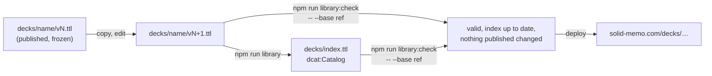
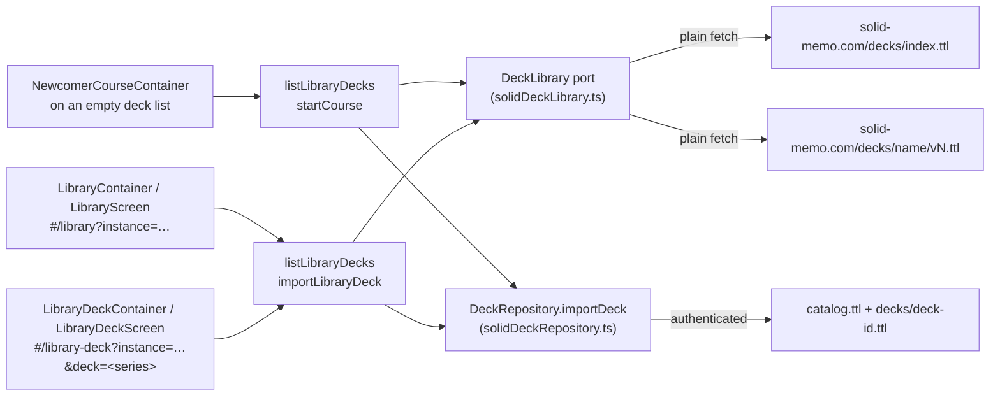
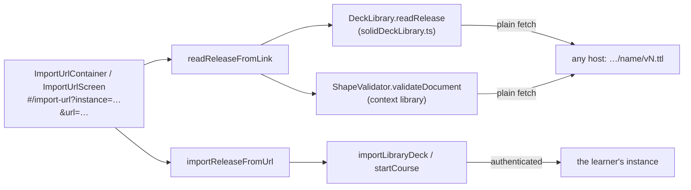

# Deck library

The deck library is the set of ready-made decks and courses anyone can
copy into their own instance: this repository's [`decks/`](../decks/)
folder, published with the site, next to the app
([deployment.md](deployment.md)), at `https://solid-memo.com/decks/`.
This page covers writing, checking and publishing a deck version, and
how the app lists, imports and adds one from a link. The library is a
[DCAT](https://www.w3.org/TR/vocab-dcat-3/) `dcat:Catalog` conforming to
[DCAT-AP](validation.md#profiles-dcat-ap-and-skos): each deck a
`dcat:DatasetSeries` of its versions, each version a `dcat:Dataset` with
its cards and a Turtle `dcat:Distribution`.

| Path under `decks/` | IRI | What |
|---|---|---|
| `index.ttl` | `https://solid-memo.com/decks/index.ttl` | The catalog the app lists, generated from the versions and committed: each deck a series (`index.ttl#<name>`), its current version in full but for its cards, how it was made and any email, the publisher `index.ttl#solid-memo`, and the [course for newcomers](#courses). |
| `<name>/v<N>.ttl` | `https://solid-memo.com/decks/<name>/v<N>.ttl` | Version `N` of a deck, frozen once published; its cards are fragments of it (`…/v1.ttl#sweden`). |

Nothing else is in `decks/` (no lock file, sources or scripts). A
deck's name is lower-case letters, digits and dashes, and its versions
run `v1.ttl`, `v2.ttl`, … without gaps. Every IRI ends in `.ttl`, as
the vocabulary's and the shapes' do: GitHub Pages serves a `.ttl` file
as `text/turtle` but negotiates no content, so an address without the
extension is a 404. Each file states its own address as its `@base`.



## A version

A version is one `sm:Deck` and `dcat:Dataset`, the document (`<>`), in
library deck format 5 (`LibraryDeckV5`, [shapes.md](shapes.md)) or,
from vocabulary 1.18, format 6 (`LibraryDeckV6`, the same properties),
with cards as hash-fragment subjects in card format 4, 5, 6 or 7. A
version stays at its published format; a new one is written at format
6, its series and publisher still in the index:

- **Title and description** are language-tagged, one per language, one
  of them English; **keywords** too, several per language. All three
  come in every app language (English, Swedish, Korean, German, Spanish
  and French), so a new app language means a new version of every deck.
  `LIBRARY_LANGUAGES` in
  [`curationRules.ts`](../packages/domain/src/release/curationRules.ts)
  takes them from `LOCALES` ([i18n.md](i18n.md)), and
  `npm run library:check` asks them of each deck's newest version
  ([Checks](#checks)). The app shows only the reader's keywords
  ([i18n.md](i18n.md#which-language)). **Topics** are `dcat:theme`s from
  [`ns/vocab/topics.ttl`](../ns/vocab/topics.ttl), and `EDUC`
  (Education, culture and sport) from the EU's
  [data theme table](https://op.europa.eu/en/web/eu-vocabularies/concept-scheme/-/resource?uri=http://publications.europa.eu/resource/authority/data-theme).
  **Languages** are EU authority-table IRIs described in
  [`ns/vocab/external.ttl`](../ns/vocab/external.ttl).
- **Creators** are `foaf:Agent` nodes of the document, with a name and
  no email. **Licenses** are IRIs typed `dcterms:LicenseDocument`, at
  least one per version. **Sources** are `prov:wasDerivedFrom` IRIs,
  each a subject with its title, creator and license.
- **The contact** is the project's issue tracker, not a person's email
  ([Contact](#contact)).
- **The release**: `dcat:version "N"`, `dcterms:issued`, one
  `adms:versionNotes` (a plain string: the shape allows one, untagged),
  `dcat:inSeries` and `dcat:isVersionOf` `<…/decks/index.ttl#<name>>`,
  `dcterms:publisher <…/decks/index.ttl#solid-memo>`, a
  `dcat:distribution <#turtle>` pointing at the file itself, and from
  version 2 `dcat:prev` and `dcat:previousVersion` `<…/<name>/v<N-1>.ttl>`.
- **A picture on a card is described** (`sm:frontImageDescription`,
  `sm:backImageDescription`) in English and every other language of the
  card's text, for screen readers. Without one, a screen reader says
  only that there's a picture, and a card whose picture is the question
  can't be studied without sight. It says what a sighted learner sees
  and never gives the answer away: "Three vertical stripes, green, white
  and red", not the country. `npm run library:check` asks it of each
  deck's newest version.
- **A published card is never removed, but retired**: it stays and
  gains `owl:deprecated true` (card format 3 and later). Copies keep it
  and its review history but no longer study it; a later version brings
  it back by leaving the flag out. `sm:cardCount` in the index counts
  the cards in use.
- **Right-to-left text** is tagged like any other (`"كِتَاب"@ar`), with
  no bidi control characters; the app lays it out from its tag
  ([i18n.md](i18n.md#text-in-the-users-languages)). The Arabic decks
  write their Arabic fully voweled and in NFC, which puts a vowel mark
  before a shadda on the same letter, whatever the typed order.

[`decks/greek-alphabet/v1.ttl`](../decks/greek-alphabet/v1.ttl) is a
small, complete example.

## Courses

A version may be a [course](courses.md): a deck taught in chapters of
steps, each card asked as a multiple-choice question. A course adds:

- the extra type `schema:Course` on the release itself, and
  `sm:studyDirection sm:frontToBack`;
- its chapters (`sm:Chapter`, chapter format 1) and steps (`sm:Step`,
  step format 1), subjects of the release beside its cards;
- on each card it asks, `sm:distractor` links to its wrong options,
  `sm:Distractor` subjects (distractor format 1) of the release.

The index leaves the chapters, steps and distractors out, like the
cards, but keeps `schema:Course`, which tells the app a course by the
index alone (`LibraryDeck.isCourse`). The outline is read from the
release when the learner opens the course.
[`decks/solid-fundamentals/v1.ttl`](../decks/solid-fundamentals/v1.ttl)
is the first course, and the first release written in Markdown.

A course's chapters, steps and distractors are never removed, only
retired (`owl:deprecated true`), so learners keep their place.

The index names at most one course for newcomers, as library
configuration, not part of any release:
`<> sm:newcomerCourse <#name>` on the catalog, `<#name>` the series of
a course offered to someone with no decks yet
([courses.md](courses.md#the-course-for-newcomers)). `NEWCOMER_COURSE` in
[deckLibrary.ts](../packages/shacl/node/deckLibrary.ts) names the deck
(`io.newcomerCourse` in `main`, so its tests can name another);
`undefined` names none, and retires the journey that expects an offer.
No shape owns the term, `CatalogV1` included, and DCAT-AP ignores it.

## Contact

A version's `dcat:contactPoint` is the project's issue tracker, a
`vcard:Kind` node of the document as
[DCAT-AP 3.0.1](https://semiceu.github.io/DCAT-AP/releases/3.0.1/)
describes one. No subject states `foaf:mbox`.

```turtle
@prefix vcard: <http://www.w3.org/2006/vcard/ns#> .

<> dcat:contactPoint <#contact> .

<#contact>
    a vcard:Kind ;
    vcard:hasURL <https://github.com/solid-memo/website/issues> .
```

Versions published before this rule are frozen with the maintainer's
email (`foaf:mbox` on `<#anton-wiklund>`); a deck's next version drops
it. The index never repeats an email: `keptInIndex`
([seriesEntry.ts](../packages/domain/src/release/seriesEntry.ts)) leaves
out every `foaf:mbox`, and keeps the current version's contact.
`npm run library:check` checks the contact rule on every version new
since `--base` (`contactProblems`, [Checks](#checks)). `LIBRARY_CONTACT`
in [curationRules.ts](../packages/domain/src/release/curationRules.ts)
names the tracker. The Studio's release check for the library asks the
same of a draft (`repoPolicy`,
[studio.md](studio.md#the-release-check)), and its release screen writes
the contact. A release in a pod is the author's own and may name an
email. Mistakes in a release from a link go to its contact's page
([Reporting a mistake](#reporting-a-mistake)).

## Provenance

Each authored deck's version file says how it was made, in
[PROV-O](https://www.w3.org/TR/prov-o/):

- The deck is `prov:wasGeneratedBy <#compilation>`, a `prov:Activity`
  with when it ended, the sources it `prov:used` and
  `prov:wasAssociatedWith <#anton-wiklund>`. Its first comments are the
  attribution, "Compiled by Anton Wiklund with the help of AI."@en and
  "Sammanställd av Anton Wiklund med hjälp av AI."@sv. The others say
  how the cards were selected, researched and checked, and why the deck
  may carry its license.
- The compilation `prov:wasInformedBy` its quality-control rounds,
  `<#review-0>`, `<#review-1>`, …: each a `prov:Activity` whose label
  names what it looked at (sources and licenses, facts, language, …)
  and whose comments give its scope and outcome. Machine checks (SHACL
  and DCAT-AP validators, live Wikidata) are named as such.
- Each source has an `rdfs:comment` quoting the evidence for its
  license, and says whether the deck took content from it or used it
  only to verify facts.

The record condenses the working notes, whose per-card evidence and
queries aren't in the library. Some decks weren't researched card by
card, but generated from one source (such as the Swedish word decks and
network ports) or written directly (such as the capitals). They
describe their sources and licenses, some the command that generated
them, but have no review rounds. The index
leaves out every `rdfs:comment`, and the activities but for the
compilation's type, which DCAT-AP asks for. The app shows the deck's
sources and license on its page; the version file has the rest.

## What a card is about

A card compiled from linked data names the thing it's about as
`dcterms:subject`, by the IRI its source gives it:

```turtle
<#sweden>
    a solid-memo:Card ;
    dcterms:subject <http://www.wikidata.org/entity/Q34> ;
    …
```

A later version can then be remade from the source and checked card by
card, not by labels, which change. New languages can come from the
source's own labels, and the same thing can be found in two decks. A
card about several things names each.

- **The term** `dcterms:subject` has no domain. Not `schema:about`
  (domain a creative work), `owl:sameAs` (the card would *be* the
  thing) or `prov:wasDerivedFrom` (on a pod's deck, the release it came
  from).
- **The IRI** is the thing's, not a page about it: Wikidata's concept
  form, `http://www.wikidata.org/entity/Q34`, not
  `https://www.wikidata.org/wiki/Q34`. It's on one of the namespaces in
  `ABOUT_NAMESPACES` in
  [deckLibrary.ts](../packages/shacl/node/deckLibrary.ts): Wikidata's,
  the [labor market taxonomy's](#the-taxonomy-deck)
  (`http://data.jobtechdev.se/taxonomy/concept/`) and the Rijksmuseum
  collection's (`https://id.rijksmuseum.nl/`). A deck from another
  source adds its namespace there first; `npm run library:check` names
  any other (`aboutProblems`, [Checks](#checks)).
- **What the source says of the thing** may follow the cards, as the
  thing's own statements: the taxonomy deck states, of a replaced
  concept, `dcterms:isReplacedBy` each concept that replaces it. The
  card's text still says it; the IRIs are for the tools.
- **The index leaves it out**: a card's `dcterms:subject` and what the
  release says of those things, unless it names that thing as a
  source.
- **A learner's copy keeps the subjects** from card format 7 on, which
  names `dcterms:subject`. An import reads it from each card whatever
  format the release states (the taxonomy deck's cards are at format
  4), and writes it on the copy's card, where every edit keeps it. A
  newer release that changes only subjects is offered as an upgrade
  that gives every card the release's subjects, also to a copy imported
  before card format 7, which lost them
  ([migrations.md](migrations.md#catching-up-with-the-library)). What
  the release says of the things isn't copied.
- **The app shows none of it yet**, and never fetches from these
  sources during study. A Studio draft keeps it, like every triple of
  an imported release (the round trip in
  [testing.md](testing.md#strategy-per-layer)).
- **Decks compiled from linked data state their IDs** from their next
  version on: the taxonomy deck by its script, the Wikidata decks (such
  as `famous-paintings` and `capitals-of-the-world`) their QIDs, the
  label decks with their
  [languages from Wikidata](#languages-from-wikidata).

## Publishing a new version

A published version is never edited or removed, only followed by the
next. To change a deck `<name>` whose latest version is `N`:

1. Copy `decks/<name>/v<N>.ttl` to `decks/<name>/v<N+1>.ttl` and edit
   its cards (retire, never delete), texts, sources and provenance.
2. Change its `@base` to its own address
   (`…/<name>/v<N+1>.ttl`) and set
   - `dcat:version "<N+1>"`,
   - `dcat:prev` and `dcat:previousVersion`
     `<https://solid-memo.com/decks/<name>/v<N>.ttl>`,
   - `dcterms:issued` to the release time, and `dcterms:modified` if the
     deck has it,
   - `adms:versionNotes` to what changed, in one string,
   - the [contact](#contact): `dcat:contactPoint <#contact>` and its
     `vcard:Kind` node, and no `foaf:mbox` (remove it from an agent
     copied from a version published before the rule).
3. Run `npm run format:turtle`, then `npm run library`, which validates
   the library and writes `decks/index.ttl` (the new version becomes
   the series' `dcat:last` and current version). Then run
   `npm run library:check -- --base origin/main`, which checks the
   contact of every version new since `origin/main`.
4. Look at it: under `npm run dev`, the library screen lists the working
   tree's new version and offers it to copies of the old one
   ([migrations.md](migrations.md#catching-up-with-the-library)).
5. Commit the new version and the index together, as a `feat(decks)`
   commit ([CONTRIBUTING.md](../CONTRIBUTING.md#commit-messages)). The
   release it makes publishes them, once deployed
   ([deployment.md](deployment.md)).

A new deck is the same with `decks/<name>/v1.ttl`, without `dcat:prev`
and `dcat:previousVersion`, its notes "First release.". It's listed in
[REUSE.toml](../REUSE.toml) under the license its `dcterms:license`
names, as `"decks/<name>/*.ttl"`; a version that changes the license
moves it to that license's annotation, or names that version alone.
`npm run check:reuse` fails until it agrees
([style.md](style.md#licenses)).

**Text over several lines.** `npm run format:turtle` writes a literal
with a line feed as a long string, `"""…"""` with its language tag,
its lines verbatim and never indented.
A backslash and every control character but a tab or a line feed are
escaped (a carriage return as `\r`), and so is any quote that would end
or run into a delimiter. Every other literal stays on one line.

## The taxonomy deck

The deck of new and changed Swedish occupation names,
[`swedish-labour-market-taxonomy-occupation-names`](../decks/swedish-labour-market-taxonomy-occupation-names/),
is generated: one version per version of the labor market taxonomy of
Arbetsförmedlingen, the Swedish Public Employment Service. Its JobTech
taxonomy API serves the taxonomy under CC0 1.0, as the deck is.
[scripts/taxonomy_deck.py](../scripts/taxonomy_deck.py) makes it, with
Python's standard library alone. Its docstring says which names become
cards, and why, and how it handles the taxonomy's inconsistencies.

The script reads the deck's newest version, `v<N>.ttl`, and writes
`v<N+1>.ttl`, covering every taxonomy version up to the newest (or
`--to`). It carries over, verbatim, what it can't make: the title,
description and keywords in every app language, the creator's name
(never an email), and the review rounds that made those texts, which
inform (`prov:wasInformedBy`) the new `<#generation>`. It keeps every
card, retiring one no rule makes any longer. It writes the rest of
[a new version](#publishing-a-new-version): `dcat:version`,
`dcat:prev` and `dcat:previousVersion`, `dcterms:issued` (`--issued`,
by default today in UTC), the version notes, the publisher, the series,
the [contact](#contact) and the Turtle distribution.

Each card names the taxonomy concepts it's about, as
`dcterms:subject <http://data.jobtechdev.se/taxonomy/concept/<id>>`
([What a card is about](#what-a-card-is-about)): an outdated name the
concepts that had it, a new name the live concepts that have it. After
the cards, a replaced concept is `dcterms:isReplacedBy` the concepts
its card's back names, which keeps their names. A retired card keeps
its published subjects. A run may cover the same taxonomy versions as
`v<N>.ttl` when the script now writes something else of them, and
refuses when the cards would come out the same.

A version's [provenance](#provenance) records the script at the commit
it ran from, with its SHA-256 and the Python and Unicode versions, and
the command line. It records every taxonomy version read, with the query
that fetched it and a checksum of the answer. That command at that
commit remakes it byte for byte. The script refuses to run unless it's
committed and unmodified (`--allow-uncommitted` writes a draft), and
stops when a taxonomy version the deck records no longer matches its
checksum or its publication time. With `--cache-dir`, it reads from
the cache only the versions the deck has checksums of, and fetches the
others. It also stops on a concept id that isn't letters, digits and
underscores, or a publication time that isn't a time: the deck writes
both as they come.

Two options write nothing:

- `--check` prints the newest taxonomy version, the newest one the deck
  covers, whether there's a version to add, and the deck version that
  would hold it, as `key=value` lines.
- `--verify` remakes the cards of the deck's newest
  version from the taxonomy versions it records, and fails unless they
  come out byte for byte the same.

By hand, from the repository root on an up-to-date `main`:

```sh
python3 scripts/taxonomy_deck.py --verify --cache-dir ~/.cache/taxonomy
python3 scripts/taxonomy_deck.py --cache-dir ~/.cache/taxonomy
npm run format:turtle
npm run library
npm run library:check -- --base origin/main
```

The script prints what it included, left out and adjusted, and the
version notes. The version and the index go in a `feat(decks)` commit
naming its issue
([CONTRIBUTING.md](../CONTRIBUTING.md#commit-messages)).

The [Taxonomy workflow](../.github/workflows/taxonomy.yml) does this
every Monday, and by hand (Actions › Taxonomy › Run workflow):

- Its `check` job runs `--check`.
- For a taxonomy version the deck lacks, its `update` job runs
  `--verify`, makes the next version, and checks it as CI's `library`
  and `crosscheck` jobs do. It holds no secret, and its token only
  reads. It fails if anything in `decks/` changed but the new version
  and the index. It hands those two files and the version notes to the
  `publish` job as an artifact of the run.
- The `publish` job takes that artifact from its own run, and refuses
  it if it holds any other file. It refuses notes that aren't one line
  as the script writes it, or that hold an issue reference, an address,
  a mention or the word "breaking", which GitHub or semantic-release
  would act on. It then opens the issue "Taxonomy
  version N is out" (label `deck`), unless one is open already.
- It pushes a commit to the branch `taxonomy-deck` whose `Closes:`
  lines close that issue and those of earlier taxonomy versions still
  open, and opens a pull request from it, or updates the open one.
- An open pull request for the newest taxonomy version is left alone
  until a maintainer merges it, or closes it to have it remade; nothing
  merges it automatically. Once merged through the merge queue
  ([testing.md](testing.md#the-merge-queue)), the next release
  publishes the version.
- When a job fails, the `failed` job opens the issue "The weekly
  taxonomy deck update failed", or comments on the one open, with a link
  to the run.

### The taxonomy app

The `publish` job pushes and opens the pull request with the token of a
GitHub App, which starts workflows as a person's does. The workflow's
own token starts none, so CI and `ci-ok` would never run, blocking the
merge. Only this workflow can use it: the App's private key is a secret
of the `labour-market-deck` environment, which allows only `main`, as
the [deploy key](releasing.md#the-deploy-key)'s environment does.

A maintainer sets it up once:

1. Make a GitHub App owned by the `solid-memo` organization
   (Organization settings › Developer settings › GitHub Apps › New
   GitHub App), named `solid-memo-labour-market-deck`, with no webhook
   ("Active" unchecked). Give it only the repository permissions
   Contents, Issues and Pull requests, each "Read and write" (Metadata
   "Read" comes with them).
2. Install it on `solid-memo/website` alone ("Only select
   repositories").
3. Generate a private key in the App's settings.
4. Make the environment `labour-market-deck` (Settings › Environments
   › New environment), or open it if a run made it (GitHub makes it,
   with no rule, when a job first names it). Under "Deployment branches
   and tags", choose "Selected branches and tags" and add only the
   branch `main`. Add the App's client ID as environment variable
   `LABOUR_MARKET_DECK_CLIENT_ID` and the private key as environment
   secret `LABOUR_MARKET_DECK_PRIVATE_KEY`, then delete the key's file.
   Leave no repository variable or secret of either name: a job whose
   environment lacks one reads the repository's.

GitHub hands a job its environment's secrets when the job starts, so
any code the job runs could read the key, however late the token is
made. The `publish` job runs only `git`, `gh`, the runner's own tools
and pinned actions. It installs no package and runs no script of the
repository; everything installed runs in the `update` job, which holds
no secret. The token lasts an hour. The App needs no bypass of the
ruleset on `main`; it pushes only `taxonomy-deck`. Until the App is set
up, the `publish` job fails at the token step, and the failure issue
links that run. To change the key, a maintainer generates a new one in
the App's settings, replaces the environment's secret, then deletes
the old key there.

## Languages from Wikidata

Many decks are labels of well-known things (a country and its capital,
an element, a star), with cards in English and Swedish.
[scripts/wikidata_labels.py](../scripts/wikidata_labels.py) makes such
a deck's next version with cards in Korean, German, Spanish and French
too, from Wikidata's labels (written by people, CC0, as the decks
are), with Python's standard library alone. Its docstring says
how in full.

**The mapping** says what each card is about:
`scripts/wikidata-labels/<deck>.json`, one per deck, written once and
checked by a person. It gives each card in use, by fragment id, what
its front and back are made of: a template such as `"{Q224}"` or
`"{Q199471} (AFN)"`, in which `{Q…}` is the item's label. A side built
from more than one part uses a frame written in each language instead,
such as "Highest point of {0}". The script skips a card it can't
make, saying why. A card may refuse a wrong label, such as a species'
former scientific name or another species' name, and goes without that
language until Wikidata mends it. The mapping translates the card
labels ("Capital") too, and gives the next version's description,
which says which languages the cards are in.

**What a card gets.** A card gets a language when every item its sides
name has a label in it. Otherwise it goes without that language, and
the report names the item lacking it. Its labels get the languages its
sides get; its notes stay as they are. English and Swedish text never
changes (some Swedish names follow the Swedish Language Council, some
English names are the author's wording). The report lists where a
card's English or Swedish text differs from what the mapping makes of
Wikidata's labels: often on purpose, but it's how a wrong item shows.
Each card names its items as `dcterms:subject`
([What a card is about](#what-a-card-is-about)).

**Reproducible.** The version's `<#wikidata-labels>` records the
script at the commit that last changed it, with its SHA-256 and the
Python and Unicode versions. It records the mapping by its path and
SHA-256, the command line, and the revision of every item read
(`https://www.wikidata.org/wiki/Special:EntityData/Q224.json?revision=N`).
`--verify` remakes the cards of the newest version the script made,
from the version before it, the mapping and those revisions, and fails
unless they come out byte for byte the same. The script refuses to run
unless it's committed and unmodified (`--allow-uncommitted` writes a
draft), and the mapping is committed with the version it made.

**Polite to Wikidata.** One request at a time, 50 items each, an honest
User-Agent with a contact URL, gzip, and waiting as long as a busy
Wikidata asks, as Wikimedia's
[User-Agent policy](https://foundation.wikimedia.org/wiki/Policy:User-Agent_policy)
and [API etiquette](https://www.mediawiki.org/wiki/API:Etiquette) ask.
The read-only requests send no `maxlag`, which on Wikidata counts the
query service's lag and can refuse every request for hours.
`--cache-dir` keeps the labels of each revision read. `--verify` asks
for an old revision's content only for an item edited since.

A deck's next version, from the repository root on an up-to-date
`main` with the mapping written:

```sh
python3 scripts/wikidata_labels.py --deck capitals-of-the-world --cache-dir ~/.cache/wikidata
npm run format:turtle
npm run library
npm run library:check -- --base origin/main
```

The new version, the index and the mapping go in a `feat(decks)`
commit, as for [any new version](#publishing-a-new-version). A version
made by hand later keeps the cards' text, but the script's next run
writes the four languages afresh, so a wrong label is mended on
Wikidata or in the mapping.

CI never reaches Wikidata. The
[Wikidata workflow](../.github/workflows/wikidata.yml) runs `--verify`
on every deck with a mapping each Tuesday, and by hand (Actions ›
Wikidata › Run workflow). When Wikidata can't be reached, it warns and
passes; when a deck's cards come out otherwise, it fails.

## Authoring Markdown

A card, a course step or a chapter may be written in Markdown
([markdown.md](markdown.md)): CommonMark with pipe tables, for code,
tables and lists. Text is plain unless its subject says otherwise, so a release
that says nothing reads as before.

- **The marker.** State `solid-memo:textFormat solid-memo:markdown` on
  each card, step and chapter written in it, and on nothing else
  ([vocab.md](vocab.md#text-formats)). It covers a card's sides, notes
  and labels, and its distractors' text and notes (which carry none); a
  step's theory; and a chapter's description, never its title. A
  picture's description, a deck's title, description and keywords, and
  the version notes are always plain.
- **One marker per subject, not per deck**, and only where text needs
  Markdown, so a card copied alone keeps its meaning.
- **Several lines** are a Turtle long string, `"""…"""@en`, which
  `npm run format:turtle` writes with its lines verbatim and never
  indented, as a code block needs
  ([Publishing a new version](#publishing-a-new-version)).
- **Each language is its own document.** A code block in `@en` text
  stays `@en`. A back that's code alone may be untagged or `@zxx`; its
  distractors' text is then tagged the same.
- **A step's theory may be in chunks**, read one at a time, split by a
  top-level thematic break (`---`) with a blank line on each side
  ([courses.md](courses.md#writing-a-course)). Anywhere else a break
  shows as a rule.
- **Plain-text habits read otherwise in Markdown**: `<url>` is raw HTML,
  `&aring;` is "å", `*` and `_` may emphasize, `<ex:title>` is a link.
  Such text is written as code (`` `git clone <url>` ``).
- **A published version is never marked afterward.** The deck's next
  version takes Markdown, and the library upgrade brings the marker to
  the copies
  ([migrations.md](migrations.md#catching-up-with-the-library)).

```turtle
<#q-staged> a solid-memo:Card ;
    solid-memo:formatVersion 5 ;
    solid-memo:textFormat solid-memo:markdown ;
    solid-memo:front "Which Git command shows **staged** changes?"@en ;
    solid-memo:back "`git diff --staged`"@zxx ;
    solid-memo:backNote """Without `--staged`, `git diff` compares the working tree with the index:

| Command | Compares |
|---|---|
| `git diff` | working tree and index |
| `git diff --staged` | index and `HEAD` |"""@en .
```

## Checks

[`packages/shacl/node/deckLibrary.ts`](../packages/shacl/node/deckLibrary.ts)
is both commands. `npm run library` writes the index;
`npm run library:check` writes nothing and fails when the index isn't
what the versions make. Both check:

- the layout: only `index.ttl` and `<name>/v<N>.ttl`, plain names,
  versions from 1 without gaps;
- each version's metadata against its path: `@base`, the one deck being
  the document itself, `dcat:version`, series, publisher, and
  `dcat:prev` / `dcat:previousVersion` naming the version before (none
  for version 1);
- that each version states at least one `dcterms:license` IRI
  (`noLicense`, in `metadataProblems`,
  [`libraryRules.ts`](../packages/domain/src/release/libraryRules.ts)),
  a library rule since the frozen shapes allow a deck without one. It
  holds every version, and the Studio's library check names it too;
- that no version drops a card, chapter, step or distractor of the one
  before, or gives its id to another kind of subject (a step's to a
  chapter);
- that each deck's newest version has a title, a description and
  keywords in every language the app speaks (`languageProblems`, by
  `LIBRARY_LANGUAGES` in
  [`curationRules.ts`](../packages/domain/src/release/curationRules.ts)),
  a library rule, as the shapes ask only for English. When the app gains
  a language, every deck fails until a new version adds it. The Studio's
  library check asks the same of a draft (`repoPolicy`);
- that each picture on a card of a deck's newest version is described
  in English and in every other language the card's text is in, by its
  primary subtag (`missingImageDescription`, by `LIBRARY_LANGUAGES`).
  Text in `sv-se` asks a description in `sv`, and untagged text asks
  none. The Studio's library check asks it of a draft too;
- a course's outline, by the [course rules](#course-rules);
- the index's course for newcomers (`newcomerProblems`): at most one, an
  IRI, a deck of the library (one of the catalog's `dcat:dataset`s),
  whose current release is a `schema:Course`. `buildIndex` writes the
  name even when there's no such deck, so a typo in `NEWCOMER_COURSE`
  is reported;
- text in Markdown, by the [Markdown rules](#markdown-rules);
- what each card is about (`aboutProblems`): every `dcterms:subject`
  of a card an IRI on one of `ABOUT_NAMESPACES`
  ([What a card is about](#what-a-card-is-about)), on every version;
- every literal of a version and of the index in Unicode normalization
  form C, composed (`normalizationProblems`). That rules out "é" as "e"
  and a combining accent, or "사람" as five jamo, as from a macOS file
  name or a PDF. The problem names the first character
  that composes differently, by its code points;
- every version and the index against Solid Memo's shapes, DCAT-AP (a
  version with the index beside it) and SKOS, with the reference data.

### Where the rules live

The rules that read a release's data live in
[`packages/domain/src/release/`](../packages/domain/src/release/), and
the Studio runs them in the browser too:

| File | What |
|---|---|
| `releaseModel.ts` | A release as plain data: metadata, every card, chapter, step and distractor (retired too), provenance. |
| `problems.ts` | `ReleaseProblem`: a code, a severity, its subject and field, and what it needs to be worded; no text. |
| `libraryRules.ts` | The layout and each version's metadata against its place. |
| `continuityRules.ts` | A version against the one before it. |
| `courseRules.ts` | The [course rules](#course-rules); and what a release needs that its draft may lack (`readinessProblems`), which the Studio's check adds. |
| `markdownFields.ts` | Which fields are Markdown, and by which rule; the check is passed in (the domain reads no Markdown). |
| `curationRules.ts` | A `LibraryPolicy`: what a library asks beyond the data. `repoPolicy` asks title, description and keywords in every app language, each card picture described (`LIBRARY_LANGUAGES`, from `LOCALES`), and the theme `EDUC`; `podPolicy` asks nothing. |
| `seriesEntry.ts` | What the index says of a deck. |
| `releaseCheck.ts` | The Studio's release check: a policy's rules, where a library publishes a release (`libraryReleaseUrl`, `librarySeriesUrl`, used by this command too), and where each problem is fixed. |
| `draftModel.ts` | A Studio draft as a release model, at its own address or another. |

The command builds each release's model from its quads
([`quadsToReleaseModel.ts`](../packages/shacl/node/quadsToReleaseModel.ts)),
words each problem in English
([`releaseMessages.ts`](../packages/shacl/node/releaseMessages.ts)), and
checks `@base`, Turtle syntax, the shapes and the profiles. It skips the
curation rules (`LibraryDeckV5` and `LibraryDeckV6` state English and
`EDUC` for this library) and `versionNotNext`: the path fixes each
version, and the metadata check names one other than its path says. A
golden test
([`deckLibrary.golden.test.ts`](../packages/shacl/node/deckLibrary.golden.test.ts))
keeps what the rules say of published releases with faults put in.

### Course rules

`courseProblems` (`courseRules.ts`) checks what the shapes can't say
about a course, on every version (a plain deck passes):

- A release with chapters or steps is typed `schema:Course`, and a
  course has at least one chapter. It studies `sm:frontToBack`.
- A chapter is part of the release it's in (`schema:isPartOf <>`), and
  a step is part of a chapter of the release.
- Chapters each have their own `schema:position`, and so do the steps of
  one chapter.
- Each card named by `sm:checkedBy` or `sm:reviewQuestion` is a card of
  the release, and not a retired one, except from a retired step or
  chapter, so a card can be retired without editing its step.
- A card is checked by one step at most, or is a chapter's review
  question, never both.
- A card a step or chapter in use asks has text on its back (the right
  option) and at least two distractors in use. Each has text in exactly
  the back's languages: untagged for an untagged back, `zxx` for `zxx`.
- A chapter in use has at least one step in use.
- Every `sm:distractor` link, in any release, names a `sm:Distractor` of
  the release, and no two cards name the same one (a copy writes and
  removes a card's distractors with the card).

Retired steps and chapters don't count toward the rules on positions
or on how a card is asked.

### Markdown rules

`markdownProblems` (`markdownFields.ts`, with the markdown package's
check) checks, field by field, the text of every card, step and
chapter that states `sm:textFormat sm:markdown`, by the
[rules for a release](markdown.md#rules-for-a-release), which list each
problem:

- no raw HTML and no pictures;
- no link in a card's `front`, `back`, `frontLabel` or `backLabel`, or
  in a `distractorText`, an autolink included. Elsewhere, only `https:`
  links without a user name or password. Link text that reads as an
  address or host name (any dotted word ending in letters, such as
  "Node.js" or a file name) names the link's own host, give or take a
  `www.`;
- no hidden character in code or a link, and no character reference
  outside code;
- no heading underlined with dashes;
- on a card with distractors, its `back` and each `distractorText` one
  paragraph;
- a step's theory with no empty [chunk](markdown.md#chunks) (a
  top-level thematic break first, last or right after another), and as
  many chunks in each language;
- nothing past the app's [limits](markdown.md#limits): 20,000
  characters, 8 levels of blocks and markup, and a table of 20 columns
  or 2,000 cells.

It checks too that only a card, a step or a chapter states
`sm:textFormat` (a distractor's text follows its card's, any other
subject's is plain), and only a concept of `sm:TextFormats`. Unmarked
text isn't checked.

None of these is a safety rule: the app shows any text safely
([markdown.md](markdown.md#safety)).

With `-- --base <git ref>`, both commands compare with that commit's
library. A version published there that's gone or differs by a byte
fails, and so does a version not published there that states
`foaf:mbox` or lacks the library's [contact](#contact)
(`contactProblems`); without a base, that rule doesn't run.
`npm run check` runs `library:check` without a base, as a Turbo task of
the shacl package ([turbo.json](../packages/shacl/turbo.json)), cached
until a file it reads (`ns/`, `decks/`, its packages' code) changes.
CI's `check` job runs `npm run check:ci`, which leaves it to the
`library` job.

CI's `library` job ([ci.yml](../.github/workflows/ci.yml),
[testing.md](testing.md#continuous-integration)) passes a base on
pull requests, in the merge queue and on pushes to the default branch,
not on other branches' pushes, so a pull request's commits are
checked once per push. `ci-ok` waits for it. The base is:

- on a push to the default branch, the commit the push moved it from;
- in the merge queue, the commit of the default branch the queue built
  on ([testing.md](testing.md#the-merge-queue));
- on a pull request, the commit where the change left the default
  branch, so an edit to a published version is caught before merge,
  while an unmerged version can still be fixed.

A branch with no pull request isn't compared: a contributor opens one,
or checks it locally before pushing:

```sh
npm run library:check -- --base origin/main
```

pySHACL checks the index and every version against DCAT-AP again
([validation.md](validation.md#the-ci-cross-check)), and
[libraryReleases.test.ts](../packages/solid/src/libraryReleases.test.ts)
reads every version as the app does, its cards and a course's outline
([testing.md](testing.md#strategy-per-layer)).

## Reading it

The app reads the public library with a plain `fetch`, without
logging in.
[appUseCases.ts](../packages/composition/src/appUseCases.ts)
names the index. Under `npm run dev` and `npm start`, the site's own
addresses are read from the local server (`siteFetch`), showing the
working tree's library. `VITE_LIBRARY_INDEX_URL` names
another index at build time ([configuration.md](configuration.md)):

```sh
VITE_LIBRARY_INDEX_URL=https://example.org/decks/index.ttl npm run dev
```

The index is read once a page
([solidDeckLibrary.ts](../packages/solid/src/solidDeckLibrary.ts)): the
deck list, the upgrade offers, the Studio's update badges and a
release's place share that read and its decks; the index changes only
with a deploy. A failed read isn't kept, so the next one retries. Each
release is kept the same way.

The library conforms to [shapes.md](shapes.md)'s
`CatalogV1`, `LibraryDeckSeriesV3`, and `LibraryDeckV5` or
`LibraryDeckV6`, each release to its own format's shape. The app
migrates a format-5 release to format 6 in memory.

## A release outside the library

From library deck format 6, a release outside `decks/` (one Turtle
document anywhere, such as a release published in a pod) is whole
without an index. Beside the release and its cards, the document then
describes:

- its **series** (the `dcat:inSeries` and `dcat:isVersionOf`): a
  `dcat:DatasetSeries` and `dcat:Dataset` in library deck series format
  3, with its title, description, publisher, first, last, current and
  every version, as the index describes a deck;
- its **publisher**, the `dcterms:publisher` of the release and the
  series: a `foaf:Agent` with its name;
- each **earlier version** the series lists, as a `dcat:Dataset` with
  its title, description and version.

The same shapes check it (`LibraryDeckV6`, `LibraryDeckSeriesV3`,
`AgentV1`), and DCAT-AP accepts it with only the reference data beside
it
([`library-deck/v6/valid`](../packages/vocab/fixtures/library-deck/v6/valid/)
is an example, which `npm run crosscheck` checks too). Nothing in the
data limits who publishes one, and the app reads its content as any
release's (`toLibraryDeckContent`).

Such a release is made from a draft in the creator's pod
([studio.md](studio.md#drafts)), at library deck format 6:

- Every subject of the draft moves to the release's address, its
  `@base`, and its release and change time are set.
- A series the draft starts (its own `<#series>`) is described in it,
  the release its first, last and current version; one an earlier
  release described still is, the release added as last and current.
- A series an index describes, as this library's, is left to the index,
  but a next version's draft copies the series, the publisher and the
  earlier versions from the index (`readLinked`, `linkedDescription`).
  It copies only what a release needs: what an index says of a series,
  and a publisher's class and name. A release downloaded for `decks/`
  from a next version carries those statements.
- A `decks/` release made a draft and published again comes back as it
  was, but for what publishing sets (a test of its own,
  [testing.md](testing.md#strategy-per-layer)).

## In the app



- `toLibraryDecks`
  ([libraryMapper.ts](../packages/solid/src/mappers/libraryMapper.ts))
  reads the catalog's datasets, each series' current release and its
  releases, through the `LibraryDeckSeriesV3` and `LibraryDeckV6`
  shapes (older formats migrated in memory), and leaves out a series or
  release that doesn't fit its shape. It shows the English title and
  description and keeps the other languages, which an import copies as
  they are (every tag, nothing guessed or added); a format-4 release's
  untagged keywords stay untagged. Creators come from the index's
  agents. An import writes the copy at the latest formats (deck format
  6, card format 7), whatever the release's.
- The library screen lists each deck's name, card count and card
  languages, with a checkbox. A **topic** filter's checkboxes are the
  decks' topics, a broader one finding the narrower ("Languages" finds
  the Swedish decks). A **card languages** filter shows a deck whose
  cards are in every language checked. A **search** covers names,
  descriptions and keywords, in every language (`filterLibraryDecks` in
  [domain/library.ts](../packages/domain/src/library.ts)). Filters and
  search are kept until a reload.
- A deck's card languages are its current release's `dcterms:language`
  (`LibraryDeck.languages`), read by `toLibraryDecks` from the index and
  by `toStandaloneLibraryDeck` from a release from a link, never from
  the cards. They're EU language-table IRIs in the release's order, or
  none (the shape doesn't ask for them). Each is named in the app's
  language with `Intl.DisplayNames` through its tag ("KOR" is "ko");
  `languageTagOf` in
  [domain/euLanguages.ts](../packages/domain/src/euLanguages.ts) tags
  each language `EU_LANGUAGES` lists and drops any other. The row, the
  deck's page and its preview name them. The search ignores case and
  compares query and text composed (NFC), so "사람" or "é" pasted
  decomposed (NFD), as from macOS file names or PDFs, still matches.
  Arabic is compared without its vowel marks, so "كتاب" finds "كِتَاب"
  (`matchesQuery` in
  [domain/search.ts](../packages/domain/src/search.ts), `arabicFolded`
  in [domain/langText.ts](../packages/domain/src/langText.ts)). The
  Browser's card search ignores every diacritic (`folded`), Arabic's the
  same way.
- A row opens the deck's page: description, topics, keywords in the
  reader's language, the release (version, date, notes), authors,
  license, dates and sources. It has an import button, "Browse cards" (a
  read-only, paged list fetched from the release document) and "Copy
  link", which copies a link that names no instance
  ([routing.md](routing.md#a-link-to-a-library-deck)).
- A deck's page is addressed by its **series** (`&deck=…/index.ttl#name`),
  which outlives releases; a release's address still finds it, and a
  deck the library lacks falls back to the library
  ([routing.md](routing.md)).
- `importDeck` copies the current release into the instance with **one
  write of the cards document** (all 243 cards of the capitals deck in a
  single PUT), then one of the catalog. It carries the description,
  authors (as agents), license, topics, keywords and direction. The copy
  names its release with `prov:wasDerivedFrom <…/decks/name/vN.ttl>`
  (`Deck.sourceUrl`). Cards keep their library fragment ids (`#sweden`).
  A release or card in a *newer* format than the app writes is refused,
  not silently stripped.
- A pod deck whose source is any version of a series is a copy of that
  deck (`isCopyOf`), marked "Already imported"; a second copy is still
  allowed.
- Several decks can be checked and imported at once, one at a time; a
  failure part-way leaves the earlier ones imported and reports the
  error.
- A course is started, not imported (no checkbox, only its page). Its
  copy starts with no cards; a card joins it when its question is
  answered ([courses.md](courses.md)).
- The index's course for newcomers is `LibraryDeck.forNewcomers`
  (flagged only when it's a course), offered under the deck list's
  heading of an instance with no decks and started in one click
  ([courses.md](courses.md#the-course-for-newcomers)).
- For a newer release of an imported deck, the deck's page offers to
  update the copy card by card, keeping the user's changes and review
  history; the deck list says "New release" after the copy's name
  ([migrations.md](migrations.md#catching-up-with-the-library)). Both
  use the index read once a page ([Reading it](#reading-it)).

### From a link

Any readable release, such as a [release outside the
library](#a-release-outside-the-library) in its creator's pod, is added
by its address, whatever its creator, host or series: **Add from a
link**, on the deck list and the library, opens `#/import-url`
([routing.md](routing.md)).



- The learner pastes the link, which must be an http(s) address of a
  document with no fragment (`releaseUrlOf`). It goes into the URL as
  the URL standard writes it (a host in capitals or a default port
  aside), so Back and a bookmark work and copies name a release one way.
- `readReleaseFromLink` reads the document with no index
  (`DeckLibrary.readRelease`, `toStandaloneLibraryDeck` in
  [libraryMapper.ts](../packages/solid/src/mappers/libraryMapper.ts)):
  its deck, its cards counted, its creators and license, and its series
  with every version the document describes. Format 6 describes the
  series in the release, and a `decks/` release at an older format
  lists only itself. It's read afresh each time, never kept.
- Every release is read under `RELEASE_LIMITS`
  ([readLimits.ts](../packages/solid/src/client/readLimits.ts)): 32 MiB
  of body, 400,000 triples, and 64 Mi characters in the terms of those
  triples, which a Turtle prefix can make far longer than the body. That
  leaves a wide margin over the largest release in `decks/`, and a test
  fails once a release there reaches a quarter of any limit. A body past
  the limit is canceled as soon as it's past it, or before it's read
  when its `Content-Length` says so. Parsing stops keeping triples at
  the first one past either of the other limits, before any are built
  into a dataset. Each case refuses the release (`releaseTooLarge`),
  however the release is read. The same limits apply to a creator's
  catalog read for the release's series, to a release the Studio reads,
  opens as a file, or checks against the library's shapes. The library's
  index, which comes with the site and grows with the library, and the
  user's own pod documents aren't limited. A deck file has limits of its
  own, in `data-model.md`.
- The same read is checked against the library's shapes, with no login
  sent (`validateDocument(url, "library")`). A subject that breaks its
  shape refuses the release (`releaseNotConforming`); warnings don't. A
  release in a newer format than the app reads is refused.
- The screen shows the release like the library's page, without card
  list or preview, with its host, whether it's a deck or a course, and
  that it isn't the library's. Any link in its text goes
  through `ExternalLink`; once added, its cards and a course's theory
  are shown with Markdown's [safety limits](markdown.md), as any data
  is.
- `importReleaseFromUrl` then imports a deck (`importLibraryDeck`) or
  starts a course (`startCourse`). The copy names its release with
  `prov:wasDerivedFrom <url>`. Nothing is ever written to the release's
  host, only to the learner's instance, checked as every write is.
- A copy whose series the library's index doesn't list is a copy from a
  link (`useCopies` in
  [deckTreeEditor.ts](../packages/ui/src/ui/deckTreeEditor.ts)). The
  deck list says "from \<host>" after its name, and the Studio's Home a
  "From \<host>" badge. A course's deck says it's one (`schema:Course`
  on its catalog entry, [courses.md](courses.md#the-learners-state));
  any other copy's release is read once, to tell a course copied before
  decks said so.
- **Newer versions** of a release from a link may be listed by the
  creator's catalog, which links what its instance published
  (`sm:publishedRelease`, [data-model.md](data-model.md)).
  `DeckLibrary.publishedBeside` takes the first catalog that links the
  release in the folders above it, nearest first and eight folders at
  most, read as anyone reads them. The app then reads the releases it
  links but those the copy's release lists: 16 at most, four at once,
  those named as the copy's release first (`…/<name>/vN.ttl`), the
  highest version first. A catalog is its creator's to write, so it may
  link any number of releases. The newest of the same series is the
  copy's upgrade
  (`listLibraryUpdates`, `planLibraryUpgrade`, the Studio's
  [library copies](studio.md#library-copies)). `listLibraryUpdates`
  reads each release once for all the copies. For a catalog its owner
  hasn't shared, the Studio says it's unknown whether a newer version is
  out.
- Before an upgrade from a link is planned, the newer release and each
  one in between are checked against the library's shapes
  (`checkLinkedRelease`); one that breaks them refuses the upgrade
  (`releaseNotConforming`). The newer release is its creator's to write,
  so it may list any number of releases in between. The app reads the
  newest 16 of them at most, four at once, each once. A card as one left
  out has it counts as the user's, and the upgrade keeps it.
- A copy from a link isn't given its release's new title or description
  languages when its page opens (`addReleaseLanguages`,
  [migrations.md](migrations.md)). Its release stays on the creator's
  server, which can change it after the import, so only an upgrade the
  user agrees to writes what a release from a link says.

### Reporting a mistake

**Report a mistake** is under a library card's page, a library deck's
page, a release's page from a link, and each card studied from a copy
that its release has (`ReportMistake` in
[ReportMistake.tsx](../packages/ui/src/ui/ReportMistake.tsx)). A card
the learner added to their copy has no link. The review of a version
checks its form, not its facts ([CONTRIBUTING.md](../CONTRIBUTING.md)),
so these reports find the library's mistakes. `mistakeReportUrl`
([mistakeReport.ts](../packages/domain/src/mistakeReport.ts)) builds the
link from the release, the card's fragment and where the release is
reported (`ReportPlace`):

- **A library release** is one the index lists (`reportPlace`), whatever
  [contact](#contact) its version names and however it was reached.
  Its link leads to the deck form (`.github/ISSUE_TEMPLATE/deck.yml`)
  of the site's repository (`VITE_REPO_URL`,
  [configuration.md](configuration.md)), at
  `issues/new?template=deck.yml`, the query filling `deck` with the
  release's address and `details` with the card's
  (`Card: <release>#<id>`) and a line asking what is wrong. GitHub fills
  no dropdown from the query, so "What is it" is left to the learner.
- **A release from a link** leads to the web page its contact names
  (`dcat:contactPoint`'s `vcard:hasURL`, read with the release as
  `LibraryDeckContent.contact`), unfilled. The release names this page
  itself, so the link follows it as a release's other links are
  followed (`DataLink`, [Safety](markdown.md#safety)): http(s) with no
  `user@` before the host, and the host shown beside the link. With
  none, only an email, or an address that rule refuses, there's no link
  (never the library's tracker).
- **A deck the learner wrote**, with no release, has no link, nor has
  a Studio [trial](studio.md#the-trial) (`createTrialUseCases`).
