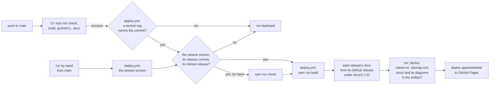

# Deployment

Solid Memo builds to plain static files — no server-side code — so it
publishes to any static host. The primary path is GitHub Pages,
deployed automatically by CI, one released version at a time.

## GitHub Pages (automatic)

This deployment is live at **<https://solid-memo.com/>**, and it runs a
released version, never a commit between two versions
([releasing.md](releasing.md)). `.github/workflows/deploy.yml` runs when
the CI workflow has finished on `main` (`workflow_run`), and deploys
only if CI passed on a release commit, the one a version tag
(`vX.Y.Z`) names, and only the newest version, once its GitHub release
is made:



A red CI run never deploys, and neither does a green one on a commit
that is not a release. Only `main` deploys, and only from this
repository:

- **After CI on a release.** A release ([releasing.md](releasing.md))
  follows a green CI run on `main`, in a workflow of its own. It pushes
  a commit to `main` that sets the new version,
  `chore(release): X.Y.Z`, and tags it `vX.Y.Z`. CI runs on that commit,
  its deterministic jobs only, as the code is its parent's
  ([releasing.md](releasing.md#what-each-stage-checks)), and once it
  passes, the deploy builds it, so the
  site's footer shows the new version. The deploy looks for a version
  tag that names the commit CI checked, and deploys nothing when there
  is none: any other push to `main`, a merged pull request or a
  Renovate update, goes live with the next version, which includes it.
  Only a plain version tag counts (`vX.Y.Z`, no `-rc.1`). The tag is
  pushed just after the release commit and is there long before CI on
  it has finished; for a release commit, the deploy still looks again
  for about two minutes before it gives up.
- **Only the newest release.** A tag is not enough. The deploy also
  checks that the tag is the newest version on `main` (the highest
  `vX.Y.Z` tag), that the commit it names is that version's release
  commit (`chore(release): X.Y.Z`), and that the version has a GitHub
  release, which semantic-release makes seconds after the tag, so it
  looks again for about a minute. A re-run of CI, or of the deploy, on
  an older release commit then deploys nothing, and says so in a
  notice: the site never goes back to an older version. When the
  newest version's tag names another commit, or the version has no
  GitHub release, the run fails and deploys nothing
  ([releasing.md](releasing.md#when-a-release-fails)), so the site never
  runs a version the releases page does not list. The deploy job looks
  for the newest version again just before it deploys, so re-running
  only the failed jobs of an older run cannot put that version back
  either.
- **Only this repository's pushes.** CI also runs on pull requests, a
  fork's included ([testing.md](testing.md#continuous-integration)),
  and a fork's branch may be named `main` too. So the deploy checks that
  the CI run it follows was for a push to `main` in this repository
  (`workflow_run.event`, `head_branch` and `head_repository`), and
  skips any other. CI never cancels a run on `main`, and a run of CI by
  hand has a concurrency group of its own, so it cannot cancel the push
  run a deploy waits for. Push runs on `main` go one at a time, and a
  newer push replaces one waiting, except a release commit's, which has
  a group of its own, so a newer push cannot hold back its deploy
  ([testing.md](testing.md#continuous-integration)). Deploys that may
  deploy, by hand or after CI on a release commit, go one at a time
  (concurrency group `pages`), none canceled; a newer one replaces one
  waiting, and deploys the same version or a newer one. Any other run
  has a group of its own, so it cannot replace a release's deploy. A
  re-run of CI on an older release commit is the exception: nothing
  tells it apart before it runs, so it may replace a newer release's
  deploy waiting its turn, and then deploys nothing. If it did, run the
  deploy by hand.
- **By hand** (Actions › Deploy to GitHub Pages › Run workflow, from
  `main`; from any other branch the job is skipped). It deploys the
  newest version, the highest `vX.Y.Z` tag on `main`, not `main` as it
  is, so it puts the site back on that version, after a deploy that
  failed, say. It checks that version as above: its release commit and
  its GitHub release.
  No CI run is behind it, so it runs `npm run check` on that version
  before it builds it. It has no Turbo cache, so it takes about as long
  as CI's build job.

The workflow enables Pages for the repository on its first run, and
stops before deploying if the vocabulary, the deck library or the docs
are missing from the build, or the docs' diagrams were not drawn. It
installs Chromium for them first ([.github/actions/chromium](../.github/actions/chromium/action.yml)),
as the build draws them ([markdown.md](markdown.md#diagrams)). CI's checks of `ns/` and `decks/`, the comparison of
the deck library with its base included
([deck-library.md](deck-library.md#checks)), are among those a deploy
waits for. The `github-pages`
environment should also be limited to `main` in the repository's
settings (Settings › Environments), so nothing but this workflow's runs
on `main` can deploy. The workflow runs from `main` even when it deploys
a tag, so that limit holds. Since a tag picks what is deployed, version
tags must be protected too: a ruleset on `refs/tags/v*` lets only the
release's deploy key and an admin create them
([releasing.md](releasing.md#the-deploy-key)).

### What the artifact contains

`apps/web/dist/` is the whole site, one origin for the app and the
data it reads:

| Path | From | What |
|---|---|---|
| `/` (`index.html`, `assets/`) | `apps/web/`, `apps/studio/` | The app, [Solid Memo Studio](studio.md) at `#/studio` included, in a chunk of its own under `assets/`. |
| `/about/index.html` | `apps/web/public/about/` | What Solid Memo is, for learners, deck authors, technologists and decision makers: plain HTML, in English, that search engines and browsers without script can read. It runs no script, so it follows the browser's light or dark, not the theme chosen in the app; [aboutPage.test.ts](../apps/web/src/aboutPage.test.ts) checks its policy and its links. It has a link preview of its own (`og:` and `twitter:` tags), with the site's picture. `sitemap.xml` lists it, the app's footer links to it, and so does the site's page in a `<noscript>`. Its links to the docs lead to `/docs/` on the same site. |
| `/robots.txt`, `/sitemap.xml` | written by the build, from [CNAME](../CNAME) | `robots.txt` keeps search engines out of `/journeys/`, the report's old address, and names the sitemap. The sitemap lists every page the build emits or copies, `/` first, except a page whose `<meta name="robots">` says `noindex` (the Studio's and the journeys' report's old addresses), on the domain in `CNAME` ([below](#custom-domain-optional)). Without a `CNAME`, there is no sitemap, and `robots.txt` names none. |
| `/docs/` (`index.html`, `<page>/index.html`, `versions/`, `diagrams/`, `docs.css`) | [`docs/`](README.md), rendered by the build | These docs as static pages, in English, at the version deployed: the README at `/docs/`, with the list of pages from their index, [docs.ttl](docs.ttl), every other page at `/docs/<page>/`, and a list of versions at `/docs/versions/`, which the deploy writes again with every release ([below](#each-releases-docs)) ([markdown.md](markdown.md#the-docs-as-a-site)). Like the About page they run no script, so they follow the browser's light or dark. Their diagrams are drawn as the site is built, light and dark, as SVG files in `diagrams/` with the font's license, `OFL-Fredoka.txt`, beside them. Their links into the repository lead to `VITE_REPO_URL` at the commit built ([configuration.md](configuration.md#vite_repo_url)). The app's footer, the About page, the site's page in a `<noscript>`, and `publiccode.yml`'s `documentation` link to `/docs/`. These addresses may change in any version: they are not part of the public API ([releasing.md](releasing.md#the-public-api)). |
| `/docs/X.Y.Z/` | each release's GitHub release, its docs' archive | The docs of every release whose GitHub release carries their archive, as that release rendered them, the deployed version's included: the same pages one folder deeper, never indexed, their links into the repository at the release's tag ([below](#each-releases-docs)). Like `/docs/`, not part of the public API. |
| `/studio/index.html` | `apps/web/public/studio/` | The Studio's old address: a page that sends `/studio/#/x` on to `/#/studio/x` ([studio.md](studio.md#routes)). |
| `/ns/vocab/*.ttl`, `/ns/shapes/<class>/v<N>.ttl` | [`ns/`](../ns/) | The vocabulary and the shapes ([vocab.md](vocab.md), [shapes.md](shapes.md)). |
| `/decks/index.ttl`, `/decks/<name>/v<N>.ttl` | [`decks/`](../decks/) | The deck library ([deck-library.md](deck-library.md)). |
| `/vendor/…` | [`packages/vocab/vendor/`](../packages/vocab/vendor/) | The vendored DCAT-AP and SKOS shapes. |
| `/journeys/index.html` | `apps/web/public/journeys/` | The user journeys' report's old address: a page that sends `/journeys/#x` on to `https://journeys.solid-memo.com/#x`, where the report now lives ([below](#the-journeys-report)). |

Vite copies `ns/`, `decks/` and `vendor/` as they are
(`turtleDirectoryPlugin` in
[publishTurtle.ts](../packages/vocab/tooling/publishTurtle.ts)), and
serves them the same way in `npm run dev` and `npm start`.

Pages serves a `.ttl` file as `text/turtle` with
`Access-Control-Allow-Origin: *`, so any app or tool can read it, but
it negotiates no content and lists no folders: an address without the
extension, or a folder such as `/decks/`, is a 404. That is why every
IRI of the vocabulary, the shapes and the library ends in `.ttl`.

One-time setup on a new machine or fork:

```sh
gh auth login
gh repo create <user>/solid-memo --public --source . --push
```

(GitHub Pages on the free plan requires a public repository.) The
deploy workflow deploys only a commit a version tag names, so a fork
deploys its own changes once it releases versions of its own, with a
deploy key of its own ([releasing.md](releasing.md#the-deploy-key)).
It deploys to `https://<user>.github.io/<repository>/`; its app works there,
but the IRIs it reads still name `https://solid-memo.com/`, which
`siteFetch` ([appUseCases.ts](../packages/composition/src/appUseCases.ts)) maps to wherever the
site is served. A fork gives its build its own name, repository link and
Pod providers in `VITE_` variables ([configuration.md](configuration.md)),
and [reuse.md](reuse.md) walks through running a copy.

## The journeys' report

The user journeys' report ([testing.md](testing.md#user-journeys)),
every browser's in one with each journey's trace, is published at
<https://journeys.solid-memo.com/>, a site of its own, not beside the
app, so the report and its trace viewer, which are Playwright's
scripts, do not run on the app's origin. After the site is deployed, the deploy workflow's `journeys`
job takes the `journeys-report` artifact of the CI run on the release
commit and force-pushes it, as one commit with no parent, over `main`
of the repository [solid-memo/journeys](https://github.com/solid-memo/journeys),
which GitHub Pages serves from that branch. So that repository holds no
code, only the newest report, with beside it a `CNAME` naming the
domain, a `.nojekyll`, so Pages serves the files as they are, and a
`robots.txt` that keeps search engines out. A deploy by hand has no CI
run, so it publishes no report, and the last one stays.

Until v4.1.2 the report was published beside the app, at `/journeys/`.
A browser that opened a trace there registered the trace viewer's
service worker, and a registration outlives its script: the worker
still loads any trace a link names and serves its pages on the app's
origin. So the app, as it starts, unregisters every service worker
under `journeys/` ([journeysWorkers.ts](../apps/web/src/journeysWorkers.ts));
it registers none of its own.

The job pushes with a deploy key: its public half is the journeys
repository's, with write access, and its private half is the secret
`JOURNEYS_DEPLOY_KEY` of the `journeys` environment here, which admits
only `main`, as the `release` environment does
([releasing.md](releasing.md#the-deploy-key)). Without the secret, as
in a fork, the job publishes nothing and says so. `journeys.solid-memo.com`
is a `CNAME` record pointing at `solid-memo.github.io`, and the journeys
repository's Pages settings name it, with HTTPS enforced.

## Why any static host works, unconfigured

- Asset URLs are relative (`base: "./"` in `vite.config.ts`), so the
  build works at a domain root or any subfolder — including a fork's
  `/<repository>/` project path on GitHub Pages.
- Routing is hash-based (`docs/routing.md`), so deep links resolve to
  `index.html` without rewrite rules.
- The Solid OIDC redirect URL derives from `window.location` at
  runtime; no per-origin auth configuration. HTTPS is required, which
  GitHub Pages provides.
- The Content Security Policy is a meta tag in `index.html`, not a
  header, for GitHub Pages sets none: it travels with the page to any
  host ([markdown.md](markdown.md#safety)). A host that can set headers
  may add the directives a meta tag cannot carry, such as
  `frame-ancestors`.

## Custom domain (optional)

Nothing in the app depends on a domain: the same build serves from any
origin. To serve a GitHub Pages deployment from a domain of your own:

1. At the domain's DNS provider, point it at GitHub Pages: for a
   subdomain (`memo.example.org`), a `CNAME` record to
   `<user>.github.io`; for an apex domain (`example.org`), `A` records
   to `185.199.108.153`, `185.199.109.153`, `185.199.110.153` and
   `185.199.111.153`, and `AAAA` records to `2606:50c0:8000::153`
   through `2606:50c0:8003::153`.
2. In the repository, set it under Settings → Pages → Custom domain.
   GitHub checks the DNS and provisions the certificate; then turn on
   Enforce HTTPS.
3. Verify the domain in your account's or organization's settings
   (Pages → Add a domain), so no other repository can claim it.

The deploy workflow publishes through `actions/deploy-pages`, which
takes the domain from that setting only: a `CNAME` file in the
repository is not read for that. On another host, follow its own steps.

The build reads it, though: `siteMapPlugin` in
[siteMap.ts](../packages/vocab/tooling/siteMap.ts) writes
`sitemap.xml` and the `Sitemap:` line of `robots.txt` on the domain
that `CNAME` names, since a sitemap's addresses are absolute. So write
your domain into `CNAME` too, a bare hostname such as
`memo.example.org`; the build fails on anything else, a scheme, a path
or a port. Without a domain, delete `CNAME`: the build then writes
`robots.txt` without a sitemap. The deploy's guard checks that there is
a sitemap whenever `CNAME` is there.

The vocabulary, shape and library IRIs name `https://solid-memo.com/`
whatever domain serves the site; the app reads them from where it is
served ([reuse.md](reuse.md#what-stays-the-same)).

### This deployment

One.com's DNS points `solid-memo.com` at GitHub Pages, and the custom
domain is set in the repository's settings. [CNAME](../CNAME) records
that setting, and the build writes the sitemap on that domain. The IRIs
above resolve on the web because this domain serves this site.

## Manual publish (any static web space)

`npm run browsers` once, as the build draws the docs' diagrams in
Chromium ([markdown.md](markdown.md#diagrams)); `npm run build`, then
upload the **contents** of `apps/web/dist/` to the web root (or any
subfolder) via SFTP or a file manager, `ns/`, `decks/`, `vendor/`,
`docs/` and `studio/` included. The sitemap and `robots.txt` name the
root of the domain in [CNAME](../CNAME): for another domain, write
yours there first, and for a subfolder, delete `CNAME`, since the
sitemap's addresses would leave the subfolder out. Verify a build
locally with `npm start` (builds, then serves `dist/` at
`http://localhost:4173`), or `npm run preview -w @solid-memo/web` to serve
the last build. Both builds need Chromium; without it, a build fails
with a message that names `npm run browsers`, unless
`DOCS_DIAGRAMS=skip` is set, which builds the docs with each diagram's
source in place of its drawing ([configuration.md](configuration.md#docs_diagrams)).

## A release's docs as an archive

`npm run docs:archive -- X.Y.Z` renders the docs as release X.Y.Z
serves them under its version, at `/docs/X.Y.Z/`
([markdown.md](markdown.md#the-docs-as-a-site)): the same pages one
folder deeper, their links into the repository at the tag `vX.Y.Z`,
never indexed, and each with a note that links the latest docs. It
packs them into `release-assets/docs-X.Y.Z.tar.gz`, which git ignores:
the pages, `docs.css`, every diagram's light and dark drawing and the
font's license, `OFL-Fredoka.txt`, all under `docs/`
([docsArchive.ts](../scripts/docsArchive.ts)). The repository's
address is the one the site's build takes (`VITE_REPO_URL`,
[configuration.md](configuration.md#vite_repo_url)).

An archive is rendered once, by that release's own code, and never
again, so it is never written without its drawings: it draws every
diagram in Chromium whatever `DOCS_DIAGRAMS` says, fails without it,
and checks each drawing as the build does (`checkSvg`, and the font's
notice in it) before it packs them, with the system's `tar`. The
archive's address and contents are not part of the public API
([releasing.md](releasing.md#the-public-api)).

Every release makes its archive and attaches it to its GitHub release,
as "Documentation X.Y.Z (HTML)" ([release.config.mjs](../release.config.mjs)):
semantic-release runs `npm run docs:archive` with the new version
before it commits, so a release whose docs cannot be drawn is not
made, and it publishes the GitHub release only once the archive is
uploaded ([releasing.md](releasing.md#what-a-release-does)). The
release workflow then attests the archive, which the deploy checks
([below](#each-releases-docs)). When the upload fails, the release
stays a draft, which the deploy refuses; the release workflow's `docs`
job, run by hand with the tag, attests and attaches the archive and
publishes it, and it replaces an archive that is not attested
([releasing.md](releasing.md#when-a-release-fails)).

## Each release's docs

The deploy serves every release's docs beside the deployed version's,
at `/docs/X.Y.Z/`, from the archive its GitHub release carries
([above](#a-releases-docs-as-an-archive)). After `npm run build`, it
runs `npm run docs:versions -- apps/web/dist`
([docsVersions.ts](../scripts/docsVersions.ts)) with every version tag
up to the one deployed, newest first. For each tag, the script finds
the archive on its GitHub release through GitHub's API, with the run's
token, and unpacks it into `docs/X.Y.Z/`. The deployed version's own
archive is unpacked too, so its address works from its first deploy on
and stays the same after the next release. Then the script writes the
list of versions, `/docs/versions/`, over the build's: every tag,
newest first, linked to its docs on the site where they are served,
and always to its docs in the repository at the tag and to its release
notes. `/docs/` itself stays the deployed version's own build.

The archived pages run on the app's origin, which holds the learner's
storage and the guest's pod, so an archive is served only when:

- a workflow run uploaded it (`github-actions[bot]`). An archive
  uploaded by hand is not served;
- its bytes match the digest GitHub's API gives. The digest comes from
  the same API as the file, so it guards only the download;
- GitHub holds an attestation that the release workflow,
  `.github/workflows/release.yml`, run on `main`, made those bytes
  (`gh attestation verify`, with the run's token), as the release and
  its recovery run attest them
  ([releasing.md](releasing.md#when-a-release-fails)). Any workflow run
  with write access could upload an archive, a workflow pushed on
  another branch among them; none but the release workflow on `main`,
  which only a reviewed change reaches, can sign as it. A fork's
  archives must be attested by its own release workflow;
- its entries, listed before anything is unpacked, are plain files and
  folders under `docs/`, with plain names: pages, stylesheets, drawings
  and the font's license, `docs/diagrams/OFL-Fredoka.txt`, which an
  archive with drawings must have. No link, no absolute path, no `..`,
  and `docs/index.html` among them;
- every file passes the checks the build's own pages pass
  ([markdown.md](markdown.md#the-docs-as-a-site)): `checkPage` for a
  page (its Content Security Policy first, no script, no event handler,
  no address from the site's root), `checkStylesheet` for a stylesheet,
  and `checkSvg` for a drawing, which allows the embedded font only
  with its notice.

A version whose archive fails is left out, with an error in the run.
One without an archive, such as every release made before the archives
were, or the upstream project's releases in a fork, is left out with a
notice. The list of versions links both to their docs in the
repository. When GitHub's API cannot be read, the run says so in an
error and serves only `/docs/`. None of these stops the deploy.

Every release adds a copy of several megabytes, and GitHub Pages
allows a site of 1 GB. When the copies near that, serving only the
newest patch of each minor version, at `/docs/X.Y/`, is a change to
`docsVersions.ts` alone; the archives stay on the releases, and the
list keeps linking each version's docs in the repository.

To try it on a build of your own, name the tags and, unless
`VITE_REPO_URL` is on github.com, the repository; `GH_TOKEN`, when set,
is sent to GitHub's API:

```sh
DOCS_TAGS="$(git tag --list 'v*')" GH_REPO=solid-memo/website npm run docs:versions -- apps/web/dist
```
