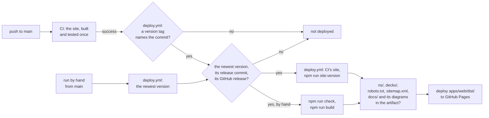

# Deployment

Solid Memo builds to plain static files — no server-side code — so it
publishes to any static host. The main path is GitHub Pages, which CI
deploys one released version at a time.

## GitHub Pages (automatic)

This deployment is live at **<https://solid-memo.com/>** and runs a
released version, never a commit between two
([releasing.md](releasing.md)). `.github/workflows/deploy.yml` runs when
the CI workflow has finished on `main` (`workflow_run`). It deploys only
if CI passed on a release commit, the one a version tag (`vX.Y.Z`)
names, and only the newest version, once its GitHub release is made:



Only `main` deploys, and only from this repository:

- **After CI on a release.** The release workflow follows a green CI
  run on `main`: it pushes a commit to `main` that sets the new
  version, `chore(release): X.Y.Z`, and tags it `vX.Y.Z`. CI on that
  commit tests nothing again and takes over the site its parent's run
  built ([releasing.md](releasing.md#what-each-stage-checks)). Once
  that run passes, the deploy ships the site
  ([below](#the-build-ci-tested)), with the new version in the footer.
  A commit without a version tag isn't
  deployed: any other push to `main`, such as a merged pull request or
  a Renovate update, goes live with the next version. Only a plain
  version tag counts (`vX.Y.Z`, no `-rc.1`). For a release commit, the
  deploy looks again for the tag for about two minutes.
- **Only the newest release.** The deploy checks that the tag is the
  newest version on `main` (the highest `vX.Y.Z` tag), that it names
  that version's release commit (`chore(release): X.Y.Z`), and that the
  version has a GitHub release. semantic-release makes that release
  seconds after the tag, so the deploy looks again for about a minute.
  On an older release commit,
  a re-run of CI or of the deploy deploys nothing and says so in a
  notice, so the site never goes back to an older version. When the
  newest tag names another commit, or the version has no GitHub
  release, the run fails and deploys nothing
  ([releasing.md](releasing.md#when-a-release-fails)), so the site
  never runs a version the releases page doesn't list. The deploy job
  checks again right before it deploys, so re-running an older run's
  failed jobs can't put that version back.
- **Only this repository's pushes.** The deploy follows only a CI run
  for a push to `main` in this repository (`workflow_run.event`,
  `head_branch` and `head_repository`), not a pull request's
  ([testing.md](testing.md#continuous-integration)), even a fork's
  branch named `main`.
- **Concurrency.** CI never cancels a run on `main`. Push runs on
  `main` go one at a time, and a newer push replaces one waiting. A run
  of CI by hand has a group of its own (it can't cancel the push run a
  deploy waits for), and so does a release commit's run (a newer push
  can't hold back its deploy). Deploys by hand or after CI on a release
  commit go one at a time (group `pages`), none canceled; a newer one
  replaces one waiting and deploys the same version or a newer one. Any
  other run has a group of its own, so it can't replace a release's
  deploy. Exception: a re-run of CI on an older release commit may
  replace a newer release's waiting deploy and deploy nothing. If it
  does, run the deploy by hand.
- **By hand** (Actions › Deploy to GitHub Pages › Run workflow, from
  `main`; from any other branch the job is skipped). It deploys the
  newest version, not the head of `main`, for example to put the site
  back on it after a failed deploy, and checks its release commit and
  GitHub release as above. It installs Chromium
  ([.github/actions/chromium](../.github/actions/chromium/action.yml))
  for the docs' diagrams ([markdown.md](markdown.md#diagrams)), runs
  `npm run check` on that version, and builds it. Without a Turbo
  cache, it takes about as long as CI's `check` and `site` jobs in a
  row.

The workflow enables Pages on its first run, and stops before
deploying if the site lacks the vocabulary, the deck
library or the docs, or the docs' diagrams weren't drawn. A deploy
waits for CI's checks of `ns/` and `decks/`, among them the deck
library's comparison with its base
([deck-library.md](deck-library.md#checks)). The `github-pages`
environment should be limited to `main` (Settings › Environments), so
only this workflow's runs on `main` can deploy; the workflow runs from
`main` even when it deploys a tag. Version tags must be protected
too, since a tag picks what's deployed: a ruleset on `refs/tags/v*`
lets only the release's deploy key and an admin create them
([releasing.md](releasing.md#the-deploy-key)).

### The build CI tested

After CI on a release commit, the deploy builds nothing: it downloads
that run's `site` artifact. As a rule, that's the site the merge
queue's run built for the parent, which every user journey ran on and
the release commit's run took over (its `reuse` job). When the release
commit's run tested its tree, it's that run's own build
([releasing.md](releasing.md#what-each-stage-checks)). The site
deployed is the one tested, and a deploy can't fail on what a build
fetches, such as Chromium or its system libraries.

That site states the version before the release, and only its pages
state it; the scripts' files are named by a hash of their content
([configuration.md](configuration.md#what-a-build-computes)).
`npm run site:version -- apps/web/dist`
([siteVersion.ts](../scripts/siteVersion.ts)) writes the released
version, from the release commit's `package.json`, into the header of
every docs page and into `index.html`, where the footer and error
reports read it. It changes nothing else, and refuses a site with a
page that states no version. The footer and the docs' links into the
repository still name the commit the site was built from. As a rule
that's the parent, which is on `main` with the release commit's code
and docs, or the release commit when its run tested its tree. A version
released before sites were kept this way has no such artifact, so a
deploy after CI on its release commit builds it.

### What the artifact contains

`apps/web/dist/` is the whole site, one origin for the app and the
data it reads:

| Path | From | What |
|---|---|---|
| `/` (`index.html`, `assets/`) | `apps/web/`, `apps/studio/` | The app, [Solid Memo Studio](studio.md) at `#/studio` included, in a chunk of its own under `assets/`. |
| `/about/index.html` | `apps/web/public/about/` | What Solid Memo is, for learners, deck authors, technologists and decision makers: plain HTML in English that search engines and browsers without script can read. It runs no script, so it follows the browser's light or dark, not the app's theme. [aboutPage.test.ts](../apps/web/src/aboutPage.test.ts) checks its policy and links. It has its own link preview (`og:` and `twitter:` tags), with the site's picture. `sitemap.xml` lists it; the app's footer and the site's page in a `<noscript>` link to it. Its docs links lead to `/docs/` on the same site. |
| `/clientid.jsonld` | written by the build, from [CNAME](../CNAME) and `VITE_APP_NAME` | The site's Client ID Document, which identity providers read when a user logs in on the domain in `CNAME` ([authentication.md](authentication.md#the-client-id-document)). Pages serves it as `application/ld+json`. Without a `CNAME`, there's none. |
| `/robots.txt`, `/sitemap.xml` | written by the build, from `CNAME` | `robots.txt` keeps search engines out of `/journeys/`, the report's old address, and names the sitemap. The sitemap lists every page the build emits or copies, `/` first, on the domain in `CNAME` ([below](#custom-domain-optional)), except a page whose `<meta name="robots">` says `noindex`: the Studio's and the journeys' report's old addresses. Without a `CNAME`, there's no sitemap, and `robots.txt` names none. |
| `/docs/` (`index.html`, `<page>/index.html`, `diagrams/`, `docs.css`) | [`docs/`](README.md), rendered by the build | These docs as static pages in English at the deployed version, the README at `/docs/` listing the pages from [docs.ttl](docs.ttl), with diagrams drawn as SVG files in `diagrams/` and links into the repository at `VITE_REPO_URL` ([configuration.md](configuration.md#vite_repo_url)) at the commit built ([markdown.md](markdown.md#the-docs-as-a-site)). Like the About page, they run no script and follow the browser's light or dark. The app's footer, the About page, the site's page in a `<noscript>`, and `publiccode.yml`'s `documentation` link to `/docs/`. These addresses may change in any version: they aren't part of the public API ([releasing.md](releasing.md#the-public-api)). |
| `/studio/index.html` | `apps/web/public/studio/` | The Studio's old address: a page that sends `/studio/#/x` on to `/#/studio/x` ([studio.md](studio.md#routes)). |
| `/ns/vocab/*.ttl`, `/ns/shapes/<class>/v<N>.ttl` | [`ns/`](../ns/) | The vocabulary and the shapes ([vocab.md](vocab.md), [shapes.md](shapes.md)). |
| `/decks/index.ttl`, `/decks/<name>/v<N>.ttl` | [`decks/`](../decks/) | The deck library ([deck-library.md](deck-library.md)). |
| `/vendor/…` | [`packages/vocab/vendor/`](../packages/vocab/vendor/) | The vendored DCAT-AP and SKOS shapes. |
| `/journeys/index.html` | `apps/web/public/journeys/` | The user journeys' report's old address: a page that sends `/journeys/#x` on to `https://journeys.solid-memo.com/#x`, where the report now lives ([below](#the-journeys-report)). |

Vite copies `ns/`, `decks/` and `vendor/` unchanged
(`turtleDirectoryPlugin` in
[publishTurtle.ts](../packages/site/src/publishTurtle.ts)), and
serves them the same way in `npm run dev` and `npm start`.

Pages serves a `.ttl` file as `text/turtle` with
`Access-Control-Allow-Origin: *`. It negotiates no content and lists no
folders (an address without the extension, or a folder such as
`/decks/`, is a 404), so every IRI of the vocabulary, the shapes and
the library ends in `.ttl`.

One-time setup on a new machine or fork:

```sh
gh auth login
gh repo create <user>/solid-memo --public --source . --push
```

GitHub Pages on the free plan requires a public repository. A fork
deploys its changes once it releases its own versions, with its own
deploy key ([releasing.md](releasing.md#the-deploy-key)), to
`https://<user>.github.io/<repository>/`, where its app works. The
vocabulary, shape and library IRIs name `https://solid-memo.com/` on
any domain; `siteFetch`
([appUseCases.ts](../packages/composition/src/appUseCases.ts)) maps
them to wherever the site is served
([reuse.md](reuse.md#what-stays-the-same)). A fork sets its own name,
repository link and Pod providers in `VITE_` variables
([configuration.md](configuration.md)); [reuse.md](reuse.md) walks
through running a copy.

## The journeys' report

The user journeys' report ([testing.md](testing.md#user-journeys)),
every browser's in one with each journey's trace, is published at
<https://journeys.solid-memo.com/>, a site of its own, so Playwright's
scripts don't run on the app's origin. After the site is deployed, the
deploy workflow's `journeys` job force-pushes the `journeys-report`
artifact of the CI run on the release commit, as one commit with no
parent, over `main` of
[solid-memo/journeys](https://github.com/solid-memo/journeys), which
GitHub Pages serves from that branch. That repository holds only the
newest report, a `CNAME` naming the domain, a `.nojekyll` so Pages
serves the files unchanged, and a `robots.txt` that keeps search
engines out. A deploy
by hand publishes no report, and the last one stays.

The report's own trace viewer isn't published. It opens a trace from
any address its `trace` parameter names or a page sends it, and shows
the trace's pages on the site that serves it: anyone's pages at a
solid-memo.com address. In its place, the job publishes
[e2e/journeys/report/trace/](../e2e/journeys/report/trace/), two files:

- An `index.html` at the address the report's **Trace** links open. It
  sends a trace of the report's, a file of its `data/` folder named as
  the report names a trace, on to Playwright's own copy of the viewer,
  <https://trace.playwright.dev/>. Any other trace goes nowhere.
- A `sw.bundle.js` at the address of the viewer's service worker. A
  browser that opened a trace before fetches it as that worker's
  update on its next visit under `/trace/`, which the old worker still
  answers, and the update unregisters itself.

The viewer at trace.playwright.dev fetches the trace from this site
(served with `Access-Control-Allow-Origin: *`), needs no account and
sends the trace nowhere.

Until v4.1.2 the report was published at `/journeys/`. A browser that
opened a trace there registered the viewer's service worker. The
registration outlives its script, so the worker still loads any trace
a link names and serves its pages on the app's origin. The app, as it
starts, unregisters every service worker under `journeys/`
([journeysWorkers.ts](../apps/web/src/journeysWorkers.ts)), and
registers none of its own.

The job pushes with a deploy key: the public half, with write access,
is the journeys repository's, and the private half is the secret
`JOURNEYS_DEPLOY_KEY` of the `journeys` environment here, which admits
only `main`, as the `release` environment does
([releasing.md](releasing.md#the-deploy-key)). Without the secret, as
in a fork, the job publishes nothing and says so.
`journeys.solid-memo.com` is a `CNAME` record pointing at
`solid-memo.github.io`, and the journeys repository's Pages settings
name it, with HTTPS enforced.

## Why any static host works, unconfigured

- Asset URLs are relative (`base: "./"` in `vite.config.ts`), so the
  build works at a domain root or any subfolder — including a fork's
  `/<repository>/` project path on GitHub Pages.
- Routing is hash-based (`docs/routing.md`), so deep links resolve to
  `index.html` without rewrite rules.
- The Solid OIDC redirect URL derives from the page's address at
  runtime. The only auth setting tied to an origin is the domain in
  `CNAME`, which the build writes the Client ID Document for. The app
  logs in with it on that domain alone. On any other address it
  registers at each login, as it does without a `CNAME`
  ([authentication.md](authentication.md#the-client-id-document)).
  HTTPS is required; GitHub Pages provides it.
- The Content Security Policy is a meta tag in `index.html`, not a
  header (GitHub Pages sets none), so it travels with the page to any
  host ([markdown.md](markdown.md#safety)). A host that can set headers
  may add the directives a meta tag can't carry, such as
  `frame-ancestors`.
- No header forbids framing either (`X-Frame-Options` or
  `frame-ancestors`), so the app checks for itself
  ([`Framed.tsx`](../packages/ui/src/ui/Framed.tsx), from
  `apps/web/src/App.tsx`). In a frame of any page, whatever its origin,
  it shows no app: only that it opens in a tab of its own, with a link
  that opens the same address in a new tab. Another site can then
  neither lay its page over the app's buttons nor lead a click to them.
  Nothing of Solid Memo's frames the app. The About page and the docs
  hold no actions, so they have no such check.

## Custom domain (optional)

Nothing in the app depends on a domain: the same build serves from
any origin. To serve a GitHub Pages deployment from a custom domain:

1. At the domain's DNS provider, point it at GitHub Pages: for a
   subdomain (`memo.example.org`), a `CNAME` record to
   `<user>.github.io`; for an apex domain (`example.org`), `A` records
   to `185.199.108.153`, `185.199.109.153`, `185.199.110.153` and
   `185.199.111.153`, and `AAAA` records to `2606:50c0:8000::153`
   through `2606:50c0:8003::153`.
2. In the repository, set it under Settings → Pages → Custom domain.
   GitHub checks the DNS and provisions the certificate; then turn on
   Enforce HTTPS.
3. Verify the domain in the account's or organization's settings
   (Pages → Add a domain), so no other repository can claim it.

The deploy workflow publishes through `actions/deploy-pages`, which
takes the domain from that setting only, not from a `CNAME` file.
Another host has steps of its own.

The build reads `CNAME`: `siteMapPlugin` in
[siteMap.ts](../packages/site/src/siteMap.ts) writes `sitemap.xml` and
the `Sitemap:` line of `robots.txt` on its domain, and `clientIdPlugin`
in [clientId.ts](../packages/site/src/clientId.ts) writes the Client ID
Document, which names it
([authentication.md](authentication.md#the-client-id-document)).
Write the domain into `CNAME` too, as a bare hostname such as
`memo.example.org`. The build fails on anything else, such as a
scheme, a path or a port. Without a domain, delete `CNAME`: the build
then writes `robots.txt` without a sitemap, and no Client ID Document.
Whenever `CNAME` is there, the
deploy's guard checks that the site has both.

### This deployment

One.com's DNS points `solid-memo.com` at GitHub Pages, and the custom
domain is set in the repository's settings. [CNAME](../CNAME) records
that setting, and the build writes the sitemap and the Client ID
Document, <https://solid-memo.com/clientid.jsonld>, on that domain,
where the vocabulary, shape and library IRIs resolve.

## Manual publish (any static web space)

A manual publish runs `npm run browsers` once, for the docs'
diagrams ([markdown.md](markdown.md#diagrams)), and `npm run build`.
It uploads the **contents** of `apps/web/dist/`,
`ns/`, `decks/`, `vendor/`, `docs/` and `studio/` included, to the web
root or any subfolder via SFTP or a file manager. The sitemap and
`robots.txt` name the root of the domain in [CNAME](../CNAME): for
another domain, that domain goes into `CNAME` first; for a subfolder,
`CNAME` is deleted, as the sitemap would leave the subfolder out.
`npm start` builds, then serves `dist/` at `http://localhost:4173`;
`npm run preview -w @solid-memo/web` serves the last build. Without
Chromium, a build fails with a message that names `npm run browsers`,
unless `DOCS_DIAGRAMS=skip` puts each diagram's source in place of its
drawing ([configuration.md](configuration.md#docs_diagrams)).

## A release's docs as an archive

`npm run docs:archive -- X.Y.Z` renders the docs of release X.Y.Z
([markdown.md](markdown.md#the-docs-as-a-site)): the same pages as
`/docs/`, never indexed, with links into the repository at the tag
`vX.Y.Z`. Each page links to the latest docs at the site's origin,
from [CNAME](../CNAME), as the header's link to the site does, so the
pages work wherever the archive is unpacked. The script packs into
`release-assets/docs-X.Y.Z.tar.gz`, which git ignores, the pages,
`docs.css`, every diagram's light and dark drawing and the font's
license, `OFL-Fredoka.txt`, all under `docs/`
([docsArchive.ts](../scripts/docsArchive.ts)). The repository's
address is the site build's (`VITE_REPO_URL`,
[configuration.md](configuration.md#vite_repo_url)).

An archive is rendered once, by that release's own code. It draws
every diagram in Chromium, ignoring `DOCS_DIAGRAMS`, and fails without
Chromium. It checks each drawing as the build does (`checkSvg`, and
the font's notice in it), then packs them with the system's `tar`. The
archive's address and contents aren't part of the public API
([releasing.md](releasing.md#the-public-api)).

Every release attaches its archive to its GitHub release, as
"Documentation X.Y.Z (HTML)" ([release.config.mjs](../release.config.mjs)).
semantic-release runs `npm run docs:archive` with the new version
before it commits, so a release whose docs can't be drawn isn't made,
and publishes the GitHub release only once the archive is uploaded
([releasing.md](releasing.md#what-a-release-does)). The release
workflow then attests the archive, so anyone who downloads it can
check that the release workflow made it on `main`:

```sh
gh attestation verify docs-X.Y.Z.tar.gz --repo solid-memo/website \
  --signer-workflow solid-memo/website/.github/workflows/release.yml \
  --source-ref refs/heads/main --deny-self-hosted-runners
```

When the upload fails, the release stays a draft, which the deploy
refuses. The release workflow's `docs` job, run by hand with the tag,
then attests and attaches the archive, replacing one that isn't
attested, and publishes the release
([releasing.md](releasing.md#when-a-release-fails)).

## Older releases' docs

The site serves only the deployed version's docs, at `/docs/`. An
older release's docs are in the repository at its tag
(`<repository>/tree/vX.Y.Z/docs`, where GitHub draws their diagrams
too), and since 3.3.0 in the archive its GitHub release carries
([above](#a-releases-docs-as-an-archive)).

Until #280 the site served each release's docs at `/docs/X.Y.Z/` too.
The copies, several megabytes each, grew toward GitHub Pages' limit of
1 GB a site, and each deploy downloaded and checked them all. Those
addresses were never indexed and never part of the public API
([releasing.md](releasing.md#the-public-api)).
