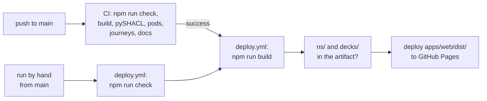

# Deployment

Solid Memo builds to plain static files — no server-side code — so it
publishes to any static host. The primary path is GitHub Pages,
deployed automatically by CI.

## GitHub Pages (automatic)

This deployment is live at **https://solid-memo.com/**. `.github/workflows/deploy.yml`
runs when the CI workflow has finished on `main`
(`workflow_run`), and deploys only if CI passed:



A red CI run never deploys. Only `main` deploys, and only from this
repository:

- **After CI.** CI also runs on pull requests, a fork's included
  ([testing.md](testing.md#continuous-integration)), and a fork's branch
  may be named `main` too. So the deploy checks that the CI run it
  follows was for a push to `main` in this repository
  (`workflow_run.event`, `head_branch` and `head_repository`), and
  skips any other. It builds the commit CI checked. CI never cancels a
  run on `main`, and a run of CI by hand has a concurrency group of its
  own, so it cannot cancel the push run a deploy waits for; push runs
  on `main` go one at a time, and a push waiting its turn is replaced
  by a newer one, which deploys it too
  ([testing.md](testing.md#continuous-integration)). Deploys go one at
  a time as well (concurrency group `pages`), none canceled.
- **By hand** (Actions › Deploy to GitHub Pages › Run workflow, from
  `main`; from any other branch the job is skipped). No CI run is behind
  it, so it runs `npm run check` before it builds `main` as it is. It
  has no Turbo cache, so it takes about as long as CI's build job.

A release ([releasing.md](releasing.md)) also follows a green CI run
on `main`, in a workflow of its own, and pushes a commit to `main` that
sets the new version. CI and the deploy run on that commit as on any
push, so the site's footer shows the version once it is deployed.

The workflow enables Pages for the repository on its first run, and
stops before deploying if the vocabulary or the deck library is missing
from the build. CI's checks of `ns/` and `decks/`, the comparison of
the deck library with its base included
([deck-library.md](deck-library.md#checks)), are among those a deploy
waits for. The `github-pages`
environment should also be limited to `main` in the repository's
settings (Settings › Environments), so nothing but this workflow's runs
on `main` can deploy.

### What the artifact contains

`apps/web/dist/` is the whole site, one origin for the app and the
data it reads:

| Path | From | What |
|---|---|---|
| `/` (`index.html`, `assets/`) | `apps/web/`, `apps/studio/` | The app, [Solid Memo Studio](studio.md) at `#/studio` included, in a chunk of its own under `assets/`. |
| `/about/index.html` | `apps/web/public/about/` | What Solid Memo is, for learners, deck authors, technologists and decision makers: plain HTML, in English, that search engines and browsers without script can read. It runs no script, so it follows the browser's light or dark, not the theme chosen in the app; [aboutPage.test.ts](../apps/web/src/aboutPage.test.ts) checks its policy and its links. `sitemap.xml` lists it, and the site's page links to it in a `<noscript>`. |
| `/studio/index.html` | `apps/web/public/studio/` | The Studio's old address: a page that sends `/studio/#/x` on to `/#/studio/x` ([studio.md](studio.md#routes)). |
| `/ns/vocab/*.ttl`, `/ns/shapes/<class>/v<N>.ttl` | [`ns/`](../ns/) | The vocabulary and the shapes ([vocab.md](vocab.md), [shapes.md](shapes.md)). |
| `/decks/index.ttl`, `/decks/<name>/v<N>.ttl` | [`decks/`](../decks/) | The deck library ([deck-library.md](deck-library.md)). |
| `/vendor/…` | [`packages/vocab/vendor/`](../packages/vocab/vendor/) | The vendored DCAT-AP and SKOS shapes. |
| `/journeys/` | the CI run's `journeys-report` artifact | The user journeys' report ([testing.md](testing.md#user-journeys)), with each journey's trace. Not there after a deploy by hand. |

Vite copies `ns/`, `decks/` and `vendor/` as they are
(`turtleDirectoryPlugin` in
[publishTurtle.ts](../packages/vocab/tooling/publishTurtle.ts)), and
serves them the same way in `npm run dev` and `npm run preview`.

Pages serves a `.ttl` file as `text/turtle` with
`Access-Control-Allow-Origin: *`, so any app or tool can read it, but
it negotiates no content and lists no folders: an address without the
extension, or a folder such as `/decks/`, is a 404. That is why every
IRI of the vocabulary, the shapes and the library ends in `.ttl`.

One-time setup on a new machine or fork:

```sh
gh auth login
gh repo create <user>/solid-memo --public --source . --push
```

(GitHub Pages on the free plan requires a public repository.) A fork
deploys to `https://<user>.github.io/<repository>/`; its app works there,
but the IRIs it reads still name `https://solid-memo.com/`, which
`siteFetch` ([appUseCases.ts](../packages/composition/src/appUseCases.ts)) maps to wherever the
site is served. A fork gives its build its own name, repository link and
Pod providers in `VITE_` variables ([configuration.md](configuration.md)),
and [reuse.md](reuse.md) walks through running a copy.

## Why any static host works, unconfigured

- Asset URLs are relative (`base: "./"` in `vite.config.ts`), so the
  build works at a domain root or any subfolder — including a fork's
  `/<repository>/` project path on GitHub Pages.
- Routing is hash-based (`docs/routing.md`), so deep links resolve to
  `index.html` without rewrite rules.
- The Solid OIDC redirect URL derives from `window.location` at
  runtime; no per-origin auth configuration. HTTPS is required, which
  GitHub Pages provides.
- The Content Security Policy is a meta tag in `index.html`, not a
  header, for GitHub Pages sets none: it travels with the page to any
  host ([markdown.md](markdown.md#safety)). A host that can set headers
  may add the directives a meta tag cannot carry, such as
  `frame-ancestors`.

## Custom domain (optional)

Nothing in the app depends on a domain: the same build serves from any
origin. To serve a GitHub Pages deployment from a domain of your own:

1. At the domain's DNS provider, point it at GitHub Pages: for a
   subdomain (`memo.example.org`), a `CNAME` record to
   `<user>.github.io`; for an apex domain (`example.org`), `A` records
   to `185.199.108.153`, `185.199.109.153`, `185.199.110.153` and
   `185.199.111.153`, and `AAAA` records to `2606:50c0:8000::153`
   through `2606:50c0:8003::153`.
2. In the repository, set it under Settings → Pages → Custom domain.
   GitHub checks the DNS and provisions the certificate; then turn on
   Enforce HTTPS.
3. Verify the domain in your account's or organization's settings
   (Pages → Add a domain), so no other repository can claim it.

The deploy workflow publishes through `actions/deploy-pages`, which
takes the domain from that setting only: a `CNAME` file in the
repository is not read. On another host, follow its own steps.

The vocabulary, shape and library IRIs name `https://solid-memo.com/`
whatever domain serves the site; the app reads them from where it is
served ([reuse.md](reuse.md#what-stays-the-same)).

### This deployment

One.com's DNS points `solid-memo.com` at GitHub Pages, and the custom
domain is set in the repository's settings. [CNAME](../CNAME) records
that setting; the deploy does not read it. The IRIs above resolve on
the web because this domain serves this site.

## Manual publish (any static web space)

`npm run build`, then upload the **contents** of `apps/web/dist/` to the web
root (or any subfolder) via SFTP or a file manager, `ns/`, `decks/`,
`vendor/` and `studio/` included. Verify a build
locally with `npm start` (builds, then serves `dist/` at
http://localhost:4173), or `npm run preview -w @solid-memo/web` to serve
the last build.
