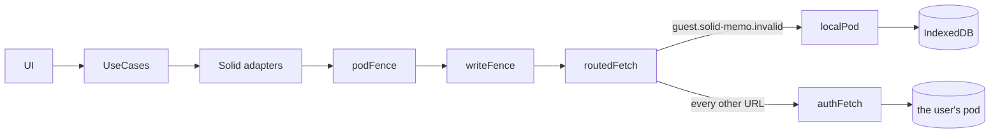
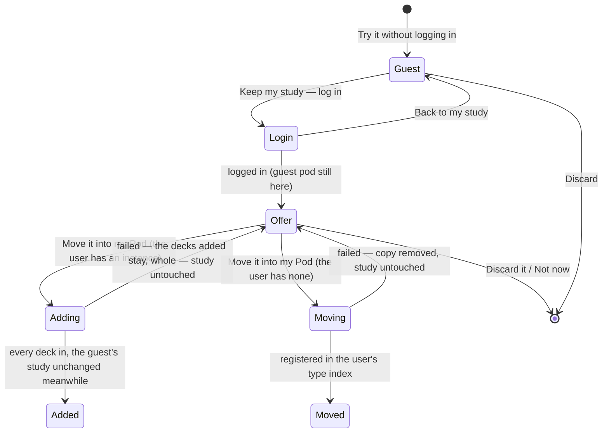

# Guest mode

Guest mode lets someone try Solid Memo before logging in, in a pod
kept in their browser. After logging in with a real WebID, the
guest can move that study into their own Pod. Everything else works the
same for a guest: the deck library, studying, statistics, preferences
and the data check. A guest's instance is made as any new one is, so it
studies by FSRS-6 ([srs.md](srs.md#which-scheduler-an-instance-is-on)).

## A pod in the browser

[localPod.ts](../packages/solid/src/localPod.ts) serves each guest a
small Solid pod as a `fetch`, which the app's Solid adapters use as they
do a server. A router
([routedFetch.ts](../packages/solid/src/routedFetch.ts)) sends each
request to the guest's pod or to the network, by URL, after the pod
fence and the write fence
([boundaries.md](boundaries.md#the-pod-fence)).

- **Origin:** `https://guest.solid-memo.invalid/` (`GUEST_ORIGIN` in
  [domain/guest.ts](../packages/domain/src/guest.ts)). The reserved
  `.invalid` domain never resolves: a guest URL slipping past the
  router fails instead of reaching anyone.
- **WebID:** `…/profile/card#me`, written when the guest starts
  (`GuestPod.start`). Its profile names the pod's root as its
  `pim:storage`. `createInstance` creates the instance and its private
  type index as on any pod.
- **What the pod speaks:** GET, HEAD, PUT, DELETE, and PATCH with SPARQL
  `INSERT DATA` / `DELETE DATA`. It gives ETags, honors `If-Match`,
  `If-None-Match: *` and `If-None-Match: <etag>`, keeps `ldp:contains`
  listings, and marks the root as a `pim:Storage`. It has no access
  control. Requests run one at a time, under a Web Lock shared by every
  tab.
- **Storage:** the `ResourceStore` port. In the browser it's
  [indexedDbResourceStore.ts](../packages/browser/src/indexedDbResourceStore.ts),
  so the study survives the login redirect. Without IndexedDB, an
  in-memory store keeps it for the current page only. It's the one
  place pod data lives in browser storage, and only a guest's.

`restoreSession` prefers a real session. Without one, it returns a
guest's session (`{ webId: GUEST_WEBID, guest: true }`) whenever a
guest pod exists in this browser.

## From a link

A link to a library deck, `#/try?deck=…`, is for anyone and doesn't
wait for "Try it without logging in": without a session, the app starts
a guest's study as that button does and opens the deck there
([routing.md](routing.md#a-link-to-a-library-deck)). A browser with a
guest pod goes on with it (`restoreSession` returns the guest's
session), and the deck opens in the guest's instance. A logged-in
user's opens it in their own. A guest's study that can't start leaves the
landing page, with the reason.

## Keeping the study

The guest pod's presence marks a study to keep, so nothing has to
survive the redirect. After any login or
restored session,
`GuestStudyOffer` asks `findGuestStudy` and makes the offer while a
guest pod exists. **Move it into my Pod** first lists the user's
instances. With at least one, the study is added to the one the user
chooses ([Adding to an instance](#adding-to-an-instance)). With none,
or when they can't be listed, it moves into a new instance
([As a new instance](#as-a-new-instance)). Logging in keeps the guest
pod for later.

### Adding to an instance

`mergeGuestStudy` adds the guest's decks, deck by deck, to the instance
the user chose (the first listed, unless they pick another). The form
lists the guest's decks (`planGuestMerge`), each checked; an unchecked
deck stays with the guest's study. At least one deck must stay
checked, unless the study has none.

A guest's deck from the same [library](deck-library.md) release as one
of the instance's (the same `prov:wasDerivedFrom`) says so. It's added
beside that deck with its own progress, never merged card by card, and
the user may uncheck it. The form says the instance keeps its own
preferences: the guest's aren't carried over. Nor is the guest's
digest, which is this browser's. Drafts the guest wrote in the
[Studio](studio.md#drafts) are copied too. When there are any, the
form says how many and the names they're copied under (step
**drafts**).

It runs these steps:

1. **read:** list the guest's instance, noting each document's version
   before any is read. Answers waiting to be logged go to the guest's
   log first, and the write fence keeps the guest's instance read-only
   meanwhile. The whole instance, answer log included, is checked
   against the shapes. Nothing is added from a study that doesn't fully
   conform (`guestStudyInvalid`), or that has a subject a newer app
   version wrote (`guestStudyTooNew`). Nor from a study with deck groups
   when a newer version wrote the instance's
   [arrangement](data-model.md#deck-groups) (`deckTreeTooNew`), refused
   before any deck is written.
2. **decks:** each kept deck becomes a new deck of the instance, in the
   guest's order ([data-model.md](data-model.md#decks-and-cards)):
   - a new id (`deck-<uuid>`), with its cards and reviews documents
     named after it in the instance's `decks/` and `reviews/`. The rest
     of its entry is the guest's: title, description, authors, license,
     topics, keywords, direction, pace, card language
     (`sm:deckCardLanguage`), creation time, the release it came from
     (`prov:wasDerivedFrom`) and, for a course's deck, its
     `schema:Course` type and completed chapters
     (`sm:completedChapter`);
   - its cards keep their fragment ids, distractors and creation
     times, written in this app's format, the document saying it's
     part of the deck. Its review states keep their SM-2 fields and
     snapshots, each naming its card, direction and scheduler; its
     FSRS-6 states come as they are;
   - the cards document, then the reviews document, is created with
     one PUT only where nothing is, then the deck's catalog entry, with
     `If-Match`, read and added again on 412 a few times at most.
     Until the entry is written, nothing names the documents. A
     failure before the entry deletes the documents it wrote, and any
     whose write's answer was lost, never one the pod refused to create.
     If only the entry's answer was lost, the deck is whole. A deck with
     no cards, or no review states, has no such document yet;
   - then its answers: each of the deck's answers in the guest's log is
     added to the instance's log for its month, insert-only, unread
     (`appendAll`, one PATCH per month, more where one would pass 64
     KiB). Its deck, card and chosen wrong option are named in the new
     deck's documents, by the same fragment ids; its grade, intervals
     and response times stay as given. Its id is the guest's followed by
     the new deck's (`answer-<time>-<random>-deck-<uuid>`). Answers of a
     deck the guest removed, or left out, aren't added.

   Nothing written may name the guest's pod (`guestUrlsLeft`). Nothing
   is registered: the instance's registered catalog and folders hold
   the added decks.
3. **arrange:** each of the guest's deck groups becomes a new group
   (`#group-<uuid>`) with its name, holding the added decks and new
   groups it held, an empty one empty. They go, in the guest's order,
   after the instance's own decks and groups, at the top level. It's
   one `graft` edit: one PATCH with `If-Match`, applied again on 412,
   which numbers the top level anew. With no group, nothing is written,
   and the added decks are listed after the instance's.
4. **drafts:** each draft the guest's catalog links is copied to the
   instance (`copyReleaseDraft`): read whole, every subject moved to
   `drafts/<name>/v<N>/` in the instance, at its version, under its
   name. When the instance has a draft of that name and version, it
   takes the next free name (`<name>-2`, …). It's written as a new
   draft is ([data-model.md](data-model.md#drafts-and-releases)). A
   draft whose link can't be written is taken back, and none of the
   instance's is written over. A copy that would still name
   the guest's pod isn't written (`guestUrlsLeft`).
5. **verify:** the guest's instance must still list the same
   resources, each at the version noted in **read**
   (`guestStudyChanged`).
6. **tidy:** delete the guest's instance as any instance is deleted
   ([data-model.md](data-model.md#discovery-chain)), and the whole
   guest pod once no instance is left. A failed delete only means
   `tidied: false`.

A failure leaves the instance valid and the guest's study as it was.
Every deck reported added (`added`) is whole: documents,
entry and, unless the failure was in adding them, answers. The only
other writes are the groups, after **arrange**, the drafts reported
copied (`copied`), each whole, and any unnamed deck document whose
deletion failed. The user is told which decks and drafts (under their
names there) are in the instance.

Trying again adds what isn't there yet. As each deck is added, and
before each group is, this browser's update journal notes
(`GuestMergeNote`) the new deck or group and what it was made from:

- for a deck, the guest's catalog entry and the versions of the guest's
  documents it was read at;
- for a group, the whole arrangement of the guest's groups around the
  added decks;
- for a draft, the versions of its documents.

On the next run:

- A deck whose entry and documents are as noted gets only its answers
  again, a no-op.
- When the arrangement is as noted, each group is made under its
  earlier URL, so a graft already made stays.
- A deck the guest changed since, in its entry or documents, is added
  anew beside the earlier one (which the user may remove). So is a deck
  the instance no longer has, and any deck without a note (the journal
  is best effort). Its answers become new entries whose ids name the
  new deck, so no log entry names two decks.
- Groups arranged otherwise than noted (a deck added anew among them)
  are made anew, holding the added decks; the earlier groups stay,
  without them.
- A noted draft at the same versions, whose copy the instance still
  links, isn't copied again; otherwise it's copied anew, under the next
  free name.

A merge that deletes the guest's study forgets the notes. A discarded
study's notes stay, matching no later guest's decks, which have new
URLs.

### As a new instance

`transferGuestStudy` copies the guest's instance into a container the
user chooses (by default `<storage>solid-memo/main/`, where a first
instance goes). It runs these steps:

1. **stage:** refuse (`typeIndexNoStorage`) when the study couldn't
   be registered: no type index of the chosen kind, and no storage the
   user's WebID leads to where one could be made
   ([data-model.md](data-model.md)). List the guest's instance, without
   the digest (this browser's). Check the target is free, then create
   it. Answers waiting to be logged go to
   the guest's log first.
2. **copy:** copy each resource with every IRI under the guest's
   instance moved under the target, and the guest's WebID renamed to the
   user's (`ContainerMove.renames`).
3. **adopt:** name the catalog's publisher as the user's profile names
   them. No document of the copy may still mention `GUEST_ORIGIN`, as an
   IRI or in text (`guestUrlsLeft`).
4. **validate:** the copy must fully conform to the shapes
   (`movedCopyInvalid`).
5. **verify:** the guest's instance must be unchanged since it was
   copied. The write fence keeps it read-only meanwhile, in the site's
   other open tabs too.
6. **register:** `attachInstance` in the type index the user chose.
   From here on the study is theirs.
7. **tidy:** register each class of the instance's data (its
   catalog, decks, cards, review states, answers and drafts,
   [data-model.md](data-model.md#discovery-chain)), then delete as the
   merge's **tidy** does. A registration that fails is left for
   **Register what is missing** in Preferences; the delete goes ahead
   anyway.

A failure before **register** deletes the copy, whole, and leaves the
guest's study as it was. The target's container, created where nothing
was and named by nothing before **register**, holds only Solid Memo's
copies. This browser's update journal notes the run:

- A copy a closed tab left behind is offered for removal, with the
  offer to keep the study, the next time the user is logged in
  (`InterruptedMoveContainer`), and removed whole.
- A move retried first, at the copy's place, fails before writing
  anything and leaves the note.
- A copy another tab's move is still writing isn't offered or removed.

The copy inherits the user's pod's default access control, like a new
instance; a guest's instance has none.

While a move runs, the site's other open tabs (the web app's and the
Studio's, which share one origin) hold the guest's instance and its
copy: a write there fails with the moving tab's message. The moving tab
holds a Web Lock named after its journal entry until the move ends,
failed or not, or the tab closes or crashes. Other tabs read the
entries on opening, then follow `storage` events, holding what an
entry names only while its lock is held. An entry a failed move keeps,
one a closed tab left, or one noting a deck added to an instance fences
nothing. A browser without Web Locks fences no other tab; **verify**
catches what it misses.
