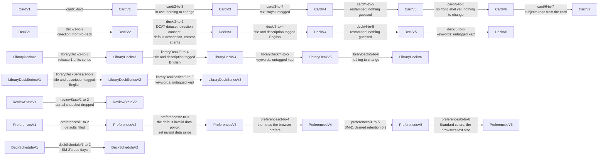
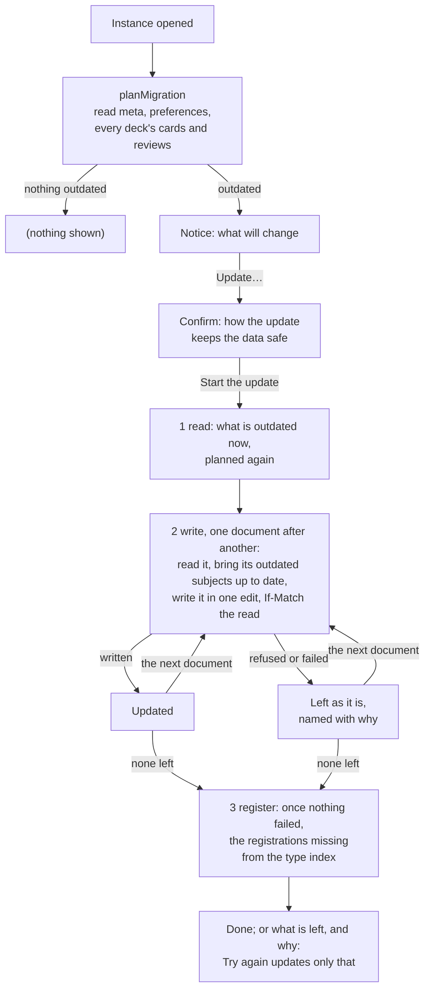
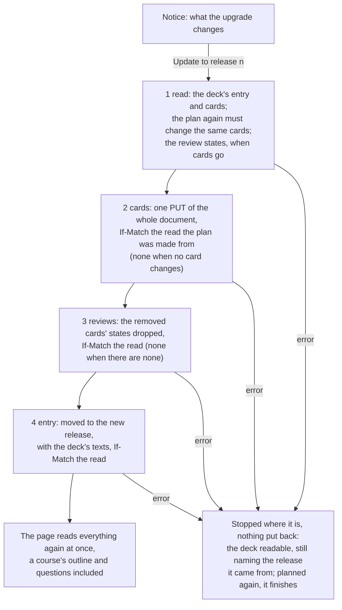

# Format versions and migrations

A pod (the learner's own Solid storage) may hold data an older version
of Solid Memo wrote, and every stored item says which format version
it's in. This page says how the app brings old data up to the format
it writes now, leaves data from a newer version alone, and updates a
deck copied from the library to its newer release.

The formats are the [shapes](shapes.md). The steps between them are the
migration modules in
[domain/shapes/migrations](../packages/domain/src/shapes/migrations/),
the plan is in [domain/migration.ts](../packages/domain/src/migration.ts),
and the notice the user sees is in
[MigrationContainer.tsx](../packages/ui/src/ui/MigrationContainer.tsx).

## Versions

Every subject Solid Memo writes carries `sm:formatVersion`. A missing
one means 1, the format that predates the field. `LATEST_VERSION` in
the generated [shapes module](../packages/vocab/src/types.generated.ts)
is what the app writes today; `DECK_FORMAT_VERSION` and friends are
aliases of it.

| Class | 1 | 2 | Why the version moved |
|---|---|---|---|
| Instance | title, created | `dcterms:replaces` (the instance it is an updated copy of) and `dcterms:modified` (when it replaced it), both optional | The format update of that time wrote a copy and kept the original as a backup. The update now writes in place and states neither. An instance an earlier update made keeps them, and the app ignores them ([The backup](#the-backup)). |
| Deck | title, document links, provenance | `sm:direction`, stated | A format-1 reader would study a bidirectional deck one way only and count the other way's review subjects against the day's budgets. |
| Card | `sm:front` and `sm:back`, both required | a side may be a picture (`sm:frontImage` / `sm:backImage`, an IRI), text, or both | A format-1 reader drops a card without `sm:front` as malformed, so picture-only cards mustn't pass as format 1. |
| Review state | the SM-2 fields; a snapshot and per-direction subjects were added without a bump, so format 1 admits them | the same fields; the snapshot is all five triples or none; the subject naming (`#<cardId>`, `#<cardId>@back-to-front`) is part of the contract | Stamping begins: a format-1 reader would ignore the snapshot and the other direction. |
| FSRS review state | an FSRS-6 state (vocabulary 1.21): stability, difficulty, due day, first and last review, the card and direction it is of, and a snapshot all four or none; `sm:scheduler sm:fsrs6` fixed | | A new shape of `sm:ReviewState`, not a review-state version: see below. |
| Preferences | whatever the unversioned era wrote: every field optional, a missing one meaning its default | every field stated | The document is rewritten on every save; format 2 is the complete record. |
| Deck schedule | the digest's counts of a deck's due days, with the direction and day boundary they hold for | the scheduler whose due days they count (`sm:scheduledWith`, vocabulary 1.21), and the version stated | Switching scheduler writes no review, so the reviews document's version can't tell the schedules apart: see below. |

Deck format 4 (and library deck series format 2, its summary in the
library index) states a deck's title and description as language-tagged
text, one value per language, exactly one of them English. The app
shows and edits the English and keeps the other languages. A format-3
reader knows only untagged strings and would drop a format-4 deck as
untitled. The step to format 4 tags a format-3 deck's title and
description as English.

Card format 3 adds a note under each side (`sm:frontNote`,
`sm:backNote`, shown once the answer is revealed) and a label above the
back (`sm:backLabel`, how the answer relates to the front), all
language-tagged text like a deck's title. It lets a card be retired
(`owl:deprecated true`): a library deck keeps a card it no longer uses
instead of removing it, and a copy keeps the card and its review state
but stops studying it. A format-2 reader would go on studying a retired
card. A format-2 card is in use, so the step to format 3 changes
nothing.

Card format 4 lets a side's text be language-tagged, one text per
language ("Mona Lisa"@en), or untagged when its language isn't known,
never both; English isn't required. The app shows the reader's
language, else the English, else the untagged text, and edits one text
while keeping the others; text typed in the app is untagged. A format-3
reader would read a tagged side as empty and drop the card. The step to
format 4 changes nothing: a format-3 side stays untagged, and no
language is guessed.

Deck format 5 and card format 5 let a deck's title and description, and
a card's notes and label, be in any language, one value per language.
English is no longer required: a deck titled only in Swedish, or a note
only in Finnish, is whole. `zxx` tags text in no
language (codes, numbers, symbols). Library releases stay at deck
format 4 (English first is the library's curation policy, not a rule of
the data), so no release is rebuilt, and an import is written in
format 5. A format-4 validator flags a title or note with no English,
and a format-4 app drops such a note when the card is edited. The steps
to format 5 change nothing but the version and guess nothing: every
format-4 deck and card is valid format 5 already.

Text the step to deck format 4 tagged English stays, as does text saved
the same in English and another language ("Stockholm"@en and
"Stockholm"@sv). A pure step can't tell an identical English copy from
a real translation, and the app accepts the same words in several
languages as text in each. An untagged card side stays untagged.

Deck format 6, with library deck format 5 and library deck series
format 3, lets a deck's keywords (`dcat:keyword`) be language-tagged,
several per language ("capitals"@en, "huvudstäder"@sv), shown in the
reader's language. A format-5 reader would read a tagged keyword as
absent and drop it on its next save of the deck. The steps to deck 6,
library deck 5 and series 3 keep untagged keywords untagged, their
language unknown (`""` in the model), and guess no language. Untagged keywords are valid only as
kept from older formats: the app writes every new keyword under the
language the user states. Library releases from library deck format 5
on tag every keyword, and each deck has keywords in English and
Swedish. Older releases stay
frozen with untagged keywords, and an import of one writes them
untagged into the format-6 copy.

Card format 6 (vocabulary 1.20) gives the front a label above it
(`sm:frontLabel`), as format 3 gave the back one, so a card studied
both ways says what's asked ("Country" above "Croatia", "Capital" above
"Zagreb"). Card format 5 was published
without the term, and a published shape is never edited
([vocab.md](vocab.md#versioning-policy)). The step to format 6
(`card/5-to-6`) changes nothing but the version. Library releases stay
at the card format they were published in: one with front labels is at
card format 6, and an import writes every card at 6. An app from before
format 6 reads a format-6 card with the format-5 shape, without its
front label, and doesn't write over it, so updating stays the user's
choice.

Card format 7 keeps what a card is about (`dcterms:subject`, the IRIs
of the things its source names); a copy of a library release keeps them
as the release states them
([deck-library.md](deck-library.md#what-a-card-is-about)). Card format 6
was published without the term. An app that wrote format 6 kept it, as
a triple its shape doesn't name, when it rewrote a card in place. It
dropped it when it copied a card into a new subject (an import, or a
move or copy into another deck). The step to format 7 (`card/6-to-7`)
changes nothing but the version. Releases compiled from linked data
state the term on cards of older formats (the taxonomy deck's version
3, at card format 4), so the app reads it whatever format a card
states. The format update keeps subjects another app gave a card. An import writes
every card at 7. An app from before format 7
reads a format-7 card with the format-6 shape and doesn't write over it.

[Deck groups](data-model.md#deck-groups) (deck group format 1) need no
migration: groups are new subjects, and a deck's `sm:position` and the
catalog's `dcat:catalog` belong to no shape.

[Courses](courses.md) (vocabulary 1.14) need no migration and moved no
format version:

- Chapter, step and distractor format 1 are new classes.
- `sm:distractor` joined card format 5, and `sm:answerMode` and
  `sm:chosenDistractor` answer format 1, each optional. An older app
  studies a course's card front to back, and reads a multiple-choice
  answer as an answer. Absent, they mean no wrong options, and
  recalled.
- `sm:completedChapter` on a deck belongs to no shape, as `sm:position`
  does, so `DeckV6` is unchanged and every writer of the deck keeps it.

An older app that edits a course's card keeps its `sm:distractor`
links, as any triple its shape doesn't own. One that removes the card
leaves its `sm:Distractor` subjects behind, which this app ignores. An
older app's [check](validation.md) lists an `sm:Distractor` as
`untyped`, a subject of no class it knows: visible, never a
violation.

[Text formats](vocab.md#text-formats) (vocabulary 1.15) need no
migration and moved no format version. `sm:textFormat` joined card
format 5, step format 1 and chapter format 1, optional:

- **A reader that ignores it loses** the rendering only: it shows the
  Markdown source and keeps the triple through an edit (the shapes
  aren't closed, and the writer keeps every predicate it doesn't own).
  Absent, the marker means plain.
- **An older app is a tab opened before the deploy, or a fork** (no
  service worker; the library index comes from the same deployment).
  Its one real loss: an edit of a multi-line text in a single-line
  field drops its line feeds. Since vocabulary 1.15, the
  app edits any card text saved with a line break in a textarea
  ([i18n.md](i18n.md)).
- **An older app's import drops the marker**, writing the card through
  its own card record. The
  [library upgrade](#catching-up-with-the-library) counts such a copy
  as left alone, its languages too, and the next release brings the
  marker back; there's no repair within one release.
- **A new concept of `sm:TextFormats` needs no bump either**: the shape
  lists none, so an unknown one is read as plain text and kept.
- **One full re-check**, as the property shapes changed the shape files
  and the rules' hash (`__SHAPES_RULESET__`, see `validation.md`).
  Outside validators of `card/v5.ttl`, `step/v1.ttl` and
  `chapter/v1.ttl` see one new constraint, which data without the
  marker meets.

What a review state is of, and the other links of vocabulary 1.16 (see
[vocab.md](vocab.md#review-states)), need no migration and moved no
format version:

- **`sm:reviewOf`, `sm:reviewDirection` and `sm:scheduler` joined
  review-state format 2**, optional. The app writes them on every state
  it writes: a review, a reset of the day, a course's answer, the format
  update's step. A state it has read is written back at its own
  subject. A new one goes to the subject the old rule
  names, or to `#review-<uuid>` where that subject is another's. An
  older reader takes a state at any other subject (another app's
  `#state-7f3a`, or `#review-<uuid>`) for one of a card the deck lacks.
  It ignores it, studies the card as new and writes `#<cardId>`, which
  this app then reads instead, one state counting per card and
  direction. States written before are read by their subject until
  they're next written.
- **Review-state formats 1 and 2 accept any subject for a state that
  names its card**, a relaxation. A tab opened before the deploy
  fetches these shapes from the site, but reads such a state by its
  subject and ignores it.
- **A state of another scheduler** has no SM-2 fields. The
  [check](validation.md#data-another-app-wrote) counts it as another
  app's, so it sets no deck aside, and this app never reads, writes over
  or removes it. Any value of `sm:scheduler` but the `sm:sm2` IRI
  counts, a literal too; from vocabulary 1.21, the `sm:fsrs6` IRI
  doesn't (an FSRS-6 state is this app's own, below). An older app
  takes it for SM-2's, can't read it (no ease factor), and would write
  over it only at the subject the old rule names for a card.
- **`schema:suggestedAnswer` on a card and `dcterms:isPartOf` on a cards
  document belong to no shape**: every writer keeps them, and the app
  reads neither. An older app that changes a card's distractors keeps
  its suggested answers, naming distractors it removed; this app keeps
  those as another app's.
- **A link to a card outlives an upgrade by an earlier version.** Until
  stable addresses, a library [upgrade](#how-an-upgrade-is-applied)
  moved the cards to a new document (`decks/<deckId>-<uuid>.ttl`) and,
  unless a removed card had states, kept the reviews document, whose
  links named the old one. The app reads a link into any cards document
  the deck has had (`decks/<deckId>.ttl` or
  `decks/<deckId>-<uuid>.ttl`) by its fragment, so no state is lost.
  This app's upgrade moves no cards, and the links it writes name the
  document the cards are in.
- **One full re-check**, as the shape files changed.

Library deck format 6 (vocabulary 1.18) lets a release describe its
series and its publisher in its own document, so a release published in
a pod is whole without an index
([deck-library.md](deck-library.md#a-release-outside-the-library)):

- **Why the version moved.** A format-5 reader looks for a release's
  series only in an index, so it can't list or upgrade a release in a
  pod. The property shapes didn't change.
- **Releases stay frozen at their format.** The library check takes a
  release in `decks/` at format 5 or 6, each against its own shape, and
  the app reads both. New releases are written at format 6.
- **The step from format 5 changes nothing** (`libraryDeck/5-to-6`,
  run in memory as every step is): a format-5 release's series and
  publisher stay in the index.
- **The drafts are new.** Draft deck, chapter and step format 1 are new
  shapes, for a release's draft. `sm:releaseDraft` and
  `sm:publishedRelease` are written on the catalog outside `CatalogV1`,
  as `sm:newcomerCourse` is on the library's, so the catalog format
  didn't move.
- **One full re-check**, as new shape files joined the rules; no
  subject in a pod is checked against them.

What an answer says of how it was given in vocabulary 1.19 (response
times, the day the prompt was due and the device's offset from UTC)
needs no migration and moved no format version:

- **`sm:recallMillis`, `sm:gradeMillis`, `sm:priorDue` and
  `sm:utcOffsetMinutes` joined answer format 1**, each optional, as
  `sm:answerMode` did in 1.14. An answer without them is counted as
  before.
- **Answers are never rewritten**, so no older writer drops them from
  an answer in the log. An older tab that adds a guest's study to an
  instance writes the guest's answers without them.
- **One full re-check**, as the property shapes changed; the new
  constraints bound only the new terms.

FSRS-6 review states (vocabulary 1.21, see
[vocab.md](vocab.md#fsrs-6)) need no migration, and the review-state
format didn't move:

- **A new shape, not review-state format 3.** An FSRS-6 state is an
  `sm:ReviewState` stamped with FSRS review-state format 1
  (`fsrs-review-state/v1.ttl`), told apart by `sm:scheduler sm:fsrs6`,
  a value its shape fixes. `pickShape` checks a review state against it
  only when the state names that scheduler, and then never against
  review state 1 or 2. SM-2 states are checked as before.
  A review-state format 3 would have moved every SM-2 state: each pod
  would need the format update, and every tab opened before the deploy
  would refuse to save a review.
- **It has no step**: its chain starts at 1.
- **An older app takes an FSRS-6 state for another scheduler's**. Its
  check gives warnings only (against review state 1, the version the
  state is stamped with), and it never reads, writes over or removes the
  state, not even with its card. A state an older tab leaves behind may
  be stale (that tab graded the card or reset the day by SM-2 alone) or
  orphaned (it removed the card). An FSRS-6 state is fresh while the SM-2
  state of its prompt has the same last review, and only then sets a
  due day. A stale or orphaned one is replaced at the next review under
  FSRS-6, estimated from the SM-2 state, and removed with its card
  ([data-model.md](data-model.md#decks-and-cards)).
- **An older app's Set due date goes unseen under FSRS-6.** It changes
  the SM-2 state's due day and keeps its last review, so the FSRS-6
  state still counts as fresh and goes on setting the card's due day
  until the card's next review.
- **The other terms of 1.21**, `sm:studyScheduler`,
  `sm:desiredRetention`, `sm:schedulerInvitationDismissed` and
  `sm:scheduledWith`, are in preferences format 5 and deck schedule
  format 2 (below).
- **One full re-check**, as a new shape file joined the rules; no pod
  holds an FSRS-6 state before the app writes one.

Preferences format 5 and deck schedule format 2 (vocabulary 1.21) say
which scheduler sets the due days:

- **Preferences format 5** states three fields, whichever scheduler is
  in use, so a switch back keeps the retention chosen. They're
  `sm:studyScheduler` (`sm:sm2` or `sm:fsrs6`), `sm:desiredRetention`
  (the chance of recall FSRS-6 aims at, from 0.7 to 0.97) and
  `sm:schedulerInvitationDismissed` (whether the learner answered "Not
  now" to the deck list's invitation to switch to FSRS-6). The step from
  format 4 (`preferences/4-to-5`) fills in SM-2, 0.9 (FSRS-6's default)
  and false. The format update offers it, as it offered the theme.
- **Defaults never change a scheduler.** A new instance is made with
  preferences that name FSRS-6. One made before with no preferences
  document reads as SM-2
  ([srs.md](srs.md#which-scheduler-an-instance-is-on)). No step turns
  FSRS-6 on: only `switchScheduler` does, once each deck's FSRS-6
  states are written.
- **Deck schedule format 2** states `sm:scheduledWith`, the scheduler
  whose due days the digest counts. A schedule holds only for its day
  boundary and while it names the scheduler in use (`freshSchedule`,
  `studyCountsOf`). Switching back from FSRS-6 to SM-2 writes no
  review, so without it the deck list would count the FSRS-6 days. The step
  from format 1 (`deckSchedule/1-to-2`) names SM-2. The format update
  never writes the digest; a schedule is restamped when it's next
  computed.
- **Why the versions moved.** Both shapes state every field, and a
  published shape is never edited. Writing both is a breaking change:
  an older tab reads format-5 preferences without the
  scheduler and refuses to save over them (`writtenByNewerApp`), so it
  can't save the preferences or the theme until it's reloaded. It reads
  a format-2 schedule as format 1, may count an FSRS-6 schedule's days
  as SM-2's, and refuses to write over one; its digest writes for that
  deck fail, and it learns the deck's documents again on its next
  visit.
- **One full re-check**, as new shape files joined the rules.

Preferences format 6 (vocabulary 1.22) keeps the colors and the text
size in the pod, as format 4 keeps the theme
([theme.md](theme.md#where-the-choice-is-kept)):

- **Preferences format 6** states `sm:palette`, any IRI (a concept of
  `sm:Palettes` among them), and `sm:textSize`, a concept of
  `sm:TextSizes`. The palette lists no concepts, so a later palette, or
  one of the user's own, needs no format 7. An unknown palette is shown
  as Standard and kept through a save. The step from format 5
  (`preferences/5-to-6`) fills in Standard and the browser's text size.
  The format update offers it, as it offered the theme.
- **Why the version moved.** A published shape is never edited.
  Writing format 6 is a breaking change. An older tab reads format-6
  preferences without the palette and the text size and refuses to save
  over them (`writtenByNewerApp`). So it can't save the preferences,
  the theme, or "Not now" to the invitation to FSRS-6 until it's
  reloaded.
- **One full re-check**, as a new shape file joined the rules.

Palette and color set format 1 (vocabulary 1.23) are new shapes, for
the palettes a user designs in the instance's `palettes.ttl`
([theme.md](theme.md#palettes-of-ones-own)):

- **No format moved**: preferences format 6 allows a user's own palette's
  IRI in `sm:palette`, and nothing is written until the user saves a
  palette. An older version keeps the
  palette through a save, shows Standard, and doesn't read
  `palettes.ttl`.
- **A color set is closed**: its shape allows only its colors, so a
  color added later is color set format 2,
  which this version reads with format 1's shape and never writes over
  (`writtenByNewerApp`).
- **One full re-check**, as new shape files joined the rules,
  `palettes.ttl` among the documents checked.

A deck's card language (vocabulary 1.24, `sm:deckCardLanguage`, the
language its card text is shown in first) needs no migration and moved
no format version:

- **It belongs to no shape**, as `sm:position` and `sm:completedChapter`
  do, so `DeckV6` is unchanged and every writer of the deck keeps it.
  This version sets or removes it only on the entry as it is then
  (`setCardLanguage`), and keeps it as stored on every other write. An
  older one keeps it, ignores it, and shows card text in the app's
  language first.
- **No re-check.** No shape file changed, and the check doesn't read
  the term.

Whether logging in skips the Connected screen (vocabulary 1.26,
`sm:connectedScreenSkipped`,
[onboarding.md](onboarding.md#skipping-the-connected-screen)) needs no
migration and moved no format version:

- **It belongs to no shape**, so `PreferencesV6` is unchanged and every
  writer of the preferences keeps it. This version sets or removes it
  only on the preferences as they are then (`markConnectedScreen`, their
  stored format kept), and keeps it as stored on every other write. An
  older one keeps it, ignores it, and shows the screen.
- **Read apart from the shape.** This version reads it on the
  preferences whatever their format, and whether or not they fit their
  shape (`connectedScreenSkipped`): a choice written on preferences that
  don't fit counts, though the preferences read as none.
- **No re-check.** No shape file changed, and the check doesn't read
  the term.

Rules that hold across versions:

- **Readers never refuse older data.** A subject is read with the shape
  of its stored version, then brought up to the latest record in memory
  by the migration chain. Nothing is written until the user asks.
- **A changed shape file means one full re-check.** The rules' hash
  changes with the shape files, so every instance is checked in full
  once on its next opening, and each document that conforms gets a
  new receipt.
- **Every write is in the current format.** `recordThing` stamps the
  descriptor's version on every subject it writes: adding or editing a
  card, saving a deck, a review, the preferences, an import.
- **Newer data passes through, and is never written over.** A stored
  version above the latest is read with the latest shape this app has;
  the model keeps the stored version, and the migration plan never
  counts it. `recordThing`, through which every subject is written
  ([records.ts](../packages/solid/src/records.ts)), refuses one whose
  stored version is above the version it writes for that kind. It
  refuses before anything is sent (`writtenByNewerApp`: "A newer
  version of Solid Memo has updated this data, so this version does not
  save over it. Reload the page…").
- **`unlessNewer` refuses the same for the writes that change or remove
  a subject without recording it.** These are a deck's position or
  completed chapter, a deck group's removal, the catalog's links, a
  repair, and the removal of a card, a distractor, a review state, a
  deck entry or a day's answers. It refuses a subject stamped above
  every version this app writes for its class. Where a shape fixes
  values the subject has (an FSRS-6 review state), the bound is the
  version for that shape's kind.
- **A tab opened before a deploy** can't write older formats over what
  the update wrote, unless its version predates these guards. The
  library import refuses newer data too, with a clear message.

## The chain

Each step is one module (`<class>/<n>-to-<n+1>.ts`): a pure, total
function from the record of one version to the record of the next,
which never mutates its input. A step also gets the IRI of the subject
being migrated (`MigrationContext`), for naming new resources beside
it. `migrate(shape, record, { subject })` walks the chain to the latest
version; a gap throws. Tests assert that the chain is contiguous for
every kind, every step is pure, the latest record passes through
untouched, and, with the real shapes, every step's output conforms to
the shape it moves to.

## The pod migration

The format update brings each outdated document up to this app's formats
on its own, where it is, in one write the pod makes whole or not at all.
No document, subject or folder changes its address, so bookmarks and
other apps' links still hold, and no type index registration changes;
only missing ones are added. No copy or backup is kept. A document that
can't be updated now is left as it is, readable, and the update goes on;
run again, it updates what's still outdated
([instanceUpdate.ts](../packages/domain/src/instanceUpdate.ts),
`updateInstance` in
[instances.ts](../packages/application/src/instances.ts)).

- **One document at a time is enough.** No fact of the update spans
  documents. A step is a pure function of one subject
  (`up(data, { subject })`, [The chain](#the-chain)). A reader brings
  each subject up to date in memory, so any mix of updated and outdated
  documents reads and conforms. Every ordinary write stamps the latest
  format (`recordThing`), so study goes on part-way. The one
  constraint linking subjects, the catalog's DCAT-AP listing of its
  decks as datasets (which outdated entries aren't), holds within the
  catalog document, written in one edit. No order between documents is
  needed, and nothing needs putting back.
- **Plan first, write nothing.** Opening an instance reads the meta
  document, the preferences, and every deck's entry, cards and review
  states, and counts what's outdated. A document still
  at a version the instance's [digest](data-model.md#the-digest) says
  has nothing outdated isn't read again. The result is cached for the
  session per instance.
- **The user decides.** The notice names what's outdated and which
  formats this app now writes. For each kind, it says what the steps
  after the oldest version found added (`oldestFormat` in the plan, the
  step tables in
  [MigrationNotice.tsx](../packages/ui/src/ui/MigrationNotice.tsx)).
  It says a deck without a description gets one only when a deck entry
  older than deck format 3 is outdated. Its button opens a confirmation,
  which says:
  - the documents are updated one by one, each where it is, in one
    write the pod makes whole or not at all;
  - where the pod checks this, a write is made only if nothing else
    changed the document since it was read;
  - every document can be read throughout;
  - one that can't be updated now is left as it is, to try again.

  Until **Start the update** is pressed, the app keeps working on the
  old format. A progress bar shows the step and, while it writes, "n of
  N documents".
- **What is outdated is read afresh** (another tab may have updated part
  of it). The update writes, in this order: `meta.ttl` and
  `preferences.ttl` when outdated, each deck's cards and reviews documents when a card or a
  state is outdated, and last `catalog.ttl`, when a deck entry is
  outdated or the catalog is missing. A missing catalog is written as
  the instance's record names it, published by the signed-in user
  ([data-model.md](data-model.md#the-catalog)). A document two decks
  share (another app may point two decks at one) is written for each
  deck in turn.
- **Each document in one conditional write.** The update reads the
  document and brings each subject stored in an older format up to date
  from that read, changing only its version. The write
  is a PATCH of what changed, or one PUT of the whole document when the
  PATCH would be larger than 64 KiB
  ([data-model.md](data-model.md#write-discipline)). Unknown triples
  survive. It carries `If-Match` the version read, so a change made
  elsewhere is never written over (412). It passes the write check, as
  every save does ([validation.md](validation.md)), and the guard
  against newer data (`writtenByNewerApp`, [Versions](#versions)). A
  document brought up to date elsewhere meanwhile isn't written.
- **One that can't be updated now is left as it is**: refused by the pod
  (412) or the write check, holding a newer version's subject, or hit by
  a network or server failure. Its one write wasn't made or was made
  whole, so it's readable either way. It's named with why, the update
  goes on with the next document, and nothing is put back.
- **What it says.** When every document was updated, the app reads
  everything again and says so. Otherwise it lists
  each document left — the instance record, the preferences, the
  catalog of the decks, or a deck's cards or review states — with why,
  and how many it did update. **Try again** plans afresh and writes only
  what's still outdated. Closed, the notice shows what's left.
- **Then the registrations.** Once nothing failed, the update adds each
  registration by class that belongs in a type index and is missing
  there ([data-model.md](data-model.md#discovery-chain)), in one write
  per index, with `If-Match`. An instance made before there were such
  registrations gains them; existing ones are left as they are. This
  is the one write outside the instance; a failure there leaves the
  update done, and **Register what is missing** in Preferences adds them
  later. An update that left a document adds none: it would register
  a catalog it couldn't write.
- **A closed tab** part-way leaves an instance that works, and its next
  opening offers the rest. Nothing is noted in the browser.
- **Other tabs, other devices.** Nothing is held while the update runs.
  Every write, the update's and any other, is conditional, so neither
  writes over the other. A document another tab or device changed
  meanwhile is left to the next run.
- **An older app**, in a tab or on a device, reads a subject stamped
  above it with the latest shape it has and, with the guard, doesn't
  write over it. That's so for a document any save wrote too, as both
  stamp their formats, so updating is the user's choice.

On a server that ignores `If-Match` (node-solid-server), a write can't
be held to the version read. A change another device makes between the
update's read and its write is kept by a PATCH, which changes only the
update's triples (and fails when a triple it deletes is gone). The PUT
of a whole large document undoes it, as any such save there does
(the write discipline in `data-model.md`).

What a server can't apply leaves that document as it was.
node-solid-server's parser knows no SPARQL-style `PREFIX` directive, so
it can't patch a document another app wrote with one. It finds a
decimal only as JavaScript spells it (`2.5` for `2.50`), so a deletion
it refuses for that is sent once more, so spelled.

### Proof on a real server

`npm run test:pod` runs the update against two majors each of the
Community Solid Server and node-solid-server, started by the tests
([testing.md](testing.md#commands)), through the app's own use cases
and Solid adapters, wired as in `createAppUseCases`. It records every
HTTP request as the app attempts it and as it reaches the server
([instanceUpdate.integration.test.ts](../e2e/pod/src/instanceUpdate.integration.test.ts)).
It seeds an old-format instance with another app's triple, an unknown
file and shared access, and checks that:

- each outdated document is written once, in order, held to the version
  it was read at (`If-Match` the ETag of its last read where the server
  enforces it, else right after a read of it). The last write is one
  edit of the type index (with `If-Match` where enforced), which keeps
  every triple and adds the registrations of the instance's catalog,
  decks, cards, review states and answers. No access control is
  written, and no resource comes or goes;
- the instance is updated, conforms and has nothing left to update, its
  decks and documents at the addresses they had; the other app's triple,
  the unknown file and the access rules are as they were;
- on an instance written by hand, a document whose write fails is served
  byte for byte as before. Its documents have prefixes of their own,
  comments, statements in no order Solid Memo writes, relative IRIs, a
  blank node and another app's decimal with a trailing zero, which a
  server's rewrite wouldn't keep as it is. Every other
  one is updated. The type index is as it was, and the instance reads,
  studies and conforms with the mix. A second run updates what's left,
  and writes nothing else;
- a document another device changed right before its write is refused
  (412) and left as that device left it, the others updated. A second
  run updates it, the change kept (where the server enforces
  `If-Match`);
- a large deck is updated in one PUT, held to the version read;
- a subject a newer version of the app wrote isn't written over;
- a save of a document changed elsewhere since it was read fails (412)
  and keeps the change; read again, it goes through.

On Community Solid Server 6, whose ETags are to the second, the
update's test of a change made "elsewhere" waits for the next second.
On node-solid-server, which ignores `If-Match`, the tests of such a
change are skipped. The tests start a Community Solid Server in memory;
`SOLID_SERVER_URL` points them at another server that lets anyone read
and write. `npm test` doesn't run them.

### The backup

The format update keeps no backup: each document is in a format the
app reads, updated or not. The chain's tests guard against a step that
runs but loses meaning ([The chain](#the-chain)). Every save applies
the same steps with no backup.

Until stable addresses, the format update copied the whole instance
into a sibling folder (`<name>-<uuid>/`), updated the copy, and kept the
original as a backup, which the copy's `meta.ttl` names
(`dcterms:replaces`). Such a backup, or a partial copy a closed tab
left, is now an ordinary folder: the app no longer lists it or offers
to restore it, and the user may delete it by hand. `meta.ttl` keeps
`dcterms:replaces` and `dcterms:modified`, which the app ignores.

Repairs edit in place, as the update does.

## Catching up with the library

A deck imported from the [deck library](deck-library.md) says which
release it came from (`prov:wasDerivedFrom <…/decks/name/vN.ttl>`).
When the library publishes a newer release, the deck page (and a
course's page) offers to bring the copy up to it (`planLibraryUpgrade`
in [domain/libraryUpgrade.ts](../packages/domain/src/libraryUpgrade.ts),
shown by
[LibraryUpgradeContainer.tsx](../packages/ui/src/ui/LibraryUpgradeContainer.tsx)).
The Studio lists every copy of an instance, and upgrades several in
turn ([studio.md](studio.md#library-copies)). A copy of a release added
from a link is upgraded to the newest version its creator's catalog
lists, when it can be read
([deck-library.md](deck-library.md#from-a-link)).

The deck list marks a copy the library has a newer release of with
"New release" after its name; its row leads to the deck page and its
offer (`newerRelease` of `useCopies` in
[deckTreeEditor.ts](../packages/ui/src/ui/deckTreeEditor.ts)). The list
tells this from the library's index alone (`libraryCopiesOf`,
`offersNewerRelease` in [library.ts](../packages/domain/src/library.ts)),
as the Studio's library copies screen does, and reads no release and
plans no upgrade. So it
marks some copies the deck page offers nothing for. One is a copy whose
newer release changes nothing in it or uses a card format this app
doesn't know. Another is a copy of a release the index doesn't list,
which may be no older than the newest. A copy of a release added from
a link isn't marked: only its creator's catalog would list a newer one.

The plan compares three sets of cards by fragment id: the release the
copy came from, the current release, and the copy. The library's
changes reach only what the user left as the library had it:

| In the releases | In the copy | The upgrade |
|---|---|---|
| Added in the new release | Not there | Adds it (retired, if the release has it retired) |
| Changed | As the old release had it | Changes it |
| Added, changed or removed | Changed by the user | Keeps the user's card, and says so |
| Retired | Anything | Retires it: kept, with its review states, but no longer studied |
| Retired before, in use again | Retired | Brings it back, with the review states it had |
| Removed | As the old release had it | Removes it, and its review states |
| What it is about changed | Its subjects as an older release had them, or none | Writes the release's subjects, the user's content and retirement kept |
| Anything | Removed by the user | Leaves it removed |
| Removed | Not there any more | Nothing to write but dropping the review states left of it; the deck still moves to the release |
| Added, changed, retired, in use again or about other things | Already as the new release has it: content and retirement, or, changed by the user, retirement; or its subjects | Nothing to write, but the deck still moves to the release |

Retiring isn't a change of the card's content, so it applies to cards
the user changed too. A library release never removes a card any more:
the build refuses one that drops a card of the release before it. The
removal rows are for releases made before cards could be retired.

A copy more than one release behind is compared with the releases in
between too. A card as one of them has it is the library's, as though
the copy came from that release (an upgrade to it, cut off before it
moved the deck's entry, wrote it). The newer release changes it and
sets its retirement.

A card's distractors are part of its content: a release that changes a
wrong option, its note or their order changes the card. A
[course](courses.md)'s deck (either release is a course) holds only the
cards the learner has answered. Its upgrade adds none, and changes,
retires and restores the cards it holds as above. A card the release
removed that it lacks is no offer. The course's outline (its
chapters, steps and theory) is never copied, but read from the release
the deck names. A release that changes only the outline is an offer of
its own (`LibraryUpgradePlan.outline`, compared by `sameOutline` in
[domain/course.ts](../packages/domain/src/course.ts)): it writes no
card and moves the deck to the release. So is a release that changes
only questions the learner hasn't reached
(`LibraryUpgradePlan.unreached`): their content, wrong options,
subjects or retirement. The deck meets them as the release it names
has them.

A card's [text format](vocab.md#text-formats) is part of its content: a
release that only marks a card as Markdown changes it. No text format
and `sm:plainText` compare the same, so a card switched to Markdown and
back is still the library's. One exception: a copy that is as
the old release had it but for lacking the release's text format, as an
app before vocabulary 1.15 imports or writes it, counts as left alone.
That holds here and when the user settles the deck's languages. The
newer release then brings the marker back, whether or not it changes the
card otherwise. A copy that states a format other than the release's,
`sm:plainText` against `sm:markdown` included, was changed by the user
and is kept.

What a card is about (its subjects, `dcterms:subject`, card format 7;
[deck-library.md](deck-library.md#what-a-card-is-about)) is the
library's: the app neither shows nor edits it, and it's no part of the
card's content. A release that changes it gives the copy's card the
release's subjects, whatever the user did to the card's text. A release
that changes nothing else is an offer of its own
(`LibraryUpgradePlan.about`, which the notice words as recording what
the cards are about). Subjects compare as sets. As for the text format,
a copy without subjects, as an app before card format 7 imports or
writes it, takes the release's. A copy with subjects of its own (only
another app could write them) is left as it is. A changed card is
written as the release has it, subjects and all. A card retired or
brought back is written once, with the release's subjects and
retirement.

A new study direction is taken up when the copy is still studied the
old release's way, and the deck's title, description, keywords and
themes each when the copy still has the old release's. A changed
title or description is kept. It gets the languages the release adds
only when it says the same as the release in every language both have,
sharing at least one (so a copy whose English the user retagged still
agrees in the languages left). Keywords compare language by language,
in any order: a copy whose keywords are the old
release's in every language takes the new release's, all languages at
once, and one whose keywords the user changed in any language keeps
them all. Untagged keywords imported from a format-4 release give way
to the new release's tagged ones. The default description the app gave
a deck that had none (`Flashcards: <title>.`) gives way to the
release's description. A copy upgraded before upgrades brought these
texts along gets its own release's languages the same way, once a
session when its page opens (`addReleaseLanguages`); nothing the user
wrote changes. That applies only to a copy of a series the library's
index lists. A release added from a link stays on its creator's server,
which can change it at any time, so a copy of one gets new languages
only from an upgrade the user agrees to. The notice lists
the notes of every release in between.

Nothing is offered for a release that isn't newer, uses a card format
this app doesn't know, or would change nothing. A copy already as the
newer release has it (the table's last two rows) is still offered the
release, which moves its entry. That covers cards as the release has
them (`applied`), and a direction, title, description, keywords or
themes already the release's where it changed them (`appliedAbout`).
It covers a copy with no card the release removed (`gone`, unless the
copy is a course's deck).
An upgrade cut off after writing the cards, or the user's own edits,
leave a copy so (guards against a later upgrade taking the newer
release's changes for the user's). A plan made on a copy an upgrade
left half done finishes that upgrade, or takes the copy on to a release
out since ([How an upgrade is applied](#how-an-upgrade-is-applied)).
Review history of every card but the removed ones is kept.

### How an upgrade is applied

An upgrade writes the deck's documents where they are, each in one
write made only if it's still as it was read. The order leaves the
deck readable after each write: its cards, then the review states
of the cards it removes (SM-2's and FSRS-6's, in one write), then its
catalog entry, which says which release the deck is. A failure stops it
where it is and puts nothing back; planned again, the upgrade is
offered and finishes
([domain/deckUpgrade.ts](../packages/domain/src/deckUpgrade.ts),
`applyLibraryUpgrade` in
[library.ts](../packages/application/src/library.ts)). The deck, its
documents and its cards keep their addresses and ids, so the answer log
(statistics count a card by its deck and id) and other apps' links
still name them.

- **Planned on the deck as read.** The upgrade reads the deck's entry
  and cards again, and plans again. A plan that no longer changes the
  same cards as the one the user agreed to (another device edited one)
  stops it before any write (`deckChangedSinceOffer`). The cards' write
  is held to the read the plan was made from: a cards document changed
  since isn't written (`changedElsewhere`).
- **The cards first**, written whole in one PUT with `If-Match` (a PATCH
  of much text can be cut short, [testing.md](testing.md)). A card the
  release adds is made at the time it's written.
- **Review states change only when they must.** When no removed card
  has review states, the reviews document isn't touched, and reviews
  saved meanwhile on another device land as before. Otherwise it's
  written in place without the removed cards' states, after the cards
  (a state of a removed card is read as no card's).
- **The entry is the last write.** The catalog entry
  (`prov:wasDerivedFrom`) is written once, conditionally, only while it
  says what was read (`sameDeckState`), and moves the deck to the new
  release with the direction, title, description, keywords and themes
  the release changes. A write whose answer was lost is settled by
  reading the entry: when it names the new release, the upgrade is done.
- **A failure stops it where it is.** A write refused (a 412, the write
  check), failed or cut off (a closed tab) leaves what was written, and
  the deck can be studied as it is. The failure says at which step, and
  whether the deck may have changed. It may have if a write was made,
  or if the entry's write lost its answer and the entry can't be read
  again. **Try again** plans again, with the deck as it now is.
- **Planned again, it finishes.** The plan takes what's already as the
  newer release has it for the release's
  ([above](#catching-up-with-the-library)). The cards it wrote are
  `applied`, the cards it removed `gone` (any states left of them
  dropped), and the deck's texts are still to take up. So the upgrade
  is offered again, writes what's left and moves the entry. No card it
  wrote is taken for one the user changed. If a newer release is out by
  then, the deck is offered that one, planned with the release the
  cut-off upgrade was to. The newer one changes the cards it wrote as it
  would its own.
- **Nothing is kept beside the deck**: no copy, backup or note in the
  browser, and no undoing.
- **Sharing is untouched**: no access control is written.
- **Decks an earlier version moved** to `decks/<deckId>-<uuid>.ttl` and
  `reviews/<deckId>-<uuid>.ttl` are upgraded where they are, found
  through the catalog entry. Documents such an upgrade, cut off, left
  beside the ones the entry names aren't read, and stay until the user
  deletes them.
- **Progress.** The deck page shows every step and a progress bar in
  place of the offer.

On a server that ignores `If-Match` (node-solid-server), the cards' PUT
can't be held to the plan's read: a card another device edited in
between is written over.

#### Proof of the upgrade on a real server

`npm run test:pod` runs the upgrade against the same servers as the
format update, through the app's own use cases and Solid adapters, with
every request recorded as it reaches the server
([deckUpgrade.integration.test.ts](../e2e/pod/src/deckUpgrade.integration.test.ts)).
It seeds an instance holding a copy of a release, studied, its cards
shared with a friend, and checks that:

- the deck is upgraded where it is, its addresses, review states,
  sharing and another app's triple and subject in its cards document
  kept. Its cards document (in one PUT), its reviews document and its
  entry are written once each, in that order, each held to the version
  it was read at, as for the format update. No access control is written
  and nothing is kept beside the deck. The instance conforms, and
  nothing more is offered;
- on a deck whose cards and review states were written by hand
  (prefixes of their own, a comment, statements in an order the server
  wouldn't write, relative IRIs, another app's blank node):
  - the entry's write failing leaves the deck readable and conforming
    with the new release's cards, still naming the old release; planned
    again, every card it wrote is the release's, and the upgrade
    finishes with the entry alone;
  - with a newer release out by then, it's offered that one, which
    changes the cards it wrote, none taken for the user's, and finishes;
  - a release that only removes a card, cut off the same way, is offered
    again and moves the deck;
  - the review states' write failing leaves them byte for byte as
    before; planned again, the upgrade drops the removed card's state
    and finishes;
  - the cards' write failing leaves both documents byte for byte as they
    were and the entry as it was;
  - the cards' write refused for a change another device made after the
    plan read them (412) leaves them as that device left them (where the
    server enforces `If-Match`);
  - an entry's write made but its answer lost is told done by the entry;
- the keywords the user changed are kept, and a deck an earlier version
  moved to documents of its own is upgraded where they are.

## Adding a format version

1. Write `ns/shapes/<class>/v<N+1>.ttl`: copy `v<N>.ttl`, change the
   `@base` to its own address and the version assertion to
   `sh:hasValue N+1`, and add or change the properties. Add any new
   terms to the [vocabulary](vocab.md). A shape's `sh:name` version must
   match its file's, with no gaps, so a class whose shape shares a file
   with another's moves to a folder of its own when only it gets a new
   version. Library deck 5 is
   `ns/shapes/library-deck/v5.ttl`, a self-contained copy of
   `LibraryDeckV4` from `ns/shapes/deck/v4.ttl`.
2. `npm run generate`: the new record type, descriptor and
   `LATEST_VERSION` appear.
3. Add `packages/domain/src/shapes/migrations/<class>/<N>-to-<N+1>.ts`
   and register it in `migrations/index.ts`.
4. Adjust `<class>FromRecord` / `<class>ToRecord` in
   `packages/domain/src/` if the model changed, and the writers that
   build the record.
5. Add fixtures under `packages/vocab/fixtures/<class>/v<N+1>/` and the
   conformance fixture; document the version in the table above.
6. For a deck, card, review state or preferences version, say what the
   step added, which the format update notice names. Add a message
   under `migrationNotice` in every [message file](i18n.md), and its key
   at the end of the class's step table in
   [MigrationNotice.tsx](../packages/ui/src/ui/MigrationNotice.tsx).

The chain test, the conformance test, the drift check and the plan and
notice tests fail until all of that agrees. Nothing else needs touching.
