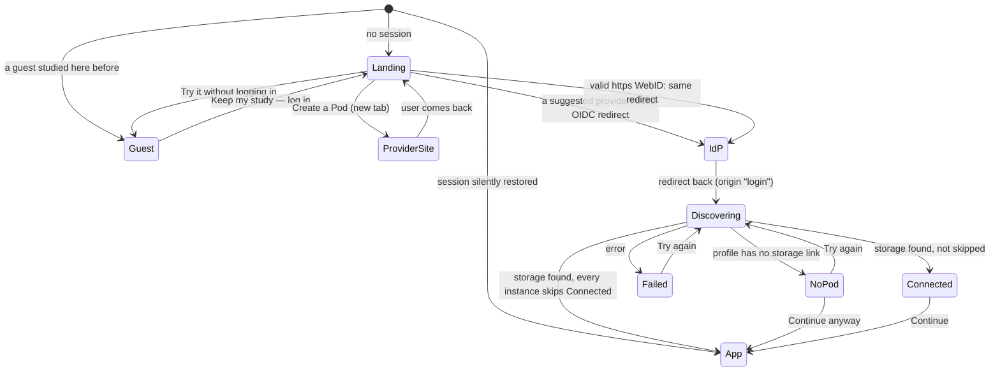

# Onboarding

How a signed-out visitor ends up with a connected Pod. The UI lives in
[packages/ui/src/ui/onboarding/](../packages/ui/src/ui/onboarding/); everything Solid-specific
stays behind use cases (see [boundaries.md](boundaries.md)).

## Flow

| Step | Component |
|---|---|
| Landing | `OnboardingFlow` + `WebIdForm` |
| Discovering, Connected, NoPod, Failed | `PodConnectionScreen` |
| Orchestration (session, account query, Connected screen choice: `useConnectedScreen`) | `AppShell` (in `App.tsx`), the one shell of the site's page around Solid Memo and the [Studio](studio.md) alike |

The landing is one page: the guest's offer, then logging in (a button
per suggested provider, and the WebID form under them), then creating a
Pod. Logging in comes before creating a Pod, so someone who has a Pod
logs in in one click. For a user who logged out or whose session
expired, and for a guest logging in, logging in comes first, before
the guest's offer. A guest studies in a pod kept in the browser until they log in
and keep their study in their Pod, added to an instance they have or as a
new one ([guest-mode.md](guest-mode.md)). A silently restored session skips onboarding entirely:
`SessionGateway.restore()` reports `origin: "login"` only when a login
redirect just completed.

Onboarding ends on an instance's deck list. A new instance has no decks
yet, so the list offers the deck library's course for newcomers under
its heading, started in one click
([courses.md](courses.md#the-course-for-newcomers)).

## Skipping the Connected screen

The Connected screen says nothing new to a learner who logs in often,
so it offers "Don't show this screen after logging in". The choice is
kept in the preferences of each of the learner's instances
(`sm:connectedScreenSkipped`, outside the preferences' shape,
[migrations.md](migrations.md)), so it follows them to every device:

- **Read beside the account.** `connectedScreenChoice` lists the
  learner's instances (the type indexes) and reads the choice in each
  one's preferences, while `discoverAccount` runs. The screen is skipped
  only when there is at least one instance and every one says so
  (`skipsConnectedScreen`). An instance whose preferences cannot be
  read counts as showing it; the choice is read whatever format the
  preferences are stored in, a newer one too, and whether or not they
  fit their shape (`connectedScreenSkipped`).
- **Discovering waits only so long.** Once storage is found, the
  Discovering screen stays while the choice is read, for 3 seconds at
  most (`CONNECTED_SCREEN_WAIT_MS`); then the Connected screen shows,
  and stays though the choice comes back later. No Pod found and a
  failed discovery show at once, and are never skipped. When the
  instances cannot be listed the screen shows, without the box. "Try
  again" reads the choice again too.
- **No instance, no box.** With no instance there is nowhere to keep
  the choice: the screen shows as before, without it.
- **Saved after Continue.** Continue enters the app at once; the box
  checked, `skipConnectedScreen` then saves the choice in every
  instance, each in its turn after the instance's other writes of its
  preferences, in one PUT of the whole document, If-Match, as "Not now"
  to FSRS-6 is ([theme.md](theme.md#where-the-choice-is-kept)). An
  instance with no preferences gets new ones (the defaults, shown as
  this device shows the app) only when its meta document reads, so
  nothing is written at a registration whose instance is gone.
  Preferences that do not fit their shape gain the choice alone, which
  counts all the same.
- **An instance not saved keeps showing it.** Preferences of a newer
  format are never written (`writtenByNewerApp`), and a write may fail:
  such an instance keeps showing the screen until the write succeeds,
  after an update of the app for a newer format. No notice says so; the
  box's hint does.
- **Shown again from Preferences.** Each instance's Preferences offers
  "Show the screen that says your Pod is connected" (not to a guest,
  who never logs in). Turning it on in any one instance brings the
  screen back. A form sends the choice only when the learner changed
  it, so one opened before the box was checked never undoes it, and
  every other save of the preferences keeps it as stored.
- **New instances show it.** A new instance, or one made from a guest's
  study, has no choice stored, so the screen shows again until the box
  is checked again.

## Pod providers

[packages/domain/src/podProvider.ts](../packages/domain/src/podProvider.ts) lists the
providers suggested (`POD_PROVIDERS`). A provider is data, nothing more —
a name, its Solid-OIDC issuer, and optionally a sign-up link — so adding a
provider is adding a list entry. A build can suggest a list of its own
instead, in `VITE_POD_PROVIDERS` ([configuration.md](configuration.md#vite_pod_providers));
`AppShell` takes the list as its `providers`:

- **every** provider is a button under "Log in with your Pod", for
  users who do not want to type their WebID. Picking one
  calls `loginWithProvider(oidcIssuer)`, which starts the same Solid-OIDC
  redirect directly at that issuer; the WebID then arrives with the session,
  and Pod discovery proceeds exactly as after a WebID login;
- providers **with a `signUpUrl`** are offered under it, under "No Pod
  yet?", for creating a Pod ([which ones](#offered-for-creating-a-pod)).

Issuers are the exact values each provider advertises in its
`/.well-known/openid-configuration`.

### Offered for creating a Pod

Every suggested provider is offered for creating a Pod: each lets anyone
sign up, with no invite and no waiting list (checked on 2026-10-24).

| Provider | Sign-up page |
| --- | --- |
| iGrant.io Data Pod | <https://igrant.io/datapod.html> |
| solidcommunity.net | <https://solidcommunity.net/.account/login/password/register/> |
| Inrupt PodSpaces | <https://start.inrupt.com/> |
| solidweb.me | <https://solidweb.me/.account/login/password/register/> |

solidcommunity.net and solidweb.me run the Community Solid Server: its
"Create account" page makes the account, and the Pod is created from the
account's page after that. Inrupt PodSpaces is a Developer Preview, which
Inrupt says is not for production use or for sensitive or personal data.

`npm run check:providers` requests each sign-up page weekly
([testing.md](testing.md#pod-providers)). A provider whose sign-up
closes, or comes to need an invite, loses its `signUpUrl` and stays
suggested for logging in; say here why it was left out.

## WebID validation

A chosen provider's issuer passes `isSecureUrl` in the use case, like every
other URL that steers authentication.

`validateWebId` ([packages/domain/src/webId.ts](../packages/domain/src/webId.ts)) accepts
only absolute `https:` URLs without embedded credentials. It runs in the
form (for the message) and again in the `loginWithWebId` use case (so no
caller can skip it). The discovered OIDC issuer passes the same
`isSecureUrl` check before the browser is sent there.

## Pod discovery

`discoverAccount(session)` returns a
[SolidAccount](../packages/domain/src/account.ts) `{ webId, name?, podUrl?, oidcIssuer? }`:

- `podUrl` — first result of `StorageGateway.discoverStorages`: the
  profile's `pim:storage` (`http://www.w3.org/ns/pim/space#storage`)
  links, falling back to the Solid Protocol's storage `Link`-header
  walk-up. Never typed by the user, never assumed from the provider or
  the WebID's origin.
- `oidcIssuer` — the profile's `solid:oidcIssuer`; informational, so a
  failed lookup does not fail discovery.
- `name` — the profile's `foaf:name` (`profileNameOf` in
  [domain/account.ts](../packages/domain/src/account.ts)), read from the WebID
  document; also informational. When present, the masthead's "Logged in
  as" and the connection screen show it instead of the WebID, as a link
  to the WebID.

The account is held in the react-query cache (`queryKeys.account(webId)`,
[architecture.md](architecture.md#query-keys)) and,
like all Pod data, is cleared on logout. Nothing is persisted by the app;
the session itself is persisted by the authn library.
