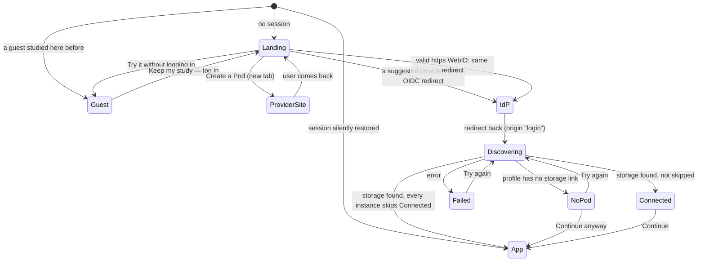

# Onboarding

How a signed-out visitor ends up with a connected Pod. The UI lives in
[packages/ui/src/ui/onboarding/](../packages/ui/src/ui/onboarding/), and
everything Solid-specific stays behind use cases
([boundaries.md](boundaries.md)).

## Flow

| Step | Component |
|---|---|
| Landing | `MakerNote` + `OnboardingFlow` + `WebIdForm` |
| Discovering, Connected, NoPod, Failed | `PodConnectionScreen` |
| Orchestration (session, account query, Connected screen choice: `useConnectedScreen`) | `AppShell` (in `App.tsx`), the site's one shell, around Solid Memo and the [Studio](studio.md) |

The landing is one page: the guest's offer, a short note from Solid
Memo's maker on why they made it, then logging in (a button per
suggested provider, and the WebID form under them), then creating a Pod.
The note (`MakerNote`) is the same paragraph as on the About page, in
the reader's language.
Someone who has a Pod logs in in one click. After a logout or an expired
session, and for a guest logging in, logging in comes first, and the
note is left out. A site with a name of its own, and the Studio, leave
the note out too: it is the maker's own statement about Solid Memo. A
guest studies in a pod kept in the browser until logging in moves the
study into their Pod, in an instance they have or a new one
([guest-mode.md](guest-mode.md)). A silently restored session skips
onboarding: `SessionGateway.restore()` reports `origin: "login"` only
right after a login redirect.

Onboarding ends on an instance's deck list. A new instance's empty list
offers the deck library's course for newcomers under its heading,
started in one click ([courses.md](courses.md#the-course-for-newcomers)).

## Skipping the Connected screen

The Connected screen offers "Don't show this screen after logging in".
The choice is kept in each instance's preferences
(`sm:connectedScreenSkipped`, outside the preferences' shape,
[migrations.md](migrations.md)), so it follows the learner to every
device:

- **Read beside the account.** While `discoverAccount` runs,
  `connectedScreenChoice` lists the learner's instances (the type
  indexes) and reads the choice in each one's preferences, of any
  format and whether or not they fit their shape
  (`connectedScreenSkipped`). The screen is skipped only when at least
  one instance exists and all say so (`skipsConnectedScreen`). An
  instance whose preferences can't be read counts as showing it.
- **Discovering waits only so long.** Once storage is found,
  Discovering stays up to 3 seconds (`CONNECTED_SCREEN_WAIT_MS`) while
  the choice is read. Then the Connected screen shows and stays, even if
  the choice arrives later. No Pod found and a failed discovery show at
  once and are never skipped. "Try again" rereads the choice too.
- **No instance, no box.** With no instance, or when the instances
  can't be listed, the screen shows without the box.
- **Saved after Continue.** Continue enters the app at once. With the
  box checked, `skipConnectedScreen` then saves the choice in each
  instance in turn, after that instance's other preference writes, as
  one If-Match PUT of the whole document, like "Not now" to FSRS-6
  ([theme.md](theme.md#where-the-choice-is-kept)). An instance with no
  preferences gets new ones (the defaults, as this device shows the
  app) only when its meta document reads, so nothing's written at a
  registration whose instance is gone. Preferences that don't fit
  their shape gain only the choice, which still counts.
- **An instance not saved keeps showing it.** Preferences of a newer
  format are never written (`writtenByNewerApp`), and a write may fail:
  the screen shows until a write succeeds (for a newer format, after an
  app update). The box's hint says so; no notice does.
- **Shown again from Preferences.** Each instance's Preferences offers
  "Show the screen that says your Pod is connected", except to a guest.
  Turning it on in any instance brings it back. A form sends the
  choice only when the learner changed it, so a form opened before the
  box was checked never undoes it, and every other preferences save
  keeps it.
- **New instances show it.** A new instance, or one made from a guest's
  study, has no choice stored, so the screen shows until the box is
  checked again.

## Pod providers

[packages/domain/src/podProvider.ts](../packages/domain/src/podProvider.ts)
lists the suggested providers (`POD_PROVIDERS`), each a list entry: a
name, its Solid-OIDC issuer and an optional sign-up link. A build can
set its own list in `VITE_POD_PROVIDERS`
([configuration.md](configuration.md#vite_pod_providers)). `AppShell`
takes the list as its `providers`:

- **Every** provider is a button under "Log in with your Pod". Picking
  one calls `loginWithProvider(oidcIssuer)`: the same Solid-OIDC
  redirect, at that issuer. The WebID arrives with the session, and
  discovery runs as after a WebID login.
- Providers **with a `signUpUrl`** are offered under "No Pod yet?" for
  creating a Pod ([which ones](#offered-for-creating-a-pod)).

Each issuer is exactly as its provider advertises it in
`/.well-known/openid-configuration`. A provider is listed only if it
sends the `iss` parameter on its answers, without which the app
refuses the login
([authentication.md](authentication.md#the-issuer-on-the-providers-answer)).

### Offered for creating a Pod

Every suggested provider is offered: each lets anyone sign up, with no
invite and no waiting list (checked on 2026-10-24).

| Provider | Sign-up page |
| --- | --- |
| solidcommunity.net | <https://solidcommunity.net/.account/login/password/register/> |
| Inrupt PodSpaces | <https://start.inrupt.com/> |
| solidweb.me | <https://solidweb.me/.account/login/password/register/> |

solidcommunity.net and solidweb.me run the Community Solid Server: its
"Create account" page makes the account, and the Pod is then created
from the account's page. Inrupt PodSpaces is a Developer Preview,
which Inrupt says isn't for production use or for sensitive or personal data.

`npm run check:providers` requests each sign-up page weekly
([testing.md](testing.md#pod-providers)). A provider whose sign-up
closes or comes to need an invite loses its `signUpUrl`, stays
suggested for logging in, and gets a note here on why.

## WebID validation

Every URL that steers authentication passes `isSecureUrl` in its use
case: a chosen provider's issuer, and the discovered OIDC issuer before
the browser is sent there.

`validateWebId` ([packages/domain/src/webId.ts](../packages/domain/src/webId.ts))
accepts only absolute `https:` URLs without embedded credentials. It
runs in the form (for the message) and in the `loginWithWebId` use
case (no caller skips it).

## Pod discovery

`discoverAccount(session)` returns a
[SolidAccount](../packages/domain/src/account.ts) `{ webId, name?, podUrl?, oidcIssuer? }`:

- `podUrl`: the first result of `StorageGateway.discoverStorages`, from
  the profile's `pim:storage` (`http://www.w3.org/ns/pim/space#storage`)
  links, falling back to the Solid Protocol's storage `Link`-header
  walk-up. The user never types it, and the app never assumes it from
  the provider or the WebID's origin.
- `oidcIssuer`: the profile's `solid:oidcIssuer`, informational: a
  failed lookup doesn't fail discovery.
- `name`: the profile's `foaf:name` (`profileNameOf` in
  `domain/account.ts`), from the WebID document, informational too.
  When present, the masthead's "Logged in as" and the connection
  screen show it instead of the WebID, linked to the WebID.

The account lives in the react-query cache (`queryKeys.account(webId)`,
[architecture.md](architecture.md#query-keys)) and, like all Pod data,
is cleared on logout. Only the authn library persists anything: the
session.
