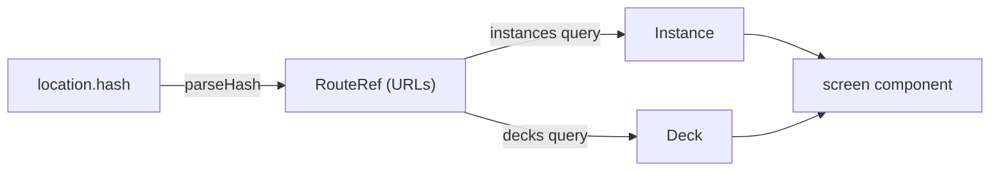
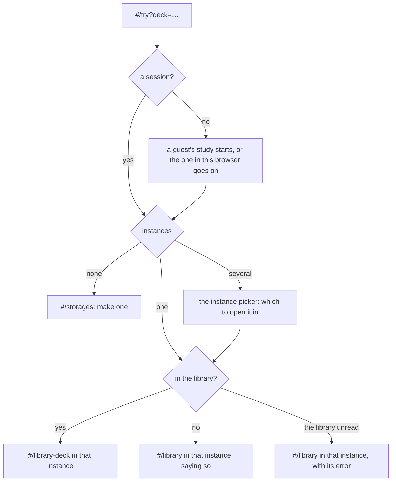

# Routing

The URL always represents the view the user is looking at, so every
screen can be bookmarked, shared, reloaded, and walked with
Back/Forward.

## Where it lives

Routing is a UI concern: [`packages/ui/src/ui/router.ts`](../packages/ui/src/ui/router.ts)
defines the serializable `RouteRef` union, the `routeToHash` /
`parseHash` pair, and the `useHashRoute` hook. `Workspace` owns the
mapping from a `RouteRef` to a rendered screen.

The hook itself is `useHashRouter` in
[`routerCore.ts`](../packages/ui/src/ui/routerCore.ts), over any app's
routes and its pair of functions. The [Studio](studio.md) has routes of
its own and keeps them with the same core; this page is about Solid
Memo's.

The Studio shares Solid Memo's page. Its routes are the hashes under
`#/studio` (`STUDIO_PATH`; `isStudioHash` tells them apart), and none of
Solid Memo's is one of them. The page
([`apps/web/src/App.tsx`](../apps/web/src/App.tsx)) follows the hash and
shows Solid Memo's `Workspace` or the Studio's, so a link between the
two apps is a plain hash link. Solid Memo links to the Studio with
`studioHref`: the instance's Home there, `#/studio?instance=…`. The
instance bar, each deck's actions menu and the deck page have this
"Open in Studio" link. Solid Memo cannot import the Studio's router, so
`studioHref` spells that route itself, and a Studio test checks that
the two agree.

Within the Studio, its sidebar's sections, decks and drafts, the
tabs of a deck or a draft, and the palette's entries that go somewhere
([studio.md](studio.md#quick-open-and-commands)), are links to its
routes: following one pushes a history entry, as any link does, and
none adds a route or a parameter of its own. The chrome around a
screen (which section, deck or draft the sidebar marks, which tabs
there are and which is current, whether the aside shows a course's
outline, a deck, a library copy's upgrade or a card) is worked out from the route alone, and hiding the sidebar,
the aside or the dock, or a table's columns, changes no URL ([studio.md](studio.md#layout)).
F8 goes to a problem's field as a link does.

A card's route, `#/studio/card`, also carries the card workbench's
query, so the deck's cards stay listed beside the card: the
workbench's own parameters (`q`, `lang`, `state`, `has`, `sort`,
`order`, `page`, `size`), but `in` for where to look, as the card's
`field` is the field it opens at. They are optional: a link to a card
without them lists the deck's cards as the workbench does by default.
Opening a card from the list pushes a history entry; going from card
to card beside it (`j` and `k`, Previous and Next) replaces it, as
does putting the list at the page of a card opened from elsewhere.
While the card's edits are not saved, a hashchange (Back, Forward, a
hash typed in) is undone before the router hears of it, by going as
many entries the other way, and asked about first
([studio.md](studio.md#card-inspector)). To tell how far, the router
numbers the entries it sees (`position` in each entry's state, read by
`historyPosition` and `shownPosition` in
[routerCore.ts](../packages/ui/src/ui/routerCore.ts)): one more for
each entry after another, as it pushes one or hears of one the browser
made; a replace keeps the number. No entry is pushed to undo a move, so
the history after it is kept.

Home's route, `#/studio`, carries the view its tabs show (`show`:
`due`, `courses`, `copies` or `attention`; every deck without it) and
the deck beside its table (`deck`, the deck at the table's cursor). A
draft's cards, `#/studio/draft-cards`, carry how they are sorted
(`sort` and `order=desc`). Each is optional, and each change of them
replaces the history entry: it is the same screen, looked at another
way ([studio.md](studio.md#home)).

## Hash routing, not pathname routing

The route is kept in `location.hash`:

- Deep links work on any static host — no server rewrite rules.
- The Solid OIDC redirect uses the query string (`?code=&state=`);
  the hash stays clear of it.

## Route scheme

Instances and decks are Solid resources, so their identifiers are
full URLs, carried URL-encoded in hash query parameters.

| Hash | Screen |
| --- | --- |
| `#/storages` | storage picker |
| `#/instances` | instance picker |
| `#/new-instance?storage=…&source=…` | instance creator |
| `#/decks?instance=…` | deck list (home), under today's study and the [courses](courses.md#the-learners-flow) to go on with |
| `#/new-deck?instance=…` | deck creator |
| `#/library?instance=…` | [deck library](deck-library.md): ready-made decks to import into the instance |
| `#/library-deck?instance=…&deck=…` | one library deck's page — its description, topics, keywords in the reader's language, release, authors, license, dates and sources, with an import button for that deck alone, and "Copy link", which copies its `#/try` link. `deck` is the deck's series (`…/decks/index.ttl#name`); a release's URL finds it too, and an unknown deck falls back to the library |
| `#/library-browse?instance=…&deck=…[&page=n]` | a library deck's cards, read-only, paged like the Browser (paging *replaces* the history entry) |
| `#/library-card?instance=…&deck=…&card=…` | one card of a library deck, read-only: both sides as study shows them, and a link to the deck's page (opened by clicking a row of `#/library-browse`). `card` is the card's fragment id in its release (`sweden` for `…/v1.ttl#sweden`); a card the deck does not have falls back to the deck's cards (*replaces*) |
| `#/library-preview?instance=…&deck=…` | a try of a library deck before import: its cards at random, one at a time, revealed as in study, with nothing graded or recorded. Opened by Preview in the library and on the deck's page; "Back to library" returns to the library |
| `#/import-url?instance=…[&url=…]` | a deck or course [added from a link](deck-library.md#from-a-link) to its release, published anywhere: the link pasted goes into `url` (*pushes*, so Back returns to the link before), and the release at it is read, checked and shown, to import or start. Opened from the deck list and the library; its breadcrumb is under the library |
| `#/deck?instance=…&deck=…` | deck detail |
| `#/deck-preferences?instance=…&deck=…[&section=languages]` | a deck's own preferences: its name, daily limits, the language its cards are shown in first (for a course, its course language, which its own text follows too), and the languages of its text. `section=languages` opens it at the Languages section, whose heading takes the focus (marked `data-arrival` for `useScreenFocus`): where the deck page's notice of text that does not say its language links; an unknown `section` opens the screen at its start |
| `#/browse?instance=…&deck=…[&languages=unstated][&page=n]` | [Browser](browsing.md#the-browser) — the one place a deck and its cards are edited. Cards are paged; `page` (1-based) is omitted for the first page. `languages` lists only the cards whose language is the user's to settle: a side that does not say it (`unstated`); an unknown value lists all. Paging and a change of filter *replace* the history entry (a change of filter starts at the first page), so Back leaves the Browser rather than walking every page, while opening a card *pushes*, so Back from a card returns to the same filter and page. |
| `#/new-card?instance=…&deck=…` | [card creator](browsing.md#the-card-creator) (opened from, and returning to, the Browser) |
| `#/card?instance=…&deck=…&card=…` | one card's own page: the card, its editor (its wrong options included, [studio.md](studio.md#card-inspector)), remove (opened by clicking a Browser row; an unknown card falls back to the Browser) |
| `#/study?instance=…&deck=…` | study session: the deck's due and new prompts for today, interleaved |
| `#/cram?instance=…&deck=…` | a [cram of the deck's leeches](srs.md#cramming-the-leeches), as often as the learner likes, with nothing graded or recorded: no due date, statistic or leech changes. Linked as "Cram the leeches" under the deck's hardest cards when one is a leech; its trail is Decks › *deck* › Cram, and "End session" returns to the deck's page. An unknown deck falls back to the deck list |
| `#/cram?instance=…` | a cram of every deck's leeches together, as the deck's is, naming the deck of the card up. Linked as "Cram the leeches" under the leeches across the decks, on the statistics' memory tab; its trail is Decks › Statistics › Cram, the Statistics crumb opening the memory tab, where "End session" returns too |
| `#/course?instance=…&deck=…` | the [course](courses.md) `deck` is the learner's copy of, from the library or from a link: its chapters, each locked, open or done, with its steps done, a button to go on where the learner left off, a link to its preferences (`#/deck-preferences`), where its course language is chosen, and the offer of a newer release, as on the deck's page; once every chapter is done, a link back to the deck list. Where a passed final review takes the learner, and then it cheers the chapter just completed, which `Workspace` keeps in memory, not in the URL, and drops at the next route: a reload, Back to it or a later visit cheers nothing. A deck that is no copy of a release falls back to its page |
| `#/course-chapter?instance=…&deck=…&chapter=…` | one chapter of the course (`chapter` is its subject in the release), a step at a time: the theory, then its questions without it. The step to take is derived from the learner's progress (the first not done), not carried in the URL; a chapter the course does not have, or one still locked, falls back to the course |
| `#/course-review?instance=…&deck=…&chapter=…` | a chapter's final review, which completes it. It opens on a word before the review, with a link back to the course; once the chapter is completed it navigates (*pushes*) to the course, unless the learner has left the review meanwhile. Falls back as `course-chapter` does, and to `course-chapter` (*replaces*) for a chapter with steps not done, once the course has been read afresh: going on from the last step reaches it before that step's answer is read back |
| `#/preferences?instance=…` | preferences |
| `#/palette?instance=…[&palette=…]` | the [palette editor](theme.md#palettes-of-ones-own): `palette` is a palette of the user's own, its subject in the instance's `palettes.ttl`; absent, or one the instance does not have, a new palette. Saving it goes back to the preferences, as Cancel does; its trail is Decks › Preferences › Palette, and it stays reachable whatever the data, as the preferences do |
| `#/statistics?instance=…[&range=30d\|12m\|all][&view=activity\|memory\|cards]` | the instance's [statistics](statistics.md#the-statistics-page): `range` the answers they are of (the last 30 days, 12 months or all; absent, the last 90 days) and `view` the tab shown (absent, the overview). An unknown value of either falls back to its default (*replaces*), and a change of either *replaces* the history entry: it is the same page, looked at another way. Linked from the instance bar and from the today strip above the deck list |
| `#/deck-statistics?instance=…&deck=…[&range=…][&view=…]` | one deck's [statistics](statistics.md#a-decks-own-figures), the same tabs of its answers alone, with its own activity calendar and no figures by deck; its trail is Decks › *deck* › Statistics. Linked as "More statistics" from the deck's page; an unknown deck falls back to the deck list |
| `#/validate?instance=…` | developer tool: the instance's documents checked against the shapes ([validation.md](validation.md)); shows how to turn developer mode on when it is off |
| `#/try?deck=…` | a [link to a library deck](#a-link-to-a-library-deck) anyone can open: it names no instance, and goes on to the deck's page in one of the learner's (*replaces*), as a guest if need be. `deck` is the deck's series, or one of its releases, as for `#/library-deck`. What a library deck's page's "Copy link" copies |

## Resolution and fallbacks

The hash carries identifiers only; `Workspace` resolves them to domain
objects before rendering:

- The deck lookup shares the `queryKeys.decks(instanceUrl)` query cache
  with the home screen, so in-app navigation resolves without a refetch.
  The deck list itself reads the decks as arranged into groups, under
  `queryKeys.deckTree(instanceUrl)`, which sits under the decks' key, so
  whatever refreshes the decks refreshes their arrangement too; on the
  home screen, the decks in that arrangement fill
  `queryKeys.decks(instanceUrl)`, so the catalog is read once. A library
  deck is resolved the same way from the `queryKeys.library()` cache the
  library screen reads. Every `queryKeys.library()` query is
  `libraryIndexQuery`, which never goes stale and is not read again when
  the window is focused: the index changes only with a deploy, so it is
  read once a page ([deck-library.md](deck-library.md#reading-it)). The
  keys are made in one module ([architecture.md](architecture.md#query-keys)).
- The header logotype links to `#/` — deliberately not a route — so it
  lands on the default route: the deck list, or a picker when the
  instance is ambiguous.
- Invalid or unknown routes never strand the user. Where a route goes
  instead is decided in one pure function, `resolveRoute(route, loaded)`
  in [`resolveRoute.ts`](../packages/ui/src/ui/resolveRoute.ts), from
  the route and what `Workspace` has read for it so far: the instances,
  and for each of the deck, card, library deck, library card and course
  the route needs, whether it isn't needed, is still loading, failed, is
  missing or was found. It returns the route to go to, or null while the
  route opens or what decides it is still being read; a read that failed
  shows its error, not a fallback, save the library's for a link to a
  library deck, which goes to the library. One effect in `Workspace` calls it and
  replaces the route with what it returns. Its rules, in the order a
  route is resolved, the first that applies winning:
  1. **No route** (an unparsable hash, or `#/`): the deck list of the
     only instance, the instance picker with several, the storage picker
     with none.
  2. **A link to a library deck** (`#/try`), once the library is read:
     [as below](#a-link-to-a-library-deck).
  3. **An unknown instance**: the instance picker, or the storage picker
     when there are no instances.
  4. **An unknown deck**: that instance's deck list.
  5. **The statistics** with a range or tab they do not know: the same
     statistics at its default.
  6. **An unknown card**: its deck's cards (the Browser).
  7. **An unknown library deck**: the library.
  8. **An unknown library card**: its deck's cards.
  9. **A course's routes**: a deck that is no copy of a release goes to
     its page; a chapter the course does not have, or one still locked,
     to the course; a final review of a chapter with steps not done, to
     the chapter, once the course has been read afresh.
  10. **The storage picker** with a single storage: on to the instance
      creator for it.
  11. **The instance creator** with a storage the storage picker does
      not offer, nor the user added by hand there since the page loaded:
      back to the storage picker, so a link cannot fill in an address
      someone else chose. A reload forgets the storages added by hand.

  All fallbacks use `history.replaceState`, so they are not Back stops;
  in-app navigation uses `pushState`, so Back walks the screens. What
  the fallbacks leave in memory, not the URL (that a `#/try` deck is not
  in the library, and the chapter just completed), `Workspace` keeps.

## A link to a library deck

Every other route names an instance, which only its owner can open: a
guest's is an address under `guest.solid-memo.invalid` that exists in
their browser alone. So a library deck's page copies a link that names
none, `#/try?deck=…` (`tryHref`), for anyone to open:

- **Without a session**, `AppShell` starts a guest's study
  ([guest-mode.md](guest-mode.md#from-a-link)) instead of showing the
  landing page, when the page loads at the link or the link is followed
  on the landing page. With one, a guest's restored or the user's, it
  goes on with it.
- **Then** `Workspace` reads the instances and the library. With one
  instance, it opens the deck's page there; with several, it shows the
  instance picker, which asks which to open the deck in, and opens it
  in the one chosen. Each *replaces* the link, so Back does not return
  to it. With none, it goes to the storage picker, to make one, and the
  deck is not opened.
- **A deck the library does not have** opens the library instead,
  which says so above it. That is kept in memory, not in the URL, and
  dropped as the learner leaves the library. A library that cannot be
  read opens there too, where its error says why, and nothing is said
  of the deck, which may well be in it.
- **A course** opens at its page in the library, as any deck, where it
  is started, or continued when the instance has it already.

## Breadcrumbs

`breadcrumbsFor(route, names)` in
[packages/ui/src/ui/Breadcrumbs.tsx](../packages/ui/src/ui/Breadcrumbs.tsx) derives a trail from
the current route alone — Decks › *deck* › Browser › *card* — and
`Workspace` renders it above every screen. Every crumb — the current page
included, marked `aria-current="page"` — is a plain `<a href="#/…">` link
built with `routeToHash`, so following one is an
ordinary hash navigation: Back/Forward, new-tab and keyboard use all work
without extra code. The trail is the way back up: screens have no
"Back to …" buttons, save where going back is one of the choices a
screen puts to the user, as a course's final review does before it
starts and a finished course does; those are plain links too. Top-level screens (deck list, instance picker) show a
single crumb, so "Decks" is on hand everywhere inside an instance. The
masthead's logo and "Solid Memo" title both link to `#/`, the root.
