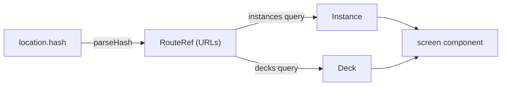
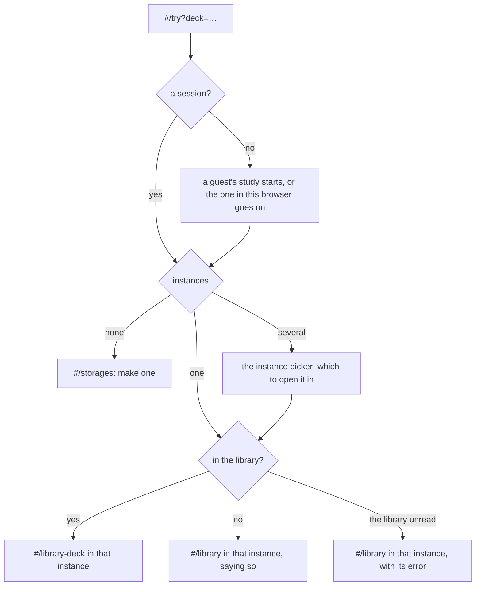

# Routing

The URL always shows the view the user is on, so every screen can be
bookmarked, shared, reloaded, and walked with Back/Forward.

## Where it lives

Routing is a UI concern.
[`packages/ui/src/ui/router.ts`](../packages/ui/src/ui/router.ts)
defines the serializable `RouteRef` union, the `routeToHash` /
`parseHash` pair, and the `useHashRoute` hook. `Workspace` maps a
`RouteRef` to a rendered screen.

The hook is `useHashRouter` in
[`routerCore.ts`](../packages/ui/src/ui/routerCore.ts), which takes any
app's routes and its pair of functions; the [Studio](studio.md) keeps
its own routes with the same core. This page covers Solid Memo's.

The Studio shares Solid Memo's page. Its routes are the hashes under
`#/studio` (`STUDIO_PATH`, told apart by `isStudioHash`), none of them
Solid Memo's. The page
([`apps/web/src/App.tsx`](../apps/web/src/App.tsx)) shows Solid Memo's
`Workspace` or the Studio's by the hash, so a link between them is a
plain hash link. `studioHref` links to the instance's Home in the Studio
(`#/studio?instance=…`) from the instance bar, each deck's actions menu
and the deck page, as "Open in Studio". Solid Memo can't import the
Studio's router, so `studioHref` spells the route out, and a Studio test
checks that the two agree.

In the Studio, the sidebar's sections, decks and drafts, the tabs of a
deck or a draft, and the palette's entries that go somewhere are links
to its routes ([studio.md](studio.md#quick-open-and-commands)).
Following one pushes a history entry, and none adds a route or a
parameter of its own. The route alone sets the chrome around a screen:
the sidebar's marked section, deck or draft, the tabs and the current
one, and the aside's course outline, deck, library copy's upgrade or
card. Hiding the sidebar, the aside, the dock or a table's columns
changes no URL ([studio.md](studio.md#layout)). F8 goes to a problem's
field as a link does.

A card's route, `#/studio/card`, carries the card workbench's query too,
so the deck's cards stay listed beside it. That is `q`, `lang`,
`state`, `has`, `sort`, `order`, `page` and `size`, with `in` for the
workbench's `field`, since the card's `field` is the field it opens
at. Home's route, `#/studio`, carries its tab's view (`show`: `due`,
`courses`, `copies` or `attention`) and the deck at its cursor
(`deck`), and a draft's cards, `#/studio/draft-cards`, their sort
(`sort`, `order=desc`). All are optional: without them, a card lists
the deck's cards as the workbench does by default, and Home shows
every deck ([studio.md](studio.md#routes)). Opening a card from the list pushes a
history entry. These replace it: moving to the card beside it (`j` and
`k`, Previous and Next), putting the list at the page of a card opened
from elsewhere, and a change of Home's view or deck or of the drafts'
sort.

While the card's edits aren't saved, a guard undoes a hashchange
(Back, Forward, a typed hash) before the router hears of it, by going
as many entries the other way, and asks the user first
([studio.md](studio.md#card-inspector)). For
that, the router numbers the entries it sees: `position` in each
entry's state, read by `historyPosition` and `shownPosition` in
`routerCore.ts`. Each entry after another, pushed by the router or
made by the browser, gets one more; a replace keeps the number.
Undoing a move pushes no entry, so the history after it is kept.

## Hash routing, not pathname routing

The route is kept in `location.hash`:

- Deep links work on any static host — no server rewrite rules.
- The Solid OIDC redirect uses the query string (`?code=&state=`);
  the hash stays clear of it.

## Route scheme

Instances and decks are Solid resources, identified by full URLs
carried URL-encoded in hash query parameters.
[Resolution and fallbacks](#resolution-and-fallbacks) says where a
route with an unknown deck, card, chapter or value goes instead.

| Hash | Screen |
| --- | --- |
| `#/storages` | storage picker |
| `#/instances` | instance picker |
| `#/new-instance?storage=…&source=…` | instance creator |
| `#/decks?instance=…` | deck list (home), under today's study and the [courses](courses.md#the-learners-flow) to go on with |
| `#/new-deck?instance=…` | deck creator |
| `#/library?instance=…` | [deck library](deck-library.md): ready-made decks to import into the instance |
| `#/library-deck?instance=…&deck=…` | one library deck's page: description, topics, keywords in the reader's language, release, authors, license, dates and sources; an import button for that deck alone; and "Copy link", for its `#/try` link. `deck` is the deck's series (`…/decks/index.ttl#name`) or a release's URL |
| `#/library-browse?instance=…&deck=…[&page=n]` | a library deck's cards, read-only, paged like the Browser (paging *replaces* the history entry) |
| `#/library-card?instance=…&deck=…&card=…` | one card of a library deck, read-only: both sides as in study, and a link to the deck's page. Opened from a row of `#/library-browse`. `card` is the card's fragment id in its release (`sweden` for `…/v1.ttl#sweden`) |
| `#/library-preview?instance=…&deck=…[&chapter=…]` | a try of a library deck before import: its cards at random, one at a time, revealed as in study, nothing graded or recorded. A course's lists its chapters, and with `chapter` (a chapter's fragment id) plays that chapter's steps, theory then questions. Opened by Preview in the library and on the deck's page; "Back to library" returns to the library |
| `#/import-url?instance=…[&url=…]` | a deck or course [added from a link](deck-library.md#from-a-link) to its release, published anywhere. The pasted link goes into `url` (*pushes*, so Back returns to the link before); the release there is read, checked and shown, to import or start. Opened from the deck list and the library; its breadcrumb is under the library |
| `#/deck?instance=…&deck=…` | deck detail |
| `#/deck-preferences?instance=…&deck=…[&section=languages]` | a deck's own preferences: its name, daily limits, the language its cards are shown in first (for a course, its course language, which its own text follows too), and the languages of its text. `section=languages` opens it at the Languages section, its heading focused (`data-arrival` for `useScreenFocus`); an unknown `section`, at its start. The deck page's notice of text that doesn't say its language links there |
| `#/browse?instance=…&deck=…[&languages=unstated][&page=n]` | [Browser](browsing.md#the-browser) — the one place a deck and its cards are edited. `page` (1-based) is omitted for the first page. `languages=unstated` lists only the cards with a side that doesn't say its language; an unknown value lists all. Paging and a change of filter *replace* the history entry, so Back leaves the Browser, and a change of filter starts at the first page. Opening a card *pushes*, so Back from a card returns to the same filter and page. |
| `#/new-card?instance=…&deck=…` | [card creator](browsing.md#the-card-creator) (opened from, and returning to, the Browser) |
| `#/card?instance=…&deck=…&card=…` | one card's page: the card, its editor (wrong options included, [studio.md](studio.md#card-inspector)), remove; opened from a Browser row |
| `#/study?instance=…&deck=…` | study session: the deck's due and new prompts for today, interleaved |
| `#/cram?instance=…&deck=…` | a [cram of the deck's leeches](srs.md#cramming-the-leeches), as often as the learner likes, nothing graded or recorded: no due date, statistic or leech changes. Linked as "Cram the leeches" under the deck's hardest cards when one is a leech. Trail: Decks › *deck* › Cram; "End session" returns to the deck's page |
| `#/cram?instance=…` | every deck's leeches crammed together, as the deck's are, naming the shown card's deck. Linked as "Cram the leeches" under the leeches across the decks, on the statistics' memory tab. Trail: Decks › Statistics › Cram; the Statistics crumb and "End session" both open the memory tab |
| `#/course?instance=…&deck=…` | the [course](courses.md) that `deck` is the learner's copy of, from the library or a link: its chapters, each locked, open or done, with its steps done; a button to go on where the learner left off; a link to its preferences (`#/deck-preferences`), where the course language is chosen; and the offer of a newer release, as on the deck's page. Once every chapter is done, it links back to the deck list. After a passed final review it cheers the completed chapter, kept in `Workspace`'s memory, not the URL, until the next route: a reload, Back to it or a later visit cheers nothing |
| `#/course-chapter?instance=…&deck=…&chapter=…` | one chapter of the course (`chapter` is its subject in the release), a step at a time: the theory, then its questions without it. The step is the first not done in the learner's progress, not in the URL |
| `#/course-review?instance=…&deck=…&chapter=…` | a chapter's final review, which completes it, opening on a word before the review with a link back to the course. Once the chapter is completed, it *pushes* the course, unless the learner has left meanwhile. It falls back as `course-chapter` does, and to `course-chapter` (*replaces*) while the chapter has steps not done |
| `#/preferences?instance=…` | preferences |
| `#/palette?instance=…[&palette=…]` | the [palette editor](theme.md#palettes-of-ones-own): `palette` is one of the user's own palettes, its subject in the instance's `palettes.ttl`; absent or unknown, a new palette. Saving and Cancel go back to the preferences. Trail: Decks › Preferences › Palette; like the preferences, it stays reachable whatever the data |
| `#/statistics?instance=…[&range=30d\|12m\|all][&view=activity\|memory\|cards]` | the instance's [statistics](statistics.md#the-statistics-page): `range` picks the answers (the last 30 days, 12 months or all; absent, 90 days) and `view` the tab (absent, the overview). A change of either *replaces* the history entry. Linked from the instance bar and the today strip above the deck list |
| `#/deck-statistics?instance=…&deck=…[&range=…][&view=…]` | one deck's [statistics](statistics.md#a-decks-own-figures): the same tabs over its answers alone, with its own activity calendar and no figures by deck. Trail: Decks › *deck* › Statistics. Linked as "More statistics" from the deck's page |
| `#/validate?instance=…` | developer tool: the instance's documents checked against the shapes ([validation.md](validation.md)); shows how to turn developer mode on when it's off |
| `#/try?deck=…` | a [link to a library deck](#a-link-to-a-library-deck) that names no instance, for anyone to open. `deck` as for `#/library-deck` |

## Resolution and fallbacks

The hash carries identifiers only; `Workspace` resolves them to domain
objects before rendering:

- The deck lookup shares the `queryKeys.decks(instanceUrl)` query cache
  with the home screen, so in-app navigation resolves without a refetch.
  The deck list reads the decks' arrangement into groups,
  `queryKeys.deckTree(instanceUrl)`, a key under the decks', so
  whatever refreshes the decks refreshes it too; on the home screen,
  its decks fill `queryKeys.decks(instanceUrl)`, so the catalog is read
  once. A library deck resolves from the library screen's
  `queryKeys.library()` cache: every such query is `libraryIndexQuery`,
  never stale and not read again on window focus. The index changes
  only with a deploy, so it's read once a page
  ([deck-library.md](deck-library.md#reading-it)). One module makes
  the keys and sets which sits under which
  ([architecture.md](architecture.md#query-keys)).
- The masthead's logo and "Solid Memo" title link to `#/` — deliberately
  not a route — which lands on the default route: the deck list, or a
  picker when the instance is ambiguous.
- Invalid or unknown routes never strand the user. One pure function,
  `resolveRoute(route, loaded)` in
  [`resolveRoute.ts`](../packages/ui/src/ui/resolveRoute.ts), decides
  where such a route goes, from the route and what `Workspace` has
  read: the instances, and each deck, card, library deck, library card
  and course as not needed, loading, failed, missing or found. It
  returns the route to go to, or null while the route opens or what
  decides it is still being read. A failed read shows its error,
  not a fallback, except the library's read for a link to a library
  deck, which goes to the library. One effect in `Workspace` replaces
  the route with its result. Its rules, in order, the
  first that applies winning:
  1. **No route** (an unparsable hash, or `#/`): the deck list of the
     only instance, the instance picker with several, the storage picker
     with none.
  2. **A link to a library deck** (`#/try`), once the library is read:
     [as below](#a-link-to-a-library-deck).
  3. **An unknown instance**: the instance picker, or the storage picker
     with none.
  4. **An unknown deck**: that instance's deck list.
  5. **The statistics** with a range or tab they don't know: the
     statistics at their default.
  6. **An unknown card**: its deck's cards (the Browser).
  7. **An unknown library deck**: the library.
  8. **An unknown library card**: its deck's cards.
  9. **A course's routes**: a deck that's no copy of a release goes to
     its page. A chapter the course lacks or keeps locked goes to the
     course. A final review of a chapter with steps not done goes to
     the chapter, once the course has been read afresh (going on from
     the last step reaches the review before that step's answer is
     read back).
  10. **The storage picker** with a single storage: on to the instance
      creator for it.
  11. **The instance creator** with a storage that the storage picker
      doesn't offer and the user hasn't added there by hand since the
      page loaded: back to the storage picker, so a link can't fill in
      an address someone else chose. A reload forgets the storages
      added by hand.

  All fallbacks use `history.replaceState`, so they aren't Back stops;
  in-app navigation uses `pushState`, so Back walks the screens.

## A link to a library deck

Every other route names an instance, which only its owner can open (a
guest's, under `guest.solid-memo.invalid`, exists in their browser
alone). A library deck's page copies a link that names
none, `#/try?deck=…` (`tryHref`), for anyone to open:

- **Without a session**, `AppShell` starts a guest's study
  ([guest-mode.md](guest-mode.md#from-a-link)) instead of the landing
  page, whether the page loads at the link or the link is followed
  there. A session, a guest's restored or the user's, goes on.
- **Then** `Workspace` reads the instances and the library. With one
  instance, it opens the deck's page there; with several, the instance
  picker asks which to open the deck in, and it opens there. Each
  *replaces* the link, so Back doesn't return to it. With none, it goes
  to the storage picker to make one, and the deck isn't opened.
- **A deck the library doesn't have** opens the library, which says so
  above it, kept in memory, not in the URL, until the learner leaves
  the library. A library that can't be read opens there
  too, with its error, saying nothing of the deck.
- **A course** opens at its library page like any deck, to start, or
  to continue when the instance has it.

## Breadcrumbs

`breadcrumbsFor(route, names)` in
[packages/ui/src/ui/Breadcrumbs.tsx](../packages/ui/src/ui/Breadcrumbs.tsx)
derives a trail from the current route alone — Decks › *deck* ›
Browser › *card* — which `Workspace` renders above every screen. Each
crumb, the current page included (`aria-current="page"`), is a plain
`<a href="#/…">` link built with `routeToHash`. Back/Forward, new-tab
and keyboard use work without extra code.

The trail is the way back up: screens have no "Back to …" buttons,
except where going back is one of a screen's choices: a course's final
review before it starts, and a finished course. Those are plain links
too. Top-level screens (deck list, instance picker) show a single crumb,
so "Decks" is on hand everywhere inside an instance.
