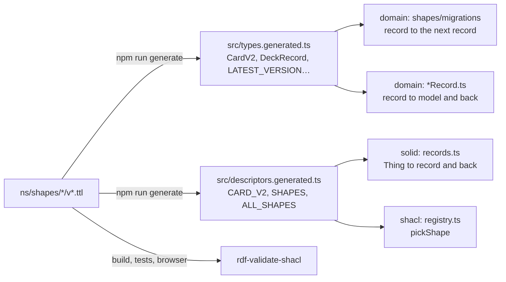

# Shapes

A shape is a machine-readable description of valid Solid Memo data:
which properties a thing has, and of what kind. The app uses shapes to
check data, to generate code, and to tell an old format from a new one.

The shapes are written in [SHACL](https://www.w3.org/TR/shacl/) and
drive the code that reads and writes the data. Each class has one shape
file per format version under
[`ns/shapes/`](../ns/shapes/), published with the site at
`https://solid-memo.com/ns/shapes/`
([ns.ts](../packages/vocab/src/ns.ts), [deployment.md](deployment.md)).

## Files and IRIs

```text
instance/v1.ttl, v2.ttl       https://solid-memo.com/ns/shapes/instance/v1.ttl#shape
deck/v1.ttl … v6.ttl          …/deck/v2.ttl#inPod  and  …/deck/v2.ttl#inLibrary
library-deck/v5.ttl, v6.ttl   …/library-deck/v5.ttl#inLibrary  (library deck 5 on)
deck-series/v1.ttl … v3.ttl
card/v1.ttl … v7.ttl
review-state/v1.ttl, v2.ttl
fsrs-review-state/v1.ttl      …/fsrs-review-state/v1.ttl#shape  (an FSRS-6 review state)
preferences/v1.ttl … v6.ttl
document-receipt/v1.ttl, deck-schedule/v1.ttl, v2.ttl, month-summary/v1.ttl   (the digest)
deck-group/v1.ttl             …/deck-group/v1.ttl#inPod  (the arranged deck list)
chapter/v1.ttl, step/v1.ttl   …/chapter/v1.ttl#inLibrary  (a course's outline)
distractor/v1.ttl             …/distractor/v1.ttl#shape  (a wrong option, in a pod or the library)
draft-deck/v1.ttl, draft-chapter/v1.ttl, draft-step/v1.ttl
                              …/draft-deck/v1.ttl#inDraft  (a release's draft)
palette/v1.ttl, color-set/v1.ttl
                              …/palette/v1.ttl#shape  (a palette of the user's own)
```

Each file's address is its IRI and its `@base`. The IRIs keep `.ttl`:
GitHub Pages serves the file as `text/turtle` but negotiates no
content, so an address without it is a 404. `npm run generate` finds
every version by reading the folders
([sources.ts](../packages/vocab/tooling/sources.ts)).

A deck lives in two places, so it has two shapes: `<#inPod>` (a
catalog entry, with the links to its two documents) and `<#inLibrary>`
(a [deck library](deck-library.md) document, with no pod documents and
possibly its sources). Up to format 4, both share one document and its named property shapes. A shape's
`sh:name` version must match its file's, so library decks 5 and 6,
versions the pod's deck doesn't share, each have a self-contained file
(`library-deck/v5.ttl`, `library-deck/v6.ttl`).

A third place is a release's **draft**, written in its author's pod.
`<#inDraft>` shapes its deck, chapters and steps (`DraftDeckV1`,
`DraftChapterV1`, `DraftStepV1`), each in its own file. Their property
shapes copy the release's (library deck 6, chapter 1, step 1), relaxed
only in what a published release needs. The shared `<#shape>` shapes
check a draft's cards, distractors, agents and distributions.

## Conventions

- **No `sh:targetClass`.** Formats 1 and 2 of a class target the same
  class, so every subject would fail one of them. `pickShape` in
  [registry.ts](../packages/shacl/src/registry.ts) chooses the shape by
  `(rdf:type, sm:formatVersion)` — absent = 1 — and by the context
  (pod, library or draft), at build time, in tests and in the browser.
  Every node shape carries `sh:class` and `sh:nodeKind sh:IRI` instead.
  The class is Solid Memo's own or, for the standard classes it writes,
  DCAT's or FOAF's (`CLASS_NAMESPACES` in
  [packages/vocab/tooling/shapes.ts](../packages/vocab/tooling/shapes.ts)).
  A subject with a Solid Memo class is checked against that class's
  shapes only: a deck group, a `dcat:Catalog` too, is never checked as
  `CatalogV1`.
- **Fixed values tell shapes of one class apart.** A property shape
  with `sh:hasValue` and `sh:maxCount 1` on a predicate other than
  `rdf:type` fixes that predicate's value, for example an FSRS-6 review
  state's `sm:scheduler sm:fsrs6`. The generator puts the value in the
  descriptor's `fixedValues`, not the record; the writer sets it.
  `pickShape` checks a subject against a shape with fixed values only
  when the subject has them all, and then never against its class's
  shapes without them. So an SM-2 state is checked as review
  state 1 or 2, and an FSRS-6 state, an `sm:ReviewState` too, as FSRS
  review state 1, each with versions of its own. An `sh:hasValue` on a
  predicate that may repeat (the theme `EDUC` among a release's
  `dcat:theme`s) constrains that field and fixes nothing.
- **Further types are stated**, for example
  `sh:property [ sh:path rdf:type ; sh:hasValue dcat:Dataset ]`. The
  shape is still picked by its `sh:class`; the writer adds every such
  type. A course's chapter is a `schema:Syllabus`, a step a
  `schema:LearningResource`, a distractor a `schema:Answer`
  ([courses.md](courses.md#why-schemaorg)).
- **The version is asserted.** Format ≥ 2: `sm:formatVersion` with
  `sh:hasValue N`, exactly once. Format 1: `sh:maxCount 1 ; sh:in ( 1 )`,
  "absent or 1", the format that predates the field.
- **Not closed.** Unknown triples are neither violations nor removed:
  readers ignore them and writers edit subjects in place. The one closed
  shape is color set format 1, which the app paints with
  ([theme.md](theme.md#how-a-palette-of-ones-own-is-held-safe)); a new
  color is a new color set format.
- **Property shapes are named** (`<#front>`, never blank nodes) for the
  generator and the results. `sh:message` replaces cryptic engine
  text, always in exactly English and Swedish (`"…"@en`, `"…"@sv`),
  which [messages.test.ts](../packages/vocab/tooling/messages.test.ts)
  checks. The app shows a message in the reader's language, else in
  English marked so (a Korean reader sees English). Without one, the
  validator's English text stands, beside a general message in the
  reader's language by its constraint (`validation.constraint.*` in
  the message catalogs).
- **Rules a record can't carry** are enforced by the record → model
  mappers in code and by SHACL in validation. A card side has text or a
  picture (`sh:or`). The review snapshot is all five triples or none
  (`sh:xone`), an FSRS-6 state's all four or none. A review state names
  its card with `sm:reviewOf` or is named `#<cardId>` or
  `#<cardId>@back-to-front` (a node-level `sh:or` of a `sh:pattern` and
  the property).

## Version by version

| Shape | Beyond class, node kind and version |
|---|---|
| Instance 1 | `dcterms:title` 1..1, `dcterms:created` 1..1 |
| Deck 1 | `dcterms:title` 1..1, `dcterms:created` 0..1, `dcterms:creator` 0..n, `dcterms:license` 0..1 IRI, `dcterms:description` 0..1; in a pod `sm:cardsDocument` and `sm:reviewsDocument` 1..1 and `dcterms:source` 0..1 (the library document it came from); in the library no document links and `dcterms:source` 0..n |
| Deck 2 | Deck 1 + `sm:direction` 1..1, one of `front-to-back`, `back-to-front`, `bidirectional`; `dcterms:modified` 0..1 dateTime |
| Card 1 | `sm:front`, `sm:back` 1..1 |
| Card 2 | `sm:front`, `sm:back` 0..1; `sm:frontImage`, `sm:backImage` 0..1 IRI; each side has text or a picture |
| Card 3 | Card 2 + `sm:frontNote` and `sm:backNote`, a note under that side's text, shown once the answer is revealed, and `sm:backLabel`, a caption above the back's text saying how the answer relates to the front, shown with the back either way. Each is optional language-tagged text, shown and edited as a deck-4 title: one value per language, exactly one English when present (a node-level `sh:or`: SHACL can't say "if any value" on the property). `owl:deprecated` 0..1 boolean, `true` on a retired card (kept with its review states, never studied, listed in the Browser only when asked) |
| Card 4 | Card 3, but a side's text (`sm:front`, `sm:back`) is one untagged literal or language-tagged text, at most one value per language, never both (`sh:or` of `xsd:string` and `rdf:langString`, `sh:uniqueLang`, at most one untagged value, and a node-level `sh:or`). The app writes typed text untagged. English isn't required (a Swedish vocabulary deck's back is Swedish). The app shows the reader's language, else the English, else the untagged text, and edits the English, else the untagged or only text, keeping the other languages. `sm:frontImageDescription` and `sm:backImageDescription` (no version bump; an older reader shows the picture with a generic name), the picture's text alternative: 0..n language-tagged text, one per language (`sh:uniqueLang`). The app uses the reader's language as alt text, else a name for its side; it edits the page's language, else the English, else the first by tag, and writes a new one in the page's language. A description is read while the side is asked, so it should say what the picture shows without giving the answer away |
| Card 5 | Card 4, but `sm:frontNote`, `sm:backLabel` and `sm:backNote` are language-tagged text in any language, at most one value per language (`sh:uniqueLang`); the node-level `sh:or` asking for English is gone. A side's text is as in card 4. `zxx` tags text in no language (codes, numbers, symbols). The app edits each text, picture descriptions included, in the languages the user states, with a language picker under each field, and never writes untagged text anew. A side's untagged text is kept only while untouched; editing or translating it asks for its language. Text saved the same in English and another language, as cards 3 and 4 had the app write, is text in each language, left untouched ([i18n.md](i18n.md#text-in-the-users-languages)). Every format-4 card is a format-5 card. Without a version bump: `sm:distractor` 0..n IRIs (vocabulary 1.14), a multiple-choice question's wrong options, `sm:Distractor` subjects of the same document, which an older reader ignores, studying the card front to back. The library, not the shape, checks that every card a [course](courses.md) asks has back text and two distractors or more. `sm:textFormat` 0..1 IRI (vocabulary 1.15), how the texts are written ([vocab.md](vocab.md#text-formats)), with no `sh:in`: an unknown concept is read, kept and shown as plain text. An older reader shows the text as written; an older writer keeps the triple through an edit but drops it copying a card from the library ([migrations.md](migrations.md#versions)). `schema:suggestedAnswer`, written beside each `sm:distractor` since vocabulary 1.16, belongs to no shape; an older writer keeps it, and this app adds or removes only those naming its own distractors |
| Card 6 | Card 5 + `sm:frontLabel` (vocabulary 1.20), a caption above the front's text saying what kind of thing the front is, shown with the front either way, typed as `sm:backLabel`. Every format-5 card is a format-6 card |
| Card 7 | Card 6 + `dcterms:subject`, 0..n IRIs: what the card is about, each by its source's IRI (a Wikidata item, a taxonomy concept). A library release compiled from linked data names them ([deck-library.md](deck-library.md#what-a-card-is-about)), and a learner's copy keeps them as stated. The app neither shows nor edits them, and every edit keeps them. The term isn't the vocabulary's, so the vocabulary didn't move. Every format-6 card is a format-7 card. The app reads the term from a card of any format (releases state it on older ones too) and writes it at 7 |
| Review state 1 | `sm:easeFactor` decimal, `sm:intervalDays`, `sm:repetitions` integer, `sm:due` `YYYY-MM-DD`, `sm:firstReviewedAt`, `sm:lastReviewedAt` dateTime, all 1..1; the five `sm:previous*` 0..1 each (unversioned pods already hold snapshots); subject named per direction, or any subject for a state that names its card with `sm:reviewOf` (since vocabulary 1.16: another app may write an unstamped state so) |
| Review state 2 | Review state 1 with the snapshot all or nothing. Added in vocabulary 1.16 without a version bump: `sm:reviewOf` 0..1 IRI, the card; `sm:reviewDirection` 0..1, `sm:frontToBack` or `sm:backToFront` (an `iriEnum`); `sm:scheduler` 0..1 IRI, a concept of `sm:Schedulers` with no `sh:in`, so another scheduler's concept is no violation (the app leaves such a state alone, [data-model.md](data-model.md#decks-and-cards)). The app writes all three on every state and names each new state by its card and direction; a state read back keeps its subject, however another app named it |
| FSRS review state 1 | An FSRS-6 review state (vocabulary 1.21), a `sm:ReviewState` told apart by the fixed `sm:scheduler sm:fsrs6` (`sh:hasValue`, at most one scheduler), `sm:formatVersion 1` stated. `sm:reviewOf` 1..1 IRI and `sm:reviewDirection` 1..1, `sm:frontToBack` or `sm:backToFront`, so its subject follows no naming rule (the app names it `#<cardId>@fsrs6` or `#<cardId>@back-to-front@fsrs6`). `sm:stability` 1..1 decimal > 0 (days), `sm:difficulty` 1..1 decimal from 1 to 10; `sm:due` `YYYY-MM-DD`, `sm:firstReviewedAt`, `sm:lastReviewedAt` dateTime, 1..1; the snapshot `sm:previousStability`, `sm:previousDifficulty`, `sm:previousDue`, `sm:previousLastReviewedAt` all four or none. An app before 1.21 takes it for another scheduler's state, checks it against review state 1 with warnings only and leaves it alone (`migrations.md`) |
| Preferences 1 | `sm:newCardsPerDay`, `sm:maxReviewsPerDay`, `sm:dayBoundaryHour` (0–23) integer 0..1; `sm:answerScale` 0..1, `sm2` or `minimal`; `sm:developerMode` 0..1 boolean |
| Preferences 2 | Preferences 1 with every field 1..1 |
| Deck 3 | A `dcat:Dataset` too. `dcterms:title` and `dcterms:description` 1..1; `dcterms:created`, `dcterms:modified` 0..1; `dcterms:creator` 0..n IRIs (foaf:Agent nodes); `dcterms:license` 0..1; `sm:studyDirection` 1..1, a concept of `sm:StudyDirections` (`sm:direction` forbidden); `dcat:theme` 0..n IRIs, `dcat:keyword` 0..n; `dcterms:source` forbidden. In a pod: `dcat:distribution` 0..n, the two document links; `prov:wasDerivedFrom` 0..1 (the library release it came from); and study caps `sm:deckNewCardsPerDay` and `sm:deckMaxReviewsPerDay`, integers ≥ 0, 0..1 each (no version bump; an older reader ignores them). In the library, one release: `dcterms:publisher`, `dcat:version` (1, 2, …), `dcat:inSeries`, `dcat:isVersionOf` 1..1; `dcat:prev`, `dcat:previousVersion`, `adms:versionNotes`, `dcterms:issued` 0..1; `dcat:theme` including the EU theme EDUC; `dcterms:language` 0..n; `dcat:distribution` 1..n; `prov:wasDerivedFrom` 0..n; no document links and no study caps |
| Deck 4 | Deck 3, but `dcterms:title` and `dcterms:description` are language-tagged text (`rdf:langString`): one or more values, at most one per language (`sh:uniqueLang`), exactly one English (`sh:qualifiedValueShape [ sh:languageIn ("en") ]`, `sh:qualifiedMinCount 1`, `sh:qualifiedMaxCount 1`). The app shows the reader's language (the browser's preferred languages), else the English, and edits the page's language, else the English, keeping the other languages. Text typed on a non-English page is written in that language and, while untranslated, as the English too (renaming then replaces both) |
| Deck 5 | Deck 4 in a pod (`<#inPod>`, `DeckV5` only), but `dcterms:title` and `dcterms:description` are language-tagged text in any language: one or more values, at most one per language (`sh:uniqueLang`), English not required, so a deck titled only in Swedish or Japanese is whole. A library release stays library deck 4 (`LibraryDeckV4`, English required), the library's curation policy, not a data rule. The app edits each language's text under the tag the user states, and no longer writes an identical English copy. A deck 4 title tagged English though in another language stays so until the user retags it; one saved the same in English and another language is text in each, left untouched. Every format-4 deck is a format-5 deck |
| Deck 6 | Deck 5 in a pod (`DeckV6` only), but `dcat:keyword` 0..n is language-tagged text in any language, several values per language (no `sh:uniqueLang`). Untagged keywords (`sh:or` of `xsd:string` and `rdf:langString`) are accepted only as kept from older formats: the app writes every keyword under the language the user states. The app shows them as [i18n.md](i18n.md#which-language) says. The step from deck 5 keeps the keywords untagged. A deck's card language (`sm:deckCardLanguage`, vocabulary 1.24) belongs to no shape, like `sm:position` and `sm:completedChapter`, so `DeckV6` keeps it untouched; a library release and a draft deck never carry it |
| Library deck 5 | Library deck 4 (`LibraryDeckV5`, in `library-deck/v5.ttl`), but `dcat:keyword` 0..n is language-tagged text, several values per language; untagged keywords are invalid. The step from library deck 4 keeps a frozen release's keywords untagged |
| Library deck 6 | Library deck 5 (`LibraryDeckV6`, in `library-deck/v6.ttl`), its property shapes unchanged, but the release may describe its series (`dcat:inSeries`, a `dcat:DatasetSeries`), checked as library deck series 3, and its publisher (`dcterms:publisher`, a `foaf:Agent`), checked as agent 1. So a release published in a pod is whole without an index ([deck-library.md](deck-library.md#a-release-outside-the-library)). The step from library deck 5 changes no data |
| Draft deck 1 | In a draft (`DraftDeckV1`, `<#inDraft>`): a `sm:Deck` and a `dcat:Dataset`, with library deck 6's properties but `dcterms:title` and `dcterms:description` 0..n language-tagged text in any language, one per language; `dcterms:publisher`, `dcat:version` (1, 2, …), `dcat:inSeries`, `dcat:isVersionOf`, `dcterms:issued` and `adms:versionNotes` 0..1; `dcat:theme` and `dcat:distribution` 0..n, EDUC not required. `sm:studyDirection` stays 1..1. `sm:releasedAs` 0..1 IRI, the release it was published as, marks a draft released and no longer edited. No document links, `dcterms:source` or study caps, as in a release |
| Draft chapter 1 | In a draft (`DraftChapterV1`): chapter 1, but `dcterms:title` 0..n language-tagged text in any language, one per language, and `schema:isPartOf` and `schema:position` 0..1 |
| Draft step 1 | In a draft (`DraftStepV1`): step 1, but `sm:theory` 0..n language-tagged text in any language, one per language, `sm:checkedBy` 0..n, and `schema:isPartOf` and `schema:position` 0..1 |
| Preferences 3 | Preferences 2 + `sm:invalidDataPolicy` 1..1, a concept of `sm:InvalidDataPolicies` |
| Preferences 4 | Preferences 3 + `sm:theme` 1..1, a concept of `sm:Themes` (see [theme.md](theme.md)) |
| Preferences 5 | Preferences 4 + `sm:studyScheduler` 1..1, `sm:sm2` or `sm:fsrs6`, `sm:desiredRetention` 1..1 decimal, 0.7 to 0.97, and `sm:schedulerInvitationDismissed` 1..1 boolean |
| Preferences 6 | Preferences 5 + `sm:palette` 1..1, any IRI (a concept of `sm:Palettes`, or a palette this version doesn't know, which it keeps), and `sm:textSize` 1..1, a concept of `sm:TextSizes` (see [theme.md](theme.md#where-the-choice-is-kept)). `sm:connectedScreenSkipped` (vocabulary 1.26), whether logging in skips the Connected screen, belongs to no shape, like a deck's `sm:deckCardLanguage`, so `PreferencesV6` keeps it untouched |
| Palette 1 | A palette of the user's own (vocabulary 1.23) in the instance's `palettes.ttl`: `dcterms:title` 1..n language-tagged text, one per language; `sm:basedOn` 1..1 IRI, a concept of `sm:Palettes` with no `sh:in` (a base this version doesn't know reads as Standard); `sm:lightColors` and `sm:darkColors` 1..1 IRIs, its color sets, subjects of the same document ([theme.md](theme.md#palettes-of-ones-own)). Preferences 6 choose it by its IRI in `sm:palette`, with no new format |
| Color set 1 | A palette's colors in one theme: `sm:backgroundColor`, `sm:surfaceColor`, `sm:sunkenSurfaceColor`, `sm:textColor`, `sm:mutedTextColor`, `sm:borderColor`, `sm:fieldEdgeColor`, `sm:primaryColor`, `sm:primaryFillColor`, `sm:onPrimaryColor`, `sm:linkColor`, `sm:dangerColor`, `sm:warningColor` and `sm:grade0Color` to `sm:grade5Color`, each 0..1, an `xsd:string` that matches `^#[0-9a-fA-F]{6}$` (an opaque color). Closed (`sh:closed`, `rdf:type` ignored): no other property |
| Library deck series 1 | The deck across its releases in the library index: a `dcat:DatasetSeries` and `dcat:Dataset`; title, description, publisher 1..1; `dcat:first`, `dcat:last`, `dcat:hasCurrentVersion` 1..1; `dcat:hasVersion` 1..n; themes and keywords 0..n |
| Library deck series 2 | Library deck series 1 with the version stated (`sh:hasValue 2`) and the title and description as language-tagged text, as in deck format 4 |
| Library deck series 3 | Library deck series 2, but the keywords, copied from the current release, are language-tagged text, several per language, or untagged as a library deck 4 release has them |
| Catalog 1 | A `dcat:Catalog` (an instance's `catalog.ttl#catalog`, the library index): title, description, `dcterms:publisher` 1..1; license, modification time 0..1; `dcat:themeTaxonomy`, `dcat:dataset` 0..n. The library index's `sm:newcomerCourse` belongs to no shape ([deck-library.md](deck-library.md#courses)) |
| Deck group 1 | In a pod (`DeckGroupV1`, beside the decks in `catalog.ttl`): a [deck group](data-model.md#deck-groups), a `sm:DeckGroup` and a `dcat:Catalog`; `dcterms:title` and `dcterms:description` 1..n language-tagged text, one per language (`sh:uniqueLang`); `dcterms:publisher` 1..1 IRI (the catalog's); `dcat:dataset` (its decks) and `dcat:catalog` (its sub-groups) 0..n IRIs; `sm:position` 0..1, an integer ≥ 0. One parent per deck or group isn't a shape rule: the reader picks one. A deck's `sm:position` and the catalog's `dcat:catalog` belong to no shape, so `DeckV6` and `CatalogV1` keep them untouched |
| Agent 1 | A `foaf:Agent`: `foaf:name` 1..1, `foaf:mbox` 0..1 (a `mailto:` IRI) |
| Distribution 1 | A `dcat:Distribution`: `dcat:accessURL` 1..1; `dcat:downloadURL`, `dcat:mediaType`, `dcterms:format` 0..1 |
| Document receipt 1 | In an instance's [digest](data-model.md#the-digest): `sm:receiptOf` (the document) and `sm:documentVersion` (its ETag) 1..1; `sm:conformedTo` (the rules it conformed to) and `sm:latestFormat` 0..1 |
| Answer 1 | In an instance's [answer log](data-model.md#the-answer-log): `sm:answeredDeck` and `sm:answeredCard` (IRIs), `sm:answeredDirection` (`sm:frontToBack` or `sm:backToFront`), `sm:grade` (0–5), `sm:answeredAt` (xsd:dateTime), `sm:answeredOn` (`YYYY-MM-DD`), `sm:nextIntervalDays` 1..1; `sm:priorIntervalDays` 0..1, absent on a prompt's first answer. Without a version bump, in vocabulary 1.14: `sm:answerMode` 0..1, a concept of `sm:AnswerModes` (absent: recalled), and `sm:chosenDistractor` 0..1 IRI, the wrong option chosen; in 1.19, each 0..1: `sm:recallMillis` and `sm:gradeMillis`, integers ≥ 0, how long recalling and grading took; `sm:priorDue` (`YYYY-MM-DD`), the day the prompt was due before the answer; `sm:utcOffsetMinutes`, an integer from −840 to 840, the device's offset from UTC |
| Chapter 1 | In the library (`ChapterV1`, `<#inLibrary>`): a chapter of a course, a `sm:Chapter` and a `schema:Syllabus`; `dcterms:title` 1..n language-tagged text, one per language, exactly one of them English; `dcterms:description` 0..n language-tagged text, one per language; `schema:isPartOf` (the release) and `schema:position` (an integer ≥ 0) 1..1; `sm:reviewQuestion` 0..n IRIs (cards asked only in its final review); `owl:deprecated` 0..1 boolean, `true` once retired. `sm:textFormat` 0..1 IRI, how its description is written (never its title) (vocabulary 1.15, no version bump, as on a card 5) |
| Step 1 | In the library (`StepV1`, `<#inLibrary>`): a step of a course chapter, a `sm:Step` and a `schema:LearningResource`; `sm:theory` 1..n language-tagged text, one per language, exactly one of them English; `sm:checkedBy` 1..n IRIs (the cards that check it); `schema:isPartOf` (its chapter) and `schema:position` (an integer ≥ 0) 1..1; `owl:deprecated` 0..1 boolean. `sm:textFormat` 0..1 IRI, how its theory is written (vocabulary 1.15, no version bump, as on a card 5) |
| Distractor 1 | In a pod or the library (`DistractorV1`, `<#shape>`): a wrong option of a card, a `sm:Distractor` and a `schema:Answer`, a subject of the card's document; `sm:distractorText` 1..n, one untagged literal or language-tagged text, one per language, never both, as a card 5 side's text; `sm:distractorNote` 0..n language-tagged text, one per language, why the option is wrong; `owl:deprecated` 0..1, true once retired and no longer offered |
| Deck schedule 1 | In an instance's digest: `sm:scheduleOf` (the deck), `sm:cardsVersion`, `sm:reviewsVersion` (`"absent"` for none), `sm:scheduledDirection` (a concept of `sm:StudyDirections`), `sm:scheduledDayBoundaryHour` (0–23), `sm:scheduledOn` (`YYYY-MM-DD`), `sm:unreviewedCount`, `sm:reviewedOnDayCount`, `sm:introducedOnDayCount` 1..1; `sm:dueOnDay` 0..n, `"YYYY-MM-DD count"` |
| Deck schedule 2 | Deck schedule 1 + `sm:scheduledWith` 1..1, `sm:sm2` or `sm:fsrs6` (the scheduler whose due days it counts), and the format version 1..1 |
| Month summary 1 | In an instance's digest (vocabulary 1.25): `sm:summaryOf` (the answer log's month document) and `sm:summarizedVersion` (its ETag) 1..1; `sm:studyDayCounts` 0..n, `"YYYY-MM-DD answers introduced reviews lapses"`, one per study day with answers; `sm:youngReviewCount` and `sm:youngRecalledCount` 1..1, 0 or more; `sm:recallSecondsCount` 0..n, `"seconds count"`, 0 to 60 seconds |

The DCAT-AP profile and the reference data check the DCAT and FOAF
classes' values (an agent is a `foaf:Agent`, a theme a `skos:Concept`,
a license a `dcterms:LicenseDocument`). Solid Memo's own shapes only
say IRI (see [validation.md](validation.md#profiles-dcat-ap-and-skos)).

What a row says the app shows and edits is what the app did while that
format was the latest. Today's app edits text as the latest formats ask
(`i18n.md`).

[migrations.md](migrations.md) says why each version moved.

## What the shapes generate



[packages/vocab/tooling/shapes.ts](../packages/vocab/tooling/shapes.ts)
reads the properties that every node shape with an `sh:name`
(`"CardV2"`, `"LibraryDeckV1"`) lists: `sh:path`, `sh:datatype` or
`sh:nodeKind sh:IRI`, `sh:minCount`, `sh:maxCount`, `sh:in` and an
optional `sh:name` for the field. Anything else (`sh:or`, `sh:xone`,
`sh:pattern`, ranges, messages) is validation only.

| SHACL | Record field | Descriptor kind |
|---|---|---|
| `xsd:string` | `string` | `string` |
| `xsd:string` + `sh:in` | literal union | `enum` |
| `sh:nodeKind sh:IRI` + `sh:in` (a scheme's concepts) | IRI union | `iriEnum` |
| `xsd:integer`, `xsd:decimal` | `number` | `integer`, `decimal` |
| `xsd:boolean` | `boolean` | `boolean` |
| `xsd:dateTime` | ISO 8601 `string` | `dateTime` |
| `sh:nodeKind sh:IRI` | `string` | `iri` |
| `rdf:langString` + `sh:uniqueLang true` | `LangText`: language tag (lower case) → text; one field however many languages, required with `sh:minCount 1` | `text` |
| `sh:or ( [ sh:datatype xsd:string ] [ sh:datatype rdf:langString ] )` | `LangText`, the untagged literal under the empty tag (`""`) | `anyText` |
| either text above without `sh:uniqueLang true` (no `sh:maxCount` allowed) | `LangTexts`: language tag → texts, several per language, `{}` for none | `text` / `anyText`, `many` |
| no `sh:minCount` | optional (`?:`) | `optional` |
| `sh:minCount 1 ; sh:maxCount 1` | required | `one` |
| no `sh:maxCount` (strings and IRIs; text, see above) | `readonly string[]` | `many` |
| `sh:maxCount 0` | not a field: the writer removes the predicate | `absent` |

`sm:formatVersion` and `rdf:type` (the class and any `sh:hasValue`
types) are the envelope, not fields: the generic writer stamps them from
the descriptor. Generated files, only types and `as const` data, are
committed; CI (`npm run generate:check`) and
`packages/vocab/tooling/generate.test.ts` check them for drift.

## Reading and writing

Every mapper takes three steps
([records.ts](../packages/solid/src/records.ts)):

1. `readVersioned(thing, "card")` checks the class, reads the stored
   version (absent = 1), and reads the subject with that version's
   descriptor into a `{ version, data }` record. A version newer
   than this app knows is read with the latest shape it has, its stored
   version passed through unchanged.
2. `migrate("card", record)` walks the record up the
   [migration chain](migrations.md) to the latest version, in memory.
3. `cardFromRecord(url, storedVersion, data)` builds the domain model,
   keeping the stored version to count what's outdated.

Writing is the reverse: `cardToRecord(content)`, then
`recordThing(url, CARD_V2, record, existing)`, which edits the subject in
place, replacing only the shape's predicates (foreign triples survive),
adds the class once and stamps the version. Every
subject this app writes conforms to the latest shape, which
[conformance.test.ts](../packages/solid/src/conformance.test.ts)
proves for every version and migration step.

## Where the shapes are checked

- **Tests**: the fixtures in `packages/vocab/fixtures/<class>/v<N>/{valid,invalid}/`
  pass and fail as expected against `ns/shapes/`, and the conformance
  test runs, all offline.
- **The deck library**: every version and the index, by `npm run
  library:check` ([deck-library.md](deck-library.md#checks)).
- **pySHACL**: a release published in a pod and the drafts, by `npm run
  crosscheck` ([validation.md](validation.md#the-ci-cross-check)).
- **Browser**: the developer tool ([validation.md](validation.md)).

## Adding a version

See [migrations.md](migrations.md#adding-a-format-version).
