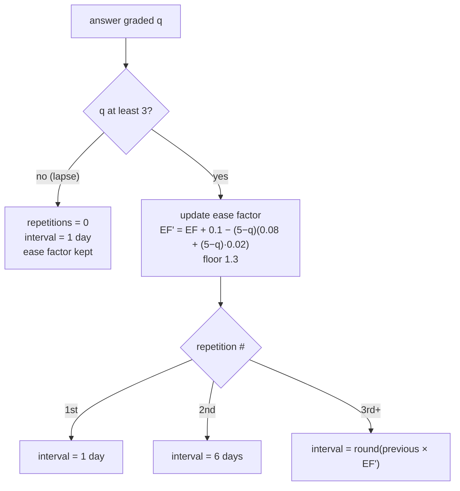
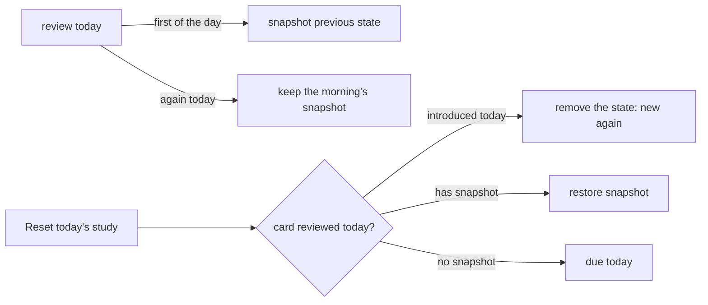

# Spaced repetition (SM-2 and FSRS-6)

Spaced repetition shows a card again just before you
would forget it: soon after you learn it, then at longer and longer
intervals. Solid Memo picks each card's next day from how well you
remembered it, by the SM-2 method or, when the preferences name it, by
FSRS-6 ([FSRS-6](#fsrs-6)). This page says how that schedule is worked
out, how a day's study session is built, and where the cards stand.

How Solid Memo schedules cards. Implemented entirely in the domain layer
([sm2.ts](../packages/domain/src/sm2.ts), [fsrs.ts](../packages/domain/src/fsrs.ts),
[scheduling.ts](../packages/domain/src/scheduling.ts))
as pure functions.

**Reference.** SM-2 is the algorithm of SuperMemo 2, first described in
Woźniak, P. A. (1990). *Optimization of learning*. Master's thesis,
University of Technology in Poznań. Its description, with the formulas
used here, is published by SuperMemo as
[Application of a computer to improve the results obtained in working with the SuperMemo method](https://www.supermemo.com/en/blog/application-of-a-computer-to-improve-the-results-obtained-in-working-with-the-supermemo-method).
Solid Memo departs from it where [The SM-2 transition](#the-sm-2-transition)
says so. [policy.md](policy.md) lists it with the other rules the code
follows.

## Prompts and directions

A session asks *prompts*: a card seen from one side (`Prompt` in
[deck.ts](../packages/domain/src/deck.ts)). A deck's direction decides which
prompts its cards make — front→back, back→front, or both (a
*bidirectional* deck, two prompts per card). Each prompt is scheduled on
its own: knowing "Sweden → Stockholm" says nothing about knowing
"Stockholm → Sweden". Everything below — review state, budgets, the
queue, the session — is per prompt.

## Review state

Each prompt (card + direction) carries one `ReviewState`:

| Field | Meaning |
|---|---|
| `easeFactor` | SM-2 easiness (starts 2.5, never below 1.3) |
| `intervalDays` | Days until the next review |
| `repetitions` | Consecutive correct answers |
| `due` | Study day ("YYYY-MM-DD") the card is next due |
| `firstReviewedAt` | Introduction timestamp (counts against the new-card budget) |
| `lastReviewedAt` | Latest review timestamp (counts against the review budget) |

A prompt with no `ReviewState` is *new*. Changing a deck's direction
keeps every state: a card's front→back state waits, unused, while the
deck is studied back→front.

## The SM-2 transition

The user grades each answer with a quality `q` from 0 (blackout) to 5
(perfect). `applySm2` transitions `(easeFactor, intervalDays, repetitions)`:



Decisions fixed in code (and tests):

- The **updated** ease factor drives interval growth (computed before the
  interval, per Woźniak's original description).
- Lapses (`q < 3`) keep the ease factor; only repetitions and interval reset.
  The card returns the next study day (interval 1).
- A grade of 0 or 1 additionally sends the card round again **within the
  session** (`repeatsInSession`); see *Study sessions*. Each pass is a
  full SM-2 review, so the state stored after the repeat is the one that
  counts.
- The original repeats every card graded below 4 after the session,
  until each scores 4 or more. Solid Memo repeats only grades 0 and 1,
  so a lapse graded 2 (reset, but not repeated) and a hard but correct
  answer (3) end the card's day.
- Intervals are rounded to whole days.
- Every grade below 3 resets the card, but the statistics and the
  Studio count a **lapse** only where it says something about memory: a
  *scored review* graded below 3, that is an answer to a prompt already
  introduced, its first that study day, recalled and graded rather than
  chosen among a course's options (`isLapse` in
  [answerChain.ts](../packages/domain/src/answerChain.ts)). A failed
  first answer, the answer to a card back in the session the same day
  and a course answer are not counted
  ([statistics.md](statistics.md#what-the-figures-count)).

### Worked examples

Each row is one answer: the state before it, the grade, and the state
after it. [sm2.test.ts](../packages/domain/src/sm2.test.ts) reads this
table and checks that the code gives every row, so a change to the
rules, or to a row, that leaves the two apart fails the tests. Keep its
header and its three number columns as they are.

| Before: ease, interval, repetitions | Grade | After: ease, interval, repetitions | Why |
|---|---|---|---|
| 2.5, 0, 0 (new) | 5 | 2.6, 1, 1 | The first repetition: 1 day. |
| 2.5, 0, 0 (new) | 3 | 2.36, 1, 1 | A pass lowers the ease; the interval is still 1 day. |
| 2.6, 1, 1 | 5 | 2.7, 6, 2 | The second repetition: 6 days. |
| 2.5, 6, 2 | 3 | 2.36, 14, 3 | 6 × 2.36 = 14.16, rounded: the **updated** ease sets the interval. |
| 2.5, 6, 2 | 4 | 2.5, 15, 3 | Grade 4 keeps the ease: 6 × 2.5 = 15. |
| 2.5, 6, 2 | 5 | 2.6, 16, 3 | 6 × 2.6 = 15.6, rounded. |
| 2.0, 10, 3 | 3 | 1.86, 19, 4 | 10 × 1.86 = 18.6, rounded. |
| 1.3, 10, 3 | 3 | 1.3, 13, 4 | The ease would be 1.16, so it stays at the floor, 1.3. |
| 2.2, 30, 5 | 2 | 2.2, 1, 0 | A lapse: back to 1 day, the ease kept. |
| 2.2, 30, 5 | 0 | 2.2, 1, 0 | Grades 0, 1 and 2 schedule alike. |

## FSRS-6

FSRS-6, the Free Spaced Repetition Scheduler, version 6, is a second
scheduler beside SM-2. It keeps two numbers for each prompt, how long
its memory lasts (*stability*) and how hard it is (*difficulty*), and
picks the due day on which the chance of remembering the card falls to
the *desired retention*, 90% by default. It is implemented in the
domain layer too, as pure functions:
[fsrs.ts](../packages/domain/src/fsrs.ts) has the formulas, and
`gradePrompt` in [grading.ts](../packages/domain/src/grading.ts)
applies a grade to both schedulers. The preferences name the scheduler
that sets the due days (`sm:studyScheduler`, preferences format 5),
and SM-2's state is updated on every review either way. FSRS-6 is the
recommended one: its intervals differ clearly by the answer, and a late
review counts for how late it is. A new instance starts on it
([Which scheduler an instance is on](#which-scheduler-an-instance-is-on)).
The learner switches in the preferences, or from the deck list's
invitation ([Switching the scheduler](#switching-the-scheduler)).

**Reference.** FSRS is by Jarrett Ye and the Open Spaced Repetition
project, described in
[The Algorithm](https://github.com/open-spaced-repetition/fsrs4anki/wiki/The-Algorithm).
Solid Memo reimplements FSRS-6's formulas and default parameters as
the reference implementation
[fsrs-rs v6.6.2](https://github.com/open-spaced-repetition/fsrs-rs/blob/v6.6.2/src/model.rs)
(BSD-3-Clause) gives them; no code is copied from it. Where Solid Memo
fixes what FSRS leaves to the app, [Decisions fixed in code](#decisions-fixed-in-code-fsrs-6)
says so.

### FSRS-6 state

A prompt scheduled with FSRS-6 has an `FsrsState`
([review.ts](../packages/domain/src/review.ts)) beside its SM-2
`ReviewState`, a subject of its own in the reviews document:

| Field | Meaning |
|---|---|
| `stability` | Days until the chance of recall falls to 90% (above 0) |
| `difficulty` | From 1 (easiest) to 10 (hardest) |
| `due` | Study day ("YYYY-MM-DD") the card is next due |
| `firstReviewedAt` | Introduction timestamp, the SM-2 state's |
| `lastReviewedAt` | Latest review timestamp |
| `previous` | The snapshot a reset of the day restores: stability, difficulty, due, last review |

SM-2 is applied on every review, whichever scheduler sets the due days,
so switching back finds its states current. An FSRS-6 state counts only
while it is **fresh**: while the SM-2 state of its prompt has the same
last review (`isFresh`). A review the FSRS-6 state did not see (an older
app graded SM-2 only, the day was reset, or the card forgotten) leaves
it stale. A stale or missing state counts for nothing, and the next
review estimates one from the SM-2 state. What sets a prompt's due day,
whichever scheduler does, is a `DueState`: its due day, the interval that
led there and its reviews. Under FSRS-6, `effectiveStates` takes each
prompt's fresh FSRS-6 due day, with the study days from its last review
to that day as its interval, and the SM-2 state's where there is none.

### The FSRS-6 transition

A rating `G` is 1 (Again), 2 (Hard), 3 (Good) or 4 (Easy), and `t` is
the whole study days since the prompt's last review. With the default
parameters `w0` to `w20` and the forgetting curve's decay `w20`:

```text
factor = 0.9^(−1/w20) − 1
R(t, S) = (1 + factor · t / S)^(−w20)            chance of recall; R(S, S) = 0.9
I(S, r) = S / factor · (r^(−1/w20) − 1)          days until R falls to r; I(S, 0.9) = S

first rating:  S = w[G−1]
               D = clamp(w4 − e^(w5·(G−1)) + 1, 1, 10)

a later one:   S, D kept to 0.001–36,500 and 1–10 first; R = R(t, S)
  Again:       S' = min(w11 · D^(−w12) · ((S+1)^w13 − 1) · e^((1−R)·w14),  S / e^(w17·w18))
  Hard..Easy:  S' = S · (1 + e^w8 · (11 − D) · S^(−w9) · (e^((1−R)·w10) − 1) · h · b)
               h = w15 for Hard, else 1;  b = w16 for Easy, else 1
  same day:    S' = S · e^(w17·(G − 3 + w18)) · S^(−w19), at least S unless Again
               (t = 0 replaces both above)
  difficulty:  D' = D − w6·(G − 3) · (10 − D) / 9
               D'' = clamp(w7 · D0(4) + (1 − w7) · D', 1, 10),  D0(4) = w4 − e^(3·w5) + 1
  S' is kept from 0.001 to 36,500.

interval = clamp(round(I(S', desired retention)), 1, 36500)
due = today + interval
```

| Parameters | Default | Used for |
|---|---|---|
| `w0`–`w3` | 0.212, 1.2931, 2.3065, 8.2956 | first stability, by rating |
| `w4`–`w7` | 6.4133, 0.8334, 3.0194, 0.001 | first difficulty, its step, mean reversion |
| `w8`–`w10` | 1.8722, 0.1666, 0.796 | stability after a recall |
| `w11`–`w14` | 1.4835, 0.0614, 0.2629, 1.6483 | stability after a lapse |
| `w15`, `w16` | 0.6014, 1.8729 | Hard penalty, Easy bonus |
| `w17`–`w19` | 0.5425, 0.0912, 0.0658 | same-day reviews |
| `w20` | 0.1542 | the forgetting curve's decay |

**Estimate from SM-2.** A prompt reviewed with SM-2 only gets its
FSRS-6 memory from its SM-2 state (`memoryFromSm2`, as fsrs-rs's
`memory_state_from_sm2` at a retention of 90%): the stability is the
SM-2 interval, and the difficulty the one at which a Good review on the
due day multiplies the stability by the ease factor:

```text
S = max(interval, 0.001)
D = clamp(11 − (ease − 1) / (e^w8 · S^(−w9) · (e^(0.1·w10) − 1)), 1, 10)
```

#### Decisions fixed in code (FSRS-6)

- **Default parameters**, not ones trained on the learner's answers,
  computed in 64-bit floating point.
- **Whole study days.** `t` is the study days between the last review's
  day and today, by the instance's day boundary, as SM-2's due days are.
  A second review the same study day has `t = 0` and takes the same-day
  formula, Again included.
- **No fuzz.** The interval is rounded to whole days, from 1 to 36,500,
  so the same answers always give the same due days.
- **Ratings.** A grade maps to a rating by its button (`ratingOfGrade`,
  `gradeGroupOf`): 0 to 2 Again, 3 Hard, 4 Good, 5 Easy. A course's
  multiple-choice answer is Good when right and Again when wrong
  (`ratingOfChoice`); its SM-2 grade stays 3 or 1, and the answer is
  read back as Good or Again by its mode.
- **Where the memory starts.** A review builds on the fresh FSRS-6
  state, else on the estimate from the SM-2 state before the review,
  else, for a new prompt, on the rating alone.
- **The snapshot.** The first review of a study day snapshots a fresh
  FSRS-6 state, and later ones that day keep that snapshot. A state
  estimated from SM-2, or a new one, has none: nothing FSRS-6 wrote is
  there to restore.
- **The same first review.** An FSRS-6 state's `firstReviewedAt` is its
  SM-2 state's, so both schedulers count the prompt as introduced on
  the same day.

#### Where the FSRS-6 states are kept

Each prompt's FSRS-6 state is a subject of the deck's reviews document
beside its SM-2 state ([data-model.md](data-model.md#decks-and-cards)),
read in the same read of the document.

- **One edit per grade.** A grade under FSRS-6 writes both states in
  the one PATCH a grade makes under SM-2, built from the document as
  written (`gradeReviewState`, [What a grade costs](#what-a-grade-costs)),
  with no read of the preferences or the answer log: a missing or stale
  FSRS-6 state is estimated from the SM-2 state inside that edit. Under
  SM-2 the FSRS-6 state is left as it is.
- **What sets the due day** (`effectiveStates`): under SM-2 the SM-2
  states; under FSRS-6, for each SM-2 state, its fresh FSRS-6 state's
  due day, with the study days from the last review to it as its
  interval, else the SM-2 state's own. The queue, the digest's schedule,
  a course's answer, where cards stand, the forecast, a card's history
  and the Studio's due column all go by it; what is written is always
  an SM-2 or an FSRS-6 state, never this view.
- **The answer log** records the intervals and the due day of what set
  the due day ([data-model.md](data-model.md#the-answer-log)); the
  grade stays SM-2's.

#### Which scheduler an instance is on

The scheduler is the preferences' own, never a default's, so a change
of default never changes anyone's scheduler behind their back:

- **A new instance** is made with its preferences stated
  (`NEW_INSTANCE_PREFERENCES`, [preferences.ts](../packages/domain/src/preferences.ts)):
  FSRS-6, as there is no SM-2 history to replay, and the theme the
  device shows. A guest's instance and a trial's sandbox are made the
  same way (`createInstance`), so a guest starts on FSRS-6 and a trial
  then takes the user's scheduler.
- **An instance with no preferences stored** was made before an
  instance stated its own, and its review states are SM-2's: it reads
  as SM-2 (`DEFAULT_PREFERENCES`), and so does a format 1 to 4 document
  (the step to format 5 fills in SM-2). Its learner is invited to switch.
- **An instance attached by its address**, or a guest's study moved into
  a pod, keeps the preferences it has.

#### The invitation to switch

A learner whose instance is on SM-2 is invited above the deck list to
switch to FSRS-6 (`SchedulerInvitationContainer`,
[SchedulerInvitation.tsx](../packages/ui/src/ui/SchedulerInvitation.tsx);
`invitesToFsrs`), a guest among them: what FSRS-6 gives, a button that
switches and "Not now". The switch is `switchScheduler`'s, with the
preferences as they are but for the scheduler, its progress and its
result where the invitation was, as on the preferences screen. "Not
now" is kept in the preferences (`sm:schedulerInvitationDismissed`,
`dismissSchedulerInvitation`), so the invitation does not come back, on
any device, and a save of the preferences keeps it. It is not shown
while FSRS-6 sets the due days. A learner who switches back to SM-2 in
the preferences and has not answered "Not now" is invited once more.

#### Switching the scheduler

The preferences screen, where FSRS-6 is listed first and marked
Recommended, and the deck list's invitation save a change of scheduler
through `switchScheduler` ([useCases.ts](../packages/application/src/useCases.ts));
a plain save of the preferences (`savePreferences`) keeps the scheduler
stored, so FSRS-6 is never turned on without its states.

- **To FSRS-6.** The answer log is read whole, once, and each deck's
  reviews document gets an FSRS-6 state for every SM-2 state
  (`switchedStates`, [schedulerSwitch.ts](../packages/domain/src/schedulerSwitch.ts)),
  in one write per deck made of the document as it is then, again from
  a fresh read when it changed meanwhile (`writeFsrsStates`, 412).
  - **Replayed** when the log holds the prompt's whole history: its
    answers since its last introduction start with the one at the SM-2
    state's `firstReviewedAt` and end with the one at its
    `lastReviewedAt`. The first answer starts the memory from its
    rating, and each later one steps it by the study days since the one
    before (0 the same study day). A multiple-choice answer is read as
    Good or Again by whether it was right, any other by its grade.
  - **Estimated from SM-2** otherwise (`memoryFromSm2`): a card moved
    in with its progress, whose answers stay with the deck it came
    from; a guest's study whose answers were not all kept; or a state an
    older app wrote.
  - Each keeps the SM-2 state's due day and reviews, and has no
    snapshot, so nothing falls due earlier or later on the day of the
    switch. An FSRS-6 state already there is made again, at the same
    subject, so a switch run twice gives the same states.
  - Progress is said per deck. A deck that cannot be written now is
    named with why, and the others go on. The preferences are saved
    last, and only once every deck is written: until then SM-2 sets the
    due days, and the switch can simply be run again. Then each deck's
    schedule in the digest is brought up to date. A switch that fails,
    or one closed before every deck is written, goes back to the form
    as the learner last saved it, FSRS-6 still chosen.
- **To SM-2.** Only the preferences are saved: SM-2's states are kept
  up to date on every review, so they are current. The digest's
  schedules name the scheduler their due days are of, so the deck
  list counts from the documents again.
- **The desired retention** (70% to 97%, stored as a share) is saved
  like any preference. It sets the interval of each review from then
  on; the due days already set stay.

### FSRS-6 worked examples

Each row is one answer: the memory before it (a new prompt, a
stability and difficulty, or an SM-2 state's ease and interval to
estimate from), the rating, the study days since the last review, the
memory after it and the interval at a desired retention of 90%.
[fsrs.test.ts](../packages/domain/src/fsrs.test.ts) reads this table
and checks that the code gives every row to within 0.0001 of each
value, as the table rounds them to 4 decimals, so a change to the formulas, or to a row, that leaves the two
apart fails the tests. Keep its header and its five number columns as
they are.

| Before: stability, difficulty | Rating | Days | After: stability, difficulty | Interval | Why |
|---|---|---|---|---|---|
| (new) | 1 Again | 0 | 0.212, 6.4133 | 1 | A first Again: the stability is `w0`, and the interval at least 1 day. |
| (new) | 2 Hard | 0 | 1.2931, 5.1122 | 1 | A first Hard: `w1`. |
| (new) | 3 Good | 0 | 2.3065, 2.1181 | 2 | A first Good: `w2`. |
| (new) | 4 Easy | 0 | 8.2956, 1 | 8 | A first Easy: `w3`; the difficulty would be below 1, so it is 1. |
| 2.3065, 2.1181 | 3 Good | 2 | 10.9643, 2.1112 | 11 | Good on the due day: the stability grows almost fivefold. |
| 10.9643, 2.1112 | 3 Good | 11 | 46.2802, 2.1043 | 46 | And again on the due day. |
| 46.2802, 2.1043 | 3 Good | 46 | 162.8626, 2.0974 | 163 | An easy card's stability grows by less each time. |
| 46.2802, 2.1043 | 3 Good | 20 | 107.1892, 2.0974 | 107 | Reviewed early: the chance of recall was still high, so the stability grows less. |
| 10.9643, 2.1112 | 1 Again | 11 | 1.5383, 7.3922 | 2 | A lapse: the stability falls, and the difficulty rises. |
| 1.5383, 7.3922 | 3 Good | 2 | 4.8763, 7.38 | 5 | Good after a lapse: a harder card grows more slowly. |
| 2.3065, 2.1181 | 3 Good | 0 | 2.3065, 2.1112 | 2 | Good again the same day: the same-day formula never lowers the stability. |
| 0.212, 6.4133 | 3 Good | 0 | 0.2467, 6.4021 | 1 | Good the same day after an Again, as when a failed card comes back in the session. |
| 5, 5 | 1 Again | 0 | 1.5968, 8.3418 | 2 | Again the same day lowers the stability by the same-day formula. |
| 0.212, 6.4133 | 1 Again | 1 | 0.1009, 8.8063 | 1 | Again the next day. |
| 8.2956, 1 | 4 Easy | 8 | 65.6242, 1 | 66 | The Easy bonus, `w16`. |
| 1.2931, 5.1122 | 2 Hard | 1 | 3.2494, 6.7405 | 3 | The Hard penalty, `w15`. |
| SM-2: 2.5, 10 | 3 Good | 10 | 25, 6.9024 | 25 | Estimated from SM-2 (stability 10, difficulty 6.9141): Good on the due day multiplies the stability by the ease, 2.5. |
| SM-2: 1.3, 20 | 3 Good | 20 | 26.5415, 9.9852 | 27 | The lowest ease, 1.3, would need a difficulty above 10, so it is 10 and the stability grows a little more. |
| SM-2: 2.5, 10 | 1 Again | 10 | 1.3646, 8.9709 | 1 | A lapse after an estimate. |

## Answer scales

Sessions grade with one of two button sets, chosen per instance in the
preferences (`sm:answerScale`, default `sm2`). Under FSRS-6 the minimal
scale is always used, as FSRS-6 knows the four ratings alone
(`effectiveAnswerScale` in [preferences.ts](../packages/domain/src/preferences.ts));
the stored scale stays, for switching back to SM-2:

| Scale | Buttons | Records |
|---|---|---|
| `sm2` | 0 — Blackout … 5 — Easy | that grade |
| `minimal` | Again · Hard · Good · Easy | 1 · 3 · 4 · 5 |

The minimal scale is a view over SM-2, not a second algorithm. Again stands
for 0–1 and Hard for 2–3, but each button must record one value: Again
records 1 (0 and 1 schedule identically) and Hard records **3**, the lowest
passing grade — recording 2 would make Hard a lapse, indistinguishable from
Again. So on the minimal scale only Again repeats in the session
([answerScale.ts](../packages/domain/src/answerScale.ts)).

## Multiple-choice answers in a course

A [course](courses.md) asks a card as a multiple-choice question: its
back among its distractors. The answer is right or wrong, not graded by
the learner, and `gradeOfChoice` in
[course.ts](../packages/domain/src/course.ts) maps it to SM-2:

| Choice | Grade | Why |
|---|---|---|
| right | 3 | The lowest passing grade: a choice says that the answer was known, not how well. |
| wrong | 1 | A lapse. |

That function is the only place a choice becomes a grade; FSRS-6
rates the same answer with `ratingOfChoice`, Good when right and Again
when wrong ([FSRS-6](#fsrs-6)), so under FSRS-6 the "grade 3" below is
SM-2's, and FSRS-6's rating of it Good. The grade then goes through the same
transition as a study review (`gradePrompt` in
[grading.ts](../packages/domain/src/grading.ts), which `applyGrade` in
[useCases.ts](../packages/application/src/useCases.ts) applies, as
`recordReview` does). Course answers are front→back.

Whether an answer is graded at all depends on the card's state
(`courseAnswerEffect`), its due day the one the scheduler in use set
(under FSRS-6, the fresh FSRS-6 state's):

| The card | Right | Wrong |
|---|---|---|
| no state: answered for the first time, in a step | introduced, grade 3: 1 repetition, ease 2.36, due the next study day | introduced, grade 1: 0 repetitions, due the next study day |
| graded earlier the same study day, as in the final review after its step | nothing written: the day's grade stands | grade 1 |
| due this study day or earlier, not graded today | grade 3 | grade 1 |
| due on a later study day: a step revisited or a chapter retaken | nothing written: practice | nothing written: practice |

- **A step** introduces each card the first time its question is
  answered. The card is written into the deck first, then graded. A
  retry the same day writes nothing when it is right, and is another
  lapse when it is wrong.
- **The final review** asks every question of the chapter, usually the
  same day. A right answer leaves the day's grade as it is, so the card
  is not pushed further out by an answer it was just shown. A wrong one
  is a lapse. A question answered wrongly comes back until it is
  answered right.
- **Revisiting** writes nothing while the card is not due, since grading
  a card early would cut its interval short. A card that is due is
  reviewed, as in study.
- **No daily limit** applies: the learner reached the card in the
  course. A card introduced there still counts as introduced that day,
  so it uses up the deck's new-card budget in study (below).
- **Afterward** the cards are studied by flip-and-grade, with the
  instance's answer scale.

## Study days and the queue

Scheduling works in *study days*, not calendar days. `studyDayOf` shifts an
instant back by `dayBoundaryHour` (default 4) before taking the local date —
reviewing at 03:00 still counts as yesterday. Timezone caveat: study days are
device-local; traveling shifts due times by a few hours (accepted for v1).

`buildStudyQueue` produces the day's session from cards + the deck's
direction + review states + preferences — the instance's, with the
deck's own daily limits in their place where it sets them
(`deckPreferences` in `domain/deckPace.ts`) (`now` is always passed in, never
read from a clock — that keeps it deterministic and testable). Retired
cards (`owl:deprecated true`) make no prompts: their review states are
kept, but never due and never new:

- **due**: prompts whose `due <= today`, oldest due first, capped at
  `maxReviewsPerDay` minus reviews already done today.
- **new**: prompts without review state, **drawn at random** (Fisher–Yates
  over an injected `random` source, so tests stay deterministic), capped at
  `newCardsPerDay` minus prompts introduced today. A long deck is
  therefore not introduced front to back, and a bidirectional deck's two
  prompts of one card need not arrive together — or even the same day.

The budgets count prompts, so a bidirectional deck spends two of the
day's new-card budget on a card introduced both ways.

Both budgets clamp at zero.

New instances start at 5 new cards per day: every new card brings
reviews in the days after, so a high number now piles them up later. The
preferences say so beside the field. (A format-1 preferences document
without the field still means the 20 of its day; see
[migrations](migrations.md).)

The deck list needs only the counts, which `getStudyCounts` takes from
the deck's schedule in the instance's [digest](data-model.md#the-digest)
while neither of its documents has changed (`studyCountsOf` in
`domain/studyDigest.ts`, tested against `buildStudyQueue` for every
direction and cap). A schedule holds its counts by study day, so it
stays right as days pass: any review since it was computed would have
changed the reviews document, so on a later day nothing was reviewed or
introduced yet.

The queue is a snapshot taken at session start;
the session then owns its own order (below) and a refetch never reshuffles
it.

## Study sessions

A deck offers one session for the day, **Study** ([StudyContainer](../packages/ui/src/ui/StudyContainer.tsx)):
today's due prompts plus new ones up to the daily new-card budget, the
new ones spread evenly among the due (`interleave`) rather than queued
after them, so a deck with a backlog still introduces something new
early on. The session opens with a due prompt when there is one. (There
used to be a separate due-only mode; one button with everything for the
day proved simpler.) Its leeches can also be crammed, any time and as
often as the learner likes, in a session that records nothing
([Cramming the leeches](#cramming-the-leeches)).

A session walks its queue one prompt at a time: the side asked → reveal
the other side → grade. A back→front prompt shows the card's back first.
A card graded 0 or 1 is put back into the *remainder* of the session at a
random position (`requeueCard`) — never as the very next card, unless it is
the only card left, in which case it simply repeats until it passes. The
"Card x of y" counter grows with each repeat. Each answer runs the
`recordReview` use case
([useCases.ts](../packages/application/src/useCases.ts)): take the card's
state as `reviews/<deckId>.ttl` holds it when written (or start from the
initial SM-2 state), apply the transition (`gradePrompt`: SM-2's, and
FSRS-6's too while it sets the due days), compute the next due day,
persist it there, and return the new state. The preferences are not read
for it: the queue comes with the instance's (`StudySessionQueue`), which
the session grades with (`GradeBasis`, recordReview's `known`). A failed save keeps the card in place with an error; the queue only
advances on success. Ending the session invalidates the review caches so
other screens see fresh state.

Under each grade button is the interval that grade would give
(`previewIntervals` in [grading.ts](../packages/domain/src/grading.ts),
the grade applied to the prompt's states as `gradePrompt` would apply
it, a new prompt's from nothing): "1 day", "6 days", "15 days". Under
SM-2 it is SM-2's interval; under FSRS-6 the FSRS-6 interval at the
desired retention, which depends on the days since the last review, so
on the time the card is shown. The screen is handed the numbers. The
grade's label stays the button's name; the interval is its description.
The states, SM-2's and FSRS-6's, come with the session's queue, as
`getStudyQueue` read them to build it, with no read of their own, and
so do the preferences, which pick the scheduler and the buttons; the
session keeps each answer's new states, so a card put back shows the
intervals its first answer left it with.

### What a grade costs

A grade writes one state, or two under FSRS-6 (its SM-2 and its FSRS-6
state, [FSRS-6](#where-the-fsrs-6-states-are-kept)), in one PATCH of the reviews document, `If-Match`
the version the document was last read or written at
([data-model.md](data-model.md#write-discipline)), the grade applied to
the card's state as that document holds it (`gradeReviewState`). The
session's first grade edits the document as its queue read it, with no
read first. A later one can do the same only when the pod answered the
last write with the document's new ETag. None of the servers the tests
measure does: Community Solid Server 6, 7 and 8, with ACP too, and Pivot
answer a PATCH with 205 and no ETag, node-solid-server gives no ETag at
all, and Nextcloud none on a write (JavaScript Solid Server could not be
measured). There the document is read again, whole, before each later
grade. When it changed elsewhere since (another device's grade: 412), it
is read again and the grade applied to the state it holds then, once, so
a grade of the same card made meanwhile is built on, not undone.

`MEASURE_GRADES=1` measures the requests, bytes and time of a session's
grades on a deck of 2,000 states against each server the tests run
([testing.md](testing.md)).

### Undoing the last answer

After an answer the screen offers **Undo last answer** (U, Ctrl+Z or
Cmd+Z, the last two checked apart from the card's own keys, which skip
any key pressed with Ctrl or Meta). It takes back the session's most
recent answer and shows that card again, unrevealed:

- **The state from before the answer** comes with the answer: the
  state the grade was applied to (`gradeReviewState`'s `current`), which
  `recordReview` returns with the answer's id as a `ReviewUndo`, kept in
  memory while the session lasts. The stored snapshot
  (`ReviewState.previous`) cannot serve: it is the state from before the
  study day's *first* review, so it could not undo a second answer of
  the day. `undoReview` writes the state back, or, for a prompt that was
  new, removes its state, as a reset does for a card introduced today.
  It writes that state as it is: a grade of the same card made on
  another device between the answer and its undo goes with it. When
  the answer wrote an FSRS-6 state, the FSRS-6 state from before it
  comes too (`ReviewUndo.fsrs`), and goes back, or goes when there was
  none, in the same save.
- **The answer leaves the log**: if it is still waiting to be added, it
  is dropped from the queue; once added, it is removed by its id
  (`AnswerLog.removeAnswer`).
- **The session goes back one step**, to how it was before the answer:
  its position, and without the copy of the card a low grade put back.
  The count says "Card x of y" as before, and that the answer was undone.

Undo goes back one step only, the last answer, and only while the
session is open; after an undo there is nothing more to undo until the
next answer. The answer that ends the session can be undone from the
end of it.

Storage note: `sm:due` is stored as a plain `"YYYY-MM-DD"` string literal,
not `xsd:date` — a study day is a calendar label, and date round-trips
through `Date` objects risk timezone off-by-one shifts.

### Cramming the leeches

A deck's leeches, the cards forgotten `LEECH_LAPSES` (4) times or more
in their reviews of the last 12 months ([statistics.md](statistics.md#a-decks-own-figures)),
can be crammed: studied right now, as often as the learner likes,
whether they are due or not. Under the deck's hardest cards, on its page
and on its statistics' memory tab, **Cram the leeches** opens the cram
(`#/cram`, [routing.md](routing.md)) when the deck has at least one.
Under the leeches across the decks, on the statistics' memory tab, the
same link crams every deck's leeches together, when there is one.

The cram ([CramContainer](../packages/ui/src/ui/CramContainer.tsx))
takes the leeches once, from the cards' progress (`getCardProgress`),
each in every direction the deck is studied in (`promptsOf`), shuffles
them and walks them on the study screen, with the answer buttons the
preferences ask for (`getPreferences`). A cram of every deck's keeps
each prompt with its deck, so the heading, the link to the deck and
where a mistake is reported follow the card up. Once it has begun, it
reads neither again, not on the window's focus nor when a change
elsewhere invalidates them, so a read failing cannot end it. A grade of
0 or 1 puts the card back, as in a session (`requeueCard`). At the end,
**Cram again** starts over with the same cards, shuffled afresh.

A cram's answers record nothing. It never calls `recordReview`,
`undoReview` or `refreshStudyDigest`, so no review state is written,
no answer of the cram is logged, and no cached review state or queue
is changed. No due date moves, the statistics do not count it, and a
leech stays a leech: a card stops being one only through study, as its
lapses in the 12-month window fall below 4. Hence the grades show no
interval and nothing can be undone, and the screen says that nothing
is recorded. Reading the cards' progress as the cram begins is the
read the statistics make: like theirs, it may log answers still queued
from earlier study and refresh the schedule cached in the study digest
([data-model.md](data-model.md#the-digest)). A
deck copied from a release still says where a mistake in a card is
reported, which only reads.

## Suggesting a session

The app only suggests a session that has something in it, so nobody starts
one to learn there was nothing to study. Both the deck page and each
deck-list row read the deck's queue for today:

| Today's queue | Deck page | Deck-list row |
|---|---|---|
| prompts due and/or new within budget | **Study**, with "N due today, and M new to introduce" | **Study** with "N due · M new" |
| nothing | "All cards have been studied" | "Nothing to study today" |
| unknown (loading / unreadable) | loading or error | no suggestion |

Rows load independently and share the deck's study queue's cache entry
(`queryKeys.studyQueue(deckUrl)`, [architecture.md](architecture.md#query-keys))
with the deck page. Concurrent reads of the instance's preferences are
shared (one request for all rows) but never cached beyond the request.

## Where cards stand

The statistics page, and each deck's page for that deck, show how far
along the cards are now and what falls due next
([cardProgress.ts](../packages/domain/src/cardProgress.ts)). Both come
from the decks' cards and review states, read afresh each time they are
shown (`getCardProgress`, two GETs a deck), not from the answer log.

- **New, relearning, young and mature.** A prompt with no review state
  is *new*. A reviewed one with `repetitions` 0 is *relearning*: it was
  forgotten last time and not remembered since, as SM-2 resets the
  repetitions on a lapse and any pass sets them to at least 1 (the
  Studio's "learning" state). Of the others, with `repetitions` above
  0, one whose `intervalDays` is under 21 (`MATURE_INTERVAL_DAYS`) is
  *young*, and one at 21 days or more is *mature*. The recall tiles and
  the recall-by-month chart draw the same line, but on the interval
  *before* each review (the answer's prior interval), so the review
  that makes a prompt mature still counts as a young one.
- **Prompts, not cards.** The counts are of prompts in the deck's
  direction, as the queue's are (`cardProgressOf` counts
  `promptsOf(activeCards(cards), direction)` and the states
  `scheduledStates` keeps of them), so a bidirectional deck counts each
  card twice, and the page says so. Retired cards, and states of a
  direction the deck is not studied in, count for nothing.
- **The forecast** is the Studio's (`forecastOf`,
  [scheduleInsight.ts](../packages/domain/src/scheduleInsight.ts)),
  worked out for each deck from its schedule (the digest's while it is
  of the documents just read, else `scheduleOf` afresh, then kept in the
  digest), then added up
  day by day across the decks (`mergeForecasts`): the reviews due on
  each of the next 30 study days, today first. Today's bar also holds
  every prompt already overdue. Each day pairs what falls due with what
  the deck's `maxReviewsPerDay` lets through (the rest carried over to
  the next day), so the reviews held back show.
- **Overdue and caught up.** *Overdue* counts the prompts due before
  today (`overdueOf`), apart from those due today. The day the decks
  are *caught up* is worked out per deck from its own forecast
  (`daysToClearOf`): the study days its cap takes to let through every
  review it holds back, or more than the 30 days. Across decks the
  latest is taken, as each deck's cap is its own.
- **Introduced is not learned.** "Cards introduced over time" is a
  running total of first answers in the
  [answer log](data-model.md#the-answer-log), over the months it reads
  (the last 12). It counts prompts of removed decks and retired cards
  too, and none introduced before those months, so it need not match
  the new, young and mature counts, which say only where today's
  prompts stand.

## Resetting the day

The deck page offers **Reset today's study** once something has been
studied today. It undoes the current study day for that deck, as if the
day's sessions had not happened. (A single answer is undone in the
session itself: [Undoing the last answer](#undoing-the-last-answer).)

A review overwrites a card's state, so undoing needs a record of what was
overwritten. `recordReview` therefore stores a snapshot (`ReviewState.previous`,
the `sm:previous*` triples) of the state from **before the study day's first
review** — a second review the same day keeps that snapshot instead of
replacing it (`snapshotBeforeReview`).

`resetStudyDay` (pure, in [scheduling.ts](../packages/domain/src/scheduling.ts)) then
decides, per card reviewed today:

| Card | Reset does |
|---|---|
| introduced today (`firstReviewedAt` is today) | removes its state — it is a new card again |
| reviewed today, has a snapshot | restores the snapshot (ease, interval, repetitions, due, last review) |
| reviewed today, no snapshot (state written before snapshots existed, or given a due day in the Studio) | can't be restored: made due today, so it can at least be studied again |
| not reviewed today | untouched |

The FSRS-6 states go back in the same save (`resetFsrsStudyDay`): one
reviewed today is restored to its snapshot (stability, difficulty, due
day, last review); one introduced today goes, as its SM-2 state does,
and so does one without a snapshot, first written today from an
estimate, which the next review estimates again from the SM-2 state
restored.



Because the daily budgets are derived from the same timestamps
(`lastReviewedAt` / `firstReviewedAt` falling in today), restoring them also
frees today's review and new-card budget. All changes go out in one save of
the reviews document (`applyReviewChanges`), so a reset is never half-applied.
The day's answers of that deck then leave the
[answer log](data-model.md#the-answer-log) as well, so the statistics
match the cards: answers still on their way to the log are added first,
then removed with the rest.
"Today" honors the instance's `dayBoundaryHour`, like the queue.

The [Studio](studio.md#card-inspector) changes a state outside a review.
Setting a card's due day (`rescheduleState`, in
[reviewStateEdits.ts](../packages/domain/src/reviewStateEdits.ts)) drops
its snapshot. Otherwise a reset of the day would bring back a state from
before the new due day, and the due day would be lost. It sets an
FSRS-6 state's due day the same way. Forgetting a card
(`resetStates`) removes its states, SM-2's and FSRS-6's, so a reset of
the day has nothing of it to restore. Neither touches the answer log.

In a [course](courses.md)'s deck, a reset treats the day's course
answers like study answers:

- A card introduced today loses its state but stays in the deck, with
  its distractors. Study then shows it as new, and the course counts its
  step as not done again. Answering its question in the course
  introduces it again.
- A card reviewed today gets its snapshot back.
- The day's multiple-choice answers leave the answer log.
- A chapter completed today stays completed: `sm:completedChapter` is
  on the catalog entry, which a reset does not touch.
