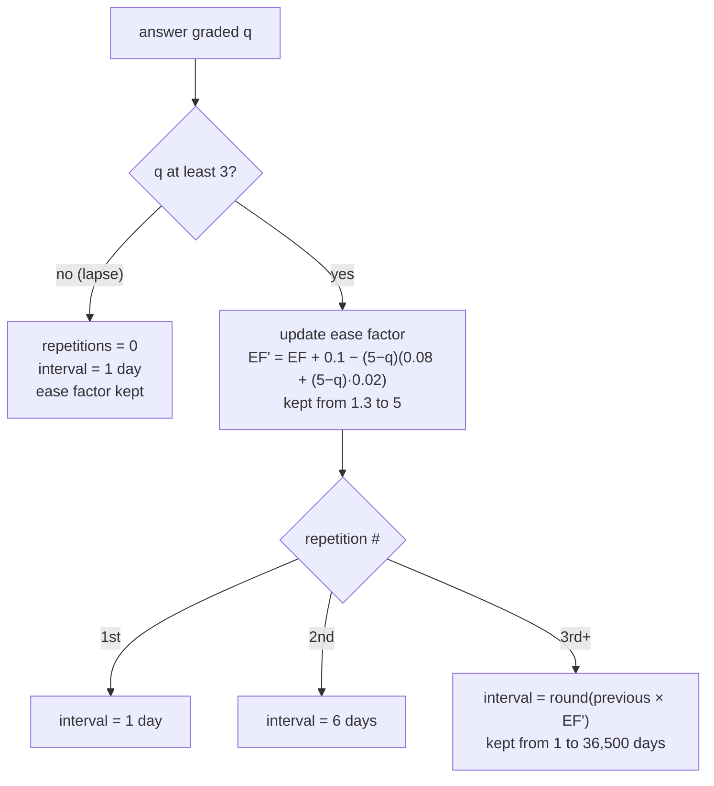
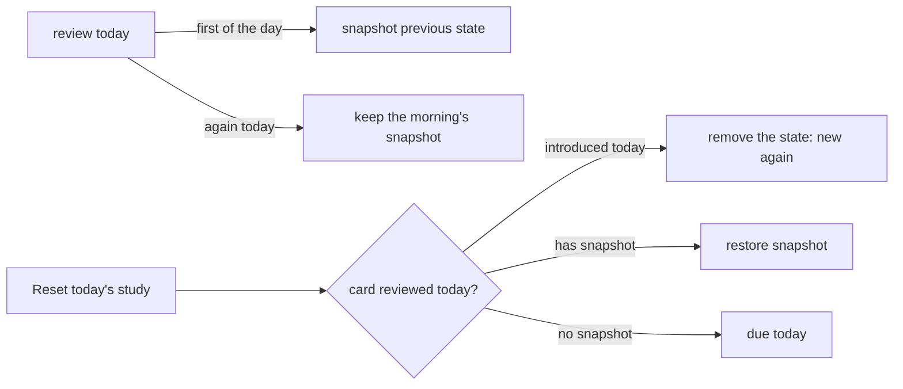

# Spaced repetition (SM-2 and FSRS-6)

Spaced repetition shows a card again shortly before the learner would
forget it: soon after learning it, then at ever longer intervals.
Solid Memo picks each card's next day from how well the learner
remembered it, by the SM-2 method or, when the preferences name it, by
FSRS-6 ([FSRS-6](#fsrs-6)), and builds each day's study session.

The domain layer implements all of the scheduling, as pure functions
([sm2.ts](../packages/domain/src/sm2.ts), [fsrs.ts](../packages/domain/src/fsrs.ts),
[scheduling.ts](../packages/domain/src/scheduling.ts)).

**Reference.** SM-2 is the algorithm of SuperMemo 2, first described in
Woźniak, P. A. (1990). *Optimization of learning*. Master's thesis,
University of Technology in Poznań. SuperMemo publishes its
description, with the formulas used here, as
[Application of a computer to improve the results obtained in working with the SuperMemo method](https://www.supermemo.com/en/blog/application-of-a-computer-to-improve-the-results-obtained-in-working-with-the-supermemo-method).
Solid Memo departs from it where [The SM-2 transition](#the-sm-2-transition)
says so. [policy.md](policy.md) lists it with the other rules the code
follows.

## Prompts and directions

A session asks *prompts*: a card seen from one side (`Prompt` in
[deck.ts](../packages/domain/src/deck.ts)). A deck's direction decides which
prompts its cards make — front→back, back→front, or both (a
*bidirectional* deck, two prompts per card). Each prompt is scheduled on
its own: knowing "Sweden → Stockholm" says nothing about knowing
"Stockholm → Sweden". Review state, budgets, the queue and the session
are all per prompt.

## Review state

Each prompt (card + direction) carries one `ReviewState`:

| Field | Meaning |
|---|---|
| `easeFactor` | SM-2 easiness (starts 2.5, kept from 1.3 to 5) |
| `intervalDays` | Days until the next review (at most 36,500) |
| `repetitions` | Consecutive correct answers |
| `due` | Study day ("YYYY-MM-DD") the card is next due |
| `firstReviewedAt` | Introduction timestamp (counts against the new-card budget) |
| `lastReviewedAt` | Latest review timestamp (counts against the review budget) |

A prompt with no `ReviewState` is *new*. Changing a deck's direction
keeps every state: a card's front→back state waits, unused, while the
deck is studied back→front.

`sm:due` is stored as a plain `"YYYY-MM-DD"` string literal, not
`xsd:date`: a study day is a calendar label, and a round trip through
`Date` objects risks a timezone off-by-one shift.

## The SM-2 transition

The learner grades each answer from 0 (blackout) to 5 (perfect), its
quality `q`. `applySm2` transitions
`(easeFactor, intervalDays, repetitions)`:



Decisions fixed in code (and tests):

- The **updated** ease factor sets the interval, as in Woźniak's
  original description.
- A lapse (`q < 3`) resets the repetitions to 0 and the interval to 1,
  and keeps the ease factor. The card returns the next study day.
- A grade of 0 or 1 sends the card round again **within the session**
  (`repeatsInSession`; see *Study sessions*). Each pass is a full SM-2
  review, and the state stored after the repeat counts.
- The original repeats every card graded below 4 after the session,
  until each scores 4 or more. Solid Memo repeats only grades 0 and 1:
  a lapse graded 2 and a hard but correct answer (3) end the card's
  day.
- Intervals are rounded to whole days.
- The original puts a floor of 1.3 under the ease factor and no bound
  on the interval. Solid Memo also keeps the ease factor at 5 at most,
  and the interval at most 36,500 days (100 years, FSRS-6's longest
  interval too). It bounds the state it reads, keeping the interval
  and the repetitions from 0 to 36,500, and the one it gives, whose
  interval is at least 1 day. The snapshot a review keeps of the
  state before it, and the estimate FSRS-6 makes from an SM-2 state,
  are bounded the same way. A state from elsewhere, such as a deck
  file with progress, then still gives a due day that is a
  `YYYY-MM-DD` date and numbers the write check accepts. A state whose
  ease factor, interval or repetitions isn't a finite number counts as
  a new card's.
- Every grade below 3 resets the card. The statistics and the Studio
  count a **lapse** only for a *scored review* graded below 3 (`isLapse`
  in [answerChain.ts](../packages/domain/src/answerChain.ts),
  [statistics.md](statistics.md#what-the-figures-count)): not a first
  answer, a repeat the same day or a course answer.

### Worked examples

Each row is one answer: the state before it, the grade, and the state
after. [sm2.test.ts](../packages/domain/src/sm2.test.ts) parses the
header and the three number columns and checks the code against every
row. A change to the rules or a row that leaves the two apart fails
the tests. Keep the header and the three number columns as they are.

| Before: ease, interval, repetitions | Grade | After: ease, interval, repetitions | Why |
|---|---|---|---|
| 2.5, 0, 0 (new) | 5 | 2.6, 1, 1 | The first repetition: 1 day. |
| 2.5, 0, 0 (new) | 3 | 2.36, 1, 1 | A pass lowers the ease; still 1 day. |
| 2.6, 1, 1 | 5 | 2.7, 6, 2 | The second repetition: 6 days. |
| 2.5, 6, 2 | 3 | 2.36, 14, 3 | 6 × 2.36 = 14.16, rounded, by the **updated** ease. |
| 2.5, 6, 2 | 4 | 2.5, 15, 3 | Grade 4 keeps the ease: 6 × 2.5 = 15. |
| 2.5, 6, 2 | 5 | 2.6, 16, 3 | 6 × 2.6 = 15.6, rounded. |
| 2.0, 10, 3 | 3 | 1.86, 19, 4 | 10 × 1.86 = 18.6, rounded. |
| 1.3, 10, 3 | 3 | 1.3, 13, 4 | The ease would be 1.16: the floor, 1.3. |
| 5, 10, 3 | 5 | 5, 50, 4 | The ease would be 5.1: the ceiling, 5. |
| 2.2, 30, 5 | 2 | 2.2, 1, 0 | A lapse: back to 1 day, the ease kept. |
| 2.2, 30, 5 | 0 | 2.2, 1, 0 | Grades 0, 1 and 2 schedule alike. |

## FSRS-6

FSRS-6, the Free Spaced Repetition Scheduler, version 6, is a second
scheduler beside SM-2. It keeps each prompt's *stability* (how long its
memory lasts) and *difficulty*, and picks the due day on which the
chance of recall falls to the *desired retention*, 90% by default.
[fsrs.ts](../packages/domain/src/fsrs.ts) has the formulas, and `gradePrompt` in [grading.ts](../packages/domain/src/grading.ts)
applies a grade to both schedulers. The preferences name the scheduler
that sets the due days (`sm:studyScheduler`, preferences format 5);
SM-2's state is updated on every review either way. FSRS-6 is
recommended (its intervals differ markedly by the answer, and a late
review counts for how late it is), and a new instance starts on it
([Which scheduler an instance is on](#which-scheduler-an-instance-is-on)).
The learner switches in the preferences or from the deck list's
invitation ([Switching the scheduler](#switching-the-scheduler)).

**Reference.** FSRS is by Jarrett Ye and the Open Spaced Repetition
project, described in
[The Algorithm](https://github.com/open-spaced-repetition/fsrs4anki/wiki/The-Algorithm).
Solid Memo reimplements FSRS-6's formulas and default parameters as
the reference implementation
[fsrs-rs v6.6.2](https://github.com/open-spaced-repetition/fsrs-rs/blob/v6.6.2/src/model.rs)
(BSD-3-Clause) gives them, and copies no code from it.
[Decisions fixed in code](#decisions-fixed-in-code-fsrs-6) says where
Solid Memo fixes what FSRS leaves to the app.

### FSRS-6 state

A prompt scheduled with FSRS-6 has an `FsrsState`
([review.ts](../packages/domain/src/review.ts)), a subject of its own
in the reviews document beside its SM-2 `ReviewState`:

| Field | Meaning |
|---|---|
| `stability` | Days until the chance of recall falls to 90% (above 0) |
| `difficulty` | From 1 (easiest) to 10 (hardest) |
| `due` | Study day ("YYYY-MM-DD") the card is next due |
| `firstReviewedAt` | Introduction timestamp, the SM-2 state's |
| `lastReviewedAt` | Latest review timestamp |
| `previous` | The snapshot a reset of the day restores: stability, difficulty, due, last review |

An FSRS-6 state counts only while it's **fresh**: while its prompt's
SM-2 state has the same last review (`isFresh`). It goes stale when an
older app graded SM-2 only, the day was reset, or the card was
forgotten, and then counts for nothing. A prompt's due
day comes from a `DueState`: a due day, the interval that led there
and the reviews. Under FSRS-6, `effectiveStates` takes it from the
fresh FSRS-6 state, with the study days from the last review to that
due day as the interval, else from the SM-2 state.

### The FSRS-6 transition

A rating `G` is 1 (Again), 2 (Hard), 3 (Good) or 4 (Easy), and `t` is
the whole study days since the prompt's last review. With the default
parameters `w0` to `w20` and the forgetting curve's decay `w20`:

```text
factor = 0.9^(−1/w20) − 1
R(t, S) = (1 + factor · t / S)^(−w20)            chance of recall; R(S, S) = 0.9
I(S, r) = S / factor · (r^(−1/w20) − 1)          days until R falls to r; I(S, 0.9) = S

first rating:  S = w[G−1]
               D = clamp(w4 − e^(w5·(G−1)) + 1, 1, 10)

a later one:   S, D kept to 0.001–36,500 and 1–10 first; R = R(t, S)
  Again:       S' = min(w11 · D^(−w12) · ((S+1)^w13 − 1) · e^((1−R)·w14),  S / e^(w17·w18))
  Hard..Easy:  S' = S · (1 + e^w8 · (11 − D) · S^(−w9) · (e^((1−R)·w10) − 1) · h · b)
               h = w15 for Hard, else 1;  b = w16 for Easy, else 1
  same day:    S' = S · e^(w17·(G − 3 + w18)) · S^(−w19), at least S unless Again
               (t = 0 replaces both above)
  difficulty:  D' = D − w6·(G − 3) · (10 − D) / 9
               D'' = clamp(w7 · D0(4) + (1 − w7) · D', 1, 10),  D0(4) = w4 − e^(3·w5) + 1
  S' is kept from 0.001 to 36,500.

interval = clamp(round(I(S', desired retention)), 1, 36500)
due = today + interval
```

| Parameters | Default | Used for |
|---|---|---|
| `w0`–`w3` | 0.212, 1.2931, 2.3065, 8.2956 | first stability, by rating |
| `w4`–`w7` | 6.4133, 0.8334, 3.0194, 0.001 | first difficulty, its step, mean reversion |
| `w8`–`w10` | 1.8722, 0.1666, 0.796 | stability after a recall |
| `w11`–`w14` | 1.4835, 0.0614, 0.2629, 1.6483 | stability after a lapse |
| `w15`, `w16` | 0.6014, 1.8729 | Hard penalty, Easy bonus |
| `w17`–`w19` | 0.5425, 0.0912, 0.0658 | same-day reviews |
| `w20` | 0.1542 | the forgetting curve's decay |

**Estimate from SM-2.** A prompt reviewed with SM-2 only gets its
FSRS-6 memory from its SM-2 state (`memoryFromSm2`, as fsrs-rs's
`memory_state_from_sm2` at a retention of 90%). The stability is the
SM-2 interval; the difficulty is the one at which a Good review on the
due day multiplies the stability by the ease factor:

```text
S = max(interval, 0.001)
D = clamp(11 − (ease − 1) / (e^w8 · S^(−w9) · (e^(0.1·w10) − 1)), 1, 10)
```

#### Decisions fixed in code (FSRS-6)

- **Default parameters**, not trained on the learner's answers, in
  64-bit floating point.
- **Whole study days.** `t` counts study days by the instance's day
  boundary, as SM-2's due days do. A second review the same study day
  has `t = 0` and takes the same-day formula, Again included.
- **No fuzz.** The interval is rounded to whole days, from 1 to
  36,500; the same answers give the same due days.
- **Ratings.** A grade maps to a rating by its button (`ratingOfGrade`,
  `gradeGroupOf`): 0 to 2 Again, 3 Hard, 4 Good, 5 Easy. A course's
  multiple-choice answer is Good when right and Again when wrong
  (`ratingOfChoice`); its SM-2 grade stays 3 or 1, and the answer is
  read back as Good or Again by its mode.
- **Where the memory starts.** A review builds on the fresh FSRS-6
  state, else on the estimate from the SM-2 state before the review,
  else, for a new prompt, on the rating alone.
- **The snapshot.** The first review of a study day snapshots a fresh
  FSRS-6 state, and later ones that day keep that snapshot. A state
  estimated from SM-2, or a new one, has none.
- **The same first review.** An FSRS-6 state's `firstReviewedAt` is its
  SM-2 state's: both count the prompt introduced the same day.

#### Where the FSRS-6 states are kept

The FSRS-6 states are read with the SM-2 states, in the same reviews
document ([data-model.md](data-model.md#decks-and-cards)).

- **One edit per grade.** A grade under FSRS-6 writes both states in
  the one PATCH a grade makes under SM-2
  ([What a grade costs](#what-a-grade-costs)).
  It reads neither the preferences nor the answer log: a missing or
  stale FSRS-6 state is estimated from the SM-2 state inside that edit.
  Under SM-2 the FSRS-6 state stays untouched.
- **What sets the due day** is `effectiveStates`'s view
  ([FSRS-6 state](#fsrs-6-state)): the SM-2 states under SM-2. The
  queue, the digest's schedule, a course's answer, where cards stand,
  the forecast, a card's history and the Studio's due column all go by
  it.
  What's written is always an SM-2 or an FSRS-6 state, never this view.
- **The answer log** records the intervals and the due day of what set
  the due day ([data-model.md](data-model.md#the-answer-log)); the
  grade stays SM-2's.

#### Which scheduler an instance is on

The scheduler is the preferences' own, never a default's, so a new
default changes no one's scheduler.

- **A new instance** is made with its preferences stated
  (`NEW_INSTANCE_PREFERENCES`,
  [preferences.ts](../packages/domain/src/preferences.ts)): FSRS-6 and
  the device's theme. A guest's instance and a trial's sandbox are made
  the same way (`createInstance`): a guest starts on FSRS-6, and a trial
  then takes the user's scheduler.
- **An instance with no preferences stored**, older and with SM-2
  states, reads as SM-2 (`DEFAULT_PREFERENCES`), as does a format 1 to 4
  document (the step to format 5 fills in SM-2). Its learner is invited
  to switch.
- **An instance attached by its address**, or a guest's study moved into
  a pod, keeps the preferences it has.

#### The invitation to switch

A learner on SM-2, a guest included, sees an invitation above the deck
list to switch to FSRS-6 (`SchedulerInvitationContainer`,
[SchedulerInvitation.tsx](../packages/ui/src/ui/SchedulerInvitation.tsx);
`invitesToFsrs`). It says what FSRS-6 gives, with a switch button and
"Not now". The button runs `switchScheduler`, the other preferences
unchanged, and shows the progress and result in place, as the
preferences screen does. "Not now" is stored in the preferences
(`sm:schedulerInvitationDismissed`, `dismissSchedulerInvitation`), so
the invitation doesn't come back on any device, and a save of the
preferences keeps it. It's hidden under FSRS-6,
and shows again after a switch back to SM-2 unless the learner answered
"Not now".

#### Switching the scheduler

Both the preferences screen and the invitation switch through
`switchScheduler`
([preferences.ts](../packages/application/src/preferences.ts)). The
preferences screen lists FSRS-6 first and marks it Recommended. A plain
save of the preferences (`savePreferences`) keeps the stored scheduler:
FSRS-6 is never turned on without its states.

- **To FSRS-6.** The answer log is read whole, once. Each deck's
  reviews document gets an FSRS-6 state for every SM-2 state
  (`switchedStates`, [schedulerSwitch.ts](../packages/domain/src/schedulerSwitch.ts)),
  in one write per deck, made again from a fresh read on a 412
  (`writeFsrsStates`).
  - **Replayed** when the log holds the prompt's whole history: its
    answers since its last introduction run from the SM-2 state's
    `firstReviewedAt` to its `lastReviewedAt`. The first answer starts
    the memory from its rating, and each later one steps it by the
    study days since the one before (0 the same study day). An answer
    rates by its grade, a multiple-choice one by whether it was right.
  - **Estimated from SM-2** otherwise (`memoryFromSm2`): a card moved
    in with its progress, whose answers stay with the deck it came
    from; a guest's study whose answers weren't all kept; or a state an
    older app wrote.
  - Each keeps the SM-2 state's due day and reviews, with no snapshot,
    so no due day moves. One already there is made again at the same
    subject: a switch run twice gives the same states.
  - Progress shows per deck. A deck that can't be written now is named
    with why, and the others go on. The preferences are saved last,
    once every deck is written (until then SM-2 sets the due days, and
    the switch can run again), then each deck's digest schedule is
    updated. A switch that fails, or is closed early, returns to the
    form as last saved, FSRS-6 still chosen.
- **To SM-2.** Only the preferences are saved: SM-2's states are
  updated on every review, so they're current. The digest's schedules
  name their scheduler, so the deck list counts from the documents
  again.
- **The desired retention** (70% to 97%, stored as a share) is saved
  like any preference. It sets the interval of each review from then
  on; due days already set stay. A stored one outside that range, or
  no number, is read as the default 90%: preferences that don't fit
  their shape are still used, and FSRS-6 has no interval for a share of
  1 or more.

### FSRS-6 worked examples

Each row is one answer, at a desired retention of 90%; the memory
before is a new prompt, a stability and difficulty, or an SM-2 ease
and interval to estimate from.
[fsrs.test.ts](../packages/domain/src/fsrs.test.ts) parses the header
and the five number columns and checks the code against every row, to
within 0.0001 (the table rounds to 4 decimals). A change to the
formulas or a row that leaves the two apart fails the tests. Keep the
header and the five number columns as they are.

| Before: stability, difficulty | Rating | Days | After: stability, difficulty | Interval | Why |
|---|---|---|---|---|---|
| (new) | 1 Again | 0 | 0.212, 6.4133 | 1 | A first Again: `w0`, the interval at least 1 day. |
| (new) | 2 Hard | 0 | 1.2931, 5.1122 | 1 | A first Hard: `w1`. |
| (new) | 3 Good | 0 | 2.3065, 2.1181 | 2 | A first Good: `w2`. |
| (new) | 4 Easy | 0 | 8.2956, 1 | 8 | A first Easy: `w3`; the difficulty floors at 1. |
| 2.3065, 2.1181 | 3 Good | 2 | 10.9643, 2.1112 | 11 | Good on the due day: almost fivefold. |
| 10.9643, 2.1112 | 3 Good | 11 | 46.2802, 2.1043 | 46 | And again on the due day. |
| 46.2802, 2.1043 | 3 Good | 46 | 162.8626, 2.0974 | 163 | An easy card grows by less each time. |
| 46.2802, 2.1043 | 3 Good | 20 | 107.1892, 2.0974 | 107 | Reviewed early, recall still likely: it grows less. |
| 10.9643, 2.1112 | 1 Again | 11 | 1.5383, 7.3922 | 2 | A lapse: stability falls, difficulty rises. |
| 1.5383, 7.3922 | 3 Good | 2 | 4.8763, 7.38 | 5 | Good after a lapse: a harder card grows more slowly. |
| 2.3065, 2.1181 | 3 Good | 0 | 2.3065, 2.1112 | 2 | Good again the same day: the stability never falls. |
| 0.212, 6.4133 | 3 Good | 0 | 0.2467, 6.4021 | 1 | Good the same day after an Again, as a failed card back in the session. |
| 5, 5 | 1 Again | 0 | 1.5968, 8.3418 | 2 | Again the same day: the same-day formula lowers the stability. |
| 0.212, 6.4133 | 1 Again | 1 | 0.1009, 8.8063 | 1 | Again the next day. |
| 8.2956, 1 | 4 Easy | 8 | 65.6242, 1 | 66 | The Easy bonus, `w16`. |
| 1.2931, 5.1122 | 2 Hard | 1 | 3.2494, 6.7405 | 3 | The Hard penalty, `w15`. |
| SM-2: 2.5, 10 | 3 Good | 10 | 25, 6.9024 | 25 | Estimated as stability 10, difficulty 6.9141: Good on the due day multiplies it by the ease, 2.5. |
| SM-2: 1.3, 20 | 3 Good | 20 | 26.5415, 9.9852 | 27 | Ease 1.3 needs a difficulty above 10: it's 10, and the stability grows a little more. |
| SM-2: 2.5, 10 | 1 Again | 10 | 1.3646, 8.9709 | 1 | A lapse after an estimate. |

## Answer scales

Sessions grade with one of two button sets, chosen per instance in the
preferences (`sm:answerScale`, default `sm2`). Under FSRS-6 the minimal
scale is always used, matching FSRS-6's four ratings
(`effectiveAnswerScale` in [preferences.ts](../packages/domain/src/preferences.ts)),
and the stored scale stays for switching back to SM-2:

| Scale | Buttons | Records |
|---|---|---|
| `sm2` | 0 — Blackout … 5 — Easy | that grade |
| `minimal` | Again · Hard · Good · Easy | 1 · 3 · 4 · 5 |

The minimal scale is a view over SM-2. Again stands for 0–1 and records
1; Hard stands for 2–3 and records **3**, the lowest passing grade, so
it isn't a lapse. On the minimal scale only Again repeats in the session
([answerScale.ts](../packages/domain/src/answerScale.ts)).

## Multiple-choice answers in a course

A [course](courses.md) asks a card as a multiple-choice question, its
back among its distractors. The answer is right or wrong, and
`gradeOfChoice` in [course.ts](../packages/domain/src/course.ts), the
only place a choice becomes a grade, maps it to SM-2:

| Choice | Grade | Why |
|---|---|---|
| right | 3 | The lowest passing grade: a choice says that the answer was known, not how well. |
| wrong | 1 | A lapse. |

FSRS-6 rates it Good or Again (`ratingOfChoice`, [FSRS-6](#fsrs-6));
"grade 3" below is SM-2's. The grade goes through the same transition as
a study review (`gradePrompt` in
[grading.ts](../packages/domain/src/grading.ts), which the answer
store's `grade` in
[answerStore.ts](../packages/application/src/answerStore.ts) applies, as
`recordReview` does). Course answers are front→back.

Whether an answer is graded at all depends on the card's state and
the due day the scheduler in use set (`courseAnswerEffect`):

| The card | Right | Wrong |
|---|---|---|
| no state: answered for the first time, in a step | introduced, grade 3: 1 repetition, ease 2.36, due the next study day | introduced, grade 1: 0 repetitions, due the next study day |
| graded earlier the same study day, as in the final review after its step | nothing written: the day's grade stands | grade 1 |
| due this study day or earlier, not graded today | grade 3 | grade 1 |
| due on a later study day: a step revisited or a chapter retaken | nothing written: practice | nothing written: practice |

- **A step** writes each card into the deck the first time its
  question is answered, then grades it.
- **The final review** asks every question of the chapter, usually the
  same day; a wrongly answered question comes back until it's right.
- **No daily limit** applies. A card introduced there uses up that
  day's new-card budget in study (below).
- **Afterward** the cards are studied by flip-and-grade, on the
  instance's answer scale.

## Study days and the queue

Scheduling works in *study days*, not calendar days. `studyDayOf`
shifts an instant back by `dayBoundaryHour` (default 4) before taking
the local date: a review at 03:00 counts as yesterday. A boundary that
would move the instant off the calendar falls back to the calendar day.
Study days are device-local, and traveling shifts due times by a few
hours (accepted for v1).

`buildStudyQueue` builds the day's session from the cards, the deck's
direction, the review states and the preferences: the instance's, with
the deck's own daily limits in their place where the deck sets them
(`deckPreferences` in `domain/deckPace.ts`). A deck's limit that isn't
a count, 0 or more, reads as absent. `now` is always passed in, never
read from a clock. Retired cards (`owl:deprecated true`) make no
prompts: their review states are kept, but never due and never new.

- **due**: prompts whose `due <= today`, oldest due first, capped at
  `maxReviewsPerDay` minus reviews already done today.
- **new**: prompts without review state, **drawn at random**
  (Fisher–Yates over an injected `random` source), capped at
  `newCardsPerDay` minus prompts introduced today. A long deck isn't
  introduced front to back, and a card's two prompts in a bidirectional
  deck needn't arrive together, or even on the same day.

The budgets count prompts: a bidirectional deck spends two of the day's
new-card budget on a card introduced both ways. Both budgets clamp at
zero.

New instances start at 5 new cards per day, with a note beside the
field that each brings reviews later. A format-1 preferences document
without the field means 20 ([migrations](migrations.md)).

`getStudyCounts` takes the deck list's counts from
the deck's schedule in the instance's [digest](data-model.md#the-digest)
while neither of its documents has changed (`studyCountsOf` in
`domain/studyDigest.ts`, tested against `buildStudyQueue` for every
direction and cap). A schedule holds its counts by study day: a later
day starts with nothing reviewed or introduced.

The queue is a snapshot taken at session start: the session owns its
order (below), and a refetch never reshuffles it.

## Study sessions

A deck offers one session a day, **Study**
([StudyContainer](../packages/ui/src/ui/StudyContainer.tsx)): today's
due prompts plus new ones within the new-card budget. The new ones are
spread evenly among the due (`interleave`), not queued after them. The
session opens with a due prompt when there is one. This one button
replaced a separate due-only mode. Leeches have a cram of their own
([Cramming the leeches](#cramming-the-leeches)).

A session walks its queue one prompt at a time: the side asked (the back
for a back→front prompt) → reveal the other side → grade. A card graded
0 or 1 goes back into the *remainder* of the session at a random
position (`requeueCard`), never next unless it's the only card left:
then it repeats until it passes. The "Card x of y" counter grows with
each repeat.

Each answer runs the `recordReview` use case
([study.ts](../packages/application/src/study.ts)):

- It applies the transition (`gradePrompt`: SM-2's, and FSRS-6's while
  it sets the due days) to the card's state as `reviews/<deckId>.ttl`
  holds it when written, or to the initial SM-2 state.
- It persists the new state and due day there, and returns the state.
- It reads no preferences: the queue comes with the instance's
  (`StudySessionQueue`), and the session grades with them (`GradeBasis`,
  recordReview's `known`).

A failed save keeps the card in place with an error, and the queue
advances only on success. Ending the session invalidates the review
caches.

Under each grade button, as its description, is the interval
`gradePrompt` gives for that grade, a new prompt's from nothing:
"1 day", "6 days", "15 days"
(`previewIntervals` in [grading.ts](../packages/domain/src/grading.ts)).
It's SM-2's under SM-2, and under FSRS-6 the FSRS-6 interval at the
desired retention, which depends on the days since the last review.
The states and the preferences (scheduler and buttons) come with the
queue as `getStudyQueue` read them. The session keeps each answer's new
states: a card put back shows the intervals its first answer left.

### What a grade costs

A grade writes one state, or two under FSRS-6
([Where the FSRS-6 states are kept](#where-the-fsrs-6-states-are-kept))
in one PATCH of the reviews document, `If-Match` the version last read
or written ([data-model.md](data-model.md#write-discipline)). It
applies the grade to the card's state as that document holds it
(`gradeReviewState`). The session's first grade edits the document as
its queue read it. A later grade could skip the read only on a write
answered with the new ETag.

None of the servers the tests measure does that. Community Solid
Server 6, 7 and 8 (with ACP too) and Pivot answer a PATCH with 205 and
no ETag. node-solid-server sends no ETag at all, and Nextcloud none on
a write. JavaScript Solid Server couldn't be measured. So each later
grade reads the document again, whole. On a 412 (another device's
grade since), it's read once more and the grade applied to the state
it holds then, building on that grade.

`MEASURE_GRADES=1` measures the requests, bytes and time of a session's
grades on a deck of 2,000 states against each server the tests run
([testing.md](testing.md)).

### Undoing the last answer

After an answer the screen offers **Undo last answer** (U, Ctrl+Z or
Cmd+Z). The last two are checked apart from the card's own keys, which
skip any key pressed with Ctrl or Meta. Undo takes back the session's
most recent answer and shows that card again, unrevealed:

- **The state from before the answer**: `recordReview` returns the state
  the grade was applied to (`gradeReviewState`'s `current`) with the
  answer's id, as a `ReviewUndo` kept in memory for the session. It
  holds the FSRS-6 state from before too when the answer wrote one
  (`ReviewUndo.fsrs`). The stored snapshot (`ReviewState.previous`) is
  from before the study day's *first* review, so it can't undo a second
  answer. `undoReview` writes the states back in one save, or removes
  one that didn't exist. A grade of the same card made on another device
  between the answer and the undo is lost.
- **The answer leaves the log**: dropped from the queue if still
  waiting, else removed by its id (`AnswerLog.removeAnswer`).
- **The session goes back one step**, without the copy a low grade put
  back; the count says "Card x of y" as before, and that the answer was
  undone.

Undo goes back one step only, while the session is open, including
from its end screen for the last answer.

### Cramming the leeches

A deck's leeches are its cards forgotten `LEECH_LAPSES` (4) times or
more in their reviews of the last 12 months
([statistics.md](statistics.md#a-decks-own-figures)). The learner can
cram them now, as often as they like, due or not. **Cram the
leeches** opens the cram (`#/cram`, [routing.md](routing.md)), shown
only when there's a leech. It sits under a deck's hardest cards, on
its page and its statistics' memory tab. Under the leeches across the
decks, on the memory tab, it crams every deck's leeches together.

The cram ([CramContainer](../packages/ui/src/ui/CramContainer.tsx))
reads the leeches once, from the cards' progress (`getCardProgress`), in
every direction the deck is studied in (`promptsOf`), and walks them
shuffled on the study screen, with the answer buttons the preferences
ask for (`getPreferences`). In a cram of every deck, each prompt keeps
its deck: the heading, the deck link and where a mistake is reported
follow the card. Once begun, it reads neither again, on window focus or
invalidation, so a failing read can't end it. A grade of 0 or 1 puts the
card back, as in a session (`requeueCard`). At the end, **Cram again**
starts over with the same cards, shuffled afresh.

A cram records nothing. It never calls `recordReview`, `undoReview` or
`refreshStudyDigest`: it writes no review state, logs no answer and
changes no cached review state or queue. The statistics don't count it,
and a leech stays one until study brings its 12-month lapses below 4.
The grades show no interval, there's no undo, and the screen says
nothing is recorded. The cards' progress read at the start is the
statistics' read: it may log answers still queued from earlier study and
refresh the schedule cached in the study digest
([data-model.md](data-model.md#the-digest)). A deck copied from a
release still says where a mistake in a card is reported, which only
reads.

## Suggesting a session

The app suggests a session only when the session has something in it.
The deck page and each deck-list row read the deck's queue for today:

| Today's queue | Deck page | Deck-list row |
|---|---|---|
| prompts due and/or new within budget | **Study**, with "N due today, and M new to introduce" | **Study** with "N due · M new" |
| nothing | "All cards have been studied" | "Nothing to study today" |
| unknown (loading / unreadable) | loading or error | no suggestion |

Rows load independently, sharing the study queue's cache entry with
the deck page (`queryKeys.studyQueue(deckUrl)`,
[architecture.md](architecture.md#query-keys)). Concurrent reads of the
preferences share one request, never cached beyond it.

## Where cards stand

The statistics page and each deck's page show how far along the cards
are and what falls due next
([cardProgress.ts](../packages/domain/src/cardProgress.ts)), from the
cards and review states, read afresh each time (`getCardProgress`, two
GETs a deck), not from the answer log.

- **New, relearning, young and mature.** A prompt with no review state
  is *new*. A reviewed one with `repetitions` 0 is *relearning* (the
  Studio's "learning" state). Of the rest, one whose `intervalDays` is
  under 21 (`MATURE_INTERVAL_DAYS`) is *young*, and one at 21 or more is
  *mature*. The recall tiles and the recall-by-month chart draw the same
  line on the interval *before* each review (the answer's prior
  interval): the review that makes a prompt mature counts as young.
- **Prompts, not cards**, as in the queue: `cardProgressOf` counts
  `promptsOf(activeCards(cards), direction)` and the states
  `scheduledStates` keeps of them. A bidirectional deck counts each
  card twice, as the page says; retired cards, and states of a
  direction the deck isn't studied in, don't count.
- **The forecast** is the Studio's (`forecastOf`,
  [scheduleInsight.ts](../packages/domain/src/scheduleInsight.ts)),
  worked out per deck from its schedule: the digest's while it matches
  the documents read, else `scheduleOf` afresh, then kept in the
  digest. `mergeForecasts` adds the decks up: the reviews due on each
  of the next 30 study days, every overdue prompt in today's bar, each
  day paired with what the deck's `maxReviewsPerDay` lets through, the
  rest carried over.
- **Overdue and caught up.** *Overdue* counts the prompts due before
  today (`overdueOf`). The day the decks are *caught up* comes from each
  deck's forecast (`daysToClearOf`): the study days its cap takes to let
  through every review it holds back, or more than the 30 days. Across
  decks the latest counts.
- **Introduced isn't learned.** "Cards introduced over time" totals
  the first answers of the last 12 months in the
  [answer log](data-model.md#the-answer-log), removed decks and retired
  cards included, so it need not match today's counts.

## Resetting the day

Once something has been studied today, the deck page offers **Reset
today's study**: it undoes the deck's current study day, as if its
sessions hadn't happened. (The session undoes a single answer:
[Undoing the last answer](#undoing-the-last-answer).)

`recordReview` stores a snapshot (`ReviewState.previous`, the
`sm:previous*` triples) of the state from **before the study day's
first review**. A second review the same day keeps that snapshot
(`snapshotBeforeReview`).

`resetStudyDay` (pure, in [scheduling.ts](../packages/domain/src/scheduling.ts)) then
decides, per card reviewed today:

| Card | Reset does |
|---|---|
| introduced today (`firstReviewedAt` is today) | removes its state — it is a new card again |
| reviewed today, has a snapshot | restores the snapshot (ease, interval, repetitions, due, last review) |
| reviewed today, no snapshot (state written before snapshots existed, or given a due day in the Studio) | can't be restored: made due today |
| not reviewed today | untouched |

The FSRS-6 states go back in the same save (`resetFsrsStudyDay`): one
reviewed today gets its snapshot back. One introduced today is removed,
as is one first written today from an estimate; the next review
estimates it again from the restored SM-2 state.



Restoring `lastReviewedAt` and `firstReviewedAt` frees today's
budgets. All changes go out in one save of the reviews document
(`applyReviewChanges`), never half-applied. The deck's answers of the
day then leave the
[answer log](data-model.md#the-answer-log): answers still on their way
to the log are added first, then removed with the rest. "Today" honors
the instance's `dayBoundaryHour`, like the queue.

In the [Studio](studio.md#card-inspector), setting a card's due day (`rescheduleState`, in
[reviewStateEdits.ts](../packages/domain/src/reviewStateEdits.ts)),
SM-2's or FSRS-6's, drops its snapshot, so a reset of the day can't
bring back the state from before the new due day. Forgetting a card (`resetStates`) removes its states,
SM-2's and FSRS-6's, so a reset of the day has nothing of it to
restore. Neither touches the answer log.

In a [course](courses.md)'s deck, a reset treats the day's course
answers like study answers:

- A card introduced today loses its state but stays in the deck, with
  its distractors: new in study, its course step not done, introduced
  again when its question is answered.
- A card reviewed today gets its snapshot back.
- The day's multiple-choice answers leave the answer log.
- A chapter completed today stays completed: `sm:completedChapter` is
  on the catalog entry, which a reset doesn't touch.
