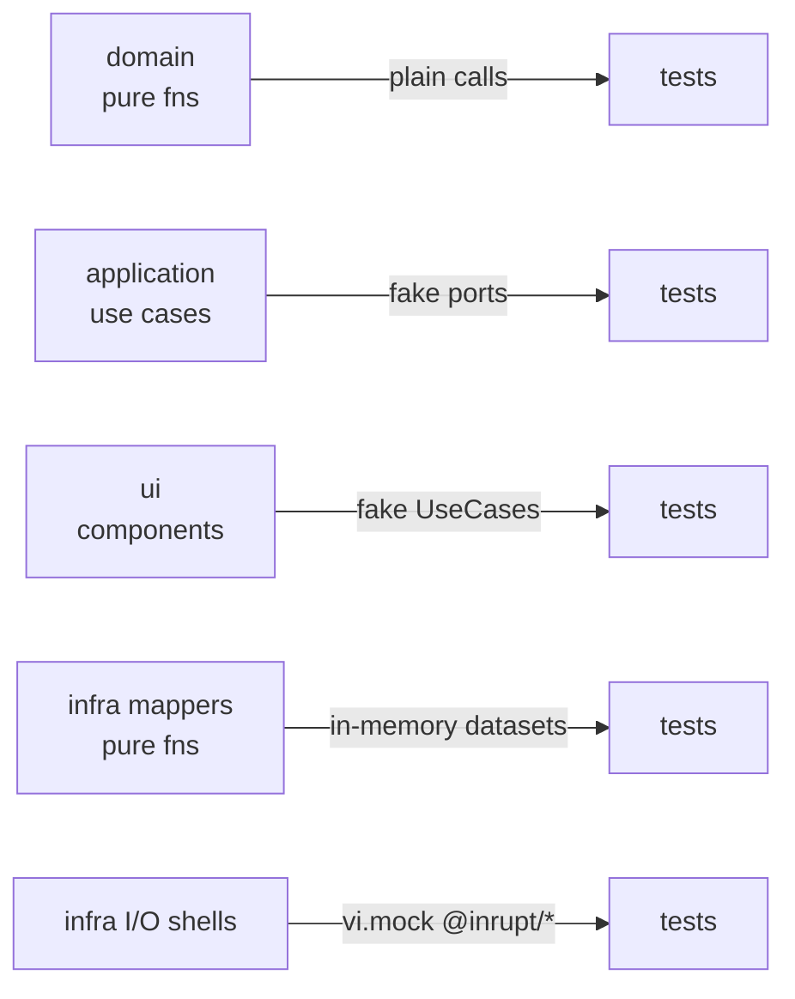

# Testing

Every change to Solid Memo is checked by automated tests
before it is published. Small tests check each part of the code on its
own, every line of it; larger ones run the app against real Solid
servers and click through it in a real browser. This page says what
each kind covers, how to run them, and how to read a failure.

Unit tests with [Vitest](https://vitest.dev/) in every package, in node
unless the package runs in the browser: `ui`, `web`, `studio`, `solid` and `browser`
run in `happy-dom`, and the UI's tests use `@testing-library/preact`
([vitest.shared.ts](../vitest.shared.ts)). Coverage is enforced at
**100%** (statements, branches, functions, lines) per package: each
package's own tests cover its own code — `npm test` fails below that.

## Commands

```sh
npm test          # every package's tests, with coverage thresholds (turbo)
npm run check     # Biome's lint, markdownlint and cspell, then npm test's tests, the round trip, typecheck, drift, Turtle formatting, the deck library, boundaries, the repository's own checks (below)
npm run check:ci  # npm run check without the deck library, as CI's check job runs it (its library job checks the library)
npm run browsers  # once: Chromium's headless shell, which npm run check and npm run build draw the docs' diagrams in (on Linux, if it lacks system libraries: sudo npx playwright install-deps chromium)
npm run lint      # Biome: the formatting and lint rules of the TypeScript, JSON and CSS (docs/style.md)
npm run format    # Biome: rewrite those files as it formats them
npm run coverage:summary   # the coverage the last tests measured, per package, as a table
npm run lint:markdown      # markdownlint over the project's Markdown, as npm run check runs it
npm run lint:spelling      # cspell, American English, over the Markdown and en.json, as npm run check runs it
npm run lint:reuse         # reuse lint: every file states its copyright and license, as CI's docs job checks (needs reuse; not in npm run check)
npm run lint:workflows     # actionlint and zizmor over .github/, as CI's workflows job runs them (needs them; not in npm run check)
npm run test:unit -- packages/ui/src/ui/App.test.tsx   # some files, or all with none, without coverage (root vitest.config.ts)
npm run test:watch # watch mode, every package's tests
npm run test:unit -w @solid-memo/domain -- account.test.ts   # one package's (test:watch too)
npm run test:roundtrip -w @solid-memo/solid   # every library release through a draft and back (below)
npm run crosscheck # the pySHACL cross-check, as CI runs it (needs scripts/requirements-ci.txt)
npm run test:crosscheck   # the Python scripts' own tests (the cross-check's, the taxonomy deck generator's), Python's unittest (needs scripts/requirements-ci.txt too)
npm run check:closes -- --base origin/main   # a commit since the branch left main closes an issue (add --body-file <file> for the pull request's body), as CI's commits job checks it (CONTRIBUTING.md)
npm run check:breaking -- --base origin/main   # the public API against where the branch left main, as CI's library job checks it (docs/releasing.md)
npm run test:pod  # the end-to-end tests, against the Solid servers they start in Docker
npm run servers -w @solid-memo/e2e-pod   # pull or build those servers' images ahead (`-- css-6` for one)
npm run pod       # a Community Solid Server at http://127.0.0.1:3999/, in memory, to poke at by hand
npm run pod:clean # take down the servers an interrupted run left
npm run journeys  # the user journeys: the built app in Chromium (a few also in Firefox, WebKit and on a phone), against a Community Solid Server 7 started in Docker
npm run journeys -- --project=chromium   # one browser's journeys (chromium, firefox, webkit or phone)
npm run journeys -- --ui  # the same in Playwright's UI mode: watch, pick, step through and time-travel a journey
npm run journeys -- -g smoke   # only the journeys whose title matches (or --repeat-each=10, or any other Playwright option)
npm run css -w @solid-memo/e2e-journeys   # keep such a server up; JOURNEY_SERVER_URL=<its url> npm run journeys reuses it
npm run journeys:report -w @solid-memo/e2e-journeys   # open the last run's report
npm run css:clean -w @solid-memo/e2e-journeys   # take down the servers an interrupted run left
npm run screenshots   # retake the app's screenshots on a phone's screen (below), from the built app
npm run check:providers   # the Pod providers onboarding suggests answer with their issuers (needs the network)
```

`npm run test:pod` runs `e2e/pod/` once against each Solid server
[servers.ts](../e2e/pod/servers.ts) knows, which its global setup
([globalSetup.ts](../e2e/pod/globalSetup.ts)) starts in Docker, each on a
free port of 127.0.0.1 and told that URL, and takes down after (or as
the run ends, on Ctrl-C); the test names say which server and version:

| Id | Server | Image | Tier |
|---|---|---|---|
| `css-7` | Community Solid Server 7.x, in memory | its own, `solidproject/community-server`, pinned by digest | blocking |
| `css-6` | Community Solid Server 6.x, in memory | the same | blocking |
| `nss-6` | node-solid-server 6.x | built here from its lockfile ([servers/nss/](../e2e/pod/servers/nss/Dockerfile)), in a root whose ACL lets anyone read and write | blocking |
| `nss-5` | node-solid-server 5.x | the same | blocking |
| `css-acp` | Community Solid Server 7.x with Access Control Policies in place of Web Access Control, in memory | built here on css-7's image ([servers/css-acp/](../e2e/pod/servers/css-acp/Dockerfile)) with a configuration of its own, its root's ACR open | blocking |
| `css-8` | Community Solid Server 8, still in alpha, in memory | its own, pinned by digest | advisory |
| `pivot` | Pivot, the server of solidcommunity.net (the Community Solid Server 7 with Pivot's components), in memory | built here from its lockfile ([servers/pivot/](../e2e/pod/servers/pivot/Dockerfile)) with a configuration of its own, its root open | advisory |
| `nextcloud` | Solid-Nextcloud: Nextcloud 32 with the Solid app, on SQLite, the pod `apps/solid/~alice/storage/` | built here from a commit of the app ([servers/nextcloud/](../e2e/pod/servers/nextcloud/Dockerfile)), installed on every start, alice's pod opened by a hook | advisory |
| `jss` | JavaScript Solid Server, files in the container, open to anyone (`--public`, which skips its access control) | built here from its lockfile ([servers/jss/](../e2e/pod/servers/jss/Dockerfile)), unmodified and pushed nowhere (it is AGPL) | advisory |

A **blocking** server's tests gate CI, and so deploys and Renovate's
merges: every test passes or skips, for a reason the tests give. An
**advisory** server's results are reported, not a gate: the Interop
workflow ([interop.yml](../.github/workflows/interop.yml)) runs them on
pushes to `main` that touch the app's Solid code, weekly, and by hand,
and a job fails only on a test failing that
`e2e/pod/servers/<id>/expected-failures.json` (`{ "<file> > <test>":
"<why>" }`, the test named without its server) does not list, or when
no test ran ([compare.ts](../e2e/pod/compare.ts) says which in the job's
summary, and what passes though listed, to take off the list). CI still
checks that every advisory server starts and meets the contract, so a
change that breaks one is not merged unnoticed, and Renovate merges an
advisory server's updates once that passes, as it does a blocking one's. Solid-Nextcloud's SQLite
refuses writes made at once, so with it in a run the test files run one
at a time (`serialFiles` in servers.ts); what it fails, and why, is its
`expected-failures.json`. css-8 becomes blocking at
8.0.0, and css-6 then goes.

Each server is a compose file, `e2e/pod/servers/<id>/compose.yml`. It may
ask only for `E2E_PORT` (the port on 127.0.0.1 the harness picked, which
the server must be told) and `E2E_SECRET` (a password made up for the
run), publishes on 127.0.0.1 only, and gets nothing of the host; `npm
test` checks that of every one ([servers.test.ts](../e2e/pod/servers.test.ts)).
Images built here are tagged `localhost/solid-memo-e2e-<id>:local` and
pushed nowhere; the others are pulled once. Before the tests, every
server must meet a contract ([contract.ts](../e2e/pod/contract.ts)): a
document anyone writes in its pod root reads back, is listed there at the
URL it was written to, and deletes. A server that is not open, or does
not know the URL it is reached at, fails there, saying so, not in every
test. What a server prints goes to `e2e/pod/logs/<id>.log`, which CI
keeps when a job fails.

The tests' fetch sends every request with `Connection: close`
([setup.ts](../e2e/pod/setup.ts)). Node 24's fetch can write a request
onto a pooled connection the server closed while a long synchronous
stretch (a big update, on a slow runner) kept it from noticing, and
then fails it without resending it; a browser resends it, so the app
needs no retry. The Fetch standard forbids the header, but Node's fetch
honors it, and `npm test` checks that it still does
([connections.test.ts](../e2e/pod/connections.test.ts)).

`SOLID_SERVERS=css-7,nss-5` runs the suite against some only (`all`
against every one; unset, the blocking ones; `css-8` for the advisory);
`SOLID_SERVER_URL` against a server of your own instead, which must let
anyone read and write, as `npm run pod`'s does (`SOLID_SERVER_NAME` names
it in the tests; `NODE_EXTRA_CA_CERTS` trusts its certificate, if a CA of
your own signed it). CI runs one job per blocking server, side by side, none
stopping the others ([migrations.md](migrations.md#proof-on-a-real-server));
Renovate keeps each server on its major (`renovate.json5`), and which
servers each workflow runs is the table's in servers.ts (`npm test`
checks). `MEASURE_ANSWER_LOG=1` adds a measurement of reading a large
answer log to `history.integration.test.ts`: two years of answers,
seeded in about a minute and a half a server, its timings printed
(shown with `--silent=false`; [statistics.md](statistics.md#loading)).
`MEASURE_GRADES=1` adds one of grading to `grading.integration.test.ts`:
a session's grades on a deck of 2,000 states, the requests, bytes and
time of each printed ([srs.md](srs.md#what-a-grade-costs)). CI runs
neither.

**In CI the images come from GitHub's cache**, not Docker Hub, whose
limit on pulls without an account the runners share: each job restores
its server's images ([e2e-images](../.github/actions/e2e-images/action.yml)),
and only when the cache has none under the job's key does it pull or
build them, then, on `main`, save them ([e2e/pod/images.ts](../e2e/pod/images.ts)).
Where `main`'s run skips the jobs that would save them
([releasing.md](releasing.md#what-each-stage-checks)), CI's `warm` jobs
save the images of every server, blocking and advisory, that the cache
lacks (`node e2e/pod/servers.ts keys all` names their keys).
A pull request and the merge queue read `main`'s images but save none:
GitHub keeps what a run saves under its ref, so their copies would never
be read again, and they would count toward the repository's 10 GB of
caches, past which GitHub evicts the least recently used. A pull request
that changes an image (a Renovate digest update, say) pulls it, until
`main` has saved it.
The key is what names the images (`node e2e/pod/servers.ts key <id>`):
the compose file, which pins a pulled image by digest, or, for an image
built here, a hash of its compose file and of every file of its build
context that Docker is sent (what `.dockerignore` keeps out is left out,
so `expected-failures.json` changes nothing) and whether each is
executable. `prepare` tags a built image with that hash
(`localhost/solid-memo-e2e-<id>:inputs-<hash>`), lets older such tags go,
and skips the build when an image of the current tag is there, as it is
after a load. The journeys' images are keyed by their compose file. The
jobs use Docker's containerd image store, which keeps the digest a loaded
image was pulled by (the classic store forgets it, and compose would pull
the image again), switching to it on a runner whose Docker does not
already; an image pulled by digest is saved under the tag its reference
names. What the cache does not have yet (a job's first run, or after an
image changes) is pulled through `mirror.gcr.io`, Google's mirror of
Docker Hub, set as Docker's registry mirror in the same step; Docker goes
to Docker Hub for what the mirror lacks. A cache that cannot be saved or
loaded only warns: the job pulls or builds, as before.

They need Docker: Docker Engine 28.3.3 or later on Linux (before it, a
port published on 127.0.0.1 could be reached from the local network,
CVE-2025-54388), or Docker Desktop. A run killed before its teardown
leaves its servers; the next run takes them down, as does `npm run
pod:clean`. `npm run pod`'s server lets anyone read and write: keep no
real data in it, and stop it when done.

The servers differ in what they enforce, and the tests ask each rather
than assume ([serverTraits.ts](../e2e/pod/src/serverTraits.ts)):

- **node-solid-server** gives no ETag (nor a modification time) on a
  read and ignores `If-Match`, so there an edit cannot be made
  conditional and the test that proves an edit is refused is skipped;
  without ETags no [digest](data-model.md#the-digest) is kept either, so
  the test of two pages learning at once is skipped, and the others
  check that every visit reads everything. (5.7.4 also ignored
  `If-None-Match: *` on a PUT; 5.8.8 and 6.0.0 enforce it.) Its parser
  knows no SPARQL-style `PREFIX` directive: no one can patch such a
  document there, so the documents an update's tests write by hand use
  `@prefix` ([migrations.md](migrations.md#the-pod-migration)). Its
  PATCH finds a decimal only as JavaScript spells its number (`1`, not
  the `1.0` it serves for a whole one), so the app sends a deletion it
  refuses for that once more, so spelled
  ([data-model.md](data-model.md#write-discipline)).
- **Community Solid Server 6** builds its ETag from the modification time
  in whole seconds: an edit in the same second as a read keeps the ETag,
  so a changed document looks unchanged. The tests edit within the
  second, so there the test that proves an edit is refused and the
  digest's tests are skipped. 7 stamps milliseconds. The tests of an
  update whose write a change made elsewhere refuses instead wait for
  the next second before they make that change, where the server's ETag
  does not change on every edit, and so run there too; on
  node-solid-server, which ignores `If-Match`, they are skipped.

Every skip says why. Everything else runs on every server. A test may
skip only where the server does something the Solid Protocol allows and
the app copes with, as above; what the app needs and has no way around (a
PATCH it can send, an ACL it can write, every insert of several at once
kept) is never a reason to skip, and a probe that cannot tell throws.
What the tests need only for themselves they ask of the server too: an
ACL document is where its `Link rel="acl"` says, and a change "another
app" makes is an N3 Patch, a SPARQL Update or the whole document, as its
`Accept-Patch` allows. What each blocking server does is pinned
([serverTraits.integration.test.ts](../e2e/pod/src/serverTraits.integration.test.ts)):
a release that changes it fails there, not as tests quietly starting or
stopping to skip, and the pin moves by hand once the change is
understood. The tests of the format update and of the library upgrade
check that a document a write of theirs left alone, or failed on, is as
it was "byte for byte": the bytes the server serves for it, asked for as
the app asks (`Accept: text/turtle`), before and after
([migrations.md](migrations.md#proof-on-a-real-server),
[the upgrade's](migrations.md#proof-of-the-upgrade-on-a-real-server)).

The Community Solid Server's in-memory store (the one these tests use)
cuts a document short after a PATCH to it when the document holds
characters outside ASCII (`å`, `ä`, `ö`), even when the patch itself is
ASCII: it stores as many bytes as there were characters. Its file store
does not; keep test data that is patched ASCII, or measure on
`-c @css:config/file.json -f <dir>`. A release's draft is written whole
(PUT) for this, and because node-solid-server stores a boolean a PATCH
inserts (`owl:deprecated true`) as false: its tests
([releaseDrafts.integration.test.ts](../e2e/pod/src/releaseDrafts.integration.test.ts))
take the library's largest course, its text as it is, through a draft
on every server, each step within a time budget.

Publishing a release
([releases.integration.test.ts](../e2e/pod/src/releases.integration.test.ts))
is the app's only write of access control. The tests write anonymously,
as every server lets anyone write, so "no login" is what the release's
own ACL (Web Access Control) or ACR (Access Control Policies, `css-acp`,
blocking so that the ACR's write gates CI as the ACL's does) says once
published: the test reads that document, not only the
release. A second release at the same address is refused, and leaves
the first as it was. A publishing cut short after the release is
written (its catalog link refused once) is finished by publishing
again; deleting the instance then keeps the release and its folder,
and says so (`keptReleases`). node-solid-server refuses the PATCH
`@inrupt/solid-client` writes an ACL with, and the Community Solid
Server answers an ACR not written yet with 404; the publisher takes
both in its stride (`accessFetch`). Solid-Nextcloud names a folder's
ACL as each of its documents', so the release stays private there
(its `expected-failures.json`). A release on another origin whose
server names an access control on the real server as its own
([releaseAccess.integration.test.ts](../e2e/pod/src/releaseAccess.integration.test.ts))
leads no request there, by publishing or by **Make it public**. On
`css-6`, whose ETags are whole seconds, the learner reads the second
release's catalog as a later visit would.

solid-server 6.0.0 is packaged with faults its image works around: it
lacks the root ACL template it copies on first start (so the image has
one in its config folder), and it lists its own commit-hook tool
`@fastify/pre-commit` as a dependency, whose install script would put a
git hook in place; 5.8.8 does too. The image installs without install
scripts. node-solid-server prints every request it handles (`solid:*`),
so its log runs to tens of megabytes.

The vocabulary, the deck library and the pod catalog fixtures are also
cross-checked by pySHACL in CI (`npm run crosscheck`;
see [validation.md](validation.md#the-ci-cross-check)). The script has
tests of its own, with Python's standard `unittest`
([scripts/test_shacl_crosscheck.py](../scripts/test_shacl_crosscheck.py),
`npm run test:crosscheck`): each builds a small repository in a
temporary folder, a few lines of Turtle in place of DCAT-AP, SkoHub's
shapes, the deck library and the fixtures, and runs the script's checks
on it, so they read none of the real documents and need no network.
They cover how it picks and targets shapes, where it stops (a shape
DCAT-AP adds, `rdfs:subClassOf`, a subject with no shape) and what it
reports when a document fails. The same command runs the tests of the
taxonomy deck's generator
([scripts/test_taxonomy_deck.py](../scripts/test_taxonomy_deck.py),
[deck-library.md](deck-library.md#the-taxonomy-deck)). CI's
`crosscheck` job runs them all before the cross-check; `npm run check`
does not, as it needs no Python. The generator itself runs weekly, and
by hand, in the [Taxonomy workflow](../.github/workflows/taxonomy.yml),
which proposes each new version of its deck as a pull request.

## User journeys

`e2e/journeys/` drives the built app (`npx turbo run build --filter=@solid-memo/web`,
served by `vite preview` at `http://127.0.0.1:4173/`, the [Studio](studio.md)
at `#/studio`) in Chromium, and a few of them in Firefox, WebKit and on
a phone ([below](#browsers)), with
[Playwright](https://playwright.dev/), through whole journeys a user
takes: logging in with a WebID at a real identity provider, setting
preferences, making and studying decks, grouping them, importing from
the library, starting the library's course for newcomers from an empty
deck list and working through its first chapter and final review,
describing a deck in two languages, validating the
instance, logging out, and opening the Studio to manage an
instance's decks and its drafts of releases, drawing it as a graph
whose links out of the pod are never fetched, writing a course in one
and test-playing it in the trial, the instance's decks and statistics
unchanged after, then publishing it, public, which someone with no
login then reads, and another user adds from its link and plays. Each
journey runs against a fresh account, pod
and WebID on a Community Solid Server 7
([css/compose.yml](../e2e/journeys/css/compose.yml)) that the global
setup starts in Docker and takes down after. The app logs in only with
https WebIDs and issuers, so the server sits behind Caddy at
`https://127.0.0.1:<port>/` with Caddy's own certificate, which the
browser is told to accept. The server shares Caddy's network, so it
reaches its own https address too (to read the WebIDs it checks tokens
for). It keeps its pods in files, not in memory, because the journeys
PATCH Swedish text (see above). The journeys need Docker and the
browsers (`npm run browsers -w @solid-memo/e2e-journeys` installs
Chromium, Firefox and WebKit, with the system libraries they need), and CI
runs them on every pull request and in the merge queue, and on `main`
only where the code has not passed them yet
([releasing.md](releasing.md#what-each-stage-checks)). They block, as
the blocking servers do.

Further journeys go through:

- reloading in the middle of a study session, which goes on with the
  cards left and counts every answer once;
- resetting today's study on a deck's page: its cards, today's budget
  of new cards and the statistics come back as before the session;
- coming back on the next study day to review a deck, forgetting some
  cards, and reading recall, lapses and the hardest cards in the
  statistics;
- a second instance in another folder: switching between the two,
  reloading, and deleting one whose folder another app also writes to,
  which is kept, and the app says why;
- logging out and back in, and in on a second device, onto the same
  instance, after a WebID the form refuses and a consent refused, the
  dark theme, High contrast and Larger text following through the pod
  (and kept through a reload), then a palette of one's own designed,
  its too little contrast used anyway, found on a third device, and the
  colors reset to Standard;
- updating a copy of a library deck's first release to its second,
  offered in Solid Memo and in the Studio, the day's study kept;
- trying Solid Memo as a guest and moving the guest's study into a new
  instance in the pod, the move first cut off and its partial copy
  removed;
- a screen that fails while it renders (the Studio's code, swapped for
  code that throws): "Something went wrong" under the header that still
  works, its details copied and its report link filled in, and the way
  back to the start;
- what Solid Memo leaves alone in a pod
  ([pod-safety.journey.ts](../e2e/journeys/journeys/pod-safety.journey.ts)),
  each journey reading the user's pod with plain requests after an
  everyday action to find their documents as they were, the same status
  and content and none added: an instance another user shares, whose
  catalog names the user's profile and a private document as its decks'
  documents, by their addresses or spelled to resolve there, its deck
  removed and the instance deleted, the Studio's health naming those
  decks; a draft there whose chapter has an id Solid Memo does not
  accept, which the Studio does not open, saying why; a release
  published and made public where the server names an access control
  elsewhere in the pod as the release's, the user's private document
  still unreadable to someone with no login; a deck's document that
  another app also writes to, kept with that app's data when the
  instance is deleted, which the picker says; and an instance laid out
  flat at the pod's root, with an older deck that is read and studied,
  then changed and removed once the user confirms its documents on the
  Studio's health screen.

### Browsers

Every journey runs in desktop Chromium, the `chromium` project in
[playwright.config.ts](../e2e/journeys/playwright.config.ts). Three
more projects run only the journeys tagged `@guest` and
`@reload`: `firefox` (desktop Firefox), `webkit` (desktop Safari's
engine) and `phone` (an iPhone 14's screen and touch, on WebKit). Those
journeys go through what differs most between engines: the login's
redirects to the identity provider and back, a guest's study kept in the
browser's storage through them, the silent restore of a session after a
reload, and a page narrow enough to lay out for a phone. The other
journeys test the app's logic, which is the same in every engine, so
running them all in each would about triple the time for little gain. A
journey tagged with one of the two runs in every browser; tag another
only when what it tests differs between engines. A step of such a
journey that tests the app's logic again names the projects it runs in
(`app.step(title, body, { in: ["chromium"] })`), and the report shows
it skipped in the others, as the reload journey's statistics and the
shared link's import are. CI runs them in five
jobs side by side: Chromium's journeys in two shards
(`npx playwright test --shard`), `journeys (chromium-1)` and
`journeys (chromium-2)`, and each other project's in a job of its own,
`journeys (firefox)`, `journeys (webkit)` and `journeys (phone)`. The
run waits for the slowest job, and each job pays the setup again, about
a minute. Chromium's journeys run fully parallel
(`fullyParallel: true`), each a unit the shards and workers share out,
so a file of several journeys, such as `pod-safety`, is spread over
both shards; a file whose journeys depend on each other runs them in
turn (`test.describe.configure({ mode: "serial" })`). A job a project makes its own, rather than a shard of all
three, keeps WebKit's and the phone's journeys, the slowest, from
landing in one job. The [user guide](user-guide.md#supported-browsers)
says which browsers Solid Memo supports.

The engines differ in three ways the journeys allow for:

- Only Chromium lets a page read the clipboard back, so "Copy link"
  takes the link from the app's call to write it
  ([LibraryDeck.ts](../e2e/journeys/pages/LibraryDeck.ts)).
- Firefox keeps no blank first page in a new tab's history, so a
  journey that goes Back to the page before the app opens one of its
  own first.
- WebKit logs a fetch to another origin that it cut off, such as one
  still running when the page is left, as an error in the page's
  script. Playwright reports that as a page error, though the app
  caught the fetch's rejection. `diagnostics.json` lists it with the
  console, where Chromium and Firefox log the same, so it fails no
  journey ([pageErrors.ts](../e2e/journeys/harness/pageErrors.ts)).

WebKit on Linux needs system libraries that `npm run browsers` installs
with `sudo`. Without them, the `webkit` and `phone` projects run in
Playwright's Docker image of the same version
(`mcr.microsoft.com/playwright:v<version>-noble`), with `--network host`
and `JOURNEY_SERVER_URL` pointing at a server that
`npm run css -w @solid-memo/e2e-journeys` keeps up.

The journeys must run the same way every time. Each page's
`Math.random` is seeded (the seed is in the report; `JOURNEY_SEED=<n>`
replays it). The browser's time zone is one where it is about noon, far
from the day boundary; the later-day journey moves the zone past the
boundary itself, since the Solid server refuses a DPoP proof more than
two minutes off its clock, so the browser's clock cannot move instead. Requests to any host other than 127.0.0.1 fail
the journey: so the Studio journey's graph, which shows a library
release and a source outside the pod, shows they are never fetched. A journey
never asserts which card a shuffled queue shows, only how many there
are.

**Accessibility.** Each step's end checks the screen it leaves the app
on with [axe](https://github.com/dequelabs/axe-core) in each palette
and theme, and its reflow at the largest text size
(`App.step`, [harness/accessibility.ts](../e2e/journeys/harness/accessibility.ts)).
Only the colors change between palettes, so the others run only the
rules colors can break. A palette of the user's own, painted on the
root's style, is taken off while they run and put back after: the
built-in palettes are what the checks hold to, and a palette of one's
own is the user's, measured by its editor
([theme.md](theme.md#palettes-of-ones-own)).

| Check | Palettes and themes | Rules | Where |
|---|---|---|---|
| axe | Standard, light and dark | WCAG 2.0, 2.1 and 2.2, A and AA | Chromium and the phone |
| axe | High contrast, Color-blind friendly and Parchment, light and dark | `color-contrast` and `link-in-text-block` | Chromium |
| Reflow | Standard, light, at the largest text size, 320px wide | no sideways scroll, no one-line text cut short without its title | Chromium |

The checks run in a step of their own, "Accessibility", within the
journey's step, so the report shows how long they took. Chromium and the phone run it;
desktop Firefox and WebKit leave it out, as their projects' metadata
says (`accessibility: false`, [accessibility.md](accessibility.md)). A violation fails the journey, which goes on to its end so that every
screen is checked. A violation let pass is listed in that file's
`KNOWN_EXCEPTIONS`, with its reason. The Solid server's own pages, its
login, are not checked. What the app aims for, and what else is
checked, is in [accessibility.md](accessibility.md).

**When a journey fails**, the CI job's summary names it, the step it
failed in (the spec's numbered step › the page object's action) and the
error, and the browser it failed in. The job's
`journeys-<chromium|engines>-<attempt>` artifact holds everything else:

- `test-results/<journey>/trace.zip`: the whole journey, replayable step
  by step. Each step shows the page before and after every action, the
  network (the login's redirects included) and the console. Open it with
  `npx playwright show-trace <trace.zip>` or at
  <https://trace.playwright.dev>. Traces hold the throwaway account's
  password and tokens, which is harmless.
- `playwright-report/`: the steps as a tree, with a screenshot at the
  end of each journey step, a video, and these attachments:
  - `diagnostics.json`: console, page errors, failed and refused
    requests, the seed, the time zone;
  - `css.log`: the server's log for the journey's time;
  - `pod-dump.ttl`: every document in the journey's pod when it failed;
  - `<step> · accessibility, <palette>, <theme>.json`: what axe found on a step's
    screen, when it found a violation;
  - `<step> · reflow.png`: the screen at the largest text size and 320px
    wide, when it did not reflow.
  Open the report with `npx playwright show-report <dir>`.
- `logs/css.log`: the server's whole log.

**The latest report is online** at <https://journeys.solid-memo.com/>,
a site of its own that each deploy publishes
([deployment.md](deployment.md#the-journeys-report)): the report of the CI run on the release
commit the site runs (after a deploy by hand, still the last release's), every browser's
journeys in one, as the `journeys-report` job merges them from every
journeys job (Playwright's blob reports, one a job). As the release commit's run
skips the journeys, it takes their reports from the run that ran them
on its code, usually the merge queue's
([releasing.md](releasing.md#what-each-stage-checks)). It shows every
journey's steps and screenshots, and its **Trace** link opens the
step-by-step timeline in the browser, at <https://trace.playwright.dev>,
which fetches the trace from the report's site
([deployment.md](deployment.md#the-journeys-report)). In the merge
queue, and on `main` when its run runs them, the journeys always keep
their traces for this. The report is public and
holds the throwaway accounts' passwords and tokens, which die with the
run's server, and it is kept out of search engines (`robots.txt`).
Since only a green run on a release commit deploys, a failure on
`main` is read from the run's artifact, as is the report of a commit
between two versions.

A run by hand (Actions › CI › Run workflow) with *trace* checked keeps
traces for passing journeys on any branch. Locally, `JOURNEY_TRACE=on
npm run journeys` does the same, and `npm run journeys:report -w
@solid-memo/e2e-journeys` serves the report so its traces open.

### Writing a journey

A journey is one file, `e2e/journeys/journeys/<name>.journey.ts`, with
one `test` whose steps are numbered as the journey's spec words them:

```ts
test("a learner's first deck @smoke", async ({ app, account, runId }) => {
  await app.step("01 · Visit Solid Memo", () => app.onboarding.visit());
  await app.step("02 · Log in with a WebID", () => logInAndCreateInstance(app, account, `Instance ${runId}`));
  await app.step("03 · Create a deck", async () => {
    await app.decks.openDeckCreator();
    await app.deckCreator.create(`Deck ${runId}`);
  });
});
```

- **Fixtures** ([fixtures.ts](../e2e/journeys/fixtures.ts)): `account`
  is a fresh account, pod and WebID; `runId` names what the run makes;
  `otherApp` writes to the pod as an app other than Solid Memo;
  `app` is the app as page objects, and `newDevice` opens it again
  in a browser context of its own, as on a second device.
- **Page objects** ([pages/](../e2e/journeys/pages/)): one per screen,
  registered on [App.ts](../e2e/journeys/pages/App.ts). Their methods
  are what a user does, and each is a step of its own in the report.
  They find elements by role and accessible name, with the app's own text
  ([harness/strings.ts](../e2e/journeys/harness/strings.ts) reads
  `packages/ui/src/i18n/`), so a journey follows the language it switches
  to. They never use CSS classes; where the app gives no accessible
  name, the app gets one. A table's cell is found by its column's
  header (`cellOf`, [tables.ts](../e2e/journeys/pages/tables.ts)), not
  by where it stands, and a text's language picker through its field,
  which the picker's text describes (`chooseLanguageOf`,
  [languages.ts](../e2e/journeys/pages/languages.ts)). The Studio's
  sections are followed in its sidebar, and a deck's or a draft's
  screens in its tabs, each found in its navigation by name
  (`studioSection`, `studioTab` in
  [Chrome.ts](../e2e/journeys/pages/Chrome.ts)), since the trail names
  the same screens; `quickOpen` goes through the palette.
- **Flows** ([flows/](../e2e/journeys/flows/)): the steps many journeys
  share, such as logging in.
- **Dialogs**: a step that expects the browser's `confirm` (Solid
  Memo's) names it with `app.expectDialog(pattern)`; any other such
  dialog fails the journey. The Studio asks in a dialog of its own
  (`ConfirmDialog`), also for what the components it shares with Solid
  Memo ask (`AskFirst`: a wrong option, a card, an instance), which a
  step answers as a user does, by its heading and its button; so do its
  component tests
  ([test/dialogs.ts](../apps/studio/src/test/dialogs.ts)).
- **One after another**: a journey that needs what another made is in
  its file, after it, and the file runs in turn (`mode: "serial"`): the
  course the Studio's course journey publishes is added from its link by
  the next journey in
  [studio-course.journey.ts](../e2e/journeys/journeys/studio-course.journey.ts),
  which is skipped when the first fails.

The harness's own code (`harness/`) has unit tests (`npm test`, so `npm
run check`). The page objects and journeys are themselves tests, run by
`npm run journeys`, and have no coverage of their own, as with
`e2e/pod`.

### Screenshots

The app's screenshots
([apps/web/public/screenshots/](../apps/web/public/screenshots/)),
which the README, `publiccode.yml` and the About page show, are taken
by [app.screenshots.ts](../e2e/journeys/screenshots/app.screenshots.ts)
with its own config
([screenshots.config.ts](../e2e/journeys/screenshots.config.ts)):
`npm run screenshots`, after `npx turbo run build --filter=@solid-memo/web`,
retakes them all in about ten minutes. It is no test, and neither
`npm run check` nor CI runs it. It drives the built app in Chromium on a
phone's screen, 390 by 844 pixels at twice the density, in English,
as a guest, so with no Solid server. It studies three library decks
day after day for eight weeks on a clock of its own (`page.clock`),
from a fixed date and with a seeded shuffle, so that the statistics
have a history to show and each run comes out much as the last. Then it takes
each screen, scrolled to its breadcrumbs. The deck pictures come from
Wikimedia, as the decks name them, so it needs the network. A screen
that changes is retaken by running it again and committing the
pictures; the README's and the About page's alt text describes what
they show.

## Continuous integration

[ci.yml](../.github/workflows/ci.yml) runs on every pull request, a
fork's included, in the merge queue ([below](#the-merge-queue)), on
every push to `main`, and by hand. A branch's pushes alone run nothing,
so a pull request's commits are not checked twice for one push. Its
jobs, side by side, each [deterministic or timing-dependent](#deterministic-and-timing-dependent-jobs):

| Job | Kind | What it checks |
|---|---|---|
| `gate` | deterministic | what the run runs: every job, or none but `reuse` (and `release-files`), when the run reuses the one that tested its tree (`npm run ci:gate`, [releasing.md](releasing.md#what-each-stage-checks)); on a release commit, that it changes nothing but the files a release writes |
| `check` | deterministic | `npm run check:ci`, which is `npm run check` without the deck library (the `library` job checks it), with Chromium's headless shell from GitHub's cache or installed ([.github/actions/chromium](../.github/actions/chromium/action.yml)) for the docs' diagrams; the coverage of every package goes to the run's summary (`npm run coverage:summary`). Turbo's cache is kept between runs under a key of this job's own, so a task whose inputs have not changed is not run again; only a run on `main` saves it, and a pull request and the merge queue start from `main`'s. The merge queue keeps it as its run's `turbo-cache` artifact, which `reuse` saves as `main`'s |
| `site` | deterministic | `npm run build`, once for the whole run, the docs' diagrams drawn in Chromium's headless shell as in `check`; the site is kept a week as the run's `site` artifact, so a `journeys` job run again still finds it, and the `journeys` jobs test that build, which the deploy ships ([deployment.md](deployment.md#the-build-ci-tested)) |
| `reuse` | deterministic | nothing: on `main`, when the run reuses the one that tested its tree, it takes over what that run made, its site, kept as this run's `site` artifact, and, but on a release commit, its Turbo cache, saved as `main`'s. It runs none of the repository's code |
| `release-files` | deterministic | on a release commit, when the run reuses the one that tested its parent: the files a release writes, by Biome, markdownlint and cspell, as `npm run check` has them, and `publiccode.yml` by its parser |
| `library` | deterministic | the change against its base: the deck library, no published version edited or removed, and every new version naming the library's contact ([deck-library.md](deck-library.md#checks)); the public API, no line of `api/` gone unless a commit says the change breaks, and none of `api/frozen/` at all (`npm run check:breaking`, [releasing.md](releasing.md#how-ci-holds-to-it)) |
| `crosscheck` | deterministic | the Python scripts' tests (the cross-check's and the taxonomy deck generator's), then the vocabulary, the deck library and the pod catalog documents, by pySHACL ([validation.md](validation.md#the-ci-cross-check)) |
| `pod (<server>)` | timing-dependent | the end-to-end tests, one job per blocking server (above) |
| `contract (<server>)` | timing-dependent | that each advisory server starts and meets the contract |
| `journeys (<project>)` | timing-dependent | the user journeys, on `site`'s build: every one in Chromium, in two shards, and those that differ between engines in Firefox, WebKit and on a phone, a job each ([Browsers](#browsers)) |
| `journeys-report` | deterministic | nothing: on `main`, after the `journeys` jobs, even when one failed, it merges their runs into one report, the `journeys-report` artifact the deploy publishes at `journeys.solid-memo.com` ([User journeys](#user-journeys)); when this run skipped them, their runs come from the run that tested its code (the gate's `tested-by`). When the journeys passed, or were skipped by the gate, it fails without every job's report (when the `site` job's failure skipped them, it has none to merge, and the run fails already); its failure fails the run, so it holds back the release and the deploy, but not `ci-ok` |
| `docs` | deterministic | the docs' links, every file's license, and `publiccode.yml` ([Documentation](#documentation)); their style and spelling are `check`'s |
| `workflows` | deterministic | the workflows and local actions, by actionlint and zizmor (`npm run lint:workflows`, [The workflows](#the-workflows)) |
| `commits` | deterministic | on a pull request, that each commit it adds follows Conventional Commits, by commitlint ([CONTRIBUTING.md](../CONTRIBUTING.md#commit-messages)), and that its body or a commit closes its issue, or the body says it is one step of it (`npm run check:closes`; not for Renovate's); in the merge queue or on a push to `main`, nothing |
| `caches` | deterministic | nothing: on `main`, after `check` or `reuse`, it deletes `main`'s older Turbo caches, the newest holding what they do. The one job whose token can write (`actions: write`, to delete caches); it runs none of the repository's code, and its failure fails neither the run nor `ci-ok` |
| `warm`, `warm-images`, `warm-browsers`, `warm-pip` | deterministic | nothing: on `main`, when the run reuses another and the jobs that test are skipped, `warm` looks up the caches they would have saved, each server's images, the journeys' server's, the journeys' browsers and Chromium's headless shell, and `warm-images` and `warm-browsers` pull, build or download only what is missing, and save it; `warm-pip` installs the Python tools, so setup-python saves pip's caches where `main` lacks them. Like `caches`, they fail neither the run nor `ci-ok` |
| `ci-ok` | deterministic | that the gate passed, and then every job above that tests the tree, or, when the run reuses another, `reuse`, and `release-files` on a release commit; `journeys-report`, `caches` and the `warm` jobs aside |

**`ci-ok` is the one check a merge to `main` waits for**: the ruleset
on `main` (a setting of the repository, Settings › Rules) is to require
it and nothing else, and Renovate merges its updates
through a pull request once it passes (`automergeType: 'pr'` in
`renovate.json5`), as anyone's change is merged. It runs even when a job
before it failed, and fails unless every one passed, or was skipped by
the gate's choice: the jobs that test when the run reuses another, the
two that reuse when it tests. A matrix job's
checks are named per server, and jobs come and go, so the ruleset names
this job alone. Deploys follow a
green run on a release commit on `main`
([deployment.md](deployment.md#github-pages-automatic)). Every check of
`ns/` and `decks/` runs here, the comparison with the base included, so
`ci-ok` gates them all and nothing is checked twice.

### Deterministic and timing-dependent jobs

A **deterministic** job gives the same answer on any runner: types,
lint, unit tests, request counts, the docs. A **timing-dependent** one
can fail on sound code because the runner was busy or a real server
was slow: the end-to-end tests against real servers (`pod`,
`contract`) and the user journeys in every browser. Each
job in [ci.yml](../.github/workflows/ci.yml) says which it is, in its
comment and in the table above, and a new job is given its kind when it
is added. Both kinds run where a tree is tested, in a pull request and
the merge queue, and block there; neither runs again on a push to
`main` the queue passed or on a release commit, whose code they already
ran on ([releasing.md](releasing.md#what-each-stage-checks)). A job that
runs always blocks.

A timing-dependent job that fails where it runs is fixed, not retried:
the journeys' waits, for one, are made to hold, with no second try
(`retries: 0` in
[playwright.config.ts](../e2e/journeys/playwright.config.ts)).

**Count, don't time, where the answer can be counted.** A regression
in network use, round trips growing from linear to quadratic, is caught
by counting the requests a use case makes against a fake pod, as the
Solid adapters' tests do; a count is deterministic, so it can block at
every stage. Time is measured only for CPU work, and then as a ratio of
two runs on the same machine (the growth tests,
[growth.ts](../packages/domain/src/testing/growth.ts)), not against a
budget in milliseconds. The pod tests that time a server only print
what they measure, and fail on none of it.

### The merge queue

A pull request is merged through GitHub's merge queue, never straight
to `main`: the ruleset on `main` requires it, in place of a branch up
to date with `main`. Once the pull request's own `ci-ok` passes, "Merge
when ready" (or Renovate's automerge, which turns on GitHub's
auto-merge) adds it to the queue. GitHub then builds a branch,
`gh-readonly-queue/main/…`, of `main`, the pull requests ahead of it
and this one, and runs ci.yml on it (`merge_group`). When `ci-ok`
passes there, `main` moves to exactly that commit; when it fails, the
pull request leaves the queue, its timeline saying why, and the ones
behind it are built again without it. So `main` only ever gets a commit
CI passed as it lands, and no one has to bring a branch up to date with
`main`: each pull request had to be, and CI run on it again, before it
could merge, and again whenever another merged first. The queue merges
with a merge commit, so a pull request's commits keep their SHAs on
`main`, and the merge commit names the pull request.

A queue run checks what a pull request run checks, with two
differences: `commits` lints nothing, the commits having been linted in
their pull request, and the base `library` compares with is the commit
of `main` the queue built on, so the pull requests ahead are part of
the change. Each queue branch is its own
concurrency group, and release.yml and deploy.yml follow push runs on
`main` alone, so a queue run releases and deploys nothing.

A newer run for the same pull request or branch cancels the one still
going, so a pull request pushed to again is checked once, at its latest
commit. Runs on `main` are never canceled: a release follows a push
run on `main` that passed ([releasing.md](releasing.md#what-a-release-does)),
and the deploy follows one on the release commit
([deployment.md](deployment.md#github-pages-automatic)), so a canceled
run would hold either back. Each event has its own concurrency group,
so a run by hand does not cancel a push run, and push runs on `main`
go one at a time, in order. A push waiting its turn is replaced by a
newer one, which the next release includes; a release commit's run has
a group of its own, since only it can deploy its version, so no newer
push replaces it.

A fork's pull request runs the same jobs, and its results are public.
That is safe because the jobs only read: the token of every job it runs
can read the repository and nothing more (`caches`, the one job whose
token can delete caches, runs on `main` alone), no job uses a secret,
and no checkout keeps the token (`persist-credentials: false`). A fork's
run may restore the caches `main`'s runs saved; what it saves (npm's,
pip's and Playwright's, not Turbo's or the images') is kept for its own
pull request only. No pull request run's artifact reaches `main`:
`reuse` takes over only those of a run of this repository's own, the
merge queue's run that passed the commit `main` moved to or, for a
release commit whose parent skipped the queue, that parent's push run
on `main`. Either ran the code that landed, as `main`'s own run would
have.

The job ids `pod` and `contract`, and their `matrix.server` lists, are
read by [servers.test.ts](../e2e/pod/servers.test.ts), which checks that
each workflow runs the servers [servers.ts](../e2e/pod/servers.ts) says
it should; keep them when changing the workflow. The workflows are
among the test's inputs (`e2e/pod/turbo.json`), so a change to a matrix
alone runs it again.

### The workflows

CI's `workflows` job runs `npm run lint:workflows` over the workflows
and the local actions in [.github/](../.github/):

- [actionlint](https://github.com/rhysd/actionlint) checks their syntax,
  their expressions' contexts and types, and, with
  [shellcheck](https://www.shellcheck.net/), the shell of every `run:`.
- [zizmor](https://docs.zizmor.sh/), offline, checks their security: an
  expression written into a script, where a value could run as code
  (passed to the script as an environment variable instead), a job given
  rights it does not use, a trigger that runs with more rights than the
  change that set it off. A finding that is meant stays, with a
  `# zizmor: ignore[<audit>]` comment on its line that says why (the
  `workflow_run` triggers of [deploy.yml](../.github/workflows/deploy.yml)
  and [release.yml](../.github/workflows/release.yml), whose jobs act
  only on CI's push runs on `main`); an audit turned off is in
  [.github/zizmor.yml](../.github/zizmor.yml), with its reason.

Neither is an npm package, so neither is part of `npm run check`: both
are pinned in [requirements-lint.txt](../scripts/requirements-lint.txt),
which Renovate updates, and `pip install -r scripts/requirements-lint.txt`
installs them, or `uv run --no-project --with-requirements
scripts/requirements-lint.txt npm run lint:workflows` runs them without
installing them. That every action is pinned is `check:actions`'s, in
`npm run check` ([The repository's own checks](#the-repositorys-own-checks)).

### Code scanning

GitHub's [CodeQL](https://codeql.github.com/) also reads the code, for
security flaws and coding errors such as a regular expression that
filters HTML badly or checks only part of a hostname. It runs in
GitHub's default setup, a setting of the repository, so no workflow
file in `.github/workflows/` holds it. It analyzes each language CodeQL
supports that it finds here, including TypeScript and JavaScript. It
runs on each push to `main`, on pull requests to `main` from branches
of this repository (not from forks), and once a week
([GitHub's docs](https://docs.github.com/en/code-security/concepts/code-scanning/setup-types)).

Its alerts are listed under the repository's Security tab, as code
scanning alerts. CodeQL does not gate a merge: the ruleset requires
`ci-ok` alone ([above](#continuous-integration)). An alert is fixed
like any other change, in a pull request. The fix's commit says what
CodeQL flagged and why the change fixes it, and names the alert by its
number when the alert is already open on `main`. An alert that a pull
request's own scan raises is fixed in that same pull request. An alert
closes once the fix is on `main` and the next scan no longer finds it.
The first five alerts were fixed this way, in #96 and #99 to #102: an
HTML page is now read with a DOM parser instead of regular expressions,
and text and URLs are compared as strings or by their parsed origin
instead of with patterns.

### The repository's own checks

`npm run check` starts with `npm run lint`: [Biome](https://biomejs.dev/)
fails on a TypeScript, JSON or CSS file it would format otherwise, or
that breaks one of its lint rules ([style.md](style.md#formatting)).
Then `npm run lint:markdown` and `npm run lint:spelling` check the
Markdown's style and spelling ([Documentation](#documentation)). It
ends with checks of the repository as a whole, plain Node scripts in
[scripts/](../scripts/):

- `check:boundaries` ([checkBoundaries.ts](../scripts/checkBoundaries.ts)):
  the imports between packages ([boundaries.md](boundaries.md)).
- `check:exports` ([checkExports.ts](../scripts/checkExports.ts)): code
  that is not a test uses every export of the apps and packages, as
  [Coverage policy](#coverage-policy) asks.
- `check:docs` ([checkDocs.ts](../scripts/checkDocs.ts)): every page in
  `docs/` is listed once in [the docs' index](docs.ttl), in one group,
  and every page the index lists is there; no two positions in a group
  are tied, and every page has a summary in English
  ([markdown.md](markdown.md#the-docs-index)). For a page the index
  does not list, it prints the block to add. And every `npm run <script>`
  in the repository's Markdown, `CHANGELOG.md` aside, names a script of
  the root `package.json`, or of the workspace it names with `-w`.
- `check:dependencies` ([checkDependencies.ts](../scripts/checkDependencies.ts)):
  the app ships released versions of other code only, or the exceptions
  [vendor-code.md](vendor-code.md#maturity) explains.
- `check:reuse` ([checkReuse.ts](../scripts/checkReuse.ts)): every
  library deck version is licensed in [REUSE.toml](../REUSE.toml) as its
  own `dcterms:license` says ([style.md](style.md#licenses)).
- `check:actions` ([checkActions.ts](../scripts/checkActions.ts)): every
  action a workflow or a local action uses from outside the repository
  is pinned to a full commit SHA, its version in a comment after it
  (`uses: actions/checkout@<sha> # v7.0.1`), as Renovate keeps them
  ([releasing.md](releasing.md#the-deploy-key)). A tag can be moved to
  other code, a commit cannot. Local actions (`./.github/actions/`) are
  the repository's own.
- `check:scripts`: these scripts' own tests and types, at 100%
  coverage like a package's (`scripts/vitest.config.ts`).

## Documentation

The project's Markdown (`docs/`, the READMEs, `AGENTS.md`) is checked
for its style and spelling by `npm run check` (so in CI's `check` job),
and for its links, with publiccode.yml and every file's license, by
CI's `docs` job:

- **Style**: [markdownlint](https://github.com/DavidAnson/markdownlint)'s
  rules, all of them but those [.markdownlint-cli2.jsonc](../.markdownlint-cli2.jsonc)
  turns off, each with its reason (line length and the table delimiter
  rows' spacing). `npm run lint:markdown` runs it alone. A
  placeholder such as `<title>` goes in backticks, or a renderer takes
  it for HTML and drops it.
- **Spelling**: [cspell](https://cspell.org/) checks the Markdown, the
  English messages (`packages/ui/src/i18n/en.json`, their text, not their
  keys) and the docs' index (`docs/docs.ttl`, its text, not its prefixes
  and addresses) in American English, the one standard
  ([style.md](style.md#language)). [cspell.config.yaml](../cspell.config.yaml)
  says what it reads and skips (`decks/`, `ns/`, the generated code, the
  other languages' catalogs), flags the British spellings its dictionary
  would let through, each with its fix, and lists the real
  words it does not know: standards, names, other languages' examples.
  A word is added there only when it is spelled right.
  `npm run lint:spelling` runs it alone.
- **Links**: [lychee](https://lychee.cli.rs/), offline, checks that every
  link to a file or a heading in the repository resolves
  ([lychee.toml](../lychee.toml)). The web's addresses are checked
  weekly, and by hand, by the [Links workflow](../.github/workflows/links.yml),
  so a site that is down for an hour fails no one's change; a link it
  finds broken is fixed, or excluded in `lychee.toml` with a reason.
- **publiccode.yml**: once the repository has one, the
  [publiccode.yml parser](https://github.com/italia/publiccode-parser-go)
  validates it against the standard, and the files it names; the Links
  workflow also checks the addresses it names. The built site's test
  checks that those on the site's own domain, such as its
  `documentation`, are pages the build serves. Without one, the step
  says so and passes ([.github/actions/publiccode](../.github/actions/publiccode/action.yml)).
- **Licenses**: [reuse](https://reuse.software/) (`npm run lint:reuse`,
  `reuse lint`) checks that every file in the repository states its
  copyright and license, in an SPDX header or in
  [REUSE.toml](../REUSE.toml), and that the text of every license used
  is in [LICENSES/](../LICENSES/) ([style.md](style.md#licenses)). The
  job installs no npm packages, so only the repository's own files are
  there. reuse is pinned in
  [requirements-lint.txt](../scripts/requirements-lint.txt), from PyPI,
  not as a Docker image, which Docker Hub's limit on pulls without an
  account, shared by the runners, could refuse. It is not part of
  `npm run check`, since reuse is a Python tool:
  `pip install -r scripts/requirements-lint.txt` installs it, or
  `uv run --no-project --with-requirements scripts/requirements-lint.txt reuse lint`
  runs it without installing it.

That every page is listed in the index is `npm run check`'s
(`check:docs`, above).

## Pod providers

Onboarding suggests the providers in
[podProvider.ts](../packages/domain/src/podProvider.ts)
(`POD_PROVIDERS`), and logs a learner in at the issuer an entry names.
The tests' Solid servers all run in Docker, so none of them is one of
these. `npm run check:providers`
([checkProviders.ts](../scripts/checkProviders.ts)) checks each
provider instead. Its issuer must answer
`<issuer>/.well-known/openid-configuration` with JSON whose `issuer` is
the entry's `oidcIssuer`, character for character, as the login compares
them. Its `signUpUrl`, where it has one, must answer too. A request that
fails or answers 5xx is tried three times. The
[Links workflow](../.github/workflows/links.yml) runs the check weekly,
and by hand, in a job of its own. It is not a gate, so a provider that
is down for an hour fails no one's change. A failure is an entry to fix,
with the provider's new issuer, or to remove.

## Without the network

Apart from the end-to-end tests' Docker images and the browsers,
installed once for the journeys and the docs' diagrams, and the Pod
providers' check, nothing needs the network: the vocabulary, the shapes and the deck library are read from
the repository's `ns/` and `decks/`, at the IRIs the site publishes
them under.

## Coverage policy

100% of every package's `src/` (and `tooling/` or `node/` where it has
one), set up once in [vitest.shared.ts](../vitest.shared.ts), with these
documented exclusions:

- `apps/web/src/main.tsx` — the app's entry point: it calls the
  composition root and renders the page, handing it the Studio's lazy
  import, no logic (configured in
  [vitest.config.ts](../apps/web/vitest.config.ts)). The page itself
  (`src/App.tsx`) is covered in `happy-dom`, with a stand-in for the
  Studio; the tests of the built site and of the Studio's old address
  run in node. The composition root itself (`packages/composition/`) is
  covered: its test wires the app as a page does, over the site's
  documents read from this repository.
- `src/test/` and `src/testing/` — test setup and helpers other
  packages' tests import (`@solid-memo/domain/testing/libraryDeck`,
  `@solid-memo/shacl/testing/turtle`, `@solid-memo/ui/test/useCasesFake`,
  `@solid-memo/browser/testing/fakeLocks`), not product code.
- `e2e/pod/` and `e2e/journeys/` — they are tests. Their harnesses'
  logic is unit-tested (what they make of a server's answers, the
  journeys' time zone, seed, text and CI summary), but no threshold
  applies.

Code that cannot reach 100% is restructured until it can (e.g. an
unreachable defensive branch is removed rather than excluded). New code
ships with its tests in the same change; coverage never dips.

Coverage cannot see code that only its own test runs: a function
nothing else calls is covered all the same. `npm run check:exports`
([checkExports.ts](../scripts/checkExports.ts), in `npm run check`)
finds it, as an export that code other than tests neither imports
(nor imports its module whole, nor calls from a `package.json` script)
nor uses in its own file. Such an export is removed with its tests, or
put to use; a helper only tests need goes to a `testing/` folder. It
reads exports, not the members of a port's interface: a port method no
use case calls is still found by reading.

A test may take 30 seconds, not vitest's 5, also set in
[vitest.shared.ts](../vitest.shared.ts). CI runs every package's tests
at once with coverage on, and its runner takes some tests fifty times
as long as a laptop does. The generator's check of `ns/`, for example,
takes 0.1 s on a laptop and ran out of 5 s on CI. A test that hangs
still fails. For the same reason, a test of speed is timed against the
same machine, never against the clock (see Domain and Markdown below).

## Strategy per layer

Dependency inversion gives every layer a seam that makes mocks trivial:

| Layer | Seam | Technique |
|---|---|---|
| Domain | none needed | Pure functions; inputs (including `now: Date`) passed as parameters. Plain assertions. What runs over a whole deck or log is timed at two sizes, in the CPU time of its own process, not against the clock (CI runs the tests, coverage on, many times slower than a laptop): eight times the input must take less than four times as long as an eighth of it done eight times over, which a linear pass meets (about one) and work growing with the input does not (about eight) — `queryCards` over 5,000 cards, `lapseIndex`, `chainIndexOf` and `statisticsOf` over years of answers, `instanceGraphOf` over an instance's cards and answers (`growth` in `src/testing/growth.ts`), and, in the Studio, the graph's layout and routes over a deck's cards. |
| Application | ports | Inject fake port objects (`vi.fn` per method). No module mocking. |
| UI | `UseCases` prop | Render with a fake `UseCases`; assert via testing-library queries. Query-dependent components get a fresh `QueryClient` (retries off). |
| Infrastructure mappers | none needed | Pure `SolidDataset`/`Thing` → domain functions; feed in-memory datasets built with `mockSolidDatasetFrom`/`buildThing`. |
| Infrastructure I/O shells | injected `fetch` + `vi.mock` | Mock `@inrupt/*` module functions; assert the shell orchestrates fetch → map → return. |
| Shapes (`packages/shacl/`, `packages/solid/src/conformance.test.ts`) | the real engine | The real `rdf-validate-shacl` over the real shapes in `ns/shapes/`: fixture documents under `packages/vocab/fixtures/` pass or fail as a table says; a record written through every descriptor, and every migration step's output, conforms (`conformance.test.ts`). Every library deck passes too, by `npm run library:check` ([deck-library.md](deck-library.md#checks)). Shape documents are read through a `fetch` that serves the repository's files at their IRIs (`shapesFetch` in [sources.ts](../packages/vocab/tooling/sources.ts), a `Response` with its `url` set), exactly as the browser reads them. |
| The round trip (`packages/solid/src/releaseDrafts.roundtrip.test.ts`) | the real draft adapter | Every release in `decks/` made a draft in a pod kept in memory, as an import makes one, then published again at its own address (`assemble`): its triples come back, apart from what publishing sets (the format versions it writes, its time of change), a blank node compared by what it says. A task of its own, `test:roundtrip`, which `npm run check` runs and Turbo runs again only when `decks/`, `ns/` or the package change; the unit tests take three releases (a course, one with blank nodes, a plain deck) the same way. |
| The library (`packages/solid/src/libraryReleases.test.ts`) | the real library adapter | Every release in `decks/` and the index, read through `createSolidDeckLibrary` over a fetch that serves the repository's files at their IRIs, as the app reads them: the index lists every deck, each release reads with every card it has (its retired ones retired), and a course's outline has every chapter and step it has in use, each asking cards the app can ask (a back and at least two distractors). The library check validates the releases; this is what the app makes of them. The check's rules (`packages/domain/src/release/`) have tests of their own, and a golden test, `packages/shacl/node/deckLibrary.golden.test.ts`, keeps as text what they say of published releases with faults put in. |
| Markdown (`packages/markdown/`) | none needed | Pure functions over strings: every node in both profiles, the folds, the chunks of a step's theory, each rule for a release (`markdownProblems`), the limits at every entry point, and the cmark and commonmark.js pathological inputs at the length cap within a time budget ([markdown.md](markdown.md)). |
| The docs' diagrams (`packages/markdown/tooling/`) | an injected `launch` | What a block must have, the settings, the keys and `checkSvg` are pure functions (`diagrams.test.ts`); `FONT_CHARS` is held to the `cmap` of the installed Fredoka file, read from its WOFF2. `drawDiagrams.test.ts` draws through a fake browser whose `evaluate(fn, arg)` calls `fn(arg)` in node, with a fake `mermaid` and `document.fonts`, so the callbacks the drawing page runs are covered: cache hits, a hit that fails `checkSvg`, misses written under a temporary name, the font's notice in every drawing, a block Mermaid refuses at the page's line, Chromium missing when drawing is required and when it is optional, and `DOCS_DIAGRAMS=skip`, in CI too, drawing nothing and starting no browser. One test draws in the real Chromium with the official Mermaid, a flowchart, a sequence diagram and a state diagram in both themes, with a timeout of its own (120 s). It is the only test of the real launch, so under `DOCS_DIAGRAMS=skip`, which skips it, the package's coverage and `npm run check` fail ([markdown.md](markdown.md#diagrams)). |
| The docs as a site (`packages/markdown/tooling/`) | an injected `Io` and `draw`, a fake browser | `docsSite.test.ts` renders docs held in memory: each kind of link from the README and from a page, and that no address starts with `/`; every problem, with its file and line; escaping; the page's frame, the figure and the figure without drawings; the font's license beside the drawings and in the footer of a page with a figure; and an archive; and that every page it writes passes `checkPage`, which refuses what a page is not written as. It also renders the repository's own `docs/` with a fake `draw` and checks that each page has as many links, tables and figures as its source, so a docs edit that breaks a link fails `npm run check` (the task's inputs hold `docs/` and the Markdown at the root). `publishDocs.test.ts` runs the Vite plugin's build hook and its dev server's middleware with a fake browser ([markdown.md](markdown.md#the-docs-as-a-site)). |
| A release's docs as an archive (`scripts/docsArchive.ts`) | an injected `Io` and `draw` | `docsArchive.test.ts` packs the repository's own `docs/` with a `draw` that makes drawings as `drawDiagrams` does, with the system's `tar`, and lists and unpacks the archive: every entry under `docs/`, in order, the font's license among them and the list of versions not, every drawing safe to serve (`checkSvg`) and carrying the font's notice, and a page linking the release's tag and never indexed. Nothing is written when the diagrams were not drawn, a drawing is unsafe or lacks the notice, or the docs have problems. The script's own `draw` is held to drawing in Chromium under `DOCS_DIAGRAMS=skip` too, and its repository address to `apps/web`'s `.env` files, as the site's build reads them ([deployment.md](deployment.md#a-releases-docs-as-an-archive)). |
| Each release's docs, served by the deploy (`scripts/docsVersions.ts`) | an injected `Io`: the environment, GitHub's API in memory, and the attestation check | `docsVersions.test.ts` packs a release's docs as `renderDocsSite` writes an archive, with the system's `tar`, and serves it from a fake API, a hundred releases a page: it is unpacked under `docs/X.Y.Z/` of a built site, a draft's or a missing archive is a notice, and the list of versions is written over the build's, every tag newest first. An archive is left out, with an error, when someone else uploaded it, it has no digest or another one, its address is off the API, it cannot be downloaded, GitHub holds no attestation of it (asked of the bytes downloaded, before anything is unpacked; the default check runs `gh attestation verify` for the release workflow on `main`, tried with a fake `gh`), or it is not an archive, or it holds a link, a file outside `docs/` or of another kind, a file twice, no front page, drawings without the font's license, or a page, stylesheet or drawing that its check refuses; and when its folder is in the build already. An API that cannot be read leaves every version linked in the repository. The script asks for its folder, `DOCS_TAGS` and a repository on GitHub ([deployment.md](deployment.md#each-releases-docs)). |
| The version a deployed site states (`scripts/siteVersion.ts`) | an injected `Io`: the site's files in memory, the repository's version | `siteVersion.test.ts` gives a built site the repository's version: the app's page and every page of the docs, the list of versions included, state it, and nothing else is written; a page that states none is named and nothing is written, and a site not built, a version that is not `X.Y.Z` or a call without one folder are refused. `withSiteVersion` (`config.test.ts`) and `withDocsVersion` (`docsSite.test.ts`) make a page the one a build at the new version writes. |
| The built site (`apps/web/src/build.test.ts`) | Vite's build API | Builds the site as `vite build` does, without writing it, and checks the bundle has no HTML sink but Preact's own, the [Studio](studio.md) is a chunk the page loads only lazily, what the page loads up front (its entry and the chunks that imports) is at most `UP_FRONT_BUDGET_KB` of JavaScript gzipped (623 kB in October 2026, against 630, raised from 600 for the Studio graph's messages in each language, from 610 for the palettes, the text sizes and preferences format 6, which the preferences' screen and the first instance read need, and from 620 for the palette editor, its messages in each language and the built-in palettes' colors it starts from; past it, the test names the largest modules, and a change that needs the weight raises the budget, saying why), and the page's Content Security Policy still lets its inline script run ([markdown.md](markdown.md#safety)). It also checks the docs the build publishes: a page for each `docs/*.md`, each with the docs' policy before anything it loads, no script, style or event handler, one heading of level 1, a title, a description, its canonical address and ids of its own, `docs.css` its one stylesheet; no address from the site's root or to a Markdown file; every link leading to a heading, a page or file of the site, a file or folder of the repository at the commit built, or an http(s) address; a figure for each Mermaid block, its light and dark drawings safe to serve (`checkSvg`) and carrying the font's notice; the font's license beside them, as the package has it; the sitemap listing every page; and every address `publiccode.yml` names on the site's domain, its `documentation` among them, a page the build serves. It draws in the real Chromium, as the build does; under `DOCS_DIAGRAMS=skip` it checks that every figure shows its source instead, and nothing is drawn. The task's inputs hold `docs/`, `ns/`, `decks/`, `CNAME` and the root's `package.json`, which the build reads, `publiccode.yml`, and the Markdown at the root, whose headings the docs' links lead to. |
| Generated code | drift test | `packages/vocab/tooling/generate.test.ts` renders the generators' output and compares it with the committed files; generated modules are data only, so importing them covers them (`packages/vocab/src/generated.test.ts`). |
| End to end | real Solid servers | `e2e/pod/` wires the real use cases and Solid adapters as `createAppUseCases` does, over a fetch that records every request, against Community Solid Server 7 and 6 and node-solid-server 6 and 5. |
| User journeys | the built app in a browser | `e2e/journeys/` drives the app in Chromium (Playwright) through whole journeys, logging in at a real identity provider (Community Solid Server 7 behind TLS) ([User journeys](#user-journeys)). |



## Conventions

- Tests are colocated: `foo.ts` ↔ `foo.test.ts`.
- Test files follow the same import boundaries as their subject
  ([boundaries.md](boundaries.md)); `packages/shacl/src/testing/turtle.ts` parses Turtle
  through `@inrupt/solid-client` for the SHACL tests.
- Node tooling tests may read the repository's `ns/` and `decks/`
  (through `NS_ROOT` and `DECKS_ROOT`) and the vocab package's `vendor/`
  and `fixtures/` (through `VOCAB_ROOT`): they are the fixtures.
- Preact-compat note: `@tanstack/react-query` must be inlined in the vitest
  server deps so the `react → preact/compat` alias applies (see
  `apps/web/vitest.config.ts`, `apps/studio/vitest.config.ts` and
  `packages/ui/vitest.config.ts`).
