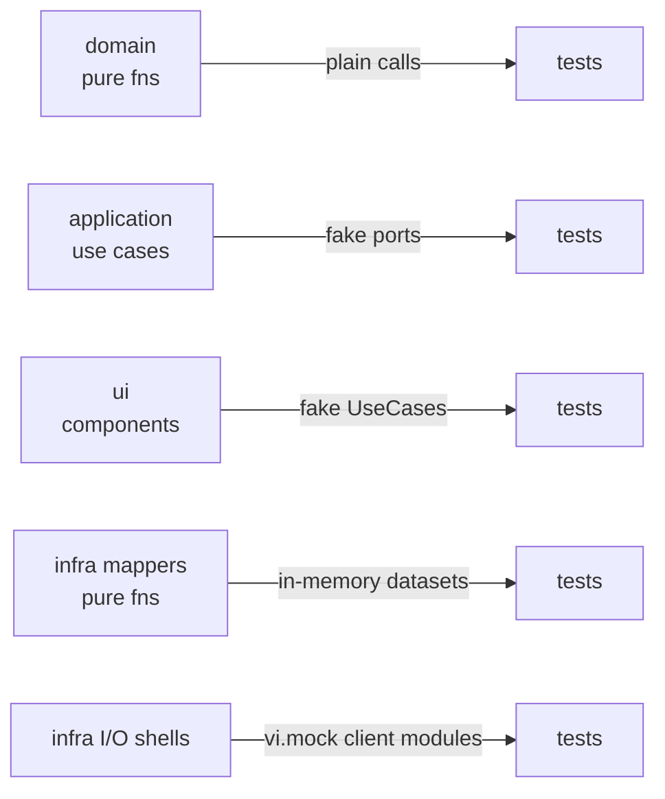

# Testing

Automated tests check every change to Solid Memo before it's
published: unit tests cover every line of each part of the code, and
larger tests run the app against real Solid servers and in a real
browser. This page says what each kind covers, how to run them, and
how to read a failure.

Every package has unit tests with [Vitest](https://vitest.dev/), in
node unless the package runs in the browser: `ui`, `web`, `studio`,
`solid`, `solid-memo-client` and `browser` run in `happy-dom`, and the UI's tests use
`@testing-library/preact` ([vitest.shared.ts](../vitest.shared.ts)).
Each package's own tests cover **100%** of its code (statements,
branches, functions, lines), or `npm test` fails
([Coverage policy](#coverage-policy)).

## Commands

```sh
npm test          # every package's tests, with coverage thresholds (turbo)
npm run check     # Biome's lint, markdownlint, cspell and the prose check, then npm test's tests, the round trip, typecheck, drift, Turtle formatting, the deck library, boundaries, the repository's own checks (below)
npm run check:ci  # npm run check without the deck library, as CI's check job runs it (its library job checks the library)
npm run browsers  # once: Chromium's headless shell, which npm run check and npm run build draw the docs' diagrams in (on Linux, if it lacks system libraries: sudo npx playwright install-deps chromium)
npm run lint      # Biome: the formatting and lint rules of the TypeScript, JSON and CSS (docs/style.md)
npm run format    # Biome: rewrite those files as it formats them
npm run coverage:summary   # the coverage the last tests measured, per package, as a table
npm run lint:markdown      # markdownlint over the project's Markdown, as npm run check runs it
npm run lint:spelling      # cspell, American English, over the Markdown and en.json, as npm run check runs it
npm run lint:prose         # the docs' prose rules, per page kind (docs/style.md#the-prose-check), as npm run check runs it; -- docs/srs.md for one page
npm run lint:reuse         # reuse lint: every file states its copyright and license, as CI's docs job checks (needs reuse; not in npm run check)
npm run lint:workflows     # actionlint and zizmor over .github/, as CI's workflows job runs them (needs them; not in npm run check)
npm run test:unit -- packages/ui/src/ui/App.test.tsx   # some files, or all with none, without coverage (root vitest.config.ts)
npm run test:watch # watch mode, every package's tests
npm run test:unit -w @solid-memo/domain -- account.test.ts   # one package's (test:watch too)
npm run test:roundtrip -w @solid-memo/solid   # every library release through a draft and back (below)
npm run crosscheck # the pySHACL cross-check, as CI runs it (needs scripts/requirements-ci.txt)
npm run test:crosscheck   # the Python scripts' own tests (the cross-check's, the taxonomy deck generator's, the Wikidata labels script's), Python's unittest (needs scripts/requirements-ci.txt too)
npm run check:closes -- --base origin/main   # a commit since the branch left main closes an issue (add --body-file <file> for the pull request's body), as CI's commits job checks it (CONTRIBUTING.md)
npm run check:breaking -- --base origin/main   # the public API against where the branch left main, as CI's library job checks it (docs/releasing.md)
npm run test:pod  # the end-to-end tests, against the Solid servers they start in Docker
SOLID_CLIENT=solid-memo-client npm run test:pod   # the same on the Solid client with no Inrupt library (docs/solid-memo-client.md); with a package's test:unit, or npm run build, too
npm run servers -w @solid-memo/e2e-pod   # pull or build those servers' images ahead (`-- css-6` for one)
npm run pod       # a Community Solid Server at http://127.0.0.1:3999/, in memory, to poke at by hand
npm run pod:clean # take down the servers an interrupted run left
npm run journeys  # the user journeys: the built app in Chromium (a few also in Firefox, WebKit and on a phone), against a Community Solid Server 7 started in Docker
npm run journeys -- --project=chromium   # one browser's journeys (chromium, firefox, webkit or phone)
npm run journeys -- --ui  # the same in Playwright's UI mode: watch, pick, step through and time-travel a journey
npm run journeys -- -g smoke   # only the journeys whose title matches (or --repeat-each=10, or any other Playwright option)
npm run css -w @solid-memo/e2e-journeys   # keep such a server up; JOURNEY_SERVER_URL=<its url> npm run journeys reuses it
npm run journeys:report -w @solid-memo/e2e-journeys   # open the last run's report
npm run css:clean -w @solid-memo/e2e-journeys   # take down the servers an interrupted run left
npm run screenshots   # retake the app's screenshots on a phone's screen (below), from the built app
npm run check:providers   # the Pod providers onboarding suggests answer with their issuers (needs the network)
```

`npm run test:pod` runs `e2e/pod/` against each Solid server
[servers.ts](../e2e/pod/servers.ts) knows, which its global setup
([globalSetup.ts](../e2e/pod/globalSetup.ts)) starts in Docker, on a
free port of 127.0.0.1 and told that URL, and takes down after the run
or on Ctrl-C. The test names say which server and version:

| Id | Server | Image | Tier |
|---|---|---|---|
| `css-7` | Community Solid Server 7.x, in memory | its own, `solidproject/community-server`, pinned by digest | blocking |
| `css-6` | Community Solid Server 6.x, in memory | the same | blocking |
| `nss-6` | node-solid-server 6.x | built here from its lockfile ([servers/nss/](../e2e/pod/servers/nss/Dockerfile)), in a root whose ACL lets anyone read and write | blocking |
| `nss-5` | node-solid-server 5.x | the same | blocking |
| `css-acp` | Community Solid Server 7.x with Access Control Policies in place of Web Access Control, in memory | built here on css-7's image ([servers/css-acp/](../e2e/pod/servers/css-acp/Dockerfile)) with a configuration of its own, its root's ACR open | blocking |
| `css-8` | Community Solid Server 8, still in alpha, in memory | its own, pinned by digest | advisory |
| `pivot` | Pivot, the server of solidcommunity.net (the Community Solid Server 7 with Pivot's components), in memory | built here from its lockfile ([servers/pivot/](../e2e/pod/servers/pivot/Dockerfile)) with a configuration of its own, its root open | advisory |
| `nextcloud` | Solid-Nextcloud: Nextcloud 32 with the Solid app, on SQLite, the pod `apps/solid/~alice/storage/` | built here from a commit of the app ([servers/nextcloud/](../e2e/pod/servers/nextcloud/Dockerfile)), installed on every start, alice's pod opened by a hook | advisory |
| `jss` | JavaScript Solid Server, files in the container, open to anyone (`--public`, which skips its access control) | built here from its lockfile ([servers/jss/](../e2e/pod/servers/jss/Dockerfile)), unmodified and pushed nowhere (it's AGPL) | advisory |

A **blocking** server's tests gate CI, and so deploys and Renovate's
merges: every test passes, or skips for a reason it gives. An
**advisory** server's results are reported, not a gate, by the Interop workflow
([interop.yml](../.github/workflows/interop.yml)), weekly, by hand, and
on pushes to `main` that touch the app's Solid code. A job fails only
when no test ran, or a test fails that
`e2e/pod/servers/<id>/expected-failures.json`
(`{ "<file> > <test>": "<why>" }`, the test named without its server)
doesn't list.
[compare.ts](../e2e/pod/compare.ts) names these in the job's summary,
with what passes though listed, to take off the list. CI still checks
that every advisory server starts and meets the contract (`contract`),
so a change that breaks one isn't merged unnoticed. Renovate merges its
updates once that passes, as it does a blocking one's.
Solid-Nextcloud's SQLite refuses concurrent writes, so with it in a run
the test files run one at a time (`serialFiles` in `servers.ts`). What
it fails, and why, is in its `expected-failures.json`. css-8 becomes blocking at 8.0.0,
and css-6 then goes.

Each server is a compose file, `e2e/pod/servers/<id>/compose.yml`,
asking only for `E2E_PORT` (the port on 127.0.0.1 the harness picked,
which the server must be told) and `E2E_SECRET` (a password made up for the run). It publishes on
127.0.0.1 only and gets nothing of the host, as `npm test` checks
([servers.test.ts](../e2e/pod/servers.test.ts)). Images built here are
tagged `localhost/solid-memo-e2e-<id>:local`, pushed nowhere; others
are pulled once. Before the tests, every server must meet a
contract ([contract.ts](../e2e/pod/contract.ts)): a document anyone
writes in its pod root reads back, is listed there at the URL it was
written to, and deletes. A server that isn't open, or doesn't know the
URL it's reached at, fails there, saying so, not in every test. What a server prints goes
to `e2e/pod/logs/<id>.log`, which CI keeps when a job fails.

The tests' fetch sends every request with `Connection: close`
([setup.ts](../e2e/pod/setup.ts)). Node 24's fetch can fail, without
resending, a request it wrote onto a pooled connection the server
closed during a long synchronous stretch (a big update, on a slow
runner). A browser resends, so the app needs no retry. The Fetch
standard forbids the header; Node's fetch honors it, as `npm test`
checks ([connections.test.ts](../e2e/pod/connections.test.ts)).
It follows no redirect either, as the app's fetch with the user's
credentials doesn't
([authentication.md](authentication.md#authenticated-requests)). A
server that answers a pod request with a redirect fails the tests.

`SOLID_SERVERS=css-7,nss-5` runs the suite against some servers only
(`all`, every one; `css-8`, the advisory; unset, the blocking ones).
`SOLID_SERVER_URL` runs it against a contributor's own server, which
must let anyone read and write, as `npm run pod`'s does.
`SOLID_SERVER_NAME` names it in the tests; `NODE_EXTRA_CA_CERTS`
trusts a certificate the contributor's own CA signed.
CI runs one job per blocking server, side by side, none stopping the
others ([migrations.md](migrations.md#proof-on-a-real-server)).
`SOLID_CLIENT=solid-memo-client` runs the suite, or a package's unit
tests (`test:unit`, without coverage), on the Solid client with no
Inrupt library in place of Inrupt's, the default
([solid-memo-client.md](solid-memo-client.md#switching-clients)).
CI runs the suite so on each blocking server too, in advisory jobs
([Continuous integration](#continuous-integration)).
Renovate keeps each server on its major (`renovate.json5`). The table
in `servers.ts` says which servers each workflow runs
([below](#the-merge-queue)).

`MEASURE_ANSWER_LOG=1` makes `history.integration.test.ts` seed two
years of answers (about a minute and a half a server) and print the
today strip's read timings on a second page load (with
`--silent=false`; [statistics.md](statistics.md#loading)).
`MEASURE_GRADES=1` makes `grading.integration.test.ts` print each
grade's requests, bytes and time for a session on a deck of 2,000
states ([srs.md](srs.md#what-a-grade-costs)). CI runs neither.

**In CI the images come from GitHub's cache**, not Docker Hub (the
runners share its limit on pulls without an account). Each job restores
its server's images ([e2e-images](../.github/actions/e2e-images/action.yml)),
and pulls or builds them only when the cache has none under the job's
key, saving them on `main` ([e2e/pod/images.ts](../e2e/pod/images.ts)).
Where `main`'s run skips those jobs
([releasing.md](releasing.md#what-each-stage-checks)), CI's `warm` jobs
save what the cache lacks, for every server
(`node e2e/pod/servers.ts keys all` names their keys).

A pull request and the merge queue read `main`'s images but save none
(caches saved under their ref are never read, yet count toward the
repository's 10 GB, past which GitHub evicts the least recently used). A
pull request that changes an image (a Renovate digest update, say) pulls
it until `main` has saved it, and the next `caches` job deletes `main`'s
older entry.

The key (`node e2e/pod/servers.ts key <id>`) is, for a pulled image,
its compose file, which pins it by digest. For an image built here,
it's a hash of its compose file and of every file of its build context
that Docker is sent, with whether each is executable; what
`.dockerignore` keeps out, such as `expected-failures.json`, changes
nothing. `prepare` tags a built image with that hash
(`localhost/solid-memo-e2e-<id>:inputs-<hash>`), lets older such tags
go, and skips the build when the current tag is there, as after a load.
The journeys' images are keyed by their compose file.

Where a runner's Docker doesn't use it already, the jobs switch Docker
to its containerd image store, which keeps the digest a loaded image
was pulled by (the classic store doesn't, and compose would pull it
again). An image pulled by digest is saved under the tag its reference
names. What the cache lacks (a job's first run, or after an image
changes) is pulled through `mirror.gcr.io`, Google's mirror of Docker
Hub. The same step sets it as Docker's registry mirror; Docker falls
back to Docker Hub for what the mirror lacks. A cache that can't be saved or loaded only
warns, and the job pulls or builds.

The tests need Docker Desktop, or Docker Engine 28.3.3 or later on Linux
(CVE-2025-54388: earlier, a port on 127.0.0.1 is reachable from the
local network). The next run or `npm run pod:clean` takes down the
servers a killed run left. `npm run pod`'s server lets anyone read and
write: a contributor keeps no real data in it, and stops it when done.

The tests ask each server what it enforces
([serverTraits.ts](../e2e/pod/src/serverTraits.ts)):

- **node-solid-server** gives no ETag (nor a modification time) on a
  read and ignores `If-Match`, so the test that proves an edit is
  refused is skipped. Without ETags no
  [digest](data-model.md#the-digest) is kept: the test of two pages
  learning at once is skipped, and the others check that every visit
  reads everything. (5.7.4 ignored `If-None-Match: *` on a PUT too;
  5.8.8 and 6.0.0 enforce it.) Its parser knows no SPARQL-style
  `PREFIX` directive, so no one can patch such a document there, and the
  documents an update's tests write by hand
  use `@prefix` ([migrations.md](migrations.md#the-pod-migration)). Its
  PATCH finds a decimal only as JavaScript spells it (`1`, not the
  `1.0` it serves for a whole one); when it refuses a deletion for that
  reason, the app sends it again with the number spelled that way
  ([data-model.md](data-model.md#write-discipline)).
- **Community Solid Server 6** builds its ETag from the modification
  time in whole seconds (7 uses milliseconds), so a document the tests
  edit in the same second as a read looks unchanged. The test that
  proves an edit is refused and the digest's tests are skipped. The
  tests of an update whose write a change made elsewhere refuses wait
  for the next second before making that change where the server's ETag
  doesn't change on every edit, and so run there too
  (on node-solid-server they're skipped).

Every skip says why, and everything else runs on every server. A test
skips only where the server does something the Solid Protocol allows and
the app copes with. What the app needs is never a reason: a PATCH it
can send, an ACL it can write, every insert of several at once kept. A probe that
can't tell throws. The tests ask the server for what they need too: an
ACL document is where its `Link rel="acl"` says, and a change "another
app" makes is an N3 Patch, a SPARQL Update or the whole document, as its
`Accept-Patch` allows. What each blocking server does is pinned
([serverTraits.integration.test.ts](../e2e/pod/src/serverTraits.integration.test.ts)):
a release that changes it fails there, not as tests quietly starting or
stopping to skip, and the pin moves by hand once the change is
understood. The tests of the format update and of the library upgrade
check that a document a write of theirs left alone, or failed on, is as
it was "byte for byte". They compare the bytes served before and after,
asked for as the app asks (`Accept: text/turtle`) (`migrations.md`,
[the upgrade's](migrations.md#proof-of-the-upgrade-on-a-real-server)).

The Community Solid Server's in-memory store, which these tests use,
cuts a document with characters outside ASCII (`å`, `ä`, `ö`) short
after any PATCH, storing as many bytes as there were characters; its
file store doesn't. So patched test data is kept ASCII, or a measurement
runs on the file store (`-c @css:config/file.json -f <dir>`). A
release's draft is written whole (PUT) for this reason, and because
node-solid-server stores a boolean a PATCH inserts
(`owl:deprecated true`) as false. Its tests
([releaseDrafts.integration.test.ts](../e2e/pod/src/releaseDrafts.integration.test.ts))
take the library's largest course, its text as it is, through a draft on
every server, each step within a time budget.

Publishing a release
([releases.integration.test.ts](../e2e/pod/src/releases.integration.test.ts))
is the app's only write of access control. The tests write anonymously,
so the test reads the release's own ACL (Web Access Control) or ACR
(Access Control Policies, `css-acp`, blocking so the ACR's write gates
CI) to find "no login" there once published. A second release at the
same address is refused, leaving the first as it was. A publishing cut
short after the release is written (its catalog link refused once)
finishes when published again; deleting the instance then keeps the
release and its folder, saying so (`keptReleases`). The public-read grant copes
(`accessFetch`, in `client/access.ts`) with node-solid-server refusing the PATCH
`@inrupt/solid-client` writes an ACL with, and with the Community Solid
Server answering 404 for an ACR not written yet. Solid-Nextcloud names a
folder's ACL as each of its documents', so the release stays private
there (its `expected-failures.json`). A release on another origin whose
server names an access control on the real server as its own
([releaseAccess.integration.test.ts](../e2e/pod/src/releaseAccess.integration.test.ts))
leads no request there, by publishing or by **Make it public**. On
`css-6`, the learner reads the second release's catalog as a later visit
would.

The image of solid-server 6.0.0 puts the root ACL template the package
lacks, copied on first start, in its config folder. It installs without
install scripts, as 6.0.0, like 5.8.8, lists `@fastify/pre-commit`,
whose install script puts a git hook in place, as a dependency.
node-solid-server logs every request (`solid:*`), so its log runs to
tens of megabytes.

In CI, pySHACL cross-checks the vocabulary, the deck library and the
pod catalog fixtures (`npm run crosscheck`;
[validation.md](validation.md#the-ci-cross-check)). The script's own
tests use Python's standard `unittest`
([scripts/test_shacl_crosscheck.py](../scripts/test_shacl_crosscheck.py),
`npm run test:crosscheck`), each on a small repository in a temporary
folder, a few lines of Turtle standing in for DCAT-AP, SkoHub's shapes,
the deck library and the fixtures. They read none of the real
documents and need no network. They cover how the script picks and targets shapes, where it stops (a shape DCAT-AP adds,
`rdfs:subClassOf`, a subject with no shape) and what it reports when a
document fails.

The same command runs the tests of the taxonomy deck's generator
([scripts/test_taxonomy_deck.py](../scripts/test_taxonomy_deck.py),
[deck-library.md](deck-library.md#the-taxonomy-deck)) and of the script
that gives label decks their languages from Wikidata
([scripts/test_wikidata_labels.py](../scripts/test_wikidata_labels.py),
[deck-library.md](deck-library.md#languages-from-wikidata)), each
against a fake taxonomy or Wikidata of its own. CI's `crosscheck` job
runs them all before the cross-check; `npm run check`, which needs no
Python, doesn't. The generator runs weekly and by hand in the
[Taxonomy workflow](../.github/workflows/taxonomy.yml), which proposes
each new deck version as a pull request. The Wikidata script checks its
decks against the revisions they record, weekly and by hand, in the
[Wikidata workflow](../.github/workflows/wikidata.yml). Neither runs on
a pull request.

## User journeys

`e2e/journeys/` drives the built app with
[Playwright](https://playwright.dev/) in Chromium, and a few journeys
in Firefox, WebKit and on a phone ([below](#browsers)). The app is
built with `npx turbo run build --filter=@solid-memo/web` and served by
`vite preview` at `http://127.0.0.1:4173/`, the [Studio](studio.md) at
`#/studio`. The journeys log in with a WebID at a real identity
provider, set preferences, make, study and group decks, and import from
the library. A newcomer starts the library's newcomers' course from an empty deck
list through its first chapter and final review. A user describes a
deck in two languages, validates the instance and logs out. In the
Studio, a user manages an instance's decks and release drafts, and
draws the instance as a graph whose links out of the pod are never
fetched. A user writes a course in a draft, test-plays it in the trial
(the instance's decks and statistics unchanged) and publishes it:
someone with no login reads it, and another user adds it from its link
and plays it.

Each journey runs against a fresh account, pod and WebID on a Community
Solid Server 7 the global setup starts in Docker and takes down after
([css/compose.yml](../e2e/journeys/css/compose.yml)). The app logs in
only with https WebIDs and issuers, so the server sits behind Caddy at
`https://127.0.0.1:<port>/` with Caddy's own certificate, which the
browser accepts. Sharing Caddy's network, the server reaches its own
https address to read the WebIDs it checks tokens for. It keeps its pods
in files, as the journeys PATCH Swedish text (see above). The journeys
need Docker and the browsers
(`npm run browsers -w @solid-memo/e2e-journeys` installs Chromium,
Firefox and WebKit, with their system libraries). CI runs them as a gate
([below](#deterministic-and-timing-dependent-jobs)).

Further journeys go through:

- reloading in the middle of a study session, which goes on with the
  cards left and counts every answer once;
- resetting today's study on a deck's page: its cards, today's budget
  of new cards and the statistics come back as before the session;
- coming back on the next study day to review a deck, forgetting some
  cards, and reading recall, lapses and the hardest cards in the
  statistics, with no leech to cram yet. Unit tests cover cramming: a
  leech takes more study days than a journey's time zones hold;
- a second instance in another folder: switching between the two,
  reloading, and deleting one whose folder another app also writes to,
  which is kept, and the app says why;
- logging out and back in, and in on a second device, onto the same
  instance, after a WebID the form refuses and a consent refused. The
  dark theme, High contrast and Larger text follow through the pod and
  a reload. A palette of one's own is designed, used despite too little
  contrast, found on a third device, and reset to Standard. The
  Connected screen is skipped from the next login on, on every device,
  until the learner turns it back on in Preferences;
- updating a copy of a library deck's first release to its second,
  offered in Solid Memo and the Studio, the day's study kept;
- trying Solid Memo as a guest and moving the study into a new
  instance in the pod, the move first cut off and its partial copy
  removed;
- a screen that fails while it renders (the Studio's code swapped for
  code that throws): "Something went wrong" under the working header,
  its details copied, its report link filled in, and the way back;
- what Solid Memo leaves alone in a pod
  ([pod-safety.journey.ts](../e2e/journeys/journeys/pod-safety.journey.ts)),
  each journey reading the pod with plain requests after an everyday
  action and finding the documents as they were, none added:
  - an instance another user shares, whose catalog names the user's
    profile and a private document as its decks' documents, by address
    or spelled to resolve there. Its deck is removed, the instance
    deleted, and the Studio's health screen names those decks;
  - a draft there whose chapter has an id Solid Memo doesn't accept,
    which the Studio doesn't open, saying why;
  - a release published and made public where the server names an
    access control elsewhere in the pod as the release's, the user's
    private document still unreadable without a login;
  - a deck's document Solid Memo and another app both write to, kept
    with that app's data when the instance is deleted, as the picker
    says;
  - an instance laid out flat at the pod's root, its older deck read,
    studied, changed, and removed once the user confirms its documents
    on the Studio's health screen.

### Browsers

Every journey runs in desktop Chromium, the `chromium` project in
[playwright.config.ts](../e2e/journeys/playwright.config.ts); three
more run only the journeys tagged `@guest` and `@reload`:
`firefox` (desktop Firefox), `webkit` (desktop Safari's engine) and
`phone` (an iPhone 14's screen and touch, on WebKit). Those journeys
cover what differs most between engines: the login's redirects to the
identity provider and back, a guest's study kept in storage through
them, a session's silent restore after a reload, and a phone-width
layout. A journey gets one of the two tags only when what it tests
differs between engines; the others test the app's logic. A step of a
tagged journey that tests the app's logic names the projects it runs
in (`app.step(title, body, { in: ["chromium"] })`), and the report
shows it skipped elsewhere, as for the reload journey's statistics and
the shared link's import.

CI runs them in five jobs side by side, each paying about a minute of
setup. Chromium's run in two shards (`npx playwright test --shard`),
`journeys (chromium-1)` and `journeys (chromium-2)`, and each other
project, WebKit's and the phone's the slowest, in a job of its own,
`journeys (firefox)`, `journeys (webkit)` and `journeys (phone)`.
When one of them fails, CI cancels the others (`fail-fast`), as their
result no longer changes the run's; "Re-run failed jobs" runs the
canceled ones again too.
Chromium's journeys run fully parallel (`fullyParallel: true`), so a
file of several, such as `pod-safety`, spreads over both shards; a file
whose journeys depend on each other runs them in turn
(`test.describe.configure({ mode: "serial" })`). The
[user guide](user-guide.md#supported-browsers) says which browsers
Solid Memo supports.

The journeys allow for three differences between engines:

- Only Chromium lets a page read the clipboard back, so "Copy link"
  takes the link from the app's call to write it
  ([LibraryDeck.ts](../e2e/journeys/pages/LibraryDeck.ts)).
- Firefox keeps no blank first page in a new tab's history, so a
  journey that goes Back to before the app opens a page of its own
  first.
- WebKit logs a cut-off fetch to another origin, such as one still
  running when the page is left, as a script error, which Playwright
  reports as a page error though the app caught the rejection. It fails
  no journey: `diagnostics.json` lists it with the console,
  where Chromium and Firefox log the same
  ([pageErrors.ts](../e2e/journeys/harness/pageErrors.ts)).

WebKit on Linux needs system libraries `npm run browsers` installs with
`sudo`; without them, the `webkit` and `phone` projects run in
Playwright's Docker image of the same version
(`mcr.microsoft.com/playwright:v<version>-noble`), with `--network host`
and `JOURNEY_SERVER_URL` pointing at a server that
`npm run css -w @solid-memo/e2e-journeys` keeps up.

**In CI the browsers and their system libraries come from GitHub's
cache**, the browsers under Playwright's version. The system libraries
the runner image lacks are kept as the `.deb` files
`npx playwright install-deps` would fetch from Ubuntu's mirror, and
installed from them
([playwright-deps](../.github/actions/playwright-deps/action.yml)). The
mirror often stalls for minutes, at times past a job's timeout.
Their key is the runner image's (`ImageOS`, `ImageVersion`) with
playwright-core's version. A job asks the mirror only when the cache
has none, each `apt-get` given three minutes and one more try, and
saves the download only on `main`. The `caches` job keeps
`main`'s two newest entries per browser (GitHub rolls a new image out
over days). The release workflow's jobs restore nothing from the cache
and always ask the mirror
([releasing.md](releasing.md#the-deploy-key)), as do CI's `site` job
and the deploy's build, which make the site that's deployed
([deployment.md](deployment.md#the-build-ci-tested)).

The journeys run the same way every time:

- Each page's `Math.random` is seeded (the seed is in the report;
  `JOURNEY_SEED=<n>` replays it).
- The browser's time zone is one where it's about noon. The later-day
  journey moves the zone past the day boundary, not the clock: the
  Solid server refuses a DPoP proof more than two minutes off its own.
- A request to any host but 127.0.0.1 fails the journey (so the Studio
  journey proves its graph's library release and outside source are
  never fetched).
- A journey never asserts which card a shuffled queue shows, only how
  many there are.

**Accessibility.** At each step's end, the harness checks the screen the
step leaves the app on with
[axe](https://github.com/dequelabs/axe-core), in each palette and theme,
and its reflow at the largest text size (`App.step`,
[harness/accessibility.ts](../e2e/journeys/harness/accessibility.ts)). A
palette of the user's own, painted on the root's style, is taken off
while they run and put back after; its editor measures it
([theme.md](theme.md#palettes-of-ones-own)).

| Check | Palettes and themes | Rules | Where |
|---|---|---|---|
| axe | Standard, light and dark | WCAG 2.0, 2.1 and 2.2, A and AA | Chromium and the phone |
| axe | High contrast, Color-blind friendly and Parchment, light and dark | `color-contrast` and `link-in-text-block` | Chromium |
| Reflow | Standard, light, at the largest text size, 320px wide | no sideways scroll, no one-line text cut short without its title | Chromium |

The checks run in a step of their own, "Accessibility", inside the
journey's step, timed in the report; desktop Firefox and WebKit leave it
out (`accessibility: false` in their projects' metadata). A violation
fails the journey, which goes on to its end; one let pass is in
`KNOWN_EXCEPTIONS` in `harness/accessibility.ts`, with its reason. The
Solid server's own pages, its login, aren't checked.
[accessibility.md](accessibility.md) says what the app aims for, and
what else is checked.

**When a journey fails**, the CI job's summary names it, the step it
failed in (the spec's numbered step › the page object's action), the
error, and the browser. The job's
`journeys-<chromium|engines>-<attempt>` artifact holds the rest:

- `test-results/<journey>/trace.zip`: the whole journey, each step
  showing the page before and after every action, the network (the
  login's redirects included) and the console. It holds the throwaway
  account's password and tokens, which is harmless. `npx playwright show-trace <trace.zip>`
  or <https://trace.playwright.dev> opens it.
- `playwright-report/`: the steps as a tree, with a screenshot at the
  end of each journey step, a video, and these attachments:
  - `diagnostics.json`: console, page errors, failed and refused
    requests, the seed, the time zone;
  - `css.log`: the server's log for the journey's time;
  - `pod-dump.ttl`: every document in the journey's pod when it failed;
  - `<step> · accessibility, <palette>, <theme>.json`: what axe found on
    a step's screen, when it found a violation;
  - `<step> · reflow.png`: the screen at the largest text size and 320px
    wide, when it didn't reflow.
  `npx playwright show-report <dir>` opens the report.
- `logs/css.log`: the server's whole log.

**The latest report is online** at
<https://journeys.solid-memo.com/>, a site of its own that each deploy
publishes ([deployment.md](deployment.md#the-journeys-report)). It's the
release commit's, every browser's journeys merged by the `journeys-report` job
from the blob reports of the run that ran them on its code, usually the
merge queue's ([releasing.md](releasing.md#what-each-stage-checks)).
After a deploy by hand, it's still the last release's. Its **Trace**
link opens the timeline at `trace.playwright.dev`, which fetches the
trace from the report's site; in the merge queue, and on `main` when
its run runs them, the journeys always keep their traces. The report is
public, kept out of search engines (`robots.txt`), and its throwaway
passwords and tokens die with the run's server. A failure on
`main`, or the report of a commit between two versions, is read from
the run's artifact.

A run by hand (Actions › CI › Run workflow) with *trace* checked keeps
traces for passing journeys on any branch. Locally,
`JOURNEY_TRACE=on npm run journeys` does the same, and
`npm run journeys:report -w @solid-memo/e2e-journeys` serves the report
so its traces open.

### Writing a journey

A journey is one file, `e2e/journeys/journeys/<name>.journey.ts`, with
one `test` whose steps are numbered as the journey's spec words them:

```ts
test("a learner's first deck @smoke", async ({ app, account, runId }) => {
  await app.step("01 · Visit Solid Memo", () => app.onboarding.visit());
  await app.step("02 · Log in with a WebID", () => logInAndCreateInstance(app, account, `Instance ${runId}`));
  await app.step("03 · Create a deck", async () => {
    await app.decks.openDeckCreator();
    await app.deckCreator.create(`Deck ${runId}`);
  });
});
```

- **Fixtures** ([fixtures.ts](../e2e/journeys/fixtures.ts)): `account`
  is a fresh account, pod and WebID, and `runId` names what the run
  makes. `otherApp` writes to the pod as another app. `app` is the app
  as page objects, and `newDevice` opens it in a browser context of its
  own, as on a second device.
- **Page objects** ([pages/](../e2e/journeys/pages/)): one per screen,
  registered on [App.ts](../e2e/journeys/pages/App.ts). Their methods
  are what a user does, each a step in the report. They find elements
  by role and accessible name in the app's own text
  ([harness/strings.ts](../e2e/journeys/harness/strings.ts) reads
  `packages/ui/src/i18n/`), following the language a journey switches
  to, never by CSS class: where the app gives no accessible name, the
  app gets one. They find a table's cell by its column's header
  (`cellOf`, [tables.ts](../e2e/journeys/pages/tables.ts)), and a
  text's language picker through the field its text describes
  (`chooseLanguageOf`, [languages.ts](../e2e/journeys/pages/languages.ts)).
  They find the Studio's sections by name in its sidebar and a deck's
  or a draft's screens in its tabs, not the trail, which names the same
  screens (`studioSection`, `studioTab` in
  [Chrome.ts](../e2e/journeys/pages/Chrome.ts)); `quickOpen` goes
  through the palette.
- **Flows** ([flows/](../e2e/journeys/flows/)): steps many journeys
  share, such as logging in.
- **Dialogs**: a step that expects the browser's `confirm` (Solid
  Memo's) names it with `app.expectDialog(pattern)`; any other fails the
  journey. The Studio asks in its own dialog (`ConfirmDialog`), for its
  shared components' questions too (`AskFirst`: a wrong option, a card,
  an instance), which a step answers by its heading and button, as the
  Studio's component tests do
  ([test/dialogs.ts](../apps/studio/src/test/dialogs.ts)).
- **One after another**: a journey that needs what another made is in
  its file, after it, and the file runs in turn (`mode: "serial"`). In
  [studio-course.journey.ts](../e2e/journeys/journeys/studio-course.journey.ts),
  the next journey adds the published course from its link, and is
  skipped when the first fails.

The harness's own code (`harness/`) has unit tests (`npm test`); the
page objects and journeys are tests, run by `npm run journeys`.

### Screenshots

The app's screenshots
([apps/web/public/screenshots/](../apps/web/public/screenshots/)),
shown by the README, `publiccode.yml` and the About page, are taken by
[app.screenshots.ts](../e2e/journeys/screenshots/app.screenshots.ts)
([screenshots.config.ts](../e2e/journeys/screenshots.config.ts)).
After `npx turbo run build --filter=@solid-memo/web`,
`npm run screenshots` retakes them all in about ten minutes; it's no
test, and neither `npm run check` nor CI runs it. It drives the built
app in Chromium on a phone's screen, 390 by 844 pixels at twice the
density, in English, as a guest, with no Solid server. It studies three
library decks daily for eight weeks on its own clock (`page.clock`),
from a fixed date with a seeded shuffle, so the statistics have a
history and each run comes out much as the last. Then it takes each
screen, scrolled to its breadcrumbs. It needs the network for the deck
pictures, from Wikimedia. A changed screen is retaken by running it
again and committing the pictures, whose alt text in the README and the
About page describes them.

## Continuous integration

[ci.yml](../.github/workflows/ci.yml) runs on every pull request, a
fork's included, in the merge queue ([below](#the-merge-queue)), on
every push to `main`, and by hand, not on a branch's pushes alone. Its
jobs run side by side, each
[deterministic or timing-dependent](#deterministic-and-timing-dependent-jobs):

| Job | Kind | What it checks |
|---|---|---|
| `gate` | deterministic | what the run runs: every job, or none but `reuse` (and `release-files`), when the run reuses the one that tested its tree (`npm run ci:gate`, [releasing.md](releasing.md#what-each-stage-checks)); on a release commit, that it changes nothing but the files a release writes |
| `check` | deterministic | `npm run check:ci`: `npm run check` without the deck library (`library` checks it), Chromium's headless shell and its system libraries, for the docs' diagrams, from GitHub's cache or installed ([.github/actions/chromium](../.github/actions/chromium/action.yml), [Browsers](#browsers)). Every package's coverage goes to the run's summary (`npm run coverage:summary`). Turbo's cache is kept between runs under this job's own key, so a task whose inputs haven't changed doesn't run again. Only a run on `main` saves it, and pull requests and the merge queue start from `main`'s; the queue keeps it as its run's `turbo-cache` artifact, which `reuse` saves as `main`'s |
| `site` | deterministic | `npm run build`, once a run, the docs' diagrams drawn as in `check`, kept a week as the run's `site` artifact (a `journeys` job run again still finds it), which the `journeys` jobs test and the deploy ships. Nothing in it comes from GitHub's cache, and in the merge queue and on `main` it attests the list of the site's files, which the deploy checks the artifact against ([deployment.md](deployment.md#the-build-ci-tested)) |
| `reuse` | deterministic | nothing: on `main`, when the run reuses the one that tested its tree, it takes over that run's site as this run's `site` artifact and, except on a release commit, its Turbo cache, saved as `main`'s. It runs none of the repository's code |
| `release-files` | deterministic | on a release commit, when the run reuses the one that tested its parent: the files a release writes, by Biome, markdownlint and cspell, as `npm run check` has them, and `publiccode.yml` by its parser |
| `library` | deterministic | the change against its base. The deck library: no published version edited or removed, and every new version naming the library's contact ([deck-library.md](deck-library.md#checks)). The public API: no line of `api/` gone unless a commit says the change breaks, and none of `api/frozen/` at all (`npm run check:breaking`, [releasing.md](releasing.md#how-ci-holds-to-it)) |
| `crosscheck` | deterministic | the Python scripts' tests, then the vocabulary, the deck library and the pod catalog documents, by pySHACL ([validation.md](validation.md#the-ci-cross-check)) |
| `pod (<server>)` | timing-dependent | the end-to-end tests, one job per blocking server (above) |
| `contract (<server>)` | timing-dependent | that each advisory server starts and meets the contract |
| `solid-memo-client (unit)` | deterministic | advisory: with `SOLID_CLIENT=solid-memo-client`, `solid`'s unit tests without those of the four Inrupt modules the client replaces (`src/client/{access,rdf,resources,session,session.library}.test.ts`), `solid`'s round trip, and the unit tests of `shacl`, `composition` and `web`, each step run even when one before it failed. `web`'s build test builds the site without the docs' diagrams (`DOCS_DIAGRAMS=skip`), so the job installs no Chromium; `check` draws them. npm runs them, not Turbo, so no result comes from a cache, and without coverage. The client's own tests are `check`'s ([solid-memo-client.md](solid-memo-client.md#tests)) |
| `solid-memo-client (<server>)` | timing-dependent | advisory: the end-to-end tests with `SOLID_CLIENT=solid-memo-client`, one job per blocking server, on the images in `pod`'s cache, which it restores and only `pod` saves. What the server printed is kept when the job fails. Neither of the `solid-memo-client` jobs fails the run or `ci-ok` when it fails (`continue-on-error`), so neither holds back a merge, a release or a deploy |
| `journeys (<project>)` | timing-dependent | the user journeys, on `site`'s build: all in Chromium in two shards, and those that differ between engines in Firefox, WebKit and on a phone, a job each (Browsers, above) |
| `journeys-report` | deterministic | nothing: on `main`, after the `journeys` jobs, even when one failed (then with what the canceled ones ran), it merges their runs, or those of the run that tested its code (the gate's `tested-by`), into the `journeys-report` artifact the deploy publishes ([User journeys](#user-journeys)). It fails without every job's report when the journeys passed or the gate skipped them, not when the `site` job's failure skipped them. Its failure fails the run, holding back the release and the deploy, but not `ci-ok` |
| `docs` | deterministic | the docs' links, every file's license, and `publiccode.yml` ([Documentation](#documentation)) |
| `workflows` | deterministic | the workflows and local actions, by actionlint and zizmor (`npm run lint:workflows`, [The workflows](#the-workflows)) |
| `commits` | deterministic | on a pull request only: each commit it adds follows Conventional Commits, by commitlint ([CONTRIBUTING.md](../CONTRIBUTING.md#commit-messages)), and its body or a commit closes its issue, or the body says it's one step of it (`npm run check:closes`; not for Renovate's) |
| `caches` | deterministic | nothing: on `main`, after `check` or `reuse`, it deletes all but the newest of `main`'s Turbo caches, of the CodeQL databases per language, and of each end-to-end server's images, and all but the two newest of the browsers' system libraries per browser. It's the one job whose token can write (`actions: write`). It runs none of the repository's code, and its failure fails neither the run nor `ci-ok` |
| `warm`, `warm-images`, `warm-browsers`, `warm-pip` | deterministic | nothing: on `main`, when the run reuses another, they save only the caches the skipped jobs would have saved and `main` lacks (`releasing.md`), failing neither the run nor `ci-ok` |
| `ci-ok` | deterministic | that the gate passed, and then every job above that tests the tree, or, when the run reuses another, `reuse`, and `release-files` on a release commit; `journeys-report`, `caches`, the `warm` jobs and the `solid-memo-client` jobs aside |

**`ci-ok` is the one check a merge to `main` waits for.** The ruleset
on `main` (Settings › Rules) requires it alone, so it stays fixed as
jobs and matrix servers come and go, and Renovate merges its updates
through a pull request once it passes (`automergeType: 'pr'` in
`renovate.json5`). It runs even when a job before it failed, and fails
unless every job passed or was skipped by the gate's choice: the
testing jobs when the run reuses another, the two reusing ones when it
tests. Every check of `ns/` and `decks/`, the comparison with the base
included, is under it. Deploys follow a green run on a release commit
on `main` ([deployment.md](deployment.md#github-pages-automatic)).

### Deterministic and timing-dependent jobs

A **deterministic** job gives the same answer on any runner: types,
lint, unit tests, request counts, the docs. A **timing-dependent** one
can fail on sound code on a busy runner or a slow server:
the end-to-end tests against real servers (`pod`, `contract`) and the
user journeys. Each job in [ci.yml](../.github/workflows/ci.yml) states
its kind in its comment, from when it's added.
Both kinds run where a tree is tested, in a pull request and the merge
queue, not again on a push to `main` the queue passed or on a release
commit ([releasing.md](releasing.md#what-each-stage-checks)). A job
that runs always blocks, the advisory `solid-memo-client` jobs aside.

A timing-dependent job that fails is fixed, not retried: the journeys'
waits, for one, are made to hold (`retries: 0` in
[playwright.config.ts](../e2e/journeys/playwright.config.ts)).

**Count, don't time, where the answer can be counted.** The Solid
adapters' tests count the requests a use case makes against a fake pod,
catching round trips growing from linear to quadratic, for example, at
every stage. Time is measured only
for CPU work, as a ratio of two runs on the same machine (the growth
tests, [growth.ts](../packages/domain/src/testing/growth.ts)), not
against a budget in milliseconds. The pod tests that time a server only
print what they measure.

### The merge queue

The ruleset on `main` requires a pull request to merge through GitHub's
merge queue, in place of a branch up to date with `main`. Once the pull
request's own `ci-ok` passes, "Merge when ready" adds it to the queue,
as does Renovate's automerge through GitHub's auto-merge. GitHub then
builds a branch, `gh-readonly-queue/main/…`, of `main`, the pull
requests ahead and this one, and runs `ci.yml` on it (`merge_group`).
When `ci-ok` passes there, `main` moves to exactly that commit. When it
fails, the pull request leaves the queue, its timeline saying why, and
the ones behind are built again without it. So `main` only gets commits
CI passed as they land. The queue merges with a merge commit, so a
pull request's commits keep their SHAs on `main`. The merge commit
names the pull request.

A queue run checks what a pull request run checks, except that
`commits` lints nothing and `library` compares with the commit of
`main` the queue built on, the pull requests ahead included. Each queue
branch is its own concurrency group. A queue run releases and deploys
nothing: release.yml and deploy.yml follow push runs on `main` alone.

A newer run for a pull request or branch cancels the one still going.
Runs on `main` are never canceled: a release follows a push run that
passed ([releasing.md](releasing.md#what-a-release-does)), and the
deploy one on the release commit
([deployment.md](deployment.md#github-pages-automatic)). Each event has
its own concurrency group, so a run by hand doesn't cancel a push run,
and push runs on `main` go one at a time, in order. A waiting one is
replaced by a newer one, which the next release includes. A release
commit's run, the only one that can deploy its version, has a group of
its own, which no newer push replaces.

A fork's pull request runs the same jobs, with public results: every
job's token can only read the repository, no job uses a secret, no
checkout keeps the token (`persist-credentials: false`), and `caches`
runs on `main` alone. A fork's run may restore the
caches `main`'s runs saved, and what it saves (npm's, pip's and
Playwright's browsers, not Turbo's, the images' or the browsers' system
libraries) is kept for its own pull request only. No pull request run's
artifact reaches `main`: `reuse` takes over only this repository's own
merge queue run that passed the commit `main` moved to or, for a
release commit whose parent skipped the queue, that parent's push run.

[servers.test.ts](../e2e/pod/servers.test.ts) reads the job ids `pod`,
`solid-memo-client-pod` and `contract` and their `matrix.server` lists, which a change to the
workflow keeps, to check that each workflow runs the servers
[servers.ts](../e2e/pod/servers.ts) names. The workflows are among the
test's inputs (`e2e/pod/turbo.json`), so a change to a matrix alone
runs it again.

### The workflows

CI's `workflows` job runs `npm run lint:workflows` over the workflows
and the local actions in [.github/](../.github/):

- [actionlint](https://github.com/rhysd/actionlint) checks their syntax,
  their expressions' contexts and types, and, with
  [shellcheck](https://www.shellcheck.net/), the shell of every `run:`.
- [zizmor](https://docs.zizmor.sh/), offline, checks their security. It
  flags an expression written into a script, where a value could run as
  code (the fix passes it as an environment variable). It flags a job
  given rights it doesn't use, and a trigger that runs with more rights
  than the change that set it off. A finding that's meant stays, with a
  `# zizmor: ignore[<audit>]` comment on its line that says why, as on
  the `workflow_run` triggers of
  [deploy.yml](../.github/workflows/deploy.yml) and
  [release.yml](../.github/workflows/release.yml), whose jobs act only
  on CI's push runs on `main`. An audit turned off is in
  [.github/zizmor.yml](../.github/zizmor.yml), with its reason.

Neither is an npm package or part of `npm run check`. Both are pinned
in [requirements-lint.txt](../scripts/requirements-lint.txt), which
Renovate updates. `pip install -r scripts/requirements-lint.txt`
installs them, or `uv run --no-project --with-requirements
scripts/requirements-lint.txt npm run lint:workflows` runs them without
installing. `check:actions`, in `npm run check`, checks that every
action is pinned
([The repository's own checks](#the-repositorys-own-checks)).

The Python tools CI installs are pinned twice. Each
`scripts/requirements-*.in` names the tools at exact versions, and
`uv pip compile` writes its `requirements-*.txt`: every package they
need, at an exact version, with the hash of each of its files. pip
installs the `.txt`, and with a hash in it, refuses any file whose hash
differs or any package not listed. [uv.toml](../uv.toml) has uv
compile only versions public for 3 days
([GOVERNANCE.md](../GOVERNANCE.md#dependency-updates)). CI's jobs and the Taxonomy workflow
pass `--require-hashes` too. The hashes don't cover what pip installs
to build a package that has no wheel, such as `actionlint-py`: those
build tools come unpinned. Only CI's jobs that hold no secret install
`requirements-lint.txt`.

Each `.txt` holds the packages for every Python its tools support:
3.9 and later for `requirements-ci.txt`, which is pySHACL's floor, and
3.11 and later for `requirements-lint.txt`, which is zizmor's.
Renovate bumps a pin in a `.in` file and compiles its `.txt` again,
and each month it compiles both again to bring the packages they need
up to date, in a pull request a maintainer merges
([renovate.json5](../renovate.json5)). Renovate reads the command at
the top of a `.txt` and runs it again, so the command writes each
option with an `=` and the output file in full. By hand, after
changing a `.in` file:

```sh
uv pip compile --generate-hashes --universal --python-version=3.9 scripts/requirements-ci.in --output-file=scripts/requirements-ci.txt
uv pip compile --generate-hashes --universal --python-version=3.11 scripts/requirements-lint.in --output-file=scripts/requirements-lint.txt
```

### Code scanning

GitHub's [CodeQL](https://codeql.github.com/) reads the code for
security flaws and coding errors, such as a regular expression that
filters HTML badly or checks only part of a hostname. It runs in
GitHub's default setup (a repository setting, not a workflow), over
every language CodeQL supports that it finds here, TypeScript and
JavaScript among them. It runs on each push to `main`, on pull requests
to `main` from this repository's branches (not forks), and weekly
([GitHub's
docs](https://docs.github.com/en/code-security/concepts/code-scanning/setup-types)).

Its alerts are under the repository's Security tab. CodeQL doesn't gate
a merge ([above](#continuous-integration)). An alert is fixed in a pull
request like any change, one a pull request's own scan raises in that
pull request. The commit says what CodeQL flagged and why the change
fixes it, with the alert's number when it's open on `main`. An alert
closes once the fix is on `main` and the next scan no longer finds it.
The first five alerts were fixed this way, in #96 and #99 to #102: HTML
is now read with a DOM parser, not regular expressions, and text and
URLs are compared as strings or by parsed origin, not with patterns.

### The repository's own checks

`npm run check` starts with `npm run lint`: [Biome](https://biomejs.dev/)
fails on a TypeScript, JSON or CSS file it would format otherwise, or
that breaks one of its lint rules ([style.md](style.md#formatting)).
Then `npm run lint:markdown`, `npm run lint:spelling` and
`npm run lint:prose` check the Markdown's style, spelling and prose
([Documentation](#documentation)). It ends with
checks of the repository as a whole, plain Node scripts in
[scripts/](../scripts/):

- `check:boundaries` ([checkBoundaries.ts](../scripts/checkBoundaries.ts)):
  the imports between packages ([boundaries.md](boundaries.md)).
- `check:exports` ([checkExports.ts](../scripts/checkExports.ts)): code
  that isn't a test uses every export of the apps and packages, as
  [Coverage policy](#coverage-policy) asks.
- `check:docs` ([checkDocs.ts](../scripts/checkDocs.ts)):
  [the docs' index](docs.ttl) lists every page in `docs/` once, in one
  group, and only those, with no two positions in a group tied, and
  every page with a summary in English and a kind
  ([markdown.md](markdown.md#the-docs-index)). For a page the index
  doesn't list, it prints the block to add. Every `npm run <script>` in the repository's Markdown, `CHANGELOG.md` aside,
  names a script of the root `package.json`, or of the workspace it
  names with `-w`.
- `check:dependencies`
  ([checkDependencies.ts](../scripts/checkDependencies.ts)): the app
  ships only released versions of other code, or the exceptions in
  [vendor-code.md](vendor-code.md#maturity). Every package in the
  lockfile comes from the npm registry with its integrity hash, no
  install script but the listed ones, and the root `.npmrc` turns install
  scripts off ([vendor-code.md](vendor-code.md#installing)).
- `check:reuse` ([checkReuse.ts](../scripts/checkReuse.ts)): every
  library deck version is licensed in [REUSE.toml](../REUSE.toml) as its
  own `dcterms:license` says ([style.md](style.md#licenses)).
- `check:actions` ([checkActions.ts](../scripts/checkActions.ts)): every
  action a workflow or a local action uses from outside the repository
  is pinned to a full commit SHA, its version in a comment after it
  (`uses: actions/checkout@<sha> # v7.0.1`), as Renovate keeps them
  ([releasing.md](releasing.md#the-deploy-key)). Local actions
  (`./.github/actions/`) are exempt. Every npm command that installs
  packages says `--ignore-scripts`. Every tool after a `# renovate:`
  download comment has its version on the next line and the SHA-256 of
  its file on the line after (`<NAME>_SHA256:`), which the workflow
  checks the download against.
- `check:keys` ([checkQueryKeys.ts](../scripts/checkQueryKeys.ts)): no
  screen of Solid Memo or the Studio writes a query key out as an
  array; each is made by a function of the keys modules
  ([architecture.md](architecture.md#query-keys)). Tests write theirs
  out, and fail when a key changes.
- `check:scripts`: these scripts' tests and types, at 100% coverage
  (`scripts/vitest.config.ts`).

## Documentation

`npm run check`, and so CI's `check` job, checks the style and spelling
of the Markdown (`docs/`, the READMEs, `AGENTS.md`) and the prose of
the pages in `docs/`, and CI's `docs` job the rest:

- **Style**:
  [markdownlint](https://github.com/DavidAnson/markdownlint)'s rules,
  all of them but those
  [.markdownlint-cli2.jsonc](../.markdownlint-cli2.jsonc) turns off,
  each with its reason (line length and the table delimiter rows'
  spacing). `npm run lint:markdown` runs it alone. A placeholder such as
  `<title>` goes in backticks, or a renderer drops it as HTML.
- **Spelling**: [cspell](https://cspell.org/) checks for American
  English ([style.md](style.md#language)) in the Markdown, the English
  messages (`packages/ui/src/i18n/en.json`, not their keys) and the
  docs' index (`docs/docs.ttl`, not its prefixes and addresses).
  Its configuration, [cspell.config.yaml](../cspell.config.yaml), says
  what it reads and skips (`decks/`, `ns/`, the generated code,
  the other languages' catalogs). It flags the British spellings its
  dictionary would let through, each with its fix, and lists the real
  words it doesn't know (standards, names, other languages' examples),
  only when spelled right. `npm run lint:spelling` runs it alone.
- **Prose**: each page in `docs/` follows the writing rules for its
  kind ([style.md](style.md#the-prose-check)), as
  [prose.json](../prose.json) has them: sentence length, filler, voice,
  contractions and links. `npm run lint:prose` runs it alone, and
  `npm run lint:prose -- docs/srs.md` checks one page. It's the
  project's own script, so nothing needs installing.
- **Links**: [lychee](https://lychee.cli.rs/), offline, checks that
  every link to a file or a heading in the repository resolves
  ([lychee.toml](../lychee.toml)). The
  [Links workflow](../.github/workflows/links.yml) checks the web's
  addresses weekly and by hand, apart from any change. A broken one is
  fixed, or excluded in `lychee.toml` with a reason.
- **publiccode.yml**: once the repository has one, the
  [publiccode.yml parser](https://github.com/italia/publiccode-parser-go)
  validates it against the standard, and the files it names. The Links
  workflow checks the addresses it names, and the built site's test
  that those on the site's own domain, such as its `documentation`, are
  pages the build serves. Without one, the step says so and passes
  ([.github/actions/publiccode](../.github/actions/publiccode/action.yml)).
  The step downloads the parser from its release and checks the archive
  against the SHA-256 committed beside its version, not against the
  checksums the release publishes, which could be replaced with the
  archive. Renovate updates the version and the hash together, and a
  person merges that update.
- **Licenses**: [reuse](https://reuse.software/) (`npm run lint:reuse`,
  `reuse lint`) checks that every file in the repository states its
  copyright and license, in an SPDX header or in
  [REUSE.toml](../REUSE.toml), and that every license used has its text
  in [LICENSES/](../LICENSES/) ([style.md](style.md#licenses)). The job
  installs no npm packages, so it sees only the repository's own files.
  reuse is pinned in
  [requirements-lint.txt](../scripts/requirements-lint.txt), from PyPI,
  not as a Docker image (Docker Hub's pull limit could refuse it), and
  isn't in `npm run check`:
  `pip install -r scripts/requirements-lint.txt` installs it, or
  `uv run --no-project --with-requirements scripts/requirements-lint.txt reuse lint`
  runs it without installing.

## Pod providers

Onboarding suggests the providers in
[podProvider.ts](../packages/domain/src/podProvider.ts)
(`POD_PROVIDERS`) and logs a learner in at the issuer an entry names.
`npm run check:providers`
([checkProviders.ts](../scripts/checkProviders.ts)) checks each, as
no test server is one. Its issuer must answer
`<issuer>/.well-known/openid-configuration` with JSON whose `issuer` is
the entry's `oidcIssuer`, character for character, as the login
compares them. Its `signUpUrl`, if any, must answer a request asking
for HTML as a browser does. A request that fails or answers 5xx is
tried three times. The [Links workflow](../.github/workflows/links.yml)
runs the check weekly and by hand, in its own job, not as a gate. A
failure means an entry to fix, with the new issuer, or to remove.

## Without the network

Only the end-to-end tests' Docker images, the browsers (installed once)
and the Pod providers' check need the network. The vocabulary, the
shapes and the deck library are read from `ns/` and `decks/`, at the
IRIs the site publishes them under.

## Coverage policy

Coverage is 100% of every package's `src/` (and `tooling/` or `node/`
where it has one), set up once in [vitest.shared.ts](../vitest.shared.ts),
with these documented exclusions:

- `apps/web/src/main.tsx` — the app's entry point, with no logic
  (excluded in [vitest.config.ts](../apps/web/vitest.config.ts)): it
  renders the page from the composition root, with the Studio's lazy
  import. The page (`src/App.tsx`) is covered in
  `happy-dom`, with a stand-in for the Studio; the tests of the built
  site and of the Studio's old address run in node. The composition
  root (`packages/composition/`) is covered by a test that wires the app
  as a page does, over the site's documents in this repository.
- `src/test/` and `src/testing/` — test setup and helpers other
  packages' tests import (`@solid-memo/domain/testing/libraryDeck`,
  `@solid-memo/shacl/testing/turtle`, `@solid-memo/ui/test/useCasesFake`,
  `@solid-memo/ui/test/fakes/*`, `@solid-memo/browser/testing/fakeLocks`,
  `@solid-memo/application/testing/noPorts`), not product code.
- `e2e/pod/` and `e2e/journeys/` — they're tests. Their harnesses'
  logic (what they make of a server's answers, the journeys' time zone,
  seed, text and CI summary) is unit-tested, with no threshold.

Code that can't reach 100% is restructured until it can: an
unreachable defensive branch is removed, not excluded. New code ships
with its tests in the same change, and coverage never dips.

Code only its own test runs counts as covered.
`npm run check:exports` ([checkExports.ts](../scripts/checkExports.ts),
in `npm run check`) finds it: an export that code other than tests
neither imports (nor imports its module whole, nor calls from a
`package.json` script) nor uses in its own file. Such an export is
removed with its tests, or put to use; a helper only tests need goes to
a `testing/` folder. The check reads exports, not a port's members: a
port method no use case calls is found by reading.

A test may take 60 seconds, not vitest's 5 (`vitest.shared.ts`). CI
runs every package's tests at once with coverage on, and takes some
tests fifty times as long as a laptop does: the generator's check of
`ns/` took over 5 s there, against 0.1 s. Tests that read a file at the
size limits, about a second on a laptop, ran out of 30 s on a slow
runner. A test that hangs still fails.

## Strategy per layer

Dependency inversion gives every layer a seam for its fakes:

| Layer | Seam | Technique |
|---|---|---|
| Domain | none needed | Pure functions; inputs (including `now: Date`) passed as parameters. Plain assertions. What runs over a whole deck or log is timed at two sizes in its own process's CPU time: eight times the input must take under four times as long as an eighth of it done eight times (a linear pass gives about one, work growing with the input about eight). The growth tests (`growth` in `src/testing/growth.ts`) time `queryCards` over 5,000 cards, `lapseIndex`, `chainIndexOf` and `statisticsOf` over years of answers, `instanceGraphOf` over an instance's cards and answers, a course's outline (`courseOutlineFromRecords`) over its chapters and steps, the learner's progress in it (`courseProgress`) over a chapter's steps, the release check's course rules (`courseProblems`), a draft's outline (`draftOutline`) over the chapters and steps, the cards the Studio's outline shows (`draftCardFinder`), the deck health's cards that say the same (`duplicateCardsOf`) over many cards alike, a JSON-LD copy (`jsonLdOf` in `solid`) over many values of one property, and the Studio's graph layout and routes over a deck's cards. |
| Application | ports | Fake ports are injected (`vi.fn` per method): the fixtures and fake ports in [fakePorts.ts](../packages/application/src/testing/fakePorts.ts), and `NO_PORTS` ([noPorts.ts](../packages/application/src/testing/noPorts.ts)), which other packages' tests spread too, for the ports a test doesn't use. Each slice is tested in its own `<feature>.test.ts`, the stores the slices share in theirs. No module mocking. |
| UI | `UseCases` prop | Screens render with a fake `UseCases`: `makeUseCasesFake` ([useCasesFake.ts](../packages/ui/src/test/useCasesFake.ts)) makes every slice's fake ([test/fakes/](../packages/ui/src/test/fakes/)) in one object, each calling the others through it. A screen that takes a slice (the trial's) can be given that slice's fake alone. Assertions use testing-library queries. Query-dependent components get a fresh `QueryClient` (retries off). |
| Infrastructure mappers | none needed | Pure `Dataset`/`Subject` → domain functions, fed in-memory datasets built with `datasetFrom`/`buildThing` ([datasets.ts](../packages/solid/src/testing/datasets.ts)). |
| Infrastructure I/O shells | injected `fetch` + `vi.mock` | The app's client modules (`client/resources`, `client/rdf`, `client/session`) are mocked, or given a fake (`fakeSessionClient.ts` in `packages/solid/src/testing/`); the tests assert the shell's fetch → map → return. Only the client modules' own tests use the Solid client libraries: each runs its module's contract, in [src/testing/contract/](../packages/solid/src/testing/contract/), against Inrupt's implementation, and tests beside it what is the library's alone ([vendor-code.md](vendor-code.md#cost-of-swapping-a-vendor)). `solid-memo-client`'s tests run the same contract against its own. |
| Shapes (`packages/shacl/`, `packages/solid/src/conformance.test.ts`) | the real engine | The real `rdf-validate-shacl` over the real shapes in `ns/shapes/`: fixture documents under `packages/vocab/fixtures/` pass or fail as a table says. A record written through every descriptor, and every migration step's output, conforms (`conformance.test.ts`). Every library deck passes too, by `npm run library:check` ([deck-library.md](deck-library.md#checks)). Shape documents are read as the browser reads them, through a `fetch` that serves the repository's files at their IRIs (`shapesFetch` in [sources.ts](../packages/vocab/tooling/sources.ts), a `Response` with its `url` set). |
| The round trip (`packages/solid/src/releaseDrafts.roundtrip.test.ts`) | the real draft adapter | Every release in `decks/` becomes a draft in a pod kept in memory, as an import makes one, and is published again at its own address (`assemble`), its triples coming back apart from what publishing sets (the format versions, its time of change), a blank node compared by what it says. Its task, `test:roundtrip`, in `npm run check`, runs again only when `decks/`, `ns/` or the package change. The unit tests take three releases the same way: a course, one with blank nodes, a plain deck. |
| The library (`packages/solid/src/libraryReleases.test.ts`) | the real library adapter | Every release in `decks/` and the index, read as the app reads them, through `createSolidDeckLibrary` over a fetch serving the repository's files at their IRIs. The index lists every deck, and each release reads with all its cards (its retired ones retired). A course's outline has every chapter and step it uses, each asking cards the app can ask (a back and at least two distractors). The library check validates the releases; this tests what the app makes of them. Its rules (`packages/domain/src/release/`) have their own tests, and a golden test, `packages/shacl/node/deckLibrary.golden.test.ts`, keeps as text what they say of published releases with faults put in. |
| Markdown (`packages/markdown/`) | none needed | Pure functions over strings: every node in both profiles, the folds, the chunks of a step's theory, each rule for a release (`markdownProblems`), the limits at every entry point, and the cmark and commonmark.js pathological inputs at the length cap within a time budget ([markdown.md](markdown.md)). |
| The docs' diagrams (`packages/site/`) | an injected `launch` | What a block must have, the settings, the keys and `checkSvg` are pure functions (`diagrams.test.ts`); `FONT_CHARS` is held to the `cmap` of the installed Fredoka file, read from its WOFF2. `drawDiagrams.test.ts` draws through a fake browser (`evaluate(fn, arg)` calls `fn(arg)` in node), a fake `mermaid` and `document.fonts`, covering the drawing page's callbacks: cache hits, a hit failing `checkSvg`, misses written under a temporary name, the font's notice in every drawing, a block Mermaid refuses at the page's line, Chromium missing when drawing is required or optional, and `DOCS_DIAGRAMS=skip`, in CI too, drawing nothing and starting no browser. One test, the only one of the real launch, draws a flowchart, a sequence diagram and a state diagram in both themes in the real Chromium with the official Mermaid (timeout 120 s); `DOCS_DIAGRAMS=skip` skips it, so the package's coverage and `npm run check` fail ([markdown.md](markdown.md#diagrams)). |
| The docs as a site (`packages/site/`) | an injected `Io` and `draw`, a fake browser | `docsSite.test.ts` renders docs held in memory: each kind of link from the README and from a page, and that no address starts with `/`; every problem, with its file and line; escaping; the page's frame, the figure and the figure without drawings; the font's license beside the drawings and in the footer of a page with a figure; and an archive. It renders the repository's own `docs/` with a fake `draw`, each page with as many links, tables and figures as its source, so a docs edit that breaks a link fails `npm run check`. The task's inputs hold `docs/` and the Markdown at the root. `publishDocs.test.ts` runs the Vite plugin's build hook and its dev server's middleware with a fake browser ([markdown.md](markdown.md#the-docs-as-a-site)). |
| A release's docs as an archive (`scripts/docsArchive.ts`) | an injected `Io` and `draw` | `docsArchive.test.ts` packs the repository's own `docs/` with the system's `tar` and a `draw` like `drawDiagrams`, then lists and unpacks the archive: every entry under `docs/`, in order, the font's license among them, every drawing safe (`checkSvg`) with the font's notice. A page links the release's tag and the latest docs at the site's origin (read from `CNAME`, as the site's build does), and is never indexed. Nothing is written when the diagrams weren't drawn, a drawing is unsafe or lacks the notice, or the docs have problems. The script's own `draw` is held to drawing in Chromium under `DOCS_DIAGRAMS=skip` too, and its repository address to `apps/web`'s `.env` files, as the site's build reads it ([deployment.md](deployment.md#a-releases-docs-as-an-archive)). |
| The version a deployed site states (`scripts/siteVersion.ts`) | an injected `Io`: the site's files in memory, the repository's version | `siteVersion.test.ts` gives a built site the repository's version: the app's page and every page of the docs state it, and nothing else changes. A page that states none is named, and nothing is written; a site not built, a version that isn't `X.Y.Z` or a call without one folder is refused. `withSiteVersion` (`config.test.ts`) and `withDocsVersion` (`docsSite.test.ts`) make a page the one a build at the new version writes. |
| The built site (`apps/web/src/build.test.ts`) | Vite's build API | Builds the site as `vite build` does, without writing it. The bundle has no HTML sink but Preact's own. The [Studio](studio.md) is a chunk loaded only lazily, with its messages in English. Each other language's messages are a chunk the page fetches only when it speaks that language ([i18n.md](i18n.md#loading-a-language)). What the page loads up front (its entry and the chunks that imports) is at most `UP_FRONT_BUDGET_KB` of gzipped JavaScript, what it weighs with a little room. The budget rose from 600 to 610 for the Studio graph's messages in each language, to 620 for the palettes, the text sizes and preferences format 6 (which the preferences' screen and the first instance read need), to 630 for the palette editor, its messages in each language and the built-in palettes' colors it starts from, and to 640 for the cram of the leeches and its messages in each language. It fell to 420 when the other languages' messages stopped coming up front, and to 405 when the Studio's messages moved to its chunk. It rose to 407 for the limits on what a release, a deck file and the deck groups take in, to 408 for the check of the identity provider's issuer, to 409 for the check of the terms a JSON-LD context defines, and to 414 for n3 2.13, whose store, lexer and parser grew. Past the budget, the test names the largest modules; a change that needs the weight raises the budget, saying why. Up front, each package comes once, from one folder of `node_modules`. The root `package.json` lists `readable-stream` 4, which n3, jsonld-streaming-parser and rdf-dataset-ext need: without it, npm puts `readable-stream` 2, which some development tools need, at the top of `node_modules`, and a copy of 4 beside each of the three, and the page would bundle each copy. The page's Content Security Policy must still let its inline script run ([markdown.md](markdown.md#safety)). Of the published docs, it checks a page per `docs/*.md`: the docs' policy before anything it loads, no script, style or event handler, one heading of level 1, a title, a description, its canonical address, ids of its own, `docs.css` its one stylesheet; no address from the site's root or to a Markdown file; every link to a heading, page or file of the site, a file or folder of the repository at the commit built, or an http(s) address; a figure per Mermaid block, its light and dark drawings safe (`checkSvg`) with the font's notice, and the font's license beside them; a sitemap of every page; and every address `publiccode.yml` names on the site's domain, its `documentation` among them, served. It draws in the real Chromium; under `DOCS_DIAGRAMS=skip` it checks that every figure shows its source, and draws nothing. The task's inputs hold `docs/`, `ns/`, `decks/`, `CNAME`, the root's `package.json`, `publiccode.yml`, and the Markdown at the root. |
| Generated code | drift test | `packages/vocab/tooling/generate.test.ts` renders the generators' output and compares it with the committed files; generated modules are data only, so importing them covers them (`packages/vocab/src/generated.test.ts`). |
| End to end | real Solid servers | `e2e/pod/` wires the real use cases and Solid adapters as `createAppUseCases` does, over a fetch that records every request, against Community Solid Server 7 and 6 and node-solid-server 6 and 5. |
| User journeys | the built app in a browser | `e2e/journeys/` drives the app through whole journeys ([User journeys](#user-journeys)). |



## Conventions

- Tests are colocated: `foo.ts` ↔ `foo.test.ts`.
- Test files follow the same import boundaries as their subject
  ([boundaries.md](boundaries.md)); `packages/shacl/src/testing/turtle.ts`
  parses Turtle through `src/turtleDocument.ts` for the SHACL tests.
- Node tooling tests may read the repository's `ns/` and `decks/`
  (through `NS_ROOT` and `DECKS_ROOT`) and the vocab package's `vendor/`
  and `fixtures/` (through `VOCAB_ROOT`) as their fixtures.
- `@tanstack/react-query` must be inlined in the vitest server deps so
  the `react → preact/compat` alias applies (`apps/web/vitest.config.ts`,
  `apps/studio/vitest.config.ts` and `packages/ui/vitest.config.ts`).
