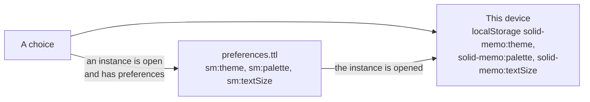

# Theme

The app comes light or dark. The user chooses with the sun/moon toggle
at the top of every screen, or under Appearance in the study
preferences, where "As my browser" follows `prefers-color-scheme` as
it changes and is the default. The preferences choose the
[colors](#palettes) and the [text size](#text-size) too, in either
theme.

## Where the choice is kept

The theme, the [palette](#palettes) and the [text size](#text-size)
are kept the same way.

- **In the pod**, in the instance's preferences
  ([preferences format 6](shapes.md)): `sm:theme`, `sm:palette` and
  `sm:textSize`, concepts of `sm:Themes`, `sm:Palettes` and
  `sm:TextSizes` ([vocab.md](vocab.md#concept-schemes) lists their
  concepts). These choices count, and follow the user to every device.
  A new instance is made with the choices shown at the time. One made
  before gets them at the user's first save of the study preferences,
  which saves what's shown then; until then a choice is kept on the
  device alone.
- **On the device**, by the `ThemePreference`, `PalettePreference` and
  `TextSizePreference` ports
  ([localStorageThemePreference.ts](../packages/browser/src/localStorageThemePreference.ts),
  key `solid-memo:theme`, "As my browser" no key; the palette's and
  the text size's below). The sign-in screens and the first paint
  read these before any pod is reached. Opening an instance whose
  preferences differ copies their choices here (`instanceTheme`,
  `instancePalette`, `instanceTextSize`).

Writes to an instance's preferences, the one that says whether logging
in skips the Connected screen among them
([onboarding.md](onboarding.md#skipping-the-connected-screen)), go one
after another, so an earlier choice never overwrites a later one. A save
of the study preferences, a switch of scheduler and "Not now" to the
invitation to FSRS-6 wait for them, so none is refused for the version
a choice made. A failed write (another device saved meanwhile, say) is
undone: the app reads the preferences back and shows what they hold. A
reload before a write is done opens the instance with the choice its
preferences held before and shows it: the newer choice is lost.

The palette's shape lists no concepts, as `sm:textFormat`'s lists none
([vocab.md](vocab.md#versioning-policy)), so a later version's
palette, or one of the user's own ([below](#palettes-of-ones-own)),
needs no new format. One this version doesn't know shows as Standard
and is kept through a save of the preferences or a switch of
scheduler, until another is chosen. A palette of the user's own is one
it knows, and choosing a built-in palette replaces it. The theme's
shape lists its three, the text size's its four.

## Showing it

The stylesheet's dark colors hang off `<html data-theme="dark">`. A
small script in `apps/web/index.html` (the page the [Studio](studio.md)
is in too) sets the attribute before the first paint, from the
device's choice, else the browser's, so a page never flashes in the
other theme. From there `packages/ui/src/ui/theme.tsx` takes over and
sets the `theme-color` meta tags for the browser's chrome to the
page's background (`--bg`).

## Palettes

The colors come in palettes, each in both themes. The user chooses
under Colors in the study preferences, where each palette has a
one-line description and a swatch drawn in its own colors (an element
marked with its `data-palette`, which its blocks style too). When the
browser asks for more contrast (`prefers-contrast: more`), the
preferences suggest High contrast. A choice takes effect at once:

| Palette | Id | What it does |
|---|---|---|
| Standard | `standard` | The app's own colors, the answer buttons from red (Again) to green (Easy). |
| High contrast | `high-contrast` | Black on white, or white on black: text at 7:1 or more, fields' edges at 4.5:1 or more, no page discs or glint, edges in place of soft shadows, and a solid focus ring. |
| Color-blind friendly | `color-vision` | Standard's surfaces, with meaning moved off red and green: blue for the primary color and links, orange for warnings, vermilion for danger, and the answer buttons from vermilion through orange, yellow and sky blue to blue. |
| Parchment (low glare) | `parchment` | Warm surfaces darker than white in the light theme, warm browns in the dark, for readers whom a bright page dazzles, the dimmer text raised to 4.5:1. |

The choice is kept in the instance's preferences and on the device, as
the theme is ([Where the choice is kept](#where-the-choice-is-kept)),
on the device by the `PalettePreference` port
([localStoragePalettePreference.ts](../packages/browser/src/localStoragePalettePreference.ts),
key `solid-memo:palette`; Standard is no key). It's shown as
`<html data-palette>` (none for Standard), set as `data-theme` is
([Showing it](#showing-it)); `theme.tsx` sets it before setting the
`theme-color` meta tags from the palette's background. The
`index.html` script takes any value shaped like an id (lowercase
letters and hyphens, at most 32), so a later palette needs no new
script, and an unknown one shows as Standard.

## Color roles

Every color the site and the Studio draw with is a role, a custom
property such as `--bg`, `--text`, `--primary-fill` or `--grade-0`, set
in [`palettes.css`](../packages/ui/src/palettes.css), which `style.css`
imports. `style.css` and `studio.css` write out no color, only roles,
two of which they may mix (`color-mix(in srgb, …)`), as a hovered answer
button's tint does.

A palette is two blocks of `palettes.css`, light and dark: Standard's
`:root` and `:root[data-theme="dark"]`, then another palette's
`:root[data-palette="…"]` and
`:root[data-palette="…"][data-theme="dark"]`. A palette with no blocks
shows as Standard. Each block sets every role.

The roles fall into groups:

- **Surfaces and text**: `--bg`, `--surface`, `--surface-sunken`,
  `--surface-hover`, `--text`, `--text-muted`, the borders, and
  `--control-border`, a text field's edge.
- **Primary and links**: `--primary` (rings, lines and green text),
  `--primary-fill` and `--primary-hover` (a primary button's fill),
  `--primary-soft`, `--on-primary` (text on the fill), `--primary-bevel`,
  `--link` and a link's hover colors.
- **Meaning**: `--danger*` and `--warning*`, and the answer buttons'
  grades `--grade-0` (Again) to `--grade-5` (Easy).
- **Charts**: `--series-1` to `--series-4`, the steps of the green a
  chart draws with, 1 the faintest: the bars of several series, the
  activity calendar's days, the answer buttons' and the cards' bars,
  and the young cards' line.
- **Decoration**: the accents, `--heading-pop`, the page's discs
  (`--paper-blue`, `--paper-yellow`) and the newcomers' glint (`--shine`).
- **The masthead and the theme toggle**: `--masthead-*`, `--logo-shadow`
  and `--toggle-*`.
- **Depth**: `--shadow-sm`, `--shadow`, `--ring` (the focus ring of a
  field) and `--zoom-backdrop`.

A block writes a color only as `#rrggbb`, `#rrggbbaa` for one seen
through (its alpha in 255ths, as the browser keeps it), `transparent`,
another role (`var()`) or a mix of these. A shadow is lengths and such
colors. `style.test.ts` checks that every
block sets every role in these forms and, with `studio.test.ts`, that
the stylesheets write out no color. In every block it
checks the contrast of the pairs that hold text
([accessibility.md](accessibility.md#checked-automatically) lists
them) at 4.5:1, and of fields' edges and a chart's steps (WCAG 1.4.11)
at 3:1; in High contrast, 7:1 and 4.5:1 (`contrastTargets`).

Color-blind friendly's answer buttons are also checked as protanopia,
deuteranopia and tritanopia see them. `style.test.ts` simulates each
with Machado, Oliveira and Fernandes' model (2009), and needs each
grade at least 0.08 from the next in OKLab, four times the smallest
noticeable difference. In every palette the buttons' names, not their
colors, say which grade is which. The tests read the blocks with
[`testing/contrast.ts`](../packages/domain/src/testing/contrast.ts);
WCAG's contrast ratio and color mixing are the app's own
[`contrast.ts`](../packages/domain/src/contrast.ts), which the palette
editor's check (`checkPalette`) uses too.

Some colors stay fixed whatever the palette:

- the pictures, `illustration.svg` and `favicon.svg`;
- the static About page (`apps/web/public/about/`) and the docs' own
  stylesheet (`packages/site/src/docs.css`), which load no
  `palettes.css`;
- the `theme-color` meta tags written out in `index.html` and the About
  page, which hold Standard's backgrounds for the browser's chrome
  before the app runs (`themeColor.test.ts` keeps them in step);
- forced colors (Windows High Contrast and the like), whose rules
  draw with the system's colors over every palette.

## Palette sources

Some of the palettes' colors come from published color schemes,
credited here; only the values are taken, no file:

- **Color-blind friendly**: blue, sky blue, orange, yellow and
  vermilion (`#0072b2`, `#56b4e9`, `#e69f00`, `#f0e442`, `#d55e00`)
  are Masataka Okabe's and Kei Ito's
  [Color Universal Design](https://jfly.uni-koeln.de/color/) palette,
  darkened where they're text. The palette isn't certified and doesn't
  carry the CUD mark.
- **Parchment**: the surfaces, the text and the accents derive from
  Jan Warchoł's [Selenized](https://github.com/jan-warchol/selenized),
  under the MIT license (copyright 2021 Jan Warchoł). `palettes.css`
  credits it in its header, as does `customPalette.ts`, which keeps a
  copy of the built-in palettes' colors. Its dim text is darkened to
  4.5:1, and the dark theme's surfaces are the project's own warm
  browns in place of Selenized's teal.
- **High contrast**: the blue, yellow and red accents (`#004488`,
  `#ddaa33`, `#bb5566`) are Paul Tol's high-contrast scheme, from his
  technical note SRON/EPS/TN/09-002 and
  [his notes on color schemes](https://sronpersonalpages.nl/~pault/),
  which state no license.

## Palettes of one's own

Under Colors, "Design a palette" opens the palette editor
(`#/palette?instance=…`, [routing.md](routing.md#route-scheme)). The
user's own palettes are listed after the built-in ones, each with its
swatch and a link to edit it. In the editor the user names the
palette, chooses its base, and in each theme a color for each role
below, starting at the base's:

| Role | What it colors |
|---|---|
| `--bg`, `--surface`, `--surface-sunken` | The page, cards and panels, and surfaces set into them |
| `--text`, `--text-muted` | The text, and text that says less, such as a hint |
| `--border`, `--control-border` | Lines, and the edges of fields |
| `--primary` | Rings, lines and text in the primary color, and the focus ring |
| `--primary-fill`, `--on-primary` | A primary button, and its text |
| `--link`, `--danger`, `--warning-text` | Links, and danger and warning text |
| `--grade-0` to `--grade-5` | The answer buttons, from 0 (Blackout, or Again) to 5 (Easy) |

Every other role is the base's, except a few mixed from a role the
palette changes (`DERIVED` in
[customPalette.ts](../packages/domain/src/customPalette.ts)). A hovered
surface is 6% of the text over the surface; a strong border, 20% of
the text over the border; a hovered button, 20% of the text over its
fill. The tints of the primary color, a link, danger and warning, and
the borders of danger and warning, are mixed too. A chart's steps are
mixed as the base mixes them, from the palette's primary color, text
and sunken surface (`SERIES` there).

Below a preview in each theme, a table measures, as each color is
chosen, every pair that holds text or must be seen against the
contrast it needs; a live region says how they stand.
The pairs (`CHECKED_PAIRS`) are:

- text, muted text, links, danger and warning text on every surface,
  and on their tints;
- muted text and links on the primary color's tint, as on the course
  card;
- a link on its hovered tint;
- the text on a button;
- an answer button's text and muted text on its tint, and on its tint
  under the pointer;
- a field's edge, the focus ring and a chart's steps on the surfaces.

`style.test.ts` checks these pairs in the built-in palettes, among the
roles a palette of one's own paints, and fails on a pair it checks
that the list leaves out. A pair needs what the base needs
([Color roles](#color-roles)). A palette with a pair below that is
saved only after "Use anyway"; one whose text is below 3:1 on the
background or on a surface isn't saved. "Save and use" shows
the app in it from then on, as choosing it under Colors does.

"Reset colors", under Colors and in the editor, goes back to Standard.
It's drawn in Standard's colors (its element marked
`data-palette="standard"`, which `palettes.css` styles as the
swatches), so it can be read and pressed whatever a palette does to
the page.

### Where a palette of one's own is kept

- **In the pod**, in the instance's `palettes.ttl`: one `sm:Palette`
  per palette at `#palette-<id>`, its name in the page's language, and
  its color sets (`sm:ColorSet`) at `#palette-<id>-light` and
  `#palette-<id>-dark` (palette and color set format 1, whose
  properties [shapes.md](shapes.md) lists). The preferences choose it
  by its address in `sm:palette`, so it needs no new preferences
  format, and it follows the user to every device as a built-in
  palette does.
- **On the device**, `solid-memo:palette` holds its base. For the first
  paint, `solid-memo:palette-colors` holds the palette and the colors
  to paint in each theme
  ([localStorageCustomPalettePreference.ts](../packages/browser/src/localStorageCustomPalettePreference.ts),
  the `CustomPalettePreference` port). Opening the instance copies the
  pod's palette there; choosing a built-in palette removes it.

### How a palette of one's own is held safe

Anyone who may write the pod may have written a palette. Wherever
it's read and painted:

- **Only the instance's own palettes are read.** A palette is read
  only when `sm:palette` names a subject of the instance's
  `palettes.ttl` (`isPaletteOf`), its color sets only as subjects of
  the same document; one at an address outside the document isn't
  listed. Any other address in `sm:palette` is never fetched and shows
  as Standard.
- **A color is `#rrggbb`, and nothing else.** The color set's shape
  says so (`sh:pattern`) and is closed, so a property that isn't a
  color, such as a picture, is reported. The instance's check reports
  data that doesn't conform without blocking it
  ([validation.md](validation.md)), so `parsePalette` keeps only the
  listed roles, each `#rrggbb`, and drops any other value.
- **Colors reach a style one property at a time.** A palette is
  painted on the root with `style.setProperty`, only for the roles it
  may paint (`PAINTED_ROLES`), each value checked against `#rrggbb`
  again (`paletteStyle` in [theme.tsx](../packages/ui/src/ui/theme.tsx)).
  No CSS text, `url()` or `var()` from the pod or the device's copy
  reaches a style. The swatches and the editor's preview are painted
  the same way.
- **The first paint checks again.** The script in `apps/web/index.html`
  reads `solid-memo:palette-colors` for the theme it sets, and paints
  only roles a palette may paint, by name, with `#rrggbb` values;
  anything else in the key paints nothing.
- **Unreadable text isn't painted.** Another app may write a palette
  whose text is below 3:1 on the background or on a surface
  (`isReadable`). Read from the pod or the device, it's shown as its
  base on every screen, signing in and choosing an instance included. The
  device's copy is forgotten. The preferences keep naming it, as they
  keep any palette this version doesn't show.
- **A palette low in contrast can be left.** A palette saved with "Use
  anyway", or written by another app with pairs below what they need
  but its text readable, is painted with the colors it has. "Reset
  colors", in Standard's colors, gets the user out of it.

The journeys' accessibility checks take a palette of one's own off the
page while they check each built-in palette
([testing.md](testing.md#user-journeys)).

## Text size

The text comes in four sizes: Default, the browser's own, then Large,
Larger and Largest, at 112.5%, 125% and 150% of it. The user chooses
under Text size in the study preferences, each size with a sample line
at that size, and the choice takes effect at once. It's kept in the
instance's preferences and on the device, as the theme is: on the
device by the `TextSizePreference` port
([localStorageTextSizePreference.ts](../packages/browser/src/localStorageTextSizePreference.ts),
key `solid-memo:textSize`; Default is no key). It's shown as
`<html data-text-size>` (none for Default), set as `data-palette` is.
Each size sets the root's font size as a percentage, which the
browser's text size multiplies, and `--text-scale` (1.125, 1.25 or
1.5). The Studio follows; its Comfortable layout is a separate
setting, and the two multiply.

The text is sized in `rem`, its line heights without a unit and its
letter spacing in `em`, so the root's font size scales nearly all of
it. What doesn't is kept to a few places, and made to follow:

- **What the window sizes**: the card's question and answer are sized
  by the window's width (`vw`), within bounds in `rem`, the `vw` term
  multiplied by `--text-scale` (1 by default).
- **Breakpoints** are in `rem`, which a media query reads as the
  browser's font size, so they follow the browser's text
  size but not the page's. The deck list's is a container query in
  `em` of the list, which follows both: narrower than 17em, a deck's
  study action and menu go under its name rather than beside it.
- **The Studio's panes**: a splitter's least and most sizes are in
  pixels for a root font size of 16px, and as much larger as the root's
  font size is ([`splitter.ts`](../apps/studio/src/ui/shell/splitter.ts)).
- **What could widen the page** at 320px in the largest text doesn't.
  A field is no wider than what it's in, though its width is in
  characters. On a narrow screen a card table's cells keep less room
  around their text, and its column names may break.
- **Text that could be cut short** wraps instead: the name of the
  group a dragged deck would land in, a bar chart's names under its
  bars, and the Studio's instance switcher. The Studio's header still
  cuts short who is signed in, to keep one row, with the whole line as
  its title.

`style.test.ts` and `studio.test.ts` fail on a font size in `px` other
than the focus proxy's 16px; with less, a phone zooms the page as the
proxy takes the focus. They fail on a breakpoint in `px` too, and on a
`vw` font size without `--text-scale`.

## Korean text

Korean, on a Korean page or in card text marked `lang="ko"` on another,
has its own `:lang(ko)` rules in `style.css`. Korean fonts (Apple SD
Gothic Neo, Malgun Gothic, Noto Sans KR) come ahead of the Japanese
ones, which hold Hangul but draw it with Japanese shapes and metrics.
Fredoka and Bangers stay first for the Latin letters. Lines break
between words, not syllables (`word-break: keep-all`). Headings, which
Bangers can't draw in Korean, are bold, and neither they nor the
uppercase labels are tracked apart. Code, `kbd`, `samp` and `pre` keep
the monospace font (`--font-mono`) over the Korean font rule.

## Arabic text

Arabic in card text marked `lang="ar"` has its own `:lang(ar)` rules in
`style.css`. Its font is Noto Naskh Arabic, a book hand that draws the
vowel marks legibly, bundled like Fredoka: only its Arabic files are
fetched, and only for Arabic text. It comes after Fredoka for the Latin
letters and before the systems' Arabic fonts (Geeza Pro, Segoe UI,
Tahoma). Arabic letters join, so no Arabic text is tracked apart: not
headings, not the card's question (tightened for Latin letters), not
the uppercase labels. Headings, which Bangers can't draw in Arabic, are
bold in the Arabic font, and code keeps the monospace font, as in
Korean. Like any right-to-left language, Arabic runs right to left in
its own isolated box ([i18n.md](i18n.md#text-in-the-users-languages)).

## German text

German, on a German page or in card text marked `lang="de"` on another,
is hyphenated at line ends (`hyphens: auto` under `:lang(de)`), so a
long compound word ("Wiederholungsintervall") breaks at a syllable, with
a hyphen, not at any letter. Spanish and French need no rules of
their own: Fredoka and Bangers draw their letters.
