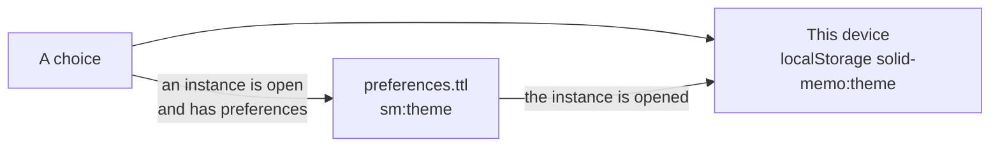

# Theme

The app comes light or dark. The user chooses with the sun/moon toggle at
the top of every screen, or under Appearance in the study preferences,
where a third choice, "As my browser", follows `prefers-color-scheme`
(and keeps following it as it changes). Until anything is chosen, that
is what the app does.

## Where the choice is kept

- **In the pod**, as `sm:theme` in the instance's preferences
  ([preferences format 4](shapes.md)): a concept of `sm:Themes`
  (`sm:systemTheme`, `sm:lightTheme`, `sm:darkTheme`). This is the
  choice that counts, and it follows the user to every device. It is
  written once the instance has preferences: a new instance is made
  with them, the theme shown at the time among them; an instance made
  before has them after the user's first save of the study preferences
  (which saves the theme shown at the time), and until then a choice is
  kept on the device alone.
- **On the device**, by the `ThemePreference` port
  ([localStorageThemePreference.ts](../packages/browser/src/localStorageThemePreference.ts),
  key `solid-memo:theme`; "As my browser" is no key at all). It is what
  the sign-in screens and the first paint have, before any pod is
  reached. Opening an instance whose preferences say otherwise copies
  their choice here (`instanceTheme`).

A write to the pod that fails (another device saved the preferences
meanwhile, say) is undone: the app reads the preferences back and shows
what they hold.

## Showing it

The stylesheet's dark colors hang off `<html data-theme="dark">`. A small
script in `apps/web/index.html` (the page the [Studio](studio.md) is
in too) sets the attribute from the device's
choice, else the browser's, before the first paint, so a page never
flashes in the other theme; `packages/ui/src/ui/theme.tsx` takes over from there and also
sets the `theme-color` meta tags for the browser's own chrome, in the
page's background (`--bg`) as the stylesheet has it.

## Color roles

Every color the site and the Studio draw with is a role, a custom
property such as `--bg`, `--text`, `--primary-fill` or `--grade-0`, set
in [`palettes.css`](../packages/ui/src/palettes.css), which `style.css`
imports. `style.css` and `studio.css` name the roles and write out no
color of their own; they may mix two roles (`color-mix(in srgb, …)`),
as a hovered answer button's tint does.

A palette is two blocks of `palettes.css`: one for the light theme, one
for the dark. Standard, today's only palette, is `:root` and
`:root[data-theme="dark"]`. Another palette's blocks would be
`:root[data-palette="…"]` and `:root[data-palette="…"][data-theme="dark"]`,
after Standard's; a palette with no blocks shows as Standard. Each
block sets every role, so no block leans on another.

The roles fall into groups:

- **Surfaces and text**: `--bg`, `--surface`, `--surface-sunken`,
  `--surface-hover`, `--text`, `--text-muted`, the borders, and
  `--control-border`, a text field's edge.
- **Primary and links**: `--primary` (rings, lines and green text),
  `--primary-fill` and `--primary-hover` (a primary button's fill),
  `--primary-soft`, `--on-primary` (text on the fill), `--primary-bevel`,
  `--link` and a link's hover colors.
- **Meaning**: `--danger*` and `--warning*`, and the answer buttons'
  grades `--grade-0` (Again) to `--grade-5` (Easy).
- **Charts**: `--series-1` to `--series-4`, the steps of a bar of
  several series.
- **Decoration**: the accents, `--heading-pop`, the page's discs
  (`--paper-blue`, `--paper-yellow`) and the newcomers' glint (`--shine`).
- **The masthead and the theme toggle**: `--masthead-*`, `--logo-shadow`
  and `--toggle-*`.
- **Depth**: `--shadow-sm`, `--shadow`, `--ring` (the focus ring of a
  field) and `--zoom-backdrop`.

A block writes a color only as `#rrggbb`, as `#rrggbbaa` for one seen
through (its alpha in 255ths, as the browser keeps it), as
`transparent`, as another role (`var()`), or as a mix of these; a
shadow is lengths and such colors. `style.test.ts` checks that every
block sets every role in these forms, that `style.css` writes out no
color (`studio.test.ts` checks the same of `studio.css`), and the
contrast of the pairs that hold text in every block: text and muted
text on every surface, the text on a primary fill, links, danger and warning text, the masthead's text, and an answer
button's text on its grade's tint ([accessibility.md](accessibility.md#checked-automatically)).
The shared helper that reads the blocks, mixes their colors and
computes WCAG's contrast ratio is
[`contrast.ts`](../packages/domain/src/testing/contrast.ts).

Some colors stay fixed on purpose, whatever the palette:

- the pictures, `illustration.svg` and `favicon.svg`;
- the static About page (`apps/web/public/about/`) and the docs' own
  stylesheet (`packages/markdown/tooling/docs.css`), which load no
  `palettes.css`;
- the `theme-color` meta tags written out in `index.html` and the About
  page, which hold Standard's backgrounds for the browser's chrome
  before the app runs (`themeColor.test.ts` keeps them in step);
- forced colors (Windows High Contrast and the like), whose rules
  draw with the system's colors over every palette.

## Text size

The text is sized in `rem`, its line heights without a unit and its
letter spacing in `em`, so the root's font size scales nearly all of
it: the browser's own text size does today, and a text size the user
chooses can set the root's font size the same way. What does not
follow the root's font size is kept to a few places, and made to:

- **What the window sizes**: the card's question and answer are sized
  by the window's width (`vw`), within bounds in `rem`. The `vw` term
  is multiplied by `--text-scale`, 1 by default, which a larger text
  size raises.
- **Breakpoints** are in `rem`. A media query reads `rem` as the
  browser's own font size, not the root's, so a breakpoint follows the
  browser's text size but not the page's.
- **The Studio's panes**: a splitter's least and most sizes are in
  pixels for a root font size of 16px, and as much larger as the root's
  font size is ([`splitter.ts`](../apps/studio/src/ui/shell/splitter.ts)).
- **Text that could be cut short** wraps instead: the name of the
  group a dragged deck would land in, a bar chart's names under its
  bars, and the Studio's instance switcher. Who is signed in, which the
  Studio's header still cuts short to keep it one row, has the whole
  line as its title.

`style.test.ts` and `studio.test.ts` fail on a font size in `px` other
than the focus proxy's 16px (with less, a phone would zoom the page as
the proxy takes the focus), on a breakpoint in `px`, and on a `vw` font
size without `--text-scale`.

## Korean text

Korean, on a Korean page or in card text marked `lang="ko"` on another,
has its own `:lang(ko)` rules in `style.css`: Korean fonts (Apple SD
Gothic Neo, Malgun Gothic, Noto Sans KR) ahead of the Japanese ones,
which hold Hangul too but draw it with Japanese shapes and metrics;
Fredoka and Bangers stay first for the Latin letters. Lines break between
words, not syllables (`word-break: keep-all`). Headings, which Bangers
cannot draw in Korean, are bold, and neither they nor the uppercase
labels are tracked apart. Code, `kbd`, `samp` and `pre` keep the
monospace font (`--font-mono`), which the Korean font rule would
otherwise take from them.

## Arabic text

Arabic in card text marked `lang="ar"` has its own `:lang(ar)` rules in
`style.css`: Noto Naskh Arabic, a book hand that draws the vowel marks
clearly, bundled like Fredoka (only its Arabic files are fetched, and
only for Arabic text), after Fredoka for the Latin letters and before
the systems' Arabic fonts (Geeza Pro, Segoe UI, Tahoma). Arabic letters
join, so no Arabic text is tracked apart: not headings, not the card's
question (tightened for Latin letters), not the uppercase labels.
Headings, which Bangers cannot draw in Arabic, are bold in the Arabic
font, and code keeps the monospace font, as in Korean. Arabic, like any
language written right to left, runs right to left in its own isolated
box ([i18n.md](i18n.md#text-in-the-users-languages)).

## German text

German, on a German page or in card text marked `lang="de"` on another,
is hyphenated at line ends (`hyphens: auto` under `:lang(de)`), so a
long compound word ("Wiederholungsintervall") breaks at a syllable with
a hyphen rather than at any letter. Spanish and French need no rules of
their own: Fredoka and Bangers draw their letters.
