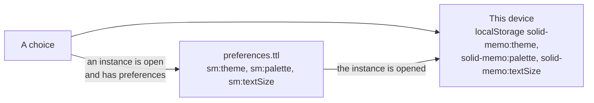

# Theme

The app comes light or dark. The user chooses with the sun/moon toggle at
the top of every screen, or under Appearance in the study preferences,
where a third choice, "As my browser", follows `prefers-color-scheme`
(and keeps following it as it changes). Until anything is chosen, that
is what the app does. Beside it, the preferences choose the
[colors](#palettes) and the [text size](#text-size), in either theme.

## Where the choice is kept

The theme, the [palette](#palettes) and the [text size](#text-size)
are each kept the same way.

- **In the pod**, in the instance's preferences
  ([preferences format 6](shapes.md)): `sm:theme`, a concept of
  `sm:Themes` (`sm:systemTheme`, `sm:lightTheme`, `sm:darkTheme`);
  `sm:palette`, a concept of `sm:Palettes` (`sm:standardPalette`,
  `sm:highContrastPalette`, `sm:colorVisionPalette`,
  `sm:parchmentPalette`); and `sm:textSize`, a concept of
  `sm:TextSizes` (`sm:defaultTextSize`, `sm:largeTextSize`,
  `sm:largerTextSize`, `sm:largestTextSize`). These are the choices
  that count, and they follow the user to every device. They are
  written once the instance has preferences: a new instance is made
  with them, the theme, palette and text size shown at the time among
  them; an instance made before has them after the user's first save of
  the study preferences (which saves what is shown at the time), and
  until then a choice is kept on the device alone.
- **On the device**, by the `ThemePreference`, `PalettePreference` and
  `TextSizePreference` ports
  ([localStorageThemePreference.ts](../packages/browser/src/localStorageThemePreference.ts),
  key `solid-memo:theme`, "As my browser" no key at all; the palette's
  and the text size's below). They are what the sign-in screens and the
  first paint have, before any pod is reached. Opening an instance
  whose preferences say otherwise copies their choices here
  (`instanceTheme`, `instancePalette`, `instanceTextSize`).

The writes to an instance's preferences go one after another, the theme's,
the palette's and the text size's alike, so a later choice is never
overwritten by an earlier one. A save of the study preferences, a
switch of scheduler and "Not now" to the invitation to FSRS-6 wait for
them, so none is refused for the version a choice made. A write that
fails (another device saved the preferences meanwhile, say) is undone:
the app reads the preferences back and shows what they hold. A page
reloaded before a write is done opens the instance with the choice its
preferences held before, and shows that one: the choice made just
before the reload is lost, the theme's as much as the palette's or the
text size's.

The palette's shape lists no concepts, as `sm:textFormat`'s lists none
([vocab.md](vocab.md#versioning-policy)): a palette of a later version,
or one of the user's own ([below](#palettes-of-ones-own)), needs no new
format. This version shows a palette it does not know as Standard, and
keeps it: a save of the preferences, or a switch of scheduler, writes
it back as it was while Standard is shown, and only choosing another
palette replaces it. A palette of the user's own is one it knows: a
choice of a built-in palette replaces it. The text size's shape lists
its four, as the theme's lists its three.

## Showing it

The stylesheet's dark colors hang off `<html data-theme="dark">`. A small
script in `apps/web/index.html` (the page the [Studio](studio.md) is
in too) sets the attribute from the device's
choice, else the browser's, before the first paint, so a page never
flashes in the other theme; `packages/ui/src/ui/theme.tsx` takes over from there and also
sets the `theme-color` meta tags for the browser's own chrome, in the
page's background (`--bg`) as the stylesheet has it.

## Palettes

Apart from light and dark, the colors come in palettes, each for what
it does for the reader, and each in the light theme and in the dark.
The user chooses under Colors in the study preferences, each palette
with a one-line description and a swatch drawn in its own colors (an
element marked with its `data-palette`, which its blocks style too);
when the browser asks for more contrast (`prefers-contrast: more`),
the preferences suggest High contrast. A choice takes effect at once:

| Palette | Id | What it does |
|---|---|---|
| Standard | `standard` | The app's own colors, the answer buttons from red (Again) to green (Easy). |
| High contrast | `high-contrast` | Black on white, or white on black: text at 7:1 or more, fields' edges at 4.5:1 or more, no page discs or glint, edges in place of soft shadows, and a solid focus ring. |
| Color-blind friendly | `color-vision` | Standard's surfaces, with meaning moved off red and green: blue for the primary color and links, orange for warnings, vermilion for danger, and the answer buttons from vermilion through orange, yellow and sky blue to blue. |
| Parchment (low glare) | `parchment` | Warm surfaces darker than white in the light theme, warm browns in the dark, for readers whom a bright page dazzles, the dimmer text raised to 4.5:1. |

The choice is kept in the instance's preferences and on the device, as
the theme is ([Where the choice is kept](#where-the-choice-is-kept)):
on the device by the `PalettePreference` port
([localStoragePalettePreference.ts](../packages/browser/src/localStoragePalettePreference.ts),
key `solid-memo:palette`; Standard is no key at all). It is shown as
`<html data-palette>`: the script in `apps/web/index.html` sets it
before the first paint, and `theme.tsx` from there, before it sets the
`theme-color` meta tags from the palette's background; Standard goes
without. The script takes any value of the form an id has (lowercase
letters and hyphens, at most 32), so a later palette needs no new
script, and one this version does not have shows as Standard.

## Color roles

Every color the site and the Studio draw with is a role, a custom
property such as `--bg`, `--text`, `--primary-fill` or `--grade-0`, set
in [`palettes.css`](../packages/ui/src/palettes.css), which `style.css`
imports. `style.css` and `studio.css` name the roles and write out no
color of their own; they may mix two roles (`color-mix(in srgb, …)`),
as a hovered answer button's tint does.

A palette is two blocks of `palettes.css`: one for the light theme, one
for the dark. Standard's are `:root` and `:root[data-theme="dark"]`.
Another palette's blocks are `:root[data-palette="…"]` and
`:root[data-palette="…"][data-theme="dark"]`, after Standard's; a
palette with no blocks shows as Standard. Each block sets every role,
so no block leans on another.

The roles fall into groups:

- **Surfaces and text**: `--bg`, `--surface`, `--surface-sunken`,
  `--surface-hover`, `--text`, `--text-muted`, the borders, and
  `--control-border`, a text field's edge.
- **Primary and links**: `--primary` (rings, lines and green text),
  `--primary-fill` and `--primary-hover` (a primary button's fill),
  `--primary-soft`, `--on-primary` (text on the fill), `--primary-bevel`,
  `--link` and a link's hover colors.
- **Meaning**: `--danger*` and `--warning*`, and the answer buttons'
  grades `--grade-0` (Again) to `--grade-5` (Easy).
- **Charts**: `--series-1` to `--series-4`, the steps of a bar of
  several series.
- **Decoration**: the accents, `--heading-pop`, the page's discs
  (`--paper-blue`, `--paper-yellow`) and the newcomers' glint (`--shine`).
- **The masthead and the theme toggle**: `--masthead-*`, `--logo-shadow`
  and `--toggle-*`.
- **Depth**: `--shadow-sm`, `--shadow`, `--ring` (the focus ring of a
  field) and `--zoom-backdrop`.

A block writes a color only as `#rrggbb`, as `#rrggbbaa` for one seen
through (its alpha in 255ths, as the browser keeps it), as
`transparent`, as another role (`var()`), or as a mix of these; a
shadow is lengths and such colors. `style.test.ts` checks that every
block sets every role in these forms, that `style.css` writes out no
color (`studio.test.ts` checks the same of `studio.css`), and the
contrast of the pairs that hold text in every block: text and muted
text on every surface, the text on a primary fill, links, danger and warning text, the masthead's text, and an answer
button's text on its grade's tint ([accessibility.md](accessibility.md#checked-automatically)),
at 4.5:1 and fields' edges at 3:1, or in High contrast at 7:1 and
4.5:1 (`contrastTargets`). The pair below 4.5:1 in Standard's dark
block, which accessibility.md lists among its known gaps, is checked
in every other block.

The answer buttons of Color-blind friendly are checked as protanopia,
deuteranopia and tritanopia see them too: each deficiency simulated by
Machado, Oliveira and Fernandes' model (2009), each grade at least
0.08 apart from the next in OKLab, four times what is just
noticeable. In every palette the buttons' names, not their colors, say
which grade is which.
The tests read the blocks with
[`testing/contrast.ts`](../packages/domain/src/testing/contrast.ts).
WCAG's contrast ratio and the mixing of colors are the app's own
[`contrast.ts`](../packages/domain/src/contrast.ts), which the palette
editor's check (`checkPalette`) uses too.

Some colors stay fixed on purpose, whatever the palette:

- the pictures, `illustration.svg` and `favicon.svg`;
- the static About page (`apps/web/public/about/`) and the docs' own
  stylesheet (`packages/markdown/tooling/docs.css`), which load no
  `palettes.css`;
- the `theme-color` meta tags written out in `index.html` and the About
  page, which hold Standard's backgrounds for the browser's chrome
  before the app runs (`themeColor.test.ts` keeps them in step);
- forced colors (Windows High Contrast and the like), whose rules
  draw with the system's colors over every palette.

## Palette sources

The palettes' colors are ours, but some are taken from published
color schemes, whose authors are credited here. Only the values are
taken, and no file of theirs is copied:

- **Color-blind friendly**: blue, sky blue, orange, yellow and
  vermilion (`#0072b2`, `#56b4e9`, `#e69f00`, `#f0e442`, `#d55e00`)
  are Masataka Okabe's and Kei Ito's palette for Color Universal
  Design, [Color Universal Design](https://jfly.uni-koeln.de/color/),
  darkened where they are text. The palette is not certified, and
  does not carry the CUD mark.
- **Parchment**: the surfaces, the text and the accents are derived
  from Jan Warchoł's [Selenized](https://github.com/jan-warchol/selenized),
  under the MIT license (copyright 2021 Jan Warchoł), which
  `palettes.css` credits in its header, as does `customPalette.ts`,
  which keeps a copy of the built-in palettes' colors; its dim text is darkened to
  4.5:1, and the dark theme's surfaces are warm browns of ours in
  place of Selenized's teal.
- **High contrast**: the blue, yellow and red accents (`#004488`,
  `#ddaa33`, `#bb5566`) are Paul Tol's high-contrast scheme, from his
  technical note SRON/EPS/TN/09-002 and
  [his notes on color schemes](https://sronpersonalpages.nl/~pault/),
  which state no license.

## Palettes of one's own

Under Colors, "Design a palette" opens the palette editor
(`#/palette?instance=…`, [routing.md](routing.md#route-scheme)), and
each palette of the user's own is listed after the built-in ones, with
its swatch and a link to edit it. In the editor the user names the
palette, chooses the palette it is based on, and chooses a color for
each role it may set, in the light theme and in the dark, each field
starting at the base's color:

| Role | What it colors |
|---|---|
| `--bg`, `--surface`, `--surface-sunken` | The page, cards and panels, and surfaces set into them |
| `--text`, `--text-muted` | The text, and text that says less, such as a hint |
| `--border`, `--control-border` | Lines, and the edges of fields |
| `--primary` | Rings, lines and text in the primary color, and the focus ring |
| `--primary-fill`, `--on-primary` | A primary button, and its text |
| `--link`, `--danger`, `--warning-text` | Links, and danger and warning text |
| `--grade-0` to `--grade-5` | The answer buttons, from 0 (Blackout, or Again) to 5 (Easy) |

These are the roles a reader chooses for what they read by; every
other role is the base's. A few go with a role the palette sets, and
are mixed from it once the palette changes it, so that they still go
together: a hovered surface (6% of the text over the surface), a
strong border (20% of the text over the border), a hovered button
(20% of the text over its fill), the primary color's, a link's, the
danger's and the warning's tints, and the danger's and the warning's
borders (`DERIVED` in
[customPalette.ts](../packages/domain/src/customPalette.ts)). The
masthead, the charts and the decoration stay the base's.

A preview in each theme shows the colors as they are. Below it, a table
measures every pair that holds text, or that must be seen, against the
contrast it needs, as each color is chosen, and a live region says how
they stand: text, muted text, links, danger and warning text on every
surface, and on their tints; muted text and links on the primary
color's tint, as on the course card; a link on its hovered tint; the
text on a button and on the primary color; an answer button's text and
muted text on its tint, and on its tint under the pointer; and a
field's edge and the focus ring on the surfaces (`CHECKED_PAIRS`).
These are the pairs `style.test.ts` checks of the built-in palettes,
of the roles a palette of one's own paints, and `style.test.ts` fails
on any it checks that the list leaves out. A pair needs what the base needs
(`contrastTargets`): 4.5:1 for text and 3:1 for edges, or 7:1 and 4.5:1
on High contrast. A pair the base itself has below that, one of the
[known gaps](accessibility.md#known-gaps), needs what the base has, so
a palette that keeps its base's colors there still passes. A palette with a pair below that is saved only after
"Use anyway"; one whose text is below 3:1 on the background or on a
surface is not saved at all. Saving it ("Save and use") shows the app
in it from then on, as choosing it under Colors does.

"Reset colors", under Colors and in the editor, goes back to Standard.
It is drawn in Standard's own colors, the element around it marked
with `data-palette="standard"` (which palettes.css styles, as it
styles the swatches), so it can be read and pressed whatever a palette
does to the page.

### Where a palette of one's own is kept

- **In the pod**, in the instance's `palettes.ttl`: one `sm:Palette`
  per palette at `#palette-<id>`, with its name (`dcterms:title`,
  language-tagged, in the page's language), its base (`sm:basedOn`, a
  concept of `sm:Palettes`) and its colors in each theme
  (`sm:lightColors`, `sm:darkColors`), each an `sm:ColorSet` beside it,
  `#palette-<id>-light` and `#palette-<id>-dark`, with a property for
  each color it sets (`sm:textColor` and the like; palette and color
  set format 1, [shapes.md](shapes.md)). The preferences choose it by
  its address in `sm:palette`, so it needs no new preferences format,
  and it follows the user to every device as a built-in palette does.
- **On the device**, `solid-memo:palette` holds its base, and
  `solid-memo:palette-colors` the palette itself and the colors to
  paint in each theme, for the first paint
  ([localStorageCustomPalettePreference.ts](../packages/browser/src/localStorageCustomPalettePreference.ts),
  the `CustomPalettePreference` port). Opening the instance copies the
  pod's palette there; choosing a built-in palette removes it.

### How a palette of one's own is held safe

The pod is data anyone who may write it may have written, and a
palette is painted on every screen, so its colors are held to a few
rules wherever they are read and wherever they are painted:

- **Only the instance's own palettes are read.** A palette is read
  only when `sm:palette` names a subject of the instance's
  `palettes.ttl` (`isPaletteOf`), and its color sets only as subjects
  of the same document; a palette at an address outside the document
  is not listed. Any other address in `sm:palette` is a palette this
  version does not know: it is never fetched, and shows as Standard.
- **A color is `#rrggbb`, and nothing else.** The color set's shape
  says so (`sh:pattern`) and is closed, so a property no color is,
  such as a picture, is reported. Data that does not conform is
  reported by the instance's check, not blocked
  ([validation.md](validation.md)), so the code holds to the rule
  again: `parsePalette` keeps only the listed roles, each `#rrggbb`,
  and leaves out any other value, whatever the shape said of it.
- **Colors reach a style one property at a time.** A palette is
  painted on the root with `style.setProperty`, only for the roles it
  may paint (`PAINTED_ROLES`), each value checked against `#rrggbb`
  again where it is set (`paletteStyle` in
  [theme.tsx](../packages/ui/src/ui/theme.tsx)). No CSS text, `url()`
  or `var()` from the pod, or from the device's copy, ever reaches a
  style. The swatches and the editor's preview are painted the same
  way.
- **The first paint checks again.** The script in `apps/web/index.html`
  reads `solid-memo:palette-colors` for the theme it sets, and sets a
  color only for a role a palette may paint, by name, and only if it
  is `#rrggbb`; anything else in the key paints nothing.
- **Unreadable text is not painted.** A palette read from the pod or
  from the device whose text is below 3:1 on the background or on a
  surface (`isReadable`), as another app may have written it, is shown
  as its base, and the device's copy is forgotten, so no screen,
  whether signing in or choosing an instance, is painted in it. The
  preferences keep naming it, as they keep any palette this version
  does not show.
- **A palette low in contrast can be left.** A palette saved with "Use
  anyway", or written by another app with pairs below what they need
  but its text readable, is painted with the colors it has. "Reset
  colors", in Standard's colors, gets the user out of it.

The journeys' accessibility checks take a palette of the user's own
off the page while they check each built-in palette
([testing.md](testing.md#user-journeys)).

## Text size

The text comes in four sizes: Default, the browser's own, then Large,
Larger and Largest, at 112.5%, 125% and 150% of it. The user chooses
under Text size in the study preferences, each size with a sample line
at that size, and the choice takes effect at once. It is kept in the
instance's preferences and on the device, as the theme is: on the
device by the `TextSizePreference` port
([localStorageTextSizePreference.ts](../packages/browser/src/localStorageTextSizePreference.ts),
key `solid-memo:textSize`; Default is no key at all). It is shown as
`<html data-text-size>`: the script in `apps/web/index.html` sets it
before the first paint, and `theme.tsx` from there; Default goes
without. Each size sets the root's font size as a percentage, so the
browser's own text size is multiplied in, and `--text-scale` (1.125,
1.25 or 1.5) with it. The Studio is on the same page, so it follows
too; its Comfortable layout is a setting of its own, and the two
multiply.

The text is sized in `rem`, its line heights without a unit and its
letter spacing in `em`, so the root's font size scales nearly all of
it, the browser's own text size and the size chosen alike. What does
not follow the root's font size is kept to a few places, and made to:

- **What the window sizes**: the card's question and answer are sized
  by the window's width (`vw`), within bounds in `rem`. The `vw` term
  is multiplied by `--text-scale`, 1 by default, which a larger text
  size raises.
- **Breakpoints** are in `rem`. A media query reads `rem` as the
  browser's own font size, not the root's, so a breakpoint follows the
  browser's text size but not the page's.
- **The Studio's panes**: a splitter's least and most sizes are in
  pixels for a root font size of 16px, and as much larger as the root's
  font size is ([`splitter.ts`](../apps/studio/src/ui/shell/splitter.ts)).
- **What could widen the page** at 320px in the largest text does
  not: a field is no wider than what it is in, though its own width is
  in characters, and on a narrow screen a card table's cells keep less
  room about their text and its column names may break.
- **Text that could be cut short** wraps instead: the name of the
  group a dragged deck would land in, a bar chart's names under its
  bars, and the Studio's instance switcher. Who is signed in, which the
  Studio's header still cuts short to keep it one row, has the whole
  line as its title.

`style.test.ts` and `studio.test.ts` fail on a font size in `px` other
than the focus proxy's 16px (with less, a phone would zoom the page as
the proxy takes the focus), on a breakpoint in `px`, and on a `vw` font
size without `--text-scale`.

## Korean text

Korean, on a Korean page or in card text marked `lang="ko"` on another,
has its own `:lang(ko)` rules in `style.css`: Korean fonts (Apple SD
Gothic Neo, Malgun Gothic, Noto Sans KR) ahead of the Japanese ones,
which hold Hangul too but draw it with Japanese shapes and metrics;
Fredoka and Bangers stay first for the Latin letters. Lines break between
words, not syllables (`word-break: keep-all`). Headings, which Bangers
cannot draw in Korean, are bold, and neither they nor the uppercase
labels are tracked apart. Code, `kbd`, `samp` and `pre` keep the
monospace font (`--font-mono`), which the Korean font rule would
otherwise take from them.

## Arabic text

Arabic in card text marked `lang="ar"` has its own `:lang(ar)` rules in
`style.css`: Noto Naskh Arabic, a book hand that draws the vowel marks
clearly, bundled like Fredoka (only its Arabic files are fetched, and
only for Arabic text), after Fredoka for the Latin letters and before
the systems' Arabic fonts (Geeza Pro, Segoe UI, Tahoma). Arabic letters
join, so no Arabic text is tracked apart: not headings, not the card's
question (tightened for Latin letters), not the uppercase labels.
Headings, which Bangers cannot draw in Arabic, are bold in the Arabic
font, and code keeps the monospace font, as in Korean. Arabic, like any
language written right to left, runs right to left in its own isolated
box ([i18n.md](i18n.md#text-in-the-users-languages)).

## German text

German, on a German page or in card text marked `lang="de"` on another,
is hyphenated at line ends (`hyphens: auto` under `:lang(de)`), so a
long compound word ("Wiederholungsintervall") breaks at a syllable with
a hyphen rather than at any letter. Spanish and French need no rules of
their own: Fredoka and Bangers draw their letters.
