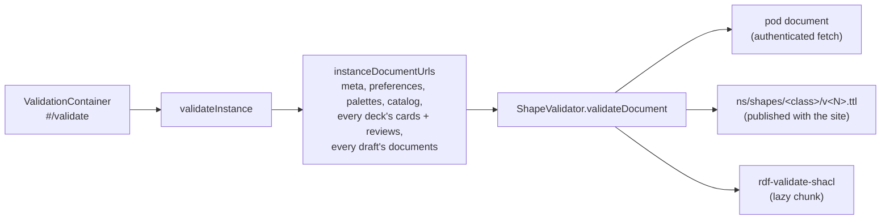

# Validation

Solid Memo checks that the data it reads from a Pod, and every change
it writes, has the form the app expects. This page says what's checked
and when, what happens to data that doesn't fit, and how it can be
repaired.

Solid Memo checks the data it works on against its [shapes](shapes.md)
and the [DCAT-AP profile](#profiles-dcat-ap-and-skos), in the browser:

- **Every instance is checked when it's opened.** The user's
  [invalid data policy](#the-invalid-data-policy) says what happens to
  data that fails. What another app wrote only gets warnings
  ([below](#data-another-app-wrote)).
- **Every write is checked before it's saved**, so the app never adds
  invalid data to a pod ([write check](#the-write-check)).
- **What can be repaired is repaired on request**; the rest is shown,
  and can be removed ([repair](#repair)).
- `#/validate?instance=…` shows the full report, linked as "Validate
  this instance" at the bottom of the workspace while developer mode (a
  per-instance [preference](data-model.md#instance-layout)) is on.
- The Studio's [health](studio.md#health) screen shows every user the
  findings and repairs for the instance or one deck (`checkDeck`, its
  entry and documents only), beside what else is wrong with a deck.

No shape constrains text in Markdown, and the app shows any text
safely ([markdown.md](markdown.md#safety)). A published library
release is held to `npm run library:check`'s
[Markdown rules](deck-library.md#markdown-rules) on how its text shows.

## Flow

- `validateInstance` (application) lists the decks and names every
  document the instance may hold, including the
  [answer log](data-model.md#the-answer-log)'s month documents and the
  documents of the [drafts](data-model.md#drafts-and-releases) its
  catalog links. It asks the `ShapeValidator` port about each, naming
  its context (a draft's is `"draft"`, below). `summarize` (domain)
  counts the violations. Nothing is written.
- **Opening an instance** runs `checkInstance`, the same check except:
  - a document still at a version that the instance's
    [digest](data-model.md#the-digest) says conformed, by the same
    rules, is neither downloaded nor checked again
    (`validateDocumentSince`: a 304 is enough), and a conforming
    document gets a receipt;
  - the rules are named by a hash of every shape and vendored profile
    file, computed when the site is built (`siteDefines` in
    `packages/site/src/siteBuild.ts`, used by `apps/web/vite.config.ts`),
    so a site with other shapes checks everything again;
  - the answer log is left out: answers are checked as they're written,
    and in the full check, which the developer report always runs.
- The [format update](migrations.md#the-pod-migration) and a
  [library upgrade](migrations.md#how-an-upgrade-is-applied) go through
  the [write check](#the-write-check): a document that would fail isn't
  written (`dataNotConforming`) and is named with why. The format
  update goes on with the other documents; a library upgrade stops, as
  at any failure. Another app's data never stops a write.
- [shaclShapeValidator.ts](../packages/solid/src/shaclShapeValidator.ts)
  fetches the document and converts it to an RDF/JS dataset
  (`toRdfJsDataset`). For every subject, it picks the shape by class
  and stored version as the mappers do (`pickShape`), and by the values
  a shape fixes (an FSRS-6 review state's `sm:scheduler`,
  [shapes.md](shapes.md#conventions)). A subject with a Solid Memo class
  is checked against that class's shapes only (a deck group, though a
  `dcat:Catalog`, isn't checked as the catalog). A subject is then:
  - `checked`, with its violations;
  - `newer`, a format this app doesn't know: skipped, reported;
  - `untyped`, no Solid Memo class: listed, to show strays.

  A subject another app wrote is also marked `foreign`, and its results
  are warnings ([below](#data-another-app-wrote)). A deck's document's
  own subject, when all it says is which deck the document is part of
  (`isDeckBackLink` in
  [ownership.ts](../packages/solid/src/ownership.ts)), is Solid Memo's
  and isn't listed. A document that
  doesn't exist is `missing`, which is normal.
- **Where a deck is** is checked beside its shape, in an instance's
  catalog (`DeckPlace`, `placeViolations` in `shaclShapeValidator.ts`).
  The entry is in violation when it's another document's subject, or
  puts a cards or reviews document at an address no deck's document
  may have
  ([data-model.md](data-model.md#where-an-instances-documents-are)).
  That's one a request or a server would take elsewhere, another
  resource's access control or metadata, or an instance document's.
  Folder and names are free. Such a deck isn't used at
  all, nor set aside: the notice names the problem, and removing the
  entry is all that's offered. A draft's deck isn't held to this.
- **A date the app can't read** is checked beside its shape, wherever
  the subject is: an instance's, a release's or a draft's
  (`DateTimeRange`, `dateViolations` in `shaclShapeValidator.ts`). It's
  a valid `xsd:dateTime` in one of the shape's date fields, past what a
  JavaScript date holds (after 13 September 275760, or before 20 April
  -271821). SHACL finds it valid, and the app reads it as no date
  (`readDatetime` in [records.ts](../packages/solid/src/records.ts)).
  It's a violation of the subject, with the date as its value. A value
  that's no date-time at all is the shape's to name, and named once.
  The app reads an optional date as absent, and a [repair](#repair)
  drops it. A subject that needs the date (an answer's time, a review
  state's reviews, the instance's creation) doesn't fit its shape, and
  is the user's to fix or remove. The release check names such a date
  as an error, and a release added from a link, or a copy's upgrade
  from one, that has one is refused. The write check doesn't look for
  it: the app writes no such date, and a subject that has one can
  still be written to.
- **A deck whose documents are unclaimed** is named in the report's
  `unclaimed` (`DeckRepository.unclaimedDocuments`), with their
  addresses: they don't say they're the deck's, and are outside the
  instance's own folder (the same `data-model.md` section). It's no
  violation: nothing is blocked or set aside, and the deck is still
  read and studied from. Those documents aren't
  checked, since a repair writes to the document. Solid Memo's data
  check and the
  Studio's Health screen show them (`UnclaimedDecksNotice`) with "These
  are this deck's documents", which claims them once the user confirms
  (`claimDeckDocuments`), for the next check.
- The shapes are fetched at their IRIs, under
  `https://solid-memo.com/ns/shapes/` (`SHAPES_BASE`), not bundled:
  they're published with the site, so the browser checks against the
  document CI validated. `siteFetch` in
  [appUseCases.ts](../packages/composition/src/appUseCases.ts) reads
  them from wherever the site is served (for `npm run dev` and
  `npm start`, the repository's `ns/`), once per session.
- The [SHACL](https://www.w3.org/TR/shacl/) engine
  ([engine.ts](../packages/shacl/src/engine.ts), the only module that
  imports `rdf-validate-shacl`) is a separate chunk, imported
  dynamically when a validation is asked for. It validates one focus
  node against one node shape (`validateNode`), so no `sh:targetClass`
  is needed.
- One engine per shape document is shared by every document checked
  against it. It runs one check at a time: the library keeps a single
  report per validator, so two documents checked together would mix up
  their results.

## Profiles: DCAT-AP and SKOS

Data is held to two published profiles, vendored verbatim under
[packages/vocab/vendor/README.md](../packages/vocab/vendor/README.md),
pinned by commit and sha256 in `packages/vocab/vendor/manifest.json`
(which a test checks), and published with the site at `/vendor/`:

| Profile | Shapes | Applies to |
|---|---|---|
| `dcat-ap` | [DCAT-AP 3.0.1](https://semiceu.github.io/DCAT-AP/releases/3.0.1/) (SEMIC) | catalogs, decks and deck releases, distributions, agents |
| `skos` | SkoHub `skos.shacl.ttl` + `skos.bestPractice.shacl.ttl`, for [SKOS](https://www.w3.org/TR/skos-reference/) | the concept schemes in `ns/vocab/` |

- [profiles.ts](../packages/shacl/src/profiles.ts) names each
  profile's files. Their shapes pick their own targets
  (`sh:targetClass`), so a profile checks a whole graph with the
  engine's `validate`, not one subject with `validateNode`.
- The engine is SHACL Core only: `coreOnly` drops the SPARQL-based
  constraints (SkoHub has some) when the shapes are loaded. The CI
  cross-check runs them in full ([below](#the-ci-cross-check)).
- DCAT-AP's class checks (`dcat:theme` must be a `skos:Concept`,
  `dcterms:language` a `dcterms:LinguisticSystem`, …) look for the
  value's type in the data graph. The reference data in
  [ns/vocab/external.ttl](../ns/vocab/external.ttl), the EU
  authority-table entries and media types Solid Memo uses, is loaded
  next to the data. A contributor adds a term there before data uses
  it.
- In the browser, DCAT-AP's class check says nothing on a catalog's
  or deck group's link (`dcat:dataset`, `dcat:catalog`) to a member
  described in another document, in the data check and the
  [write check](#the-write-check) alike (`isMemberElsewhere` in
  [shaclShapeValidator.ts](../packages/solid/src/shaclShapeValidator.ts)).
  A member of the same document still must be a `dcat:Dataset` or
  `dcat:Catalog`.
- In node (`npm run library`, the tests), `validateProfile`
  ([packages/shacl/node/shacl.ts](../packages/shacl/node/shacl.ts))
  fails on any violation about a subject of the document, and, for
  Solid Memo's own concept schemes (held to SKOS best practice), on
  warnings (a profile's recommendations).
- Fixtures under `packages/vocab/fixtures/profile/<profile>/{valid,invalid}/`
  pin every property DCAT-AP makes mandatory on the classes Solid Memo
  writes. These are title and description on a catalog, dataset and
  dataset series, a publisher on a catalog, an access URL on a
  distribution, and a name on an agent. They pin the class of
  `dcterms:source`, `dcat:theme` and `dcterms:language` values, and of
  a catalog's or group's members: a deck (`dcat:dataset`) must be a
  `dcat:Dataset` and a group (`dcat:catalog`) a `dcat:Catalog`, so a member the document
  doesn't describe fails.

## The report

Per document, the report gives its URL and status, and per subject
one of these:

- "conforms to deck format 2"
- "deck format 3 is newer than this app knows; skipped"
- "not a Solid Memo subject"
- a subject only DCAT-AP has something to say about (a license, say)
- "written by another app; Solid Memo only warns about it"
- a table of severity, property, message and value (DCAT-AP's results
  marked as such)

The summary line says "All 9 documents conform" or "3 violations
in 2 documents". A subject is checked in its *stored* format, so outdated
but valid data passes. The [format update](migrations.md) is separate.

## The invalid data policy

`validateInstance` runs when an instance is opened (`Workspace`, query
`["validation", instance]`, shared with the developer view), and after
a repair or a format update. What happens when the report doesn't
conform is a preference, `sm:invalidDataPolicy`, a concept of
`sm:InvalidDataPolicies` ([vocab.md](vocab.md#concept-schemes)):

| Policy | What the app does |
|---|---|
| Block the instance (`sm:blockInstance`) | The workspace waits for the check, then shows the Data check notice with the repair in place of every screen. Preferences and the validation view stay reachable, so the policy can be changed. |
| Set invalid data aside (`sm:blockSubject`, the default) | A deck whose entry, cards or review states don't conform is set aside (`setAsideDecks`): listed as "Set aside", not offered for study, its pages saying so. When the catalog or a deck group doesn't conform, the deck list's arrangement is set aside (`arrangementSetAside`): until it's repaired, the list shows every deck but can't be rearranged, nor its groups renamed or deleted, as with a list a [newer version arranged](data-model.md#deck-groups). Any other subject that doesn't conform (a deck's agents or distribution, the catalog's publisher, the preferences, the instance record) sets nothing aside; the write check still refuses a write that leaves it not conforming. Everything else works. The notice names the decks set aside, says when the list can't be rearranged, and reports the rest. |
| Warn only (`sm:warnOnly`) | The notice, and nothing else. |

- **The default applies only where no policy is stated**: an instance
  whose preferences were never saved, and preferences format 2, which
  the [step to format 3](migrations.md) gives the default. Format 3 and
  later state a policy. Preferences saved with "Block the instance"
  keep it. In the vocabulary, the default concept's
  definition says "The default.", as `sm:systemTheme`'s does.
- **Until the preferences are read, the workspace waits for the check**
  as under "Block the instance", so a user who chose it never sees data
  before it's checked. Preferences that can't be read leave
  the default.
- **Under "Set invalid data aside", nothing is used before the check
  says what's set aside.** Until then, a deck's pages (its browser,
  study, preferences and course) wait, and the deck list shows but
  can't be rearranged. So no write lands on data the check would set
  aside: a review state a reader drops would be studied as new, and the
  first answer would write over its history. A check that fails sets nothing aside.
- A check that can't run (the shapes unreachable, say) only warns.
- **The Studio holds to the same check and policy** (`useDataCheck` in
  `ui`, which Solid Memo's workspace uses too), as [studio.md](studio.md#data-set-aside) says.

### Data another app wrote

A subject is Solid Memo's
when it has a Solid Memo class (`sm:Deck`, `sm:Card`, …), or carries
`sm:formatVersion`, Solid Memo's stamp on every subject it writes.
The catalog (`catalog.ttl#catalog`) is Solid Memo's, and so is
a subject that one of Solid Memo's subjects names as its
`dcterms:creator`, `dcterms:publisher` or `dcat:distribution`
([ownership.ts](../packages/solid/src/ownership.ts)), even when
another app's rewrite drops its stamp. The catalog, a deck's agents
and its distribution have no Solid Memo class.

A review state of another scheduler is never Solid Memo's, whatever its
class or stamp: any value of `sm:scheduler` but the `sm:sm2` and
`sm:fsrs6` IRIs, a literal too. It only gets warnings
([data-model.md](data-model.md#decks-and-cards)). An FSRS-6 state,
naming `sm:fsrs6`, is Solid Memo's own: it's checked against FSRS
review state 1, its violations count as any other, and a
half-written snapshot is repaired by dropping it, as an SM-2 state's
is.

Any other subject is another app's, marked `foreign`. It's checked
against the shape its class picks (a `foaf:Agent` against `AgentV1`)
and DCAT-AP, but every result about it is a warning. Under every
policy it sets no deck aside, leaves the arrangement as it is and
blocks no instance. The document holding it still conforms, and gets
its [receipt](#flow). Only the developer report shows its results, and
the repair offers nothing for it. A subject another app wrote with a
Solid Memo class is held to that class's shape.

Deleting an instance, a deck or a draft removes from each document
only Solid Memo's subjects of that document's kind, conforming or not,
and deletes a document only when it's left empty
([data-model.md](data-model.md#write-discipline)). Another app's
subject, and anything whose owner is unclear, is kept with its
document, which the result names as kept.

A catalog's or deck group's link to another app's member is that
app's data too. The member may be a subject of the same document that
isn't Solid Memo's (a `schema:Dataset`, say, which fails DCAT-AP's
class check), or a blank node (which fails the shape's `sh:nodeKind
sh:IRI`). Either way, the result about the link is a warning, in the
check and the write check alike: the catalog still conforms, the
arrangement stays editable, and no repair unlinks the member. The
drop-dangling-members repair, and writing the catalog whole, keep such
a link. A link to a subject of the document that nothing describes is
still the catalog's own problem.

## The write check

Every repository write is checked: a deck, its agents and
distribution, the catalog, cards, review states, preferences, a
palette and its color sets, the instance record. Only the subjects the
write touches are checked, so an old problem elsewhere in the document
doesn't block it. They're checked against their shapes, and in a
document with DCAT subjects, against DCAT-AP (`checkSubjects` in
[shaclShapeValidator.ts](../packages/solid/src/shaclShapeValidator.ts),
wired into the repositories as `checkWrite` in
[appUseCases.ts](../packages/composition/src/appUseCases.ts)). A write
that wouldn't conform is refused with every problem named, and nothing
is saved.

Every caller names where the write goes (`WriteContext` in
[writeCheck.ts](../packages/solid/src/writeCheck.ts)), and that picks
the shapes, as `pickShape` picks them for a read:

- `"pod"`: an instance's documents, checked against the pod's shapes
  and, where they have DCAT subjects, DCAT-AP. Every write the app makes
  is one, except a draft's.
- `"draft"`: a release's draft. Its deck, chapters and steps are checked
  against the draft shapes (`DraftDeckV1`, `DraftChapterV1`,
  `DraftStepV1`, [shapes.md](shapes.md#version-by-version)), which
  don't yet ask what a release needs. Its cards, distractors and agents
  are checked against the shapes every context shares. DCAT-AP isn't
  run: a draft may still lack what a published dataset needs, such as
  a description. Every write
  of a draft is one
  ([solidReleaseDraftRepository.ts](../packages/solid/src/solidReleaseDraftRepository.ts)),
  and so is the check of a draft's documents.

  The [release check](studio.md#the-release-check) holds the draft to
  all of it before it's published: `validateRelease` checks the
  resulting release, moved to its address, against the library shapes
  (`"library"`), DCAT-AP and SKOS, with a library's index beside it
  for the library's policy. There, DCAT-AP holds the release's
  publisher and series to their class in the index. In a pod, nothing else is read
  ([deck-library.md](deck-library.md#a-release-outside-the-library)),
  so a publisher or series the release doesn't describe fails DCAT-AP's
  class check. The next version of a library release describes them,
  as the index does (`nextVersionDraft`).

A published release is never written.

A release a learner adds [from a link](deck-library.md#from-a-link) is
checked in the `"library"` context
(`validateDocument(url, "library")`): each subject against its library
shape, no DCAT-AP. It's fetched as the shapes are: no login goes to its
host. A violation refuses the release; a warning doesn't.

## Repair

`planRepair` ([domain/repair.ts](../packages/domain/src/repair.ts))
turns a report into repairs for the problems with one safe answer,
written in the subject's own stored format:

| Problem | Repair |
|---|---|
| A deck without a description | The default description, `Flashcards: <title>.` |
| A deck without a study direction, or an unknown one | Front to back, as format 1 studied every deck |
| A review state with half an undo snapshot (an SM-2 or an FSRS-6 state's) | The snapshot dropped (as the review-state 1 → 2 migration does), the four terms of an FSRS-6 state's or the five of an SM-2 state's |
| A malformed due day | Recomputed from the last review and the interval |
| An agent without a name | Named after its IRI |
| A catalog or [deck group](data-model.md#deck-groups) listing a deck or group the document doesn't describe (DCAT-AP's class check on `dcat:dataset` or `dcat:catalog`) | Those links dropped (a member typed `sm:Deck` or `sm:DeckGroup` alone is kept, and so is every link to another document) |
| A date the app can't read (`DateTimeRange`) of a field the subject's shape and format make optional | Those dates dropped, every such date of the subject in one repair; a readable value of the same field, and every other field, are kept |
| A review state's undo snapshot with a date the app can't read | The snapshot dropped, as for half a snapshot |

Every other problem is listed with its document linked, to be fixed
there or removed after a confirmation. Removing a subject drops only
the catalog's and the deck groups' membership links to it
(`dcat:dataset`, `dcat:catalog`), not a deck naming it as creator or
the catalog as publisher. `applyRepairs`
([solidRepairRepository.ts](../packages/solid/src/solidRepairRepository.ts))
reads each document once, applies its repairs and writes it once,
then the instance is checked again.

## The CI cross-check

CI checks what Solid Memo publishes again with an independent SHACL
engine, pySHACL (pinned in `scripts/requirements-ci.txt`), which runs
SPARQL-based constraints too.
[scripts/shacl_crosscheck.py](../scripts/shacl_crosscheck.py) holds to
DCAT-AP:

- the [deck library](deck-library.md)'s index and every version;
- the pod catalogs of the deck format 4, 5 (a title in any language)
  and 6 (tagged keywords) and deck group 1 (nested groups) fixtures;
- a release published in a pod, with no index beside it: the library
  deck 6 fixtures, which describe their series and publisher
  themselves.

It holds that release, the draft deck, chapter and step 1 fixtures,
and the review-state fixtures (review state 2 and FSRS review state 1
in one reviews document) to Solid Memo's own shapes. It holds the
vocabulary's concept schemes to SkoHub's SKOS shapes, best practice
included. The script picks each subject's shape by class, format
version, context and the values a shape fixes, as `pickShape` does, and
targets it with `sh:targetNode`.

Each version is checked beside the index, only for the subjects it
states something about, targeted the same way. DCAT-AP asks a node
only about its own statements and their objects' class, so a version
can't break an index node it says nothing about, and the index has its
own check. The script stops if DCAT-AP starts asking more, or if any
document states `rdfs:subClassOf`, since either would break that. The
checks run in parallel, one process per CPU. A disagreement between
the engines, or a constraint the browser's engine can't run, fails CI.

The script reads `ns/` and `decks/` from the repository, each file at
the IRI the site publishes it under, without a build or the network,
as its own job beside the build. Locally:
`pip install -r scripts/requirements-ci.txt`, then
`npm run crosscheck`. That runs `python3 scripts/shacl_crosscheck.py`,
and says what to install if pySHACL is missing.
