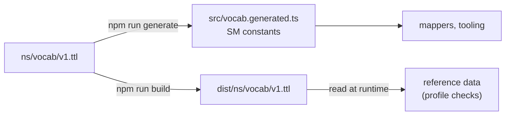

# Vocabulary

Solid Memo stores its data as linked data (RDF), where
every kind of thing and every property is named by a web address.
Where no existing standard has a term, as for a card's review
schedule, Solid Memo defines its own. This page says where those terms
are defined, how they are versioned, and how code is generated from
them.

Solid Memo's own RDF terms, where they are defined, how they are
versioned and how the app's constants are produced from them. The
namespace is `https://solid-memo.com/ns/vocab/v1.ttl#` — declared as
`solid-memo:` in the Turtle files, abbreviated to `sm:` in these docs;
no existing vocabulary covers spaced repetition.

## Source of truth

The vocabulary lives in this repository's [`ns/vocab/`](../ns/vocab/)
folder and is published with the site at
`https://solid-memo.com/ns/vocab/` ([ns.ts](../packages/vocab/src/ns.ts),
[deployment.md](deployment.md)). Its documents are `v1.ttl` (the
ontology), `topics.ttl` (the topics scheme) and `external.ttl`
(reference data), each at an address that is also its IRI and its
`@base`, so every term IRI is a fragment of the document that defines
it. Changes to them go through git and CI like any other change
([ci.yml](../.github/workflows/ci.yml)).

[`ns/vocab/v1.ttl`](../ns/vocab/v1.ttl) is an
[RDFS](https://www.w3.org/TR/rdf11-schema/)/[OWL](https://www.w3.org/TR/owl2-overview/)
ontology: the
`owl:Ontology` subject carries `owl:versionInfo` and a `skos:changeNote`
per release, and every term is an `owl:Class`, `owl:DatatypeProperty`
(literal-valued, with an `xsd:` range) or `owl:ObjectProperty`
(IRI-valued) with `rdfs:label`, `rdfs:comment`, `rdfs:domain` where it
has one class, `rdfs:range`, `rdfs:isDefinedBy` and a
`skos:historyNote` saying when it arrived.

`SM` in [vocab.ts](../packages/solid/src/vocab.ts) is a re-export
of the generated constants; the external vocabularies there
([Solid terms](https://www.w3.org/ns/solid/terms),
[PIM space](https://www.w3.org/ns/pim/space),
[Dublin Core terms](https://www.dublincore.org/specifications/dublin-core/dcmi-terms/),
[RDF](https://www.w3.org/TR/rdf11-concepts/),
[RDFS](https://www.w3.org/TR/rdf11-schema/),
[FOAF](http://xmlns.com/foaf/spec/)) are not ours to publish and stay
hand-written. [standards.md](standards.md) lists every vocabulary and
specification Solid Memo uses, with its version and status. The generator copies each term's comment and history note
into the constant's JSDoc, so the meaning is one hover away.

## Concept schemes

Where a value is one of a fixed set, it is a
[SKOS](https://www.w3.org/TR/skos-reference/) concept, not a
string, so other applications can look up what it means:

| Scheme | Where | Concepts | Used by |
|---|---|---|---|
| `sm:StudyDirections` | [`v1.ttl`](../ns/vocab/v1.ttl) | `sm:frontToBack`, `sm:backToFront`, `sm:bidirectional` | `sm:studyDirection` on a deck |
| `sm:InvalidDataPolicies` | [`v1.ttl`](../ns/vocab/v1.ttl) | `sm:blockInstance`, `sm:blockSubject` (default), `sm:warnOnly` | `sm:invalidDataPolicy` in preferences |
| `sm:Themes` | [`v1.ttl`](../ns/vocab/v1.ttl) | `sm:systemTheme` (default), `sm:lightTheme`, `sm:darkTheme` | `sm:theme` in preferences ([theme.md](theme.md)) |
| `sm:Palettes` | [`v1.ttl`](../ns/vocab/v1.ttl) | `sm:standardPalette` (default), `sm:highContrastPalette`, `sm:colorVisionPalette`, `sm:parchmentPalette` | `sm:palette` in preferences ([theme.md](theme.md#palettes)) |
| `sm:TextSizes` | [`v1.ttl`](../ns/vocab/v1.ttl) | `sm:defaultTextSize` (default), `sm:largeTextSize`, `sm:largerTextSize`, `sm:largestTextSize` | `sm:textSize` in preferences ([theme.md](theme.md#text-size)) |
| `sm:AnswerModes` | [`v1.ttl`](../ns/vocab/v1.ttl) | `sm:recall` (absent means this), `sm:multipleChoice` | `sm:answerMode` on an answer in the [answer log](data-model.md#the-answer-log) |
| `sm:TextFormats` | [`v1.ttl`](../ns/vocab/v1.ttl) | `sm:plainText` (absent means this), `sm:markdown` | `sm:textFormat` on a card, a course step or a chapter ([Text formats](#text-formats)) |
| `sm:Schedulers` | [`v1.ttl`](../ns/vocab/v1.ttl) | `sm:sm2` (absent means this), `sm:fsrs6` | `sm:scheduler` on a review state ([Review states](#review-states)); `sm:studyScheduler` in preferences and `sm:scheduledWith` on a deck schedule ([FSRS-6](#fsrs-6)) |
| Topics (`https://solid-memo.com/ns/vocab/topics.ttl`) | [`topics.ttl`](../ns/vocab/topics.ttl) | languages (swedish), geography, computing (linked-data), science (chemistry), art, labour-market | `dcat:theme` on a deck, next to the EU data theme `EDUC` |

- Every scheme has a `dcterms:title` and a `skos:definition`; every
  concept a `skos:prefLabel` and `skos:definition` in each language the
  scheme's title is in (English always; the topics in each of the
  app's languages: English, Swedish, Korean, German, Spanish and French) and its `skos:inScheme`. The generator
  refuses a concept that misses one. Top concepts say `skos:topConceptOf`, narrower ones
  `skos:broader`. The files are held to SKOS, SkoHub's best practice
  included (see [validation.md](validation.md#profiles-dcat-ap-and-skos)).
- A concept that replaces a string the app used before carries that
  string as its `skos:notation` (`sm:frontToBack` is `"front-to-back"`),
  so the mapping between them is data.
- `npm run generate` renders every scheme into
  `packages/vocab/src/concepts.generated.ts` (`STUDY_DIRECTIONS`,
  `INVALID_DATA_POLICIES`, `THEMES`, `PALETTES`, `TEXT_SIZES`,
  `ANSWER_MODES`, `TEXT_FORMATS`, `SCHEDULERS`, `TOPICS`), which the app lists and labels
  from, in the language the user reads; [concepts.ts](../packages/domain/src/concepts.ts) looks concepts up by
  IRI or notation. It renders the EU languages `external.ttl` describes
  too (`EU_LANGUAGES`: each entry's IRI, code and English label), which
  the Studio offers as a release's languages
  ([studio.md](studio.md#the-releases-metadata-and-provenance)).
- Concepts are only ever added. One that should go is deprecated
  (`owl:deprecated`), never removed: decks point at it.
- The topics scheme is versioned the way `v1` is, but without a version
  in its IRI. A topic is only a name decks point at, and adding one or
  improving its labels breaks nothing, so there is never a
  `topics/v2`. The scheme carries `owl:versionInfo` and a
  `skos:changeNote` per release, each addition bumping it (1.0 → 1.1 →
  …), and every topic carries a `skos:historyNote` saying when it
  arrived ("Since 1.4.").

## Versioning policy

- **Within v1, terms are only ever added.** An addition bumps
  `owl:versionInfo` (1.0 → 1.1 → …) and appends to the change note. A
  term's meaning, datatype or range never changes. A term that should no
  longer be written is deprecated (`owl:deprecated true`, with
  `dcterms:isReplacedBy`), not removed: `sm:direction` gave way to
  `sm:studyDirection` in 1.6. The generated constant carries
  `@deprecated`.
- **A published shape is never edited.** A term that a shape gains,
  even an optional one, goes into the shape's next version, which the
  app then writes: a new format version, and so a breaking change of the
  app ([releasing.md](releasing.md#what-counts-as-breaking)). This
  holds from the app's first version, 1.0.0. Before it, an optional term joined a shape's current
  format without a format bump when a reader that ignored it lost
  nothing, and the shapes were edited in place: the deck's own
  study caps (`sm:deckNewCardsPerDay`, `sm:deckMaxReviewsPerDay`, 1.7)
  and the description of a card's pictures (`sm:frontImageDescription`,
  `sm:backImageDescription`, 1.12) are such terms, and the vocabulary
  moved to the next 1.x all the same. A term may also be written on a subject outside
  its shape, which neither owns nor checks it: `sm:position` (1.13), a
  deck's place on the [arranged deck list](data-model.md#deck-groups),
  is kept by every writer of a deck because `DeckV6` does not own it, so
  the deck format did not move. 1.14 added both kinds: `sm:distractor`
  joined card format 5 and `sm:answerMode` and `sm:chosenDistractor`
  answer format 1, each optional, and `sm:completedChapter` is written
  on a deck outside `DeckV6`, as `sm:position` is
  ([courses.md](courses.md)). 1.15's `sm:textFormat` joined card format
  5, step format 1 and chapter format 1 the first way
  ([Text formats](#text-formats)), and 1.16's `sm:reviewOf`,
  `sm:reviewDirection` and `sm:scheduler` review-state format 2
  ([Review states](#review-states)). 1.17's `sm:newcomerCourse` is written
  on the library index's catalog outside `CatalogV1`, as `sm:position`
  is on a deck, so the catalog format did not move
  ([The library index](#the-library-index)). 1.18's `sm:releaseDraft`
  and `sm:publishedRelease` are written on a pod's catalog the same
  way, and its `sm:releasedAs` joined a new shape, draft deck format 1
  ([Drafts and releases](#drafts-and-releases)). 1.19's
  `sm:recallMillis`, `sm:gradeMillis`, `sm:priorDue` and
  `sm:utcOffsetMinutes` joined answer format 1 the first way
  ([The answer log](#the-answer-log)). 1.20's `sm:frontLabel` joined
  card format 6, the next version of the card shape
  ([Card labels](#card-labels)). 1.21's `sm:stability`, `sm:difficulty`,
  `sm:previousStability` and `sm:previousDifficulty` joined a new
  shape, FSRS review-state format 1, beside the concept `sm:fsrs6`; its
  `sm:studyScheduler`, `sm:desiredRetention` and
  `sm:schedulerInvitationDismissed` joined preferences format 5, and `sm:scheduledWith` deck schedule format 2, the next
  versions of those shapes ([FSRS-6](#fsrs-6)). 1.22's `sm:palette`
  and `sm:textSize`, with the schemes `sm:Palettes` and `sm:TextSizes`,
  joined preferences format 6 ([theme.md](theme.md#where-the-choice-is-kept)).
  1.23's `sm:Palette` and `sm:ColorSet`, with `sm:basedOn`,
  `sm:lightColors`, `sm:darkColors` and a property for each color,
  joined two new shapes, palette and color set format 1
  ([Palettes of one's own](#palettes-of-ones-own)). 1.24's
  `sm:deckCardLanguage` is written on a deck outside `DeckV6`, as
  `sm:position` is, so the deck format did not move
  ([The language of text](#the-language-of-text)). A shape may take a
  term of another vocabulary too, which is no `sm:` term and so moves no
  vocabulary version: card format 7 took `dcterms:subject`, what a card
  is about ([deck-library.md](deck-library.md#what-a-card-is-about)).
- **A new concept of a scheme whose property shape lists no `sh:in`
  needs no format bump.** `sm:textFormat` is such a property: its shape
  says only "at most one IRI", so a reader that meets a concept it does
  not know reads the value, keeps it through an edit and treats the text
  as plain, rather than erasing it or calling the subject invalid.
  `sm:palette` is another: a reader keeps a palette it does not know
  through a save and shows the standard colors, so a later palette, or
  one of the user's own, needs no new format. A
  scheme whose shape does list its concepts (`sm:studyDirection`,
  `sm:theme`, `sm:textSize`, `sm:reviewDirection`) is an `iriEnum`, and there a new
  concept is a new format. `sm:scheduler` lists none either, but a
  concept the app does not know is not taken for the default: it says
  the state's fields belong to another algorithm, so the state is
  another app's ([Review states](#review-states)).
- **Which concept is the app's default is the app's, not the
  vocabulary's.** A scheme's default concept says "The default." in its
  definition, a note on what the app does where data states no concept,
  which moves with the app: when "Set invalid data aside" became the
  default ([validation.md](validation.md#the-invalid-data-policy)), the
  note moved from `sm:blockInstance` to `sm:blockSubject` without a
  version bump, as no term was added and no stored value changed its
  meaning.
- **A breaking change is a new namespace** (`ns/vocab/v2.ttl#`, with
  `owl:priorVersion` pointing back), never an edit of v1: the v1 IRIs
  are baked into every pod that ever wrote them.
- The [shapes](shapes.md) say which terms a subject of a given class and
  format version uses; the vocabulary only says what each term means.

## Courses

Version 1.14 added the terms of a [course](courses.md): a library
release that is also a `schema:Course`, with chapters of steps whose
questions are its cards.

| Term | Kind | Domain → range | Alignment |
|---|---|---|---|
| `sm:Chapter` | class | | subclass of `schema:Syllabus` |
| `sm:Step` | class | | subclass of `schema:LearningResource` |
| `sm:Distractor` | class | | subclass of `schema:Answer` |
| `sm:theory` | datatype property | Step → language-tagged text | subproperty of `schema:text` |
| `sm:checkedBy` | object property | Step → Card | |
| `sm:reviewQuestion` | object property | Chapter → Card | |
| `sm:distractor` | object property | Card → Distractor | see also `schema:suggestedAnswer` |
| `sm:distractorText` | datatype property | Distractor → text, untagged or tagged as `sm:back` is | subproperty of `schema:text` |
| `sm:distractorNote` | datatype property | Distractor → language-tagged text | see also `schema:answerExplanation` |
| `sm:completedChapter` | object property | Deck → Chapter | |
| `sm:answerMode` | object property | Answer → a concept of `sm:AnswerModes` | |
| `sm:chosenDistractor` | object property | Answer → Distractor | |

- **Every new class has an `sm:` class beside the schema.org one.** A
  shape is picked by a Solid Memo, DCAT or FOAF class
  ([shapes.md](shapes.md#conventions)), so the schema.org types are
  extra types that the shapes state. A course needs no `sm:Course`: the
  release is an `sm:Deck` already.
- **External terms are reused where they mean the same:**
  `schema:isPartOf` and `schema:position` place a chapter in its course
  and a step in its chapter. `sm:position` keeps its one meaning, a
  place on the arranged deck list.
- **The vocabulary's `schema:` prefix is `https://schema.org/`.**

## Text formats

Version 1.15 added how a text is written: `sm:textFormat`, a concept of
`sm:TextFormats`, on the subject that holds the text.

| Concept | Notation | Meaning |
|---|---|---|
| `sm:plainText` | `plain` | Shown as written. The same as no text format; the app writes it where a person chose it, so a deliberate choice is told from a marker an older app lost. |
| `sm:markdown` | `markdown` | CommonMark 0.31.2, with GitHub Flavored Markdown pipe tables as its one extension (`skos:broadMatch` IANA `text/markdown`). |

- **What it covers is fixed for 1.x**, by the subject's class: on an
  `sm:Card` its `sm:front`, `sm:back`, `sm:frontNote`, `sm:frontLabel`,
  `sm:backNote` and `sm:backLabel` (the front's label since 1.20, by
  decision in [#115](https://github.com/solid-memo/website/issues/115)), and the `sm:distractorText` and `sm:distractorNote` of
  its distractors, which carry no format of their own (they are read
  and written only with their card); on an `sm:Step` its `sm:theory`;
  on an `sm:Chapter` its `dcterms:description`. A picture's description,
  a chapter's title and every deck-level text are always plain: they
  serve as `alt` text, headings and DCAT metadata. A new text predicate
  needs its own decision.
- **Opt-in on every subject, never inherited.** Absent means plain
  text, exactly as before 1.15: published text already holds strings
  Markdown would misread (`&aring;`, `git clone <url>`, `M87*`), and
  frozen releases are never retro-marked. A card copied or imported
  alone keeps its meaning, since the marker is on the card, not the
  deck. Theory and chapter descriptions are not Markdown by definition
  for the same reason: 1.14 published them as plain.
- **The definition is syntax only.** How the app shows it (raw HTML as
  text, pictures as their alt text, which links are live) is render
  policy ([markdown.md](markdown.md)), which may change without touching
  data.
- **A wider dialect is a new concept** (strikethrough or autolinks would
  change how existing Markdown text reads); an older app reads it as
  plain text and keeps it (see the versioning policy above).
- **Not `dcterms:format` or `schema:encodingFormat`.** Both describe a
  resource's media, not its text: a card also carries pictures, and a
  `schema:LearningResource`'s encoding format names its own media.
  Other schema.org or DCAT readers see the Markdown source as the
  literal's value.
- Literals stay `rdf:langString` (or untagged `xsd:string` where a
  shape allows it): each language's value is its own document, and the
  [language rules](#the-language-of-text) are unchanged.

## Review states

Version 1.16 added what a review state is of, so an app that does not
know Solid Memo's naming rule can join a state to its card, and one that
schedules by another algorithm can keep its states beside Solid Memo's.

| Term | Kind | Domain → range | Absent means |
|---|---|---|---|
| `sm:reviewOf` | object property | ReviewState → Card | the card the subject is named after: `#<cardId>` or `#<cardId>@back-to-front` |
| `sm:reviewDirection` | object property | ReviewState → `sm:frontToBack` or `sm:backToFront` | back to front when the subject ends in `@back-to-front`, else front to back |
| `sm:scheduler` | object property | ReviewState → a concept of `sm:Schedulers` | `sm:sm2`, as every state was before 1.16 |

- **Optional, in review-state format 2 without a bump.** A reader that
  ignores them finds every state at the subject the naming rule gives
  as before: the app writes a new state there (unless that subject is
  another's, then at `#review-<uuid>`). A state it has read it writes
  back at its own subject, so one another app named its own way stays
  where it is, and an older reader ignores it
  ([migrations.md](migrations.md#versions)). Format 1 and 2 accept any
  subject for a state that names its card, as another app may write one.
- **`sm:reviewDirection` is not `sm:answeredDirection`**, which has an
  answer as its domain, nor `sm:studyDirection`, a deck's, which may be
  `sm:bidirectional`: a state is of one way only.
- **What the app writes and how it reads them** is in
  [data-model.md](data-model.md#decks-and-cards): what a state says wins
  over its name, one state per card and direction counts, and a state of
  another scheduler is never read, written over or removed; an FSRS-6
  state (`sm:fsrs6`) is the app's own, kept beside the SM-2 state of the
  same prompt.
- **Other apps' terms, written beside Solid Memo's own**: a card names
  each of its distractors with `schema:suggestedAnswer` as well as
  `sm:distractor` (whose `rdfs:seeAlso` points at it), and a deck's
  cards document states `dcterms:isPartOf` the deck's catalog entry on
  the document itself. Neither belongs to a shape, so neither moved a
  format; Solid Memo reads neither.

## The library index

Two terms are written only in the [deck library](deck-library.md)'s
index, on subjects whose shapes do not own them: `sm:cardCount`, the
cards in use of a listed release, and, since 1.17, `sm:newcomerCourse`
(`dcat:Catalog` → `dcat:DatasetSeries`), the course the app offers to
someone with no decks yet ([courses.md](courses.md#the-course-for-newcomers)).
Absent, none is offered. A pod's `catalog.ttl` never has it.

## Drafts and releases

Three terms of 1.18 let anyone write a release in their own pod and
publish it there (the Studio, [studio.md](studio.md)):

| Term | From → to | What |
|---|---|---|
| `sm:releaseDraft` | `dcat:Catalog` → `sm:Deck` | A draft of a release the catalog's owner is writing in the instance: the draft's release document, whose subject is the draft deck itself, as a release is its document. |
| `sm:publishedRelease` | `dcat:Catalog` → `dcat:Dataset` | A release the owner published from the instance, frozen once published. Where the catalog is readable, a reader finds the author's releases there. |
| `sm:releasedAs` | `sm:Deck` → `dcat:Dataset` | On a draft: the release it was published as. A draft that states it is released, and no longer edited; absent, it is still being written. |

The two catalog links belong to no shape, as `sm:newcomerCourse`
does: `CatalogV1` does not own them, so the catalog format did not
move, and every writer of the catalog keeps them. `sm:releasedAs`
belongs to draft deck format 1 ([shapes.md](shapes.md#version-by-version)).
A link to the release, rather than a flag, says where the draft went.

## The answer log

Four terms of 1.19 say how an answer in the
[answer log](data-model.md#the-answer-log) was given, each optional on
answer format 1:

| Term | Kind | Domain → range | Alignment |
|---|---|---|---|
| `sm:recallMillis` | datatype property | Answer → `xsd:integer` (milliseconds) | |
| `sm:gradeMillis` | datatype property | Answer → `xsd:integer` (milliseconds) | |
| `sm:priorDue` | datatype property | Answer → `xsd:string` (`YYYY-MM-DD`, as `sm:due`) | |
| `sm:utcOffsetMinutes` | datatype property | Answer → `xsd:integer` (minutes east of UTC) | |

## Card labels

1.20 gave the front a label, as 1.8 gave the back:

| Term | Kind | Domain → range | Alignment |
|---|---|---|---|
| `sm:frontLabel` | datatype property | Card → `xsd:string` (language-tagged) | |

A label is a short caption above a side's text that says what kind of
thing that side is ("Country" above "Croatia", "Capital" above
"Zagreb"). It is shown whenever its side is, as the question or as the
answer, so a card studied both ways says what is asked. The side's text
stays the prompt or the answer itself. Card format 6 owns it
([shapes.md](shapes.md#version-by-version)): card format 5 was
published without it, and a published shape is never edited.

## FSRS-6

1.21 added a second scheduler, FSRS-6, whose states are kept beside the
SM-2 ones ([#191](https://github.com/solid-memo/website/issues/191)):

| Term | Kind | Domain → range |
|---|---|---|
| `sm:fsrs6` | concept of `sm:Schedulers` (notation `fsrs6`) | |
| `sm:stability` | datatype property | ReviewState → `xsd:decimal` (days, > 0) |
| `sm:difficulty` | datatype property | ReviewState → `xsd:decimal` (1–10) |
| `sm:previousStability` | datatype property | ReviewState → `xsd:decimal` |
| `sm:previousDifficulty` | datatype property | ReviewState → `xsd:decimal` |
| `sm:studyScheduler` | object property | Preferences → a concept of `sm:Schedulers` |
| `sm:desiredRetention` | datatype property | Preferences → `xsd:decimal` (a share: 0.9 is 90%) |
| `sm:schedulerInvitationDismissed` | datatype property | Preferences → `xsd:boolean` (the learner answered "Not now" to the invitation to switch to FSRS-6) |
| `sm:scheduledWith` | object property | DeckSchedule → a concept of `sm:Schedulers` |

- **An FSRS-6 state is a review state.** The frozen domains of
  `sm:due`, `sm:lastReviewedAt`, `sm:reviewOf` and `sm:scheduler` are
  `sm:ReviewState`, so FSRS-6 reuses them and the class, and the reviews
  document's type index registration covers its states. What tells one
  from an SM-2 state is `sm:scheduler sm:fsrs6`, which its shape fixes
  ([shapes.md](shapes.md#conventions)). `sm:previousDue` and
  `sm:previousLastReviewedAt` serve its snapshot too: their comments are
  no scheduler's. `sm:easeFactor` and `sm:repetitions` are SM-2's and
  are not reused.
- **Stability is a number of days**: the time from the last review
  until the chance of recalling the card has fallen to 90%, whatever
  retention the user asks for. Difficulty runs from 1 to 10.
- **`sm:scheduler` could not be reused** for the scheduler the user
  studies by, as its domain is `sm:ReviewState`: `sm:studyScheduler`
  says it in preferences, and `sm:scheduledWith` says which scheduler's
  due days a deck schedule in the [digest](data-model.md#the-digest)
  counts, as `sm:scheduledDirection` and `sm:scheduledDayBoundaryHour`
  say what else it was computed with.
- **Both preferences terms are always stated** (preferences format 5):
  the retention is kept while SM-2 sets the due days, so a switch back
  to FSRS-6 finds the one chosen. It is a share from 0.7 to 0.97; 0.9,
  FSRS-6's default, is what preferences of format 4 are read with.

## Palettes of one's own

1.23 added the terms of a palette the user designs, kept in the
instance's `palettes.ttl` ([theme.md](theme.md#palettes-of-ones-own)):

| Term | Kind | Domain → range |
|---|---|---|
| `sm:Palette` | class, a subclass of `skos:Concept` | |
| `sm:ColorSet` | class | |
| `sm:basedOn` | object property | Palette → a concept of `sm:Palettes` |
| `sm:lightColors`, `sm:darkColors` | object property | Palette → ColorSet |
| `sm:backgroundColor`, `sm:surfaceColor`, `sm:sunkenSurfaceColor`, `sm:textColor`, `sm:mutedTextColor`, `sm:borderColor`, `sm:fieldEdgeColor`, `sm:primaryColor`, `sm:primaryFillColor`, `sm:onPrimaryColor`, `sm:linkColor`, `sm:dangerColor`, `sm:warningColor`, `sm:grade0Color` … `sm:grade5Color` | datatype property | ColorSet → `xsd:string`, `#rrggbb` |

- **A palette of one's own is a concept.** `sm:palette`'s range is
  `skos:Concept`, which a term's range never leaves, so `sm:Palette`
  is a subclass of it: preferences that choose one of the user's
  palettes keep to the range they always had, and need no new format.
- **A color is a string, not a CSS value.** Each names one color role
  of the app's ([theme.md](theme.md#color-roles)), written `#rrggbb`,
  an opaque color in sRGB; there is no property for text that could be
  any CSS. A role added later is a new property, and a new format of
  the color set, whose shape is closed.
- **Two color sets, not two sets of properties.** A palette's colors in
  the light theme and in the dark are each a subject of their own,
  with the same properties, rather than a light and a dark property of
  each color.

## The language of text

Solid Memo's text properties (`sm:front`, `sm:back`, `sm:frontNote`,
`sm:frontLabel`, `sm:backLabel`, `sm:backNote`, `sm:frontImageDescription`,
`sm:backImageDescription`, a course's `sm:theory`,
`sm:distractorText` and `sm:distractorNote`, and `dcterms:title` and
`dcterms:description` on a deck or chapter) say their language with the literal's
own language tag (`"Huvudstäder"@sv`), one value per language, not
with a term of ours. A deck's keywords (`dcat:keyword`) are tagged the
same way, the one text with several values per language
(`"capitals"@en, "countries"@en, "huvudstäder"@sv`). Tags are [BCP 47](https://www.rfc-editor.org/info/bcp47), stored in lower case. Text in no
language — codes, numbers, symbols ("404", "Fe") — is tagged `zxx`,
BCP 47's "no linguistic content", rather than with a language it is
not in; a page shows it with no `lang`. A card side saved untagged
(`xsd:string`), or a keyword saved before deck format 6, says nothing about its language: it is not known, not
none. Which formats require which tags is the [shapes](shapes.md)'
business.

There is no term for the languages a deck is in: the app works out
which languages to offer from the tags the deck's text already uses
(see [i18n.md](i18n.md#text-in-the-users-languages)). A learner may say
which of them they want first, though: `sm:deckCardLanguage` (1.24), one
lower-case BCP 47 tag as a plain string, on the deck's catalog entry, is
the language the deck's card text (fronts, backs, notes, labels,
picture descriptions and wrong options) is shown in first, ahead of
the app's language ([i18n.md](i18n.md#which-language)). It ranks card text only: the
deck's title, description and keywords are shown as before. It is
written outside `DeckV6`, which neither owns nor checks it, so a reader
keeps it only when it names a language other than `zxx`, and drops
anything else. `dcterms:language` is not used for it: that term is used
only on library releases, for DCAT-AP, where it names EU
authority-table languages (IRIs, not tags) and cannot tell a card's
front from its back, and it says what a dataset is in, not what a
learner prefers.

## License

Everything in `ns/` is MIT-licensed, like the rest of the repository
([README](../README.md#license)). The topics scheme says so in its own
data, `dcterms:license <https://spdx.org/licenses/MIT>` on the scheme
(since 1.11). The ontology's `v1.ttl`, the shapes' versions and
`external.ttl` do not state it in their RDF; [REUSE.toml](../REUSE.toml) states it for every
file in `ns/` instead, without editing them
([style.md](style.md#licenses)). A future version of the ontology or
of a shape may state it the way the topics scheme does.

## What dereferences

| IRI | What is served |
|---|---|
| `https://solid-memo.com/ns/vocab/v1.ttl#Deck` (any term) | The ontology, `…/ns/vocab/v1.ttl`, as Turtle: the term is a subject of it. |
| `https://solid-memo.com/ns/vocab/topics.ttl#geography` (any topic) | The topics scheme, `…/ns/vocab/topics.ttl`. |
| `https://solid-memo.com/ns/vocab/external.ttl` | Reference data, not terms of ours: the external terms (EU authority-table entries, media types) Solid Memo data points at, typed so [profile validation](validation.md#profiles-dcat-ap-and-skos) can check them. |

GitHub Pages serves each as `text/turtle` with
`Access-Control-Allow-Origin: *`, so any application reads it
directly. It negotiates no content: the documents are Turtle only, and
an IRI without the `.ttl` would be a 404, which is why the namespace
keeps the extension. The `turtleDirectoryPlugin` in
[packages/vocab/tooling/publishTurtle.ts](../packages/vocab/tooling/publishTurtle.ts)
emits them into the build and serves them in dev.

## Adding a term

1. Add it to [`ns/vocab/v1.ttl`](../ns/vocab/v1.ttl) with every
   annotation; bump the version and the change note.
2. `npm run generate` (CI runs `npm run generate:check` and fails on
   drift; the drift test in `packages/vocab/tooling/generate.test.ts`
   does too).
3. Use it in a [shape](shapes.md) — the fixture test checks that every
   `sm:` predicate a shape uses is declared here. A published shape is
   never edited, so the term goes into the shape's next version
   ([Versioning policy](#versioning-policy)).
