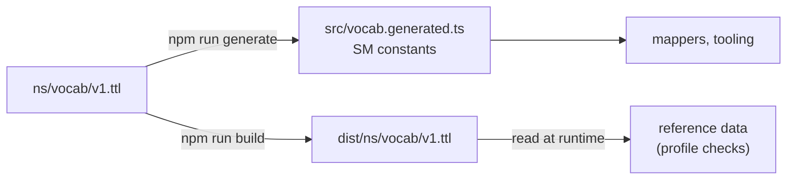

# Vocabulary

Solid Memo stores its data as linked data (RDF), where a web address
names every kind of thing and every property. Where no standard has a
term, as for a card's review schedule, Solid Memo defines its own. This
page says where those terms are defined, how they're versioned, and how
the app's constants are generated from them. The namespace is
`https://solid-memo.com/ns/vocab/v1.ttl#`: the Turtle files declare it
as `solid-memo:`, and these docs abbreviate it to `sm:`. No existing
vocabulary covers spaced repetition.

## Source of truth

The vocabulary lives in this repository's [`ns/vocab/`](../ns/vocab/)
folder, and the site publishes it at `https://solid-memo.com/ns/vocab/`
([ns.ts](../packages/vocab/src/ns.ts), [deployment.md](deployment.md)).
Its documents are `v1.ttl` (the ontology), `topics.ttl` (the topics
scheme) and `external.ttl` (reference data). Each document's address is
its IRI and its `@base`, every term IRI a fragment of it. Changes go
through git and CI ([ci.yml](../.github/workflows/ci.yml)).

[`ns/vocab/v1.ttl`](../ns/vocab/v1.ttl) is an
[RDFS](https://www.w3.org/TR/rdf11-schema/)/[OWL](https://www.w3.org/TR/owl2-overview/)
ontology. Its `owl:Ontology` subject carries `owl:versionInfo` and a
`skos:changeNote` per release. Every term is an `owl:Class`,
`owl:DatatypeProperty` (literal-valued, with an `xsd:` range) or
`owl:ObjectProperty` (IRI-valued), with `rdfs:label`, `rdfs:comment`,
`rdfs:domain` where it has one class, `rdfs:range`, `rdfs:isDefinedBy`
and a `skos:historyNote` saying when it arrived.

`SM` in [vocab.ts](../packages/solid/src/vocab.ts) re-exports the
generated constants, each with its term's comment and history note as
JSDoc. The external vocabularies there
([Solid terms](https://www.w3.org/ns/solid/terms),
[PIM space](https://www.w3.org/ns/pim/space),
[Dublin Core terms](https://www.dublincore.org/specifications/dublin-core/dcmi-terms/),
[RDF](https://www.w3.org/TR/rdf11-concepts/), RDFS,
[FOAF](http://xmlns.com/foaf/spec/)) aren't Solid Memo's and stay
hand-written. [standards.md](standards.md) lists every vocabulary and
specification Solid Memo uses, with its version and status.

## Concept schemes

A value from a fixed set is a
[SKOS](https://www.w3.org/TR/skos-reference/) concept, not a string:

| Scheme | Where | Concepts | Used by |
|---|---|---|---|
| `sm:StudyDirections` | [`v1.ttl`](../ns/vocab/v1.ttl) | `sm:frontToBack`, `sm:backToFront`, `sm:bidirectional` | `sm:studyDirection` on a deck |
| `sm:InvalidDataPolicies` | `v1.ttl` | `sm:blockInstance`, `sm:blockSubject` (default), `sm:warnOnly` | `sm:invalidDataPolicy` in preferences |
| `sm:Themes` | `v1.ttl` | `sm:systemTheme` (default), `sm:lightTheme`, `sm:darkTheme` | `sm:theme` in preferences ([theme.md](theme.md)) |
| `sm:Palettes` | `v1.ttl` | `sm:standardPalette` (default), `sm:highContrastPalette`, `sm:colorVisionPalette`, `sm:parchmentPalette` | `sm:palette` in preferences ([theme.md](theme.md#palettes)) |
| `sm:TextSizes` | `v1.ttl` | `sm:defaultTextSize` (default), `sm:largeTextSize`, `sm:largerTextSize`, `sm:largestTextSize` | `sm:textSize` in preferences ([theme.md](theme.md#text-size)) |
| `sm:AnswerModes` | `v1.ttl` | `sm:recall` (absent means this), `sm:multipleChoice` | `sm:answerMode` on an answer in the [answer log](data-model.md#the-answer-log) |
| `sm:TextFormats` | `v1.ttl` | `sm:plainText` (absent means this), `sm:markdown` | `sm:textFormat` on a card, a course step or a chapter ([Text formats](#text-formats)) |
| `sm:Schedulers` | `v1.ttl` | `sm:sm2` (absent means this), `sm:fsrs6` | `sm:scheduler` on a review state ([Review states](#review-states)); `sm:studyScheduler` in preferences and `sm:scheduledWith` on a deck schedule ([FSRS-6](#fsrs-6)) |
| Topics (`https://solid-memo.com/ns/vocab/topics.ttl`) | [`topics.ttl`](../ns/vocab/topics.ttl) | languages (swedish), geography, computing (linked-data), science (chemistry), art, labour-market | `dcat:theme` on a deck, next to the EU data theme `EDUC` |

- Every scheme has a `dcterms:title` and a `skos:definition`. Every
  concept has its `skos:inScheme`, and a `skos:prefLabel` and
  `skos:definition` in each language of the scheme's title: English
  for every scheme, and for the topics each app language (English,
  Swedish, Korean, German, Spanish and French). The generator
  refuses a concept that misses one. Top concepts say
  `skos:topConceptOf`, narrower ones `skos:broader`, and the files keep
  to SKOS and SkoHub's best practice
  ([validation.md](validation.md#profiles-dcat-ap-and-skos)).
- A concept that replaces a string the app used before carries that
  string as its `skos:notation` (`sm:frontToBack` is `"front-to-back"`).
- `npm run generate` renders every scheme into
  `packages/vocab/src/concepts.generated.ts` (`STUDY_DIRECTIONS`,
  `INVALID_DATA_POLICIES`, `THEMES`, `PALETTES`, `TEXT_SIZES`,
  `ANSWER_MODES`, `TEXT_FORMATS`, `SCHEDULERS`, `TOPICS`), which the
  app lists and labels from in the user's language. It renders the EU
  languages of `external.ttl` too (`EU_LANGUAGES`: IRI, code and
  English label), which the Studio offers as a release's languages
  ([studio.md](studio.md#the-releases-metadata-and-provenance)).
  [concepts.ts](../packages/domain/src/concepts.ts) looks concepts up by
  IRI or notation.
- Concepts are only ever added. One that should go is deprecated
  (`owl:deprecated`), never removed (decks point at it).
- The topics scheme is versioned as `v1` is, with no version in its
  IRI. A topic is only a name decks point at, so adding one or improving
  its labels breaks nothing, and there's never a `topics/v2`. It carries `owl:versionInfo` and a
  `skos:changeNote` per release, each addition bumps it (1.0 → 1.1 →
  …), and every topic carries a `skos:historyNote` saying when it
  arrived ("Since 1.4.").

## Versioning policy

- **Within v1, terms are only ever added.** An addition bumps
  `owl:versionInfo` (1.0 → 1.1 → …) and appends to the change note. A
  term's meaning, datatype or range never changes. A term no longer to
  be written is deprecated (`owl:deprecated true`, with
  `dcterms:isReplacedBy`, and `@deprecated` on its constant), not
  removed: `sm:direction` gave way to `sm:studyDirection` in 1.6.
- **A published shape is never edited.** A term a shape gains, even an
  optional one, goes into the shape's next version, which the app then
  writes: a new format, and so a breaking change of the app
  ([releasing.md](releasing.md#what-counts-as-breaking)). This holds
  from the app's 1.0.0. Before it, shapes were edited in place: an
  optional term a reader could ignore at no loss joined a shape's
  current format without a bump, though the vocabulary moved to the
  next 1.x. The deck's study caps (`sm:deckNewCardsPerDay`,
  `sm:deckMaxReviewsPerDay`, 1.7) and picture descriptions
  (`sm:frontImageDescription`, `sm:backImageDescription`, 1.12) did so. A
  term written on a subject outside its shape isn't owned or checked by
  it and moves no format, and every writer of the subject keeps it:
  `sm:position` (1.13), a deck's place on the
  [arranged deck list](data-model.md#deck-groups), is outside `DeckV6`.
  Since 1.13
  ([shapes.md](shapes.md#version-by-version) has each format):
  - 1.14: `sm:distractor` joined card format 5, and `sm:answerMode`
    and `sm:chosenDistractor` answer format 1, without a bump;
    `sm:completedChapter` is outside `DeckV6` ([courses.md](courses.md)).
  - 1.15: `sm:textFormat` joined card format 5, step format 1 and
    chapter format 1 without a bump ([Text formats](#text-formats)).
  - 1.16: `sm:reviewOf`, `sm:reviewDirection` and `sm:scheduler` joined
    review-state format 2 without a bump
    ([Review states](#review-states)).
  - 1.17: `sm:newcomerCourse`, on the library index's catalog, outside
    `CatalogV1` ([The library index](#the-library-index)).
  - 1.18: `sm:releaseDraft` and `sm:publishedRelease`, on a pod's
    catalog, outside `CatalogV1`; `sm:releasedAs` in a new shape, draft deck format 1
    ([Drafts and releases](#drafts-and-releases)).
  - 1.19: `sm:recallMillis`, `sm:gradeMillis`, `sm:priorDue` and
    `sm:utcOffsetMinutes` joined answer format 1 without a bump
    ([The answer log](#the-answer-log)).
  - 1.20: `sm:frontLabel` in card format 6 ([Card labels](#card-labels)).
  - 1.21: `sm:stability`, `sm:difficulty`, `sm:previousStability` and
    `sm:previousDifficulty` in a new shape, FSRS review-state format 1,
    beside the concept `sm:fsrs6`; `sm:studyScheduler`,
    `sm:desiredRetention` and `sm:schedulerInvitationDismissed` in
    preferences format 5, and `sm:scheduledWith` in deck schedule
    format 2 ([FSRS-6](#fsrs-6)).
  - 1.22: `sm:palette` and `sm:textSize`, with the schemes `sm:Palettes`
    and `sm:TextSizes`, in preferences format 6
    ([theme.md](theme.md#where-the-choice-is-kept)).
  - 1.23: `sm:Palette` and `sm:ColorSet`, with `sm:basedOn`,
    `sm:lightColors`, `sm:darkColors` and a property for each color, in
    two new shapes, palette and color set format 1
    ([Palettes of one's own](#palettes-of-ones-own)).
  - 1.24: `sm:deckCardLanguage`, outside `DeckV6`
    ([The language of text](#the-language-of-text)).
  - 1.25: `sm:MonthSummary` and its properties in a new shape, month
    summary format 1 (see the answer log, below).
  - 1.26: `sm:connectedScreenSkipped`, outside `PreferencesV6`
    ([onboarding.md](onboarding.md#skipping-the-connected-screen)).
  - Another vocabulary's term that a shape takes moves no vocabulary
    version: card format 7 took `dcterms:subject`, what a card is about
    ([deck-library.md](deck-library.md#what-a-card-is-about)).
- **A new concept of a scheme whose property shape lists no `sh:in`
  needs no format bump.** For `sm:textFormat`, whose shape says only
  "at most one IRI", a reader keeps an unknown concept through an edit
  and treats the text as plain, never erasing it or calling the
  subject invalid. For `sm:palette`, a reader keeps an unknown palette
  through a save and shows the standard colors, so a later palette, or
  one of the user's own, needs no new format. A scheme whose shape
  lists its concepts (`sm:studyDirection`, `sm:theme`, `sm:textSize`,
  `sm:reviewDirection`) is an `iriEnum`, where a new concept is a new
  format. `sm:scheduler` lists none either, but an unknown concept
  isn't taken for the default: it says the state's fields belong to
  another algorithm, so the state is another app's.
- **Which concept is the app's default is the app's, not the
  vocabulary's.** A scheme's default concept says "The default." in its
  definition: a note on what the app does where data states no concept,
  which moves with the app. When "Set invalid data aside" became the
  default ([validation.md](validation.md#the-invalid-data-policy)), it
  moved from `sm:blockInstance` to `sm:blockSubject` without a version
  bump, as no term was added and no stored value changed its meaning.
- **A breaking change is a new namespace** (`ns/vocab/v2.ttl#`, with
  `owl:priorVersion` pointing back), never an edit of v1, whose IRIs
  are in every pod that ever wrote them.
- The [shapes](shapes.md) say which terms a subject of a given class and
  format version uses; the vocabulary only says what each term means.

## Courses

Version 1.14 added the terms of a [course](courses.md): a library
release that's also a `schema:Course`, with chapters of steps whose
questions are its cards.

| Term | Kind | Domain → range | Alignment |
|---|---|---|---|
| `sm:Chapter` | class | | subclass of `schema:Syllabus` |
| `sm:Step` | class | | subclass of `schema:LearningResource` |
| `sm:Distractor` | class | | subclass of `schema:Answer` |
| `sm:theory` | datatype property | Step → language-tagged text | subproperty of `schema:text` |
| `sm:checkedBy` | object property | Step → Card | |
| `sm:reviewQuestion` | object property | Chapter → Card | |
| `sm:distractor` | object property | Card → Distractor | `rdfs:seeAlso` `schema:suggestedAnswer` |
| `sm:distractorText` | datatype property | Distractor → text, untagged or tagged as `sm:back` is | subproperty of `schema:text` |
| `sm:distractorNote` | datatype property | Distractor → language-tagged text | `rdfs:seeAlso` `schema:answerExplanation` |
| `sm:completedChapter` | object property | Deck → Chapter | |
| `sm:answerMode` | object property | Answer → a concept of `sm:AnswerModes` | |
| `sm:chosenDistractor` | object property | Answer → Distractor | |

- **Every new class has an `sm:` class beside the schema.org one**,
  since a Solid Memo, DCAT or FOAF class picks a subject's shape
  ([shapes.md](shapes.md#conventions)); the shapes state the schema.org
  types as extra types. A course needs no `sm:Course`: the release is
  an `sm:Deck`.
- **External terms are reused where they mean the same:**
  `schema:isPartOf` and `schema:position` place a chapter in its course
  and a step in its chapter; `sm:position` stays a place on the
  arranged deck list.
- **The vocabulary's `schema:` prefix is `https://schema.org/`.**

## Text formats

Version 1.15 added how a text is written: `sm:textFormat`, a concept of
`sm:TextFormats`, on the subject that holds the text.

| Concept | Notation | Meaning |
|---|---|---|
| `sm:plainText` | `plain` | Shown as written, as with no text format; written where a person chose it, to tell a choice from a marker an older app lost. |
| `sm:markdown` | `markdown` | CommonMark 0.31.2, with GitHub Flavored Markdown pipe tables as its one extension (`skos:broadMatch` IANA `text/markdown`). |

- **What it covers is fixed for 1.x**, by the subject's class. On an
  `sm:Card` it covers `sm:front`, `sm:back`, `sm:frontNote`,
  `sm:frontLabel` (since 1.20, by decision in
  [#115](https://github.com/solid-memo/website/issues/115)),
  `sm:backNote`, `sm:backLabel`, and the `sm:distractorText` and
  `sm:distractorNote` of its distractors, which carry no format of
  their own. On an `sm:Step` it covers `sm:theory`, and on an
  `sm:Chapter` its `dcterms:description`. A picture's description
  (`alt` text), a chapter's title and every deck-level text are always
  plain. A new text predicate needs its own decision.
- **Opt-in on every subject, never inherited.** Absent means plain
  text, as before 1.15 (published text holds strings Markdown would
  misread: `&aring;`, `git clone <url>`, `M87*`), and frozen releases
  are never retro-marked. The marker is on the card, so a card copied
  or imported alone keeps its meaning. Theory and chapter descriptions,
  published as plain in 1.14, aren't Markdown by definition either.
- **The definition is syntax only.** How the app shows it (raw HTML as
  text, pictures as their alt text, which links are live) is render
  policy ([markdown.md](markdown.md)), free to change without touching
  data.
- **A wider dialect**, such as one with strikethrough or autolinks, is
  a new concept, which an older app reads as plain text and keeps.
- **Not `dcterms:format` or `schema:encodingFormat`**, which describe a
  resource's media, not its text: a card also carries pictures, and a
  `schema:LearningResource`'s encoding format names its own media. Other schema.org or DCAT readers see
  the Markdown source as the literal's value.
- Literals stay `rdf:langString` (or untagged `xsd:string` where a
  shape allows it): each language's value is its own document, and the
  [language rules](#the-language-of-text) are unchanged.

## Review states

Version 1.16 added what a review state is of: an app can join a state
to its card without Solid Memo's naming rule, and keep states of
another algorithm beside Solid Memo's.

| Term | Kind | Domain → range | Absent means |
|---|---|---|---|
| `sm:reviewOf` | object property | ReviewState → Card | the card the subject is named after: `#<cardId>` or `#<cardId>@back-to-front` |
| `sm:reviewDirection` | object property | ReviewState → `sm:frontToBack` or `sm:backToFront` | back to front when the subject ends in `@back-to-front`, else front to back |
| `sm:scheduler` | object property | ReviewState → a concept of `sm:Schedulers` | `sm:sm2`, as every state was before 1.16 |

- **Optional, in review-state format 2 without a bump.** A reader that
  ignores them finds every state at the subject the naming rule gives
  ([migrations.md](migrations.md#versions)). Format 1 and 2 accept any
  subject for a state that names its card.
- **`sm:reviewDirection` isn't `sm:answeredDirection`**, an answer's,
  nor `sm:studyDirection`, a deck's, which may be `sm:bidirectional`: a
  state is of one way only.
- **What the app writes and how it reads them** is in
  [data-model.md](data-model.md#decks-and-cards): what a state says
  wins over its name, and the app never reads, writes over or removes a
  state of another scheduler. An FSRS-6 state (`sm:fsrs6`) is the
  app's own, beside the SM-2 state of the same prompt.
- **Other apps' terms, written beside Solid Memo's own**: a card names
  each of its distractors with `schema:suggestedAnswer` beside
  `sm:distractor`, and the document of a deck's cards states that it
  `dcterms:isPartOf` the deck's catalog entry. Neither belongs to a
  shape, and Solid Memo reads neither.

## The library index

Two terms appear only in the [deck library](deck-library.md)'s index,
outside their subjects' shapes. `sm:cardCount` is the number of cards
in use of a listed release. Since 1.17,
`sm:newcomerCourse` (`dcat:Catalog` → `dcat:DatasetSeries`) names the
course the app offers to someone with no decks yet
([courses.md](courses.md#the-course-for-newcomers)); without it, the
app offers none. A pod's `catalog.ttl` never has `sm:newcomerCourse`.

## Drafts and releases

Three terms of 1.18 let anyone write and publish a release in their
own pod (the Studio, [studio.md](studio.md)):

| Term | From → to | What |
|---|---|---|
| `sm:releaseDraft` | `dcat:Catalog` → `sm:Deck` | A release the catalog's owner is drafting in the instance: the draft's release document, its subject the draft deck, as a release is its document. |
| `sm:publishedRelease` | `dcat:Catalog` → `dcat:Dataset` | A release the owner published from the instance, frozen once published; a reader of the catalog finds the author's releases there. |
| `sm:releasedAs` | `sm:Deck` → `dcat:Dataset` | On a draft: the release it was published as, and no longer edited; absent, the draft is still being written. |

The two catalog links, like `sm:newcomerCourse`, belong to no shape.
`sm:releasedAs` belongs to draft deck format 1
([shapes.md](shapes.md#version-by-version)), a link rather than a flag.

## The answer log

Four terms of 1.19 say how an answer in the
[answer log](data-model.md#the-answer-log) was given:

| Term | Kind | Domain → range | Alignment |
|---|---|---|---|
| `sm:recallMillis` | datatype property | Answer → `xsd:integer` (milliseconds) | |
| `sm:gradeMillis` | datatype property | Answer → `xsd:integer` (milliseconds) | |
| `sm:priorDue` | datatype property | Answer → `xsd:string` (`YYYY-MM-DD`, as `sm:due`) | |
| `sm:utcOffsetMinutes` | datatype property | Answer → `xsd:integer` (minutes east of UTC) | |

1.25 added a summary of one study month of the log, derived data in
the instance's [digest](data-model.md#the-digest) like 1.9's receipts
and schedules, so the today strip reads only months that changed
([statistics.md](statistics.md#the-today-strip)):

| Term | Kind | Domain → range |
|---|---|---|
| `sm:MonthSummary` | class | |
| `sm:summaryOf` | object property | MonthSummary → the month's `history/<YYYY-MM>.ttl` |
| `sm:summarizedVersion` | datatype property | MonthSummary → `xsd:string` (the document's ETag) |
| `sm:studyDayCounts` | datatype property | MonthSummary → `xsd:string`, `YYYY-MM-DD answers introduced reviews lapses` |
| `sm:youngReviewCount`, `sm:youngRecalledCount` | datatype property | MonthSummary → `xsd:integer` |
| `sm:recallSecondsCount` | datatype property | MonthSummary → `xsd:string`, `seconds count`, 0 to 60 seconds |

A summary keeps recall times as counts by the second, which add up
into a year's, as medians don't.

## Card labels

1.20 gave the front a label, as 1.8 gave the back:

| Term | Kind | Domain → range | Alignment |
|---|---|---|---|
| `sm:frontLabel` | datatype property | Card → `xsd:string` (language-tagged) | |

A label is a short caption above a side's text that says what kind of
thing that side is ("Country" above "Croatia", "Capital" above
"Zagreb"). It shows whenever its side does, as the question or the
answer, so a card studied both ways says what's asked. The side's text
stays the prompt or the answer. Card format 6 owns it
([shapes.md](shapes.md#version-by-version)).

## FSRS-6

1.21 added a second scheduler, FSRS-6, whose states are kept beside the
SM-2 ones ([#191](https://github.com/solid-memo/website/issues/191)):

| Term | Kind | Domain → range |
|---|---|---|
| `sm:fsrs6` | concept of `sm:Schedulers` (notation `fsrs6`) | |
| `sm:stability` | datatype property | ReviewState → `xsd:decimal` (days, > 0) |
| `sm:difficulty` | datatype property | ReviewState → `xsd:decimal` (1–10) |
| `sm:previousStability` | datatype property | ReviewState → `xsd:decimal` |
| `sm:previousDifficulty` | datatype property | ReviewState → `xsd:decimal` |
| `sm:studyScheduler` | object property | Preferences → a concept of `sm:Schedulers` |
| `sm:desiredRetention` | datatype property | Preferences → `xsd:decimal` (a share: 0.9 is 90%) |
| `sm:schedulerInvitationDismissed` | datatype property | Preferences → `xsd:boolean` (the learner answered "Not now" to the invitation to switch to FSRS-6) |
| `sm:connectedScreenSkipped` | datatype property | Preferences → `xsd:boolean`, outside the shape (whether logging in skips the Connected screen; 1.26) |
| `sm:scheduledWith` | object property | DeckSchedule → a concept of `sm:Schedulers` |

- **An FSRS-6 state is a review state.** It reuses the class and
  `sm:due`, `sm:lastReviewedAt`, `sm:reviewOf` and `sm:scheduler`
  (frozen domain `sm:ReviewState`), and the reviews document's type
  index registration. `sm:scheduler sm:fsrs6`, which its shape fixes,
  tells it from an SM-2 state ([shapes.md](shapes.md#conventions)).
  Its snapshot reuses `sm:previousDue` and `sm:previousLastReviewedAt`;
  SM-2's `sm:easeFactor` and `sm:repetitions` aren't reused.
- **Stability is a number of days**: from the last review until the
  chance of recall falls to 90%, whatever the desired retention.
  Difficulty runs from 1 to 10.
- **`sm:studyScheduler` names in preferences the scheduler the user
  studies by** (`sm:scheduler`'s domain is `sm:ReviewState`).
  `sm:scheduledWith` names the scheduler whose due days a deck
  schedule in the [digest](data-model.md#the-digest) counts, beside
  `sm:scheduledDirection` and `sm:scheduledDayBoundaryHour`.
- **Both preferences terms are always stated** (preferences format 5):
  the retention, a share from 0.7 to 0.97, is kept while SM-2 sets the
  due days, so a switch back to FSRS-6 finds the one chosen. The app reads preferences of format 4 with 0.9, FSRS-6's
  default.

## Palettes of one's own

1.23 added the terms of a palette the user designs, kept in the
instance's `palettes.ttl` ([theme.md](theme.md#palettes-of-ones-own)):

| Term | Kind | Domain → range |
|---|---|---|
| `sm:Palette` | class, a subclass of `skos:Concept` | |
| `sm:ColorSet` | class | |
| `sm:basedOn` | object property | Palette → a concept of `sm:Palettes` |
| `sm:lightColors`, `sm:darkColors` | object property | Palette → ColorSet |
| `sm:backgroundColor`, `sm:surfaceColor`, `sm:sunkenSurfaceColor`, `sm:textColor`, `sm:mutedTextColor`, `sm:borderColor`, `sm:fieldEdgeColor`, `sm:primaryColor`, `sm:primaryFillColor`, `sm:onPrimaryColor`, `sm:linkColor`, `sm:dangerColor`, `sm:warningColor`, `sm:grade0Color` … `sm:grade5Color` | datatype property | ColorSet → `xsd:string`, `#rrggbb` |

- **A palette of one's own is a concept**: `sm:Palette` is a subclass
  of `skos:Concept`, `sm:palette`'s range, so preferences that choose
  one need no new format.
- **A color is a string, not a CSS value**: one per color role
  ([theme.md](theme.md#color-roles)), written `#rrggbb`, an opaque
  color in sRGB. No property takes text that could be any CSS. A role
  added later is a new property, and a new format of the color set,
  whose shape is closed.
- **Two color sets, not two sets of properties**: a palette's light and
  dark colors are each a subject with the same properties.

## The language of text

Solid Memo's text properties say their language with the literal's
language tag (`"Huvudstäder"@sv`), one value per language, not with an
`sm:` term. They're `sm:front`, `sm:back`, `sm:frontNote`,
`sm:frontLabel`, `sm:backLabel`, `sm:backNote`,
`sm:frontImageDescription`, `sm:backImageDescription`, `sm:theory`,
`sm:distractorText`, `sm:distractorNote`, and `dcterms:title` and
`dcterms:description` on a deck or chapter. A deck's keywords
(`dcat:keyword`) are tagged the same way, the one text with several
values per language
(`"capitals"@en, "countries"@en, "huvudstäder"@sv`). Tags are
[BCP 47](https://www.rfc-editor.org/info/bcp47), stored in lower case.
Text in no language — codes, numbers, symbols ("404", "Fe") — is tagged
`zxx`, BCP 47's "no linguistic content", and shown with no `lang`. A
card side saved untagged (`xsd:string`), or a keyword saved before deck
format 6, has an unknown language, not none. The [shapes](shapes.md)
say which formats require which tags.

No term names the languages a deck is in: the app offers languages
from the tags the deck's text uses
([i18n.md](i18n.md#text-in-the-users-languages)).
`sm:deckCardLanguage` (1.24), one lower-case BCP 47 tag as a plain
string on the deck's catalog entry, is the language the learner wants
the deck's card text shown in first, ahead of the app's. On a
[course](courses.md) it covers the course's text too
([i18n.md](i18n.md#which-language) says which text). Its definition
took in a course's text after 1.25 without a version bump. A reader
keeps it only when it names a language other than `zxx`.
`dcterms:language` isn't used for it: that term appears only on
library releases, for DCAT-AP, naming EU authority-table languages
(IRIs, not tags), and can't tell a card's front from its back or a
learner's preference.

## License

Everything in `ns/` is MIT-licensed, like the rest of the repository
([README](../README.md#license)). The topics scheme states it in its
data, `dcterms:license <https://spdx.org/licenses/MIT>` (since 1.11).
`v1.ttl`, the shapes' versions and `external.ttl` don't state it in
their RDF: [REUSE.toml](../REUSE.toml) states it for every file in
`ns/`, without editing them ([style.md](style.md#licenses)). A future
version of the ontology or of a shape may state it as the topics
scheme does.

## What dereferences

| IRI | What is served |
|---|---|
| `https://solid-memo.com/ns/vocab/v1.ttl#Deck` (any term) | The ontology, `…/ns/vocab/v1.ttl`, as Turtle: the term is a subject of it. |
| `https://solid-memo.com/ns/vocab/topics.ttl#geography` (any topic) | The topics scheme, `…/ns/vocab/topics.ttl`. |
| `https://solid-memo.com/ns/vocab/external.ttl` | Reference data, not Solid Memo's terms: the external terms (EU authority-table entries, media types) Solid Memo data points at, typed so [profile validation](validation.md#profiles-dcat-ap-and-skos) can check them. |

GitHub Pages serves each as `text/turtle` with
`Access-Control-Allow-Origin: *`, so any application reads it
directly. There's no content negotiation, so the namespace keeps the
`.ttl` (an IRI without it is a 404). The
`turtleDirectoryPlugin`
in [packages/site/src/publishTurtle.ts](../packages/site/src/publishTurtle.ts)
emits them into the build and serves them in dev.

## Adding a term

1. Add it to [`ns/vocab/v1.ttl`](../ns/vocab/v1.ttl) with every
   annotation; bump the version and the change note.
2. Run `npm run generate`. CI runs `npm run generate:check` and fails
   on drift, as does the drift test in
   `packages/vocab/tooling/generate.test.ts`.
3. Use it in a [shape](shapes.md): the fixture test checks that every
   `sm:` predicate a shape uses is declared here. The term goes into
   the shape's next version ([Versioning policy](#versioning-policy)).
